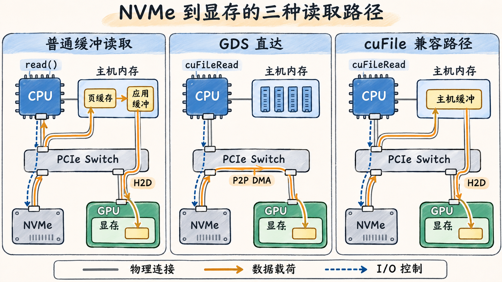

# GPUDirect Storage 改变哪段路径

普通文件读取把数据交给主机，训练进程再把张量拷到 GPU。GPUDirect Storage（GDS）让支持的存储路径把文件载荷直接搬到显存。以同节点 NVMe 上预处理好的张量记录为例，应用知道要读哪个文件、从哪个偏移读多长，以及目标 GPU 缓冲的地址。在满足条件时，NVMe 控制器发起 DMA，把载荷送入可访问的 GPU 缓冲。CPU 仍负责文件与 I/O 控制，包括打开文件、提交请求和处理完成状态。 [NVIDIA GDS 架构](https://docs.nvidia.com/gpudirect-storage/overview-guide/index.html)



*图 09-05-01｜同一台节点上的三种 NVMe 读取路径。橙色箭头表示载荷，蓝色虚线表示 I/O 控制。左右两栏的 H2D 箭头概括搬运起点和终点，实际路径经 CPU 侧 PCIe 根端口和 Switch。中栏假定设备拓扑、文件请求和已注册的目标缓冲满足直达条件。*

图中的直接路径省去了主机数据缓冲和随后的 H2D。cuFile 也可能先用内部注册的 GPU 缓冲，再在 GPU 内部搬到用户缓冲。兼容路径经由主机内存，是否经过页缓存取决于打开方式和实际采用的 I/O 路径。对仍需在 CPU 解码的图像，先把编码字节搬到 GPU 会改变预处理流程。评估 GDS 时，用两边都能直接消费的预处理记录来隔离 I/O 路径差异。 [GDS O_DIRECT 条件](https://docs.nvidia.com/gpudirect-storage/o-direct-guide/index.html) · [GDS 缓冲注册与中转](https://docs.nvidia.com/gpudirect-storage/pdf/best-practices-guide.pdf)

受支持的远程文件系统也可以走 GDS。文件仍由客户端解析和访问，支持 RDMA 的存储路径可由客户端 NIC 将文件载荷搬到 GPU 可访问的缓冲。这里需要文件系统、客户端和服务端栈一起支持。GPUDirect RDMA 提供 NIC 访问已映射 GPU 内存的能力，训练 Rank 之间的集合通信也可用这种能力。GDS 处理的是文件句柄、偏移与存储 I/O，NCCL 处理的是 Rank 和通信缓冲。 [GDS 本地及远程存储路径](https://docs.nvidia.com/gpudirect-storage/overview-guide/index.html)

## 逐层检查直达条件

1. **文件和句柄。** 应用用 `cuFileHandleRegister` 注册打开的文件，再向 `cuFileRead` 提供目标缓冲、文件偏移、缓冲偏移和长度。挂载必须满足所选路径的文件系统和直接 I/O 条件。CUDA 12.2 / GDS 1.7 起，cuFile 也接受没有 `O_DIRECT` 的文件描述符。此时若该请求有可用的直接路径，仍可采用 GDS。否则可在兼容路径中使用页缓存。设置 `O_DIRECT` 只表达直接 I/O 的要求，实际数据是否直达显存还取决于其余条件。 [GDS O_DIRECT 指南](https://docs.nvidia.com/gpudirect-storage/o-direct-guide/index.html) · [cuFile API](https://docs.nvidia.com/gpudirect-storage/api-reference-guide/)
2. **缓冲和请求。** 核对 GPU 地址、缓冲偏移、文件偏移与长度的对齐。教学对照可用 4 KiB 对齐的 GPU 缓冲、以 4 KiB 整倍数为偏移，按 1 MiB 的完整记录读。实际支持的对齐和请求类型以文件系统及后端为准。复用的缓冲可考虑用 `cuFileBufRegister` 显式注册，避免某些路径的 GPU 内部中转。遇到不对齐或当前文件不支持的请求，可能采用内部缓冲、转兼容路径或返回错误，具体由后端、操作和配置决定。 [GDS API 使用与对齐建议](https://docs.nvidia.com/gpudirect-storage/pdf/best-practices-guide.pdf)
3. **设备与软件栈。** CUDA 12.8 / GDS 1.13 起，受支持的 Linux x86_64 NVMe 组合可以使用上游内核 PCI P2PDMA，避开传统路径依赖的 `nvidia-fs` 和定制 NVMe 驱动补丁。以 H100、单盘 XFS、Ubuntu 22.04 为例，核对内核具备 PCI P2PDMA、驱动使用 NVIDIA OpenRM 并启用对应设置，确认 GPU 与 NVMe 的 PCIe 路径可用。NVIDIA 概览对该路径给出的驱动条件为 OpenRM R570 或以上。GDS 发行说明列出的内核分支示例有 Ubuntu 22.04 的 6.2 及以上和 RHEL 9.4 的 5.14，需结合发行版功能核验。若用 CUDA 12.9 Update 1 复现，发行说明列出的组件为 cuFile 1.14.1.1 和 Linux 驱动 575.57.08，可据此选 R575 的 OpenRM 版本作为候选。单盘条件也避开了上游路径的 RAID 与 NVMe 多路径限制。 [GDS 架构与 P2PDMA 条件](https://docs.nvidia.com/gpudirect-storage/overview-guide/index.html) · [GDS 1.13 与 1.14 发行说明](https://docs.nvidia.com/gpudirect-storage/pdf/release-notes.pdf) · [CUDA 12.9 Update 1 组件版本](https://docs.nvidia.com/cuda/archive/12.9.1/cuda-toolkit-release-notes/index.html)

## 用请求记录核对实走路径

下面是用于核对的教学配置，按已装版本的配置格式合并。两个 `use_pci_p2pdma` 开关分别作用于通用设置和 NVMe 块设备设置。允许兼容路径后，应用可能在条件不满足时继续读取。保留实际选择记录才能解释速度差异。 [GDS 配置字段](https://docs.nvidia.com/gpudirect-storage/configuration-guide/index.html) · [GDS 安装与诊断指南的 NVMe P2PDMA 一节](https://docs.nvidia.com/gpudirect-storage/troubleshooting-guide/)

```json
{
  "properties": {
    "allow_compat_mode": true,
    "use_pci_p2pdma": true
  },
  "block": {
    "nvme": {
      "use_pci_p2pdma": true
    }
  },
  "profile": {
    "cufile_stats": 3
  }
}
```

- **平台能力。** 用 `findmnt -T /path/to/records.bin` 核对目标文件实际落在哪个挂载，用 `lspci -t` 核对 NVMe 与 GPU 的层级，再用安装版本的 `gdscheck -p` 查看 NVMe 支持的候选模式。若工具显示 `NVMe: p2pdma, compat`，可继续检查具体文件和请求选了哪条。
- **实际请求。** 用 `gds_stats -p <pid> -l 3` 查活动进程，按目标版本读取每 GPU 的 I/O 计数 `n`、POSIX 计数 `posix`、不对齐计数 `unalign` 和数据量 `MiB`。在短诊断轮次开启 `logging.level=TRACE`，若对应请求出现 `cufile IO mode: POSIX`，可确认它经兼容路径。TRACE 单独采集，避免把日志成本计入基准。
- **后端归因。** 使用对应版本暴露的 P2PDMA 统计与后端选择记录，结合文件条件做判断。若运行环境的直接路径统计合并了两种后端，可以在仅提供 PCI P2PDMA 直接后端的隔离环境中复现。 `/proc/driver/nvidia-fs/stats` 反映该模块处理的请求。缺少模块计数时，还要核对所选后端和兼容路径证据。

各字段来自 NVIDIA 的工具说明，具体输出随版本变化。上述平台、命令与配置是文档对照，实际文件路径和性能需在目标 Linux GPU 节点验证。 [GDS 诊断工具、兼容模式日志和用户态统计](https://docs.nvidia.com/gpudirect-storage/troubleshooting-guide/) · [GDS 1.14 用户态统计变更](https://docs.nvidia.com/gpudirect-storage/pdf/release-notes.pdf)

对照时保持文件、偏移、请求大小、目标缓冲、并发和处理位置相同。先跑已核实的 P2PDMA，再用 `CUFILE_FORCE_COMPAT_MODE=true` 跑同一程序，分别记下实际模式和缓存状态。另测一轮普通缓冲读取的热页缓存基线。比较 I/O 完成时间和 CPU 成本，再量批次可用时刻和端到端步时。如果 I/O 原本完全藏在上一批计算期间，节省的时间主要体现为 CPU 或主机内存带宽余量。批次经常晚到时，提早送达显存才可能缩短步时。 [GDS 配置与基准指南](https://docs.nvidia.com/gpudirect-storage/configuration-guide/index.html) · [GDS 环境变量](https://docs.nvidia.com/gpudirect-storage/troubleshooting-guide/)
