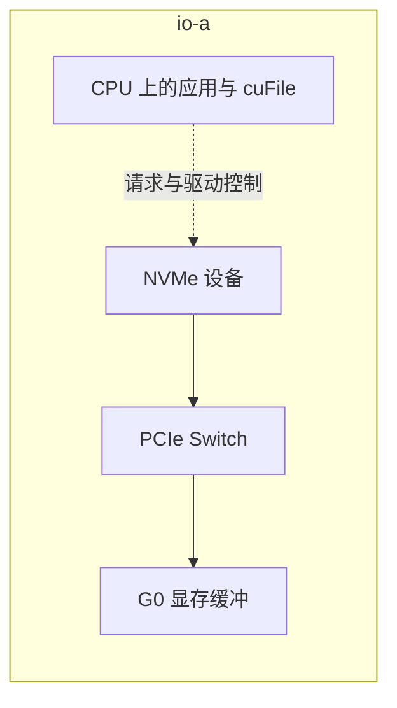

# GPUDirect Storage 改变哪段路径

## 让存储 DMA 面向显存，仍由软件安排访问

普通路径把文件内容读进主机内存，再 H2D。**GPUDirect Storage（GDS）** 在受支持条件下，让存储侧设备与 GPU 显存之间建立 DMA 数据路径，减少主机 DRAM 中转；cuFile 是应用使用这项能力的一组接口。CPU 仍负责打开文件、提交请求、组织文件系统访问和处理完成。基本分工见 [NVIDIA GDS Design Guide：Introduction / Data Transfer Issues](https://docs.nvidia.com/gpudirect-storage/design-guide/index.html)。

下面将 `io-a` 的 G0 与一块本地 NVMe **另行给定为同一 PCIe Switch 下、支持该直接路径**。这是本节新增条件，不能从导读中的容量和速率推出。图为本轮读取方向的教学物理路径：实线是文件载荷，虚线是控制，框是宿主机范围；文件系统控制内部省略。



图中不经过主机 DRAM，不代表不能经过 CPU 所属的 PCIe Root Port，也不代表 CPU 不工作。具体可用路径依平台拓扑判断。本节同 Switch 模型只是条件清楚的一种路径，未包含所有 GDS 实现。

远端文件的受支持路径则可以是“存储服务器→存储网络→客户端存储 NIC→PCIe→GPU 显存”。其中 NIC 到显存可以用到 GPUDirect RDMA，但**文件语义、文件系统集成与 cuFile 调度**仍需另外成立。通信库的 GPU—NIC 直达可用，不代表任意 NFS 挂载已经具备 GDS；远端文件还会受到元数据、服务端与存储网络限制。

## 从接口调用一直核对到本轮负载

安装 CUDA、具备 NVMe、程序调用 cuFile，各自只提供一部分条件。

| 核对对象 | 需要建立的事实 |
| --- | --- |
| 应用与数据格式 | 实际通过 cuFile 或已集成的上层库读写；读入显存后有正确的消费方法 |
| GPU 缓冲 | 分配类型、可访问范围、注册/映射及生命周期符合该版本要求 |
| 存储目标 | 本轮文件所在挂载、文件系统客户端、设备与传输组合支持直接模式 |
| 平台与软件 | GPU 驱动、GDS/cuFile、内核、存储或 NIC 驱动及固件组合受支持 |
| I/O 条件 | 文件偏移、缓冲偏移、大小与对齐满足所选路径，特殊文件特性另核对 |
| 实际模式与结果 | 本次请求未走主机回退，读取字节完整、消费顺序正确且数据校验通过 |

`nvidia-fs` 是一类 GDS 路径使用的内核协作模块，不应与第 06 章的 `nvidia-peermem` 混为一物。也不能把“没加载 nvidia-fs”写成所有 GDS 都必然失效：官方 Release Notes **v1.13** 引入特定 x86_64、内核及本地 NVMe ext4/XFS 条件下的 NVMe P2PDMA 模式，避免相应路径对 `nvidia-fs` 的依赖。这个版本条目不适用于所有文件系统和远端挂载，具体支持组合见 [GDS Release Notes：New Features and Changes / Support Matrix / Known Issues](https://docs.nvidia.com/gpudirect-storage/release-notes/index.html)。

PCIe 事务是否可走通，还受拓扑、ACS 的控制/重定向及 IOMMU 地址映射影响。应按目标平台要求核对，不能把某种裸机 x86 建议推广到 Grace 等不同平台。官方最佳实践在 System Settings 中分别说明这些平台条件，见 [GDS Best Practices：System Settings](https://docs.nvidia.com/gpudirect-storage/best-practices-guide/index.html#system-settings)。这里不提供统一修改 BIOS 或关闭隔离的操作指令。

## O_DIRECT 与回退模式要分开理解

`O_DIRECT` 表达绕开通常的文件页缓存进行直接 I/O，具体对齐限制由文件系统与内核决定；它没有指定目标一定是 GPU，也不保证写入具有 `fsync` 的持久性。普通主机缓冲也可以做直接 I/O，见 [Linux open(2)：O_DIRECT](https://man7.org/linux/man-pages/man2/open.2.html)。

早期 cuFile 要求以 `O_DIRECT` 打开文件。**CUDA 12.2 / GDS 1.7** 起也支持非 `O_DIRECT` 的文件描述符，其中满足直接访问条件的请求仍可走直接路径，其他请求可能借助页缓存或主机中转。不能只看打开标志判定每个请求。具体差异见 [GDS O_DIRECT Requirements Guide：Introduction 与回退条件](https://docs.nvidia.com/gpudirect-storage/o-direct-guide/index.html)。

Compatibility Mode 是兼容/回退模式：在直接路径不具备或配置要求回退时，通过主机缓冲等方式完成操作。它让同样的接口仍可能成功，不表示本轮已经避免 DRAM 中转。直接路径内部也可能用中间 **GPU** 缓冲处理对齐或路由，这与主机回退不是一回事，见 [GDS Overview：Compatibility and Generality / Performance Optimizations](https://docs.nvidia.com/gpudirect-storage/overview-guide/index.html)。因此“零复制”不宜解释为不发生 DMA、不使用临时资源或所有情形都只有一次物理传输。

本章主线是文件接口 cuFile。普通 HTTP/S3 GET 读取和一个文件挂载不能自行变成图中的直接路径；对象端的专门集成、插件或 cuObject 等其他接口应按各自文档另行核对，不从本节推断支持或不支持。

## 能力、实际模式与端到端结果逐步增加证据

`gdscheck -p` 用于查看平台/文件系统能力与配置；`gdsio` 可比较存储→GPU、存储→CPU 及存储→CPU→GPU 等测试路径。`-x 0` 选择 GDS 测试路径、`-x 2` 选择经主机再到 GPU 的测试，**请求一种路径不等于已经证明底层没有回退**。参数与诊断读法见 [GDS Installation and Troubleshooting：GDS and Compatibility Mode / Running Performance Benchmarks with GDS](https://docs.nvidia.com/gpudirect-storage/troubleshooting-guide/index.html)。

以下是面向已预备的独立测试文件的**教学命令**。假定 `/scratch/gds-input.bin` 已存在、至少 1 GiB、专供读取且不是训练热文件，路径与 GPU 0 已对应本机 G0；命令未在本任务执行。`-I 0` 表示读，`-s 1G` 给定测试文件范围，`-i 1M` 是该工具的请求大小参数，`-w 1` 是一个测试线程，与 DataLoader Worker 数无关。参数大小后缀与其他模式按安装版本 `-h` 核对。

```bash
/usr/local/cuda/gds/tools/gdscheck -p
/usr/local/cuda/gds/tools/gdsio -f /scratch/gds-input.bin -d 0 -w 1 -s 1G -i 1M -I 0 -x 0
/usr/local/cuda/gds/tools/gdsio -f /scratch/gds-input.bin -d 0 -w 1 -s 1G -i 1M -I 0 -x 2
```

下面另给一次 1 GiB 读取的**作者自拟记录摘要**，演示如何汇总证据；它不是上面命令会自动产生的标准输出。能力检查、库日志/统计与应用校验是不同来源，应分别采集：

| 项目 | 记录 A | 记录 B |
| --- | --- | --- |
| 目标 | `/scratch/gds-input.bin`，本地 NVMe，G0 设备显存 | 同一个目标与缓冲类型 |
| 事前支持性 | 对该挂载和软件组合核对支持直接路径 | 同左 |
| 实际请求 | 对齐范围内读取 1 GiB，全部返回完整字节 | 同左 |
| 本轮实际模式 | 库路径记录及统计与本轮对应：直接模式，无主机回退 | 库日志指出 POSIX 回退，主机中转 |
| 消费完成 | 等待读取完成后提交校验 Kernel，完成后结果 PASS | 同样校验 PASS |

A 支持这一轮直接读取和正确交付的结论，B 支持接口功能成功但使用回退的结论。若只保留首行和最后一行，则不能分辨二者。实际应把进程、时间区间、目标文件、缓冲与模式证据对应，不能靠整机累计计数推断单次请求。异步 API 还需等待相应完成并建立 Stream 依赖，不能在提交后立刻读取尚未就绪的显存。

## 绕过中转的收益仍受原始供给限制

为隔离复制成本，本节改用**已经适合 GPU 消费、无需 CPU 解码的 1 GiB 文件块**，不沿用压缩样本的四倍膨胀。给定直接读取和读取到主机的有效速率均为 5 GiB/s，H2D 为 12.5 GiB/s。若整块读完后才做下一阶段，则普通路径为 `1/5 + 1/12.5 = 0.28 s`，直接路径为 `1/5 = 0.20 s`。这组条件下少了 80 ms 中转。

如果普通路径已把多块的存储读取与 H2D 充分流水化，其理想稳态间隔也是 `max(0.20, 0.08) = 0.20 s/块`；不能再套用串行耗时宣称吞吐一定提高 40%。GDS 仍可能降低主机 DRAM 流量及 CPU 开销，但要通过同条件下的端到端对照判断。

回到原始压缩样本：如果仍然必须在 CPU 解码，就需要把编码数据交给 CPU，并让解码结果再进入 GPU；把编码字节先放入显存不能自动省掉这道工作。改成 GPU 解码是另外一种流水线，会改变计算、显存和格式支持预算。元数据不足、后端带宽不足以及下一篇的慢成员问题，也都不会因安装了 GDS 自动消失。

[上一篇：把检查点写入与恢复放进预算](04_把检查点写入与恢复放进预算.md) · [下一篇：沿时间线判断 GPU 为什么等待](06_沿时间线判断GPU为什么等待.md)
