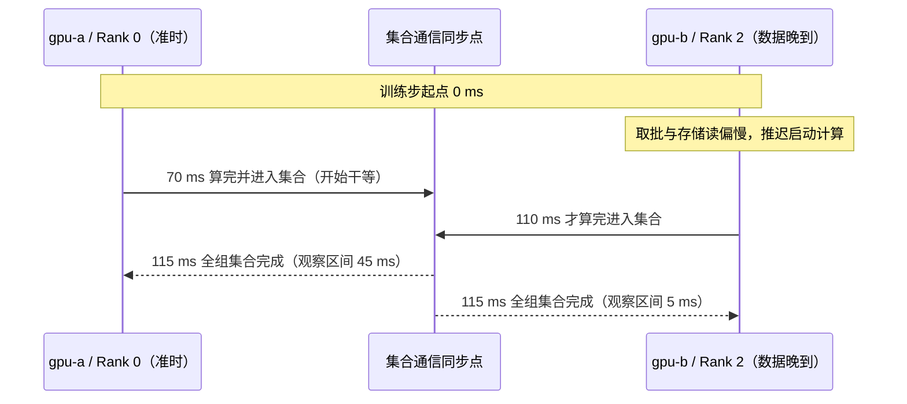

# 多 Rank 时间线与数据等待定位

多机训练突然变慢时，监控大盘常同时亮起三盏红灯：GPU 利用率掉坑、部分 Rank 的 NCCL 耗时暴涨、存储队列波动。若凭直觉把通信耗时拉长当成网络故障，去翻半天交换机配置，最后很可能扑个空。

精准归因的黄金法则只有一条：**把同一训练步的所有成员放上同一张时间线，找出最早有证据支撑的晚到环节**。顺着依赖往下追，就能看清它是怎样把等待传染给全组的。

## 一、先对齐同一训练步，再排因果先后

回到双节点四卡训练模型（`gpu-a` 跑 `Rank 0/1`，`gpu-b` 跑 `Rank 2/3`）。不同组件吐出的日志，必须靠共同的关联键钉在同一个坐标里：
- **基础定位键**：`host`、`rank`、`step`。重启复跑场景还要加上 `run_id` 与 `attempt`，避免把故障前后的同名步号拼串。
- **操作对齐键**：集合通信带通信组名与 `op_seq`，保存恢复带 `checkpoint_id`。

测量节点内部耗时，优先使用本机单调时钟。跨节点对比绝对时刻时，先核对 NTP/PTP 时钟偏差，再用训练步号和集合同步点交叉校验。一旦观察到的时差落进时钟误差范围，就不要强行给跨机事件排先后。

把黑盒拆透明，通常在四个位置采集埋点或 Profiler 轨迹：

| 观测层级 | 关键埋点或事件口径 | 核心区分的问题 |
| --- | --- | --- |
| **训练进程与加载 worker** | 批次编号、`next_batch_wait_ms`、`read_ms`、`decode_ms`、批次交付时刻 | 取批有没有卡住；慢在读存储、CPU 解码还是进程间交付 |
| **CUDA 设备流** | H2D 设备区间、`h2d_done`、计算 Kernel 区间与所属 Stream | 算子是在等主机批次、等拷贝完成，还是计算本身耗时长 |
| **集合通信** | 主机入队时刻、设备 `collective_start/end`、组与 `op_seq` | 各 Rank 何时抵达集合点；最晚成员到齐后实际传了多久 |
| **Checkpoint** | `checkpoint_id`、`stage_ms`、`write_ms`、`publish_ms`、`restore_ready_ms` | 慢步是否与同步 staging、后台写盘或恢复装载重叠同窗 |

用 PyTorch 2.9 Profiler 抓轨迹时，记住两条容易看花眼的边界。一是多 worker 并发生产的区间不可直接相加，必须按批次号对齐到最终交付。二是主进程 API 返回、设备操作启动与设备完成，三者口径完全不同。

## 二、情形一：单 Rank 数据晚到，把全组通信“拖长”

先看最容易引发误诊的经典场景。以本步起点为 `0 ms`，全组在 `115 ms` 完成梯度集合同步。下面只画最早抵达与最晚抵达的两个代表成员：



*图 09-06-01：单成员晚到引起的集合同步等待传染。早到成员账面上 45 ms 的“通信耗时”，有 40 ms 是在原地干等慢成员到齐。*

算一下两个成员的账面通信区间。准时的 `Rank 0` 经历了 `115 − 70 = 45 ms`，而晚到的 `Rank 2` 只经历了 `115 − 110 = 5 ms`。其中足足 `40 ms` 发生在 `Rank 2` 抵达之前。真正的网络传输可能只花了 `5 ms`，锅完全在慢成员的本地输入链上。

接下来顺着慢成员 `Rank 2` 从后往前倒查：
1. `next_batch_wait_ms` 先拉长 → 紧盯同批 `read_ms`、`decode_ms` 与加载队列；
2. 主机批次准时到手但 `h2d_done` 推迟 → 查拷贝 Stream、页锁定缓冲与同窗其他 DMA；
3. 输入与 H2D 全都准时，前置 Kernel 却晚结束 → 转向 GPU 计算与硬件状态排查。

### 锁定读慢或处理慢：两段核心系统观测

若慢成员指向本地盘读取，先由目标挂载查出实际块设备，再用 `iostat -x -y 1` 抓同窗实时指标（`-y` 自动跳过开机以来的首行累计值）：

```bash
# 每秒刷新本地 NVMe 扩展统计（跳过开机累计首行）
iostat -x -y 1 /dev/nvme0n1
# Device     r/s   rMB/s  rareq-sz  r_await  aqu-sz  %util
# nvme0n1  820.0   205.0    256.00    14.80   12.14  98.50
# 关键字段解读：
# - rareq-sz (256 KiB)：平均单次读大小，验证是不是退化成了小块随机读
# - r_await  (14.8 ms)：含队列等待 + 设备服务的总读时延（非纯盘内耗时）
# - aqu-sz   (12.14)  ：平均在途请求队列长度；与 r_await 同升说明盘队列积压
# - %util    (98.5%)  ：仅表示设备有 I/O 活动的时间比例！NVMe 支持多队列高并发，
#                        %util 接近 100% 绝不等于带宽已经跑满，须对照基线吞吐与 r_await。
```

若读写延迟和远端存储统计（NFS 的 `avg RTT`/`avg exe`、Lustre 的 MDS 与目标 OST）都很平稳，就把视线转向加载子进程的 CPU 抢占。在容器环境里，直接对比 cgroup v2 的 `cpu.stat` 窗口增量：

```bash
# 间隔 10 秒读取两次目标容器的 cgroup v2 CPU 统计，对比窗口增量
cat /sys/fs/cgroup/kubepods.slice/.../cpu.stat
# usage_usec        184920310
# nr_periods        1200
# nr_throttled      340          # 被 CPU 配额限流的周期次数（窗口增量飙升说明缺核）
# throttled_usec    48200000     # 累计被节流微秒数（多个线程并发累加，不可直接等同单批墙钟延迟）
```

> [!warning] 常见误区：系统聚合指标不能直接替单个 Rank 定罪
> 块设备 `iostat`、cgroup `cpu.stat` 与远端存储服务端监控都是共享资源的聚合读数。就算它们和慢步落在同一秒，也必须再拿慢 Rank 的进程归属、打开路径和同批应用计时交叉互证，排除同机其他作业的干扰。

## 三、情形二与情形三：排除数据等待后的真凶

排除单成员数据晚到后，剩下两种典型慢步的定位路线就非常清晰：

- **情形二：全组准时到齐，最晚抵达后的集合仍很慢。** 所有成员几乎同时进入集合同步点，但最晚抵达到完成的区间依旧很长。此时才真正指向通信层——立刻切回第 08 章的方法，核对 NCCL 选路、NIC 拥塞、ECN/PFC 与同规模 `nccl-tests` 基线。
- **Checkpoint 撞窗核对**：若慢步恰好叠在 Checkpoint 后台写窗口里，先查网络拓扑。存储与通信共用物理网卡或上行时，要把两路流量合账看拥塞。两者物理分网时，存储端口拥塞不会直接拖慢 NCCL，此时应改查 staging 拷贝与序列化是否挤占了主机 CPU、内存带宽或 PCIe。
- **情形三：输入准时到手，GPU 计算自身拉长。** 前置数据与 H2D 一切正常，长耗时全落在计算 Kernel 上。此时按相同张量形状和精度比对算子耗时，区分降频、HBM 带宽受限、显存分配抖动，以及激活重算（额外 Kernel）或显存卸载（额外 D2H/H2D）带来的开销。

## 四、三轮由外到内对照：一次只拆掉一段路径

时间线用来缩小嫌疑，**控制变量对照实验**才是一锤定音的铁证。保持 Rank 布局、批大小、数据类型、CPU 配额和集合配置不变，按“由外到内”顺序做三轮剥离：

| 对照轮次 | 本轮替换或移除的路径 | 保留下来的路径 | 实验结果怎么解读 |
| --- | --- | --- | --- |
| **第一轮：样本预置本地盘** | 移除远端存储与存储网络 | 保留文件读接口、采样顺序、CPU 解码与 H2D | 读取与取批等待同步缩短 → 深查远端存储或存储网（注意对齐冷热缓存） |
| **第二轮：主机内存预生成批次** | 移除磁盘读取与 CPU 解码 | 保留锁页内存、H2D、GPU 计算与集合通信 | 慢步消失 → 瓶颈落在读取或解码链上（再留编码字节做纯内存解码即可二选一） |
| **第三轮：显存预生成输入** | 进一步移除主机交付与 H2D | 仅保留 GPU 计算、集合通信与运行节奏 | 上轮还慢、本轮变快 → 锁死 H2D 或拷贝调度；本轮照慢 → 排除输入，专查算力与通信 |

> [!tip] 工程直觉：同一套剥离法，同样适用于推理尾延迟排查
> 切忌上来直接跳到第三轮“显存假数据跑快了”，就草率宣布“瓶颈在存储”。你一次跳过了远端网络、本地盘、CPU 解码、队列交付和 H2D 五段链路，根本分不清谁是真凶。这套“对齐时间线 + 逐段剥离”的思维同样适用于在线推理。当首字延迟（TTFT）飙升时，按“排队等待 → KV 缓存换入 → Prefill 计算”逐段剥离计时，一样能瞬间避开盲猜。

前六篇把分布式训练的读样本、写快照、直达搬运与时间线定位完整收束了。下一篇正式切入在线大模型推理的存储主战场：**百 GB 模型权重怎么秒级冷启动，溢出的 KV Cache 又该如何跨三级介质聪明缓存**？

> [!info]- 参考资料
> - **Linux 块设备与 cgroup v2 统计**：[Linux Kernel · Block Layer I/O Stats](https://docs.kernel.org/6.18/admin-guide/iostats.html)、[Linux man-pages · `iostat(1)`](https://man7.org/linux/man-pages/man1/iostat.1.html)、[Linux Kernel · Control Group v2 CPU Interface](https://docs.kernel.org/6.18/admin-guide/cgroup-v2.html#cpu)
> - **远端文件观测与剖析工具**：[Linux man-pages · `nfsiostat(8)`](https://man7.org/linux/man-pages/man8/nfsiostat.8.html)、[Lustre Architecture for Admins](https://wiki.lustre.org/Lustre_Architecture_for_Admins)、[PyTorch 2.9 · Profiler](https://docs.pytorch.org/docs/2.9/profiler.html)
> - **CUDA 异步执行与时间线口径**：[CUDA 13.2.1 · Asynchronous Execution](https://docs.nvidia.com/cuda/archive/13.2.1/cuda-programming-guide/02-basics/asynchronous-execution.html)
