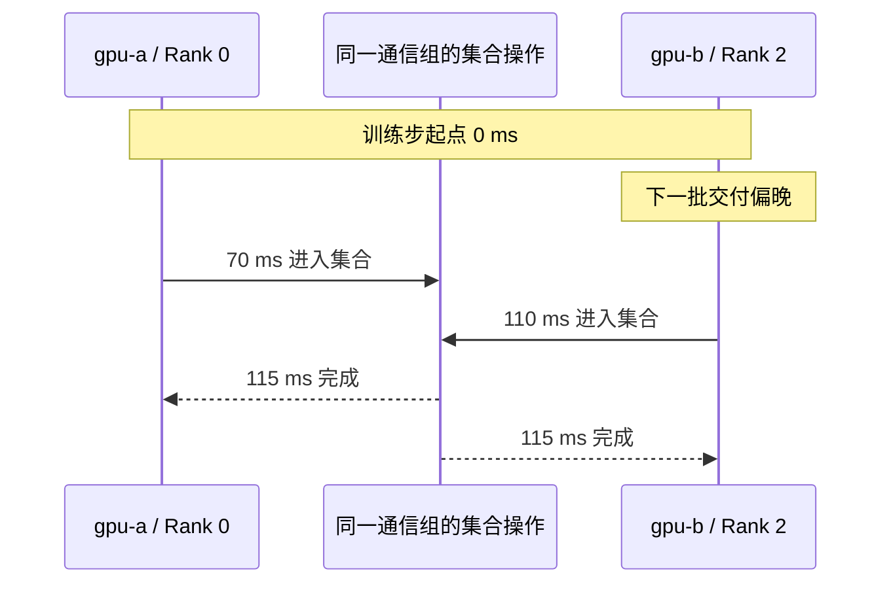

前五篇分别建立了输入、存储、流水线、Checkpoint 和 GDS 的路径。实际慢步往往同时出现“GPU 利用率下降”“某些 Rank 的 NCCL 区间变长”和“存储指标波动”，这些现象并不自动构成一条因果链。归因应从同一训练步出发，找到**最早有证据支持的晚到阶段**，再看它怎样传播到后续工作。

## 对齐同一步、同一次集合与同一个保存点

主例仍有两节点、每节点两个 Rank。应用记录按 `host / rank / step` 归并；集合操作增加通信组标识与 `op_seq`，保存与恢复增加 `checkpoint_id`。需要区分运行尝试时，再带 `run_id` 和 `attempt`，避免把重启前后的相同 Rank 与步号误拼成一条时间线。

节点内区间可用本机单调时钟测量。跨机拼接绝对时刻时要记录时钟偏差，并用训练步、集合序号和事件依赖交叉验证顺序；若观察到的时差接近时钟误差，不应强行排列因果。

| 观测位置 | 教学字段或事件 | 可以区分的问题 |
| --- | --- | --- |
| 训练进程与 DataLoader worker | 批次编号、`next_batch_wait_ms`、`read_ms`、`decode_ms`、批次交付时刻 | 取批是否阻塞，加载子进程慢在读取、CPU 处理还是交付 |
| CUDA 设备 | H2D 设备区间、`h2d_done`、计算 Kernel 区间与所属 Stream | 计算在等主机批次、等拷贝完成，还是 Kernel 本身执行较久 |
| 集合操作 | 主机提交时刻、设备侧 `collective_start/end`、组与 `op_seq` | 各 Rank 何时抵达同一次集合，最晚抵达后通信还需多久 |
| Checkpoint | `checkpoint_id`、`stage_ms`、`write_ms`、`publish_ms`、`restore_ready_ms` | 慢步是否与同步 staging、后台写或恢复装载落在同一窗口 |

这些应用字段是本章为解释而定义的教学标记，不是 PyTorch 自动提供的统一日志格式。多个 worker 并行处理不同批次时，应按批次关联各阶段与最终交付，不能把并行区间直接相加。PyTorch Profiler 可采集 CPU/CUDA 活动，主进程中的取批调用与 worker 内部读取、解码需要在对应进程中观察。CUDA API 返回、设备操作开始和设备操作完成也是不同口径。 [PyTorch 2.9 Profiler](https://docs.pytorch.org/docs/2.9/profiler.html) · [CUDA 12.9 Stream 与异步执行](https://docs.nvidia.com/cuda/archive/12.9.1/cuda-c-programming-guide/index.html#asynchronous-concurrent-execution)

## 情形一：一个 Rank 先晚到，其他 Rank 在集合中等待

下面是**教学时序**。时间已对齐到该训练步起点，只画最早与最晚抵达的 Rank；四个 Rank 均在 115 ms 观察到本次设备集合完成。

Rank 0 的集合观察区间为 `115 − 70 = 45 ms`，其中 `110 − 70 = 40 ms` 发生在 Rank 2 抵达之前。Rank 2 自己的区间只有 5 ms。这个差异说明 Rank 0 的“通信耗时”包含等待晚到成员，不能把 45 ms 全部解释成网络传输时间。

接下来沿 Rank 2 向前追溯：

1. 若 `next_batch_wait_ms` 先变长，再看同批 `read_ms`、`decode_ms` 和交付时刻。
2. 若主机批次按时交付而 `h2d_done` 变晚，检查 H2D 的 Stream 依赖、源缓冲和同窗口设备拷贝。
3. 若输入与 H2D 都准时，前置 Kernel 却晚结束，则集合晚到是计算延后的结果，而不是数据存储的直接证据。

### 读取变慢时选择对应层级的证据

- **本地 NVMe。** 先由目标挂载确定实际块设备，再用 `iostat -x -y 1` 观察同窗读吞吐、`r_await` 和 `aqu-sz`。`r_await` 包含读请求在队列中的等待和设备服务时间，不是纯设备服务时长。如果吞吐接近同请求形状下的基线平台，同时排队和读时延升高，支持设备供给承压的判断。NVMe 能并行处理请求，`%util` 表示有 I/O 活动的时间比例，不能单独当作带宽饱和度。秒级工具可能漏掉短尖峰，需要应用内更细的请求计时。 [Linux 块设备统计](https://docs.kernel.org/6.18/admin-guide/iostats.html) · [iostat 字段](https://man7.org/linux/man-pages/man1/iostat.1.html)
- **远端文件存储。** NFS 按挂载和时间窗看 `op/s`、`avg RTT`、`avg exe` 与重传；Lustre 还要区分元数据服务和实际条带涉及的 OST/OSS。大量打开变慢而数据吞吐不高时，优先核对路径查找或元数据时延。任何客户端指标都要与服务端、网络和同请求基线互证。 [nfsiostat 字段](https://man7.org/linux/man-pages/man8/nfsiostat.8.html) · [Lustre 元数据与数据路径](https://wiki.lustre.org/Lustre_Architecture_for_Admins)
- **主机处理与搬运。** 若读取时长和存储统计平稳，检查 worker 的 CPU 时间与墙钟时间、解码线程池和交付队列。cgroup v2 限制 CPU 时，可比较 `cpu.stat` 中 `nr_throttled` 与 `throttled_usec` 的窗口增量；前者是被节流的周期次数，后者是以微秒计的累计节流时间；两者都不能直接当成某个慢批的墙钟延迟。批次已交付而 H2D 未及时完成时，再查拷贝 Stream、源缓冲实际页和同窗其他 DMA。 [Linux cgroup v2 CPU 统计](https://docs.kernel.org/6.18/admin-guide/cgroup-v2.html#cpu)

块设备、cgroup 和服务端指标通常都是设备、控制组或服务端的**聚合口径**。即使它们与慢步同窗口变化，也要再用目标 Rank 的进程归属、文件路径和请求记录建立对应，不能仅凭聚合指标认定某一个 Rank 是原因。

## 情形二：各 Rank 准时抵达，最晚抵达后的集合仍变慢

如果输入张量和前置 Kernel 都稳定，各 Rank 抵达同一次集合的时间差很小，而从最晚抵达到完成的区间仍拉长，证据就更接近通信执行本身。

此时应回到第 08 章的方法，核对实际 NCCL 后端、GPU–NIC 映射、端口吞吐与拥塞，并使用相同规模、操作、消息大小和路径的集合基线。这里无需重讲集合算法，关键是保持比较口径一致。

若慢步只与 Checkpoint 后台写重叠，还需先确认两条流量是否真正共享资源：

- 共用 NIC、交换机上行或服务端时，把存储写流量与集合流量放进同一时间窗。
- 存储与计算网络物理分用时，不能把存储端口的拥塞直接当成 NCCL 网络证据；仍要检查 staging、序列化与通信是否竞争主机 CPU、内存或 PCIe。

## 情形三：输入准时，GPU 计算本身占据更长区间

如果长区间主要由计算 Kernel 占据，先比较相同输入形状、dtype 和算子路径下的 Kernel 耗时。设备持续执行 Kernel 只说明它在做工作，还需进一步区分计算吞吐、HBM 带宽、执行配置或降频等原因。

若框架报告显存分配失败，或本轮启用激活重算、显式 offload，则检查分配器事件、额外 Kernel 和 D2H/H2D 区间。重算增加设备工作，offload 增加搬运；二者都可能在输入准时的情况下延长步时。显存占用峰值、GPU 利用率和输入等待分别描述不同对象，不能相互替代。 [PyTorch 2.9 Profiler 的算子与显存事件](https://docs.pytorch.org/docs/2.9/profiler.html)

## 每轮对照只移除一段候选路径

时间线用于提出假设，对照用于检验假设。以下三轮从外到内移除路径，每轮保留相同的 Rank 布局、批次形状、dtype、CPU 配额、并发和集合配置，并保留或单独标记 Checkpoint 窗口。

| 对照 | 本轮移除什么、保留什么 | 结果可以怎样解释 |
| --- | --- | --- |
| 把相同样本布局预置到节点本地 | 替换远端存储与存储网络，保留文件读取接口、样本顺序、解码和 H2D | 若读取和取批等待同时缩短，优先复核被替换的远端路径；分别记录两侧冷热缓存，避免把缓存差异误当接口收益 |
| 在主机内存预生成同形状、同 dtype 的批次 | 移除读取与解码，保留锁页、H2D、计算和集合 | 改善说明原读取/处理链位于影响路径上，但不能单靠这一轮区分二者；可在内存中保留编码样本继续解码，或对原读取路径单独计时 |
| 使用显存中预生成的同形状输入 | 再移除 H2D 与主机交付，保留计算、集合与输入节奏 | 若上一轮仍有步首空档而本轮消失，进一步检查 H2D 或拷贝调度；若慢步仍在，优先检查保留下来的计算与通信 |

每轮同时记录各段耗时和全作业步时。某个局部阶段缩短，若它原本完全藏在前一批计算期间，端到端步时可能不变；只有落在关键路径上的等待被移除，才应预期步时改善。预生成数据还可能改变内存压力，必须纳入对照条件。若一次绕过多层而结果改善，下一轮要拆回单一变量，不能把整条被绕过路径统称为“存储瓶颈”。

最后一篇将这些判断合并为一份纸面材料：既要复算速率、队列与保存窗口，也要从 GDS 和多 Rank 记录中区分事实、候选解释与下一条证据。
