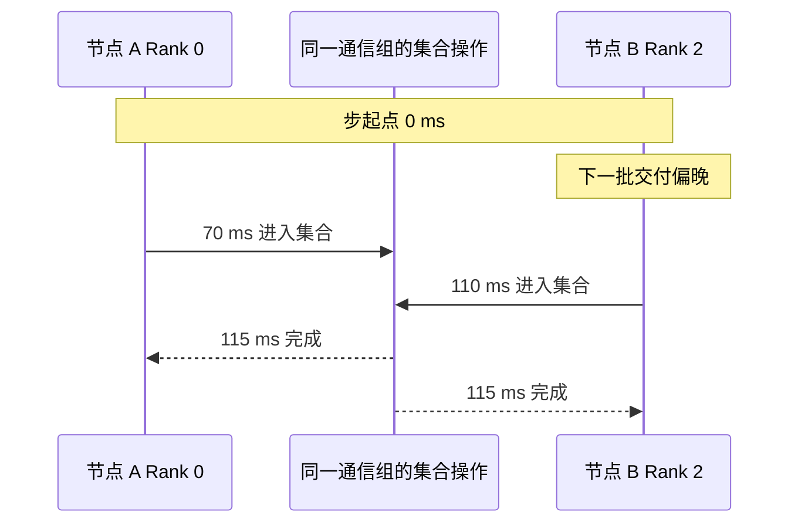

# 用多 Rank 时间线定位等待

训练 GPU 利用率下降时，先找时间线上哪个阶段最早晚到。一个 Rank 读数据慢，可能导致别的 Rank 先到达集合操作，在通信区间里等它。反过来，各 Rank 都按时完成输入和计算，仍在集合阶段出现额外耗时，就需要沿通信路径取证。

## 对齐同一步和同一次集合

以两节点、每节点两个 Rank 的训练为例。按 `host / rank / step` 组织应用记录，集合还要标记通信组与 `op_seq`，Checkpoint 则加 `checkpoint_id`。节点内可用单调时钟测区间。跨机拼接时记录时钟偏差，结合步号、集合序号和同步点验证先后顺序。两条记录的时间差如果接近时钟误差，先用事件依赖关系缩小范围。

| 观测位置 | 教学字段和事件 | 能区分什么 |
| --- | --- | --- |
| 训练进程与 worker | `next_batch_wait_ms`、`read_ms`、`decode_ms`、批次编号和返回时刻 | 取批何时阻塞，worker 是卡在读取、CPU 处理还是交付 |
| CUDA 设备 | H2D 区间、`h2d_done`、计算 Kernel 区间 | 计算在等主机张量、等拷贝完成，还是本身执行较久 |
| 集合操作 | 主机提交、设备端的 `collective_start/end` | 各 Rank 何时抵达同一次集合，完成时间何时拉长 |
| 保存或恢复 | `stage_ms`、`write_ms`、`publish_ms`、`restore_ready_ms` | 训练步变慢是否落在 staging、后台写或恢复的时间窗口 |

表中字段由应用定义。多 worker 同时在处理不同样本时，按批次关联各 worker 的阶段和最终交付时间，避免把并行区间的时长相加。使用 PyTorch 2.9 Profiler 采集 CPU/CUDA 活动，必要时启用显存事件追踪。主进程的 trace 可看到取批调用耗时，worker 内部的读取和解码应在对应进程记录。CUDA API 返回、GPU 上的操作开始和 GPU 完成是三个观测时刻，比较两轮时使用同一口径。 [PyTorch 2.9 Profiler](https://docs.pytorch.org/docs/2.9/profiler.html) · [CUDA 12.9 Stream 与异步执行](https://docs.nvidia.com/cuda/archive/12.9.1/cuda-c-programming-guide/index.html#asynchronous-concurrent-execution)

## 同样的慢步，三种时间线

### 一个 Rank 在取批处先变慢

下图是**教学时序**。假设使用 PyTorch 2.9 的两节点四 Rank 训练，时间已对齐到该训练步起点，只画最早和最晚到达的 Rank。以设备侧集合区间计时，设四个 Rank 均在 115 ms 完成本次集合。

Rank 0 看到 45 ms 的集合区间，其中有 40 ms 发生在 Rank 2 抵达之前。把早到的区间与晚到 Rank 的 `next_batch_wait_ms`、`h2d_done` 对齐，再回查它的 `read_ms` 和 `decode_ms`。这组记录显示一部分集合耗时与到达差有关。要归因到存储，还得看晚到的那批是否读得慢，以及存储观测有没有同窗变化。

- **本地读。** 先确定文件所在设备，再用 `iostat -x -y 1` 观察对应时间段的读吞吐、`r_await` 与 `aqu-sz`。吞吐接近同请求形状下的基线平台，同时排队与读延迟升高，支持设备供给承压的判断。NVMe 可并行处理请求，`%util` 表示有 I/O 活动的时间比例，需结合队列、时延和吞吐。短尖峰还需要更细的应用计时。 [Linux 块设备统计](https://docs.kernel.org/6.18/admin-guide/iostats.html) · [iostat 字段](https://man7.org/linux/man-pages/man1/iostat.1.html)
- **远程读。** 按挂载和时间窗看 NFS 的 `op/s`、`avg RTT`、`avg exe`、重传，或查并行文件系统的元数据服务和实际涉及的数据目标。大量打开变慢而数据吞吐不高时，看路径查找或元数据时延。请求和链路都需要与相同负载下的记录对照。 [nfsiostat 字段](https://man7.org/linux/man-pages/man8/nfsiostat.8.html) · [Lustre 元数据与数据路径](https://wiki.lustre.org/Lustre_Architecture_for_Admins)
- **主机或搬运。** 如果同一批的读耗时与存储统计平稳，查 worker CPU 时间与墙钟时长、解码线程数和队列。如果使用 cgroup v2 CPU 限额，看 `cpu.stat` 的 `nr_throttled` 与 `throttled_usec` 的窗口增量。批次已交付、H2D 却未及时结束时，查拷贝 Stream、源缓冲和同窗的其他 DMA。 [Linux cgroup v2 CPU 统计](https://docs.kernel.org/6.18/admin-guide/cgroup-v2.html#cpu)

### 各 Rank 准时抵达，集合本身变慢

输入张量到达和前置 Kernel 都稳定，各 Rank 的集合抵达时差仍小，但最后一个 Rank 抵达后到完成的时间拉长。此时核对实际走的 NCCL 后端和 GPU–NIC 映射、端口吞吐与拥塞证据，再用相同规模、操作、消息大小和路径的集合基线作比较。若现象只出现在 Checkpoint 窗口，要查写入和集合流量是否真的共用 NIC、交换机上行或节点内路径。若存储走独立网络，还可以检查 staging 与集合是否竞争主机内存或 PCIe。

### 输入准时，GPU 仍花很久完成一步

如果长区间主要由计算 Kernel 占据，先对照相同输入形状、dtype 和算子路径的 Kernel 耗时。Kernel 持续运行说明设备在执行工作，还需进一步区分算力与显存带宽约束。若框架报告分配失败，或配置了激活重算、显式 offload，则检查分配器、额外 Kernel 和 D2H/H2D 区间。重算会增加设备工作，offload 会引入数据搬运，两种行为都可能在训练输入准时的情况下拉长步时。单看显存占用峰值无法区分这些机制。 [PyTorch 2.9 Profiler 的算子与显存事件](https://docs.pytorch.org/docs/2.9/profiler.html)

## 每轮只移除一段候选路径

| 对照 | 保留什么 | 结果怎样解释 |
| --- | --- | --- |
| 将相同样本布局预置到节点本地 | 样本顺序、文件读取接口、解码和 H2D | 若读取及取批等待同时缩短，优先复核被替换的远程存储与网络路径。分别记录客户端冷热状态 |
| 在主机内存预生成同形状、同 dtype 的批次 | 相同锁页与 H2D 路径、计算和集合 | 取批改善表明原有读取与处理链有影响。要区分两者，可再用内存中的编码样本保留解码，或在相同读路径上单独计解码 |
| 使用显存中预先生成的同形状输入 | 计算、集合与输入节奏 | 若上轮仍有步首空档，本轮又消失，进一步查 H2D 或拷贝调度依赖 |

各轮固定 Rank 布局、CPU 配额、批次形状、并发和集合配置。保留或单独标记 Checkpoint 窗口。对照期间跟踪各段的耗时和全作业步时，同时核对预置或预生成数据是否改变了内存压力。最先变化的阶段指出该追哪条路径，步时的变化则说明这段等待有多少落在作业的关键路径上。
