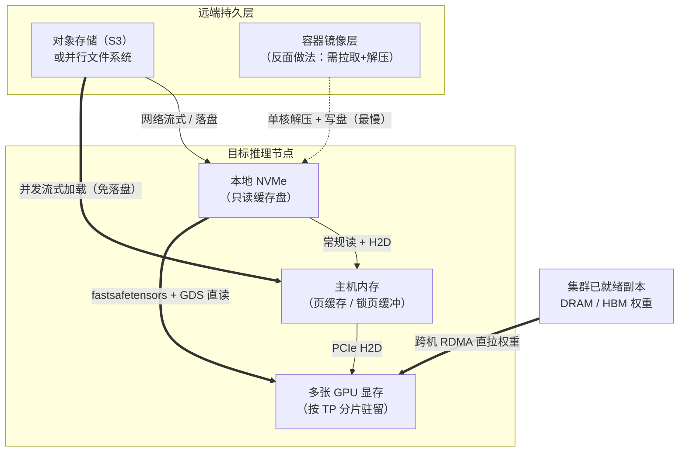
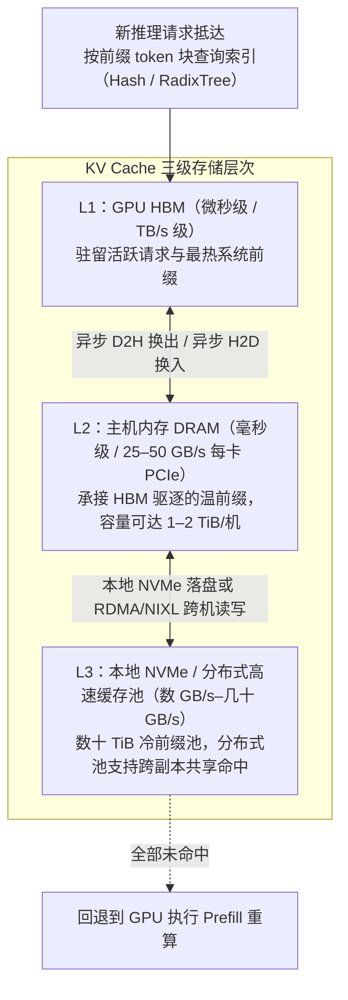

# 模型权重冷启动与 KV Cache 多级缓存

切换到在线大模型推理战场，存储压力彻底换了面孔。推理不再需要持续喂入训练图片，也不必定时写出带优化器状态的 Checkpoint。但它撞上了两座直击业务 SLA 的存储大山：

1. **百 GB 级模型权重冷启动**：业务流量暴涨触发弹性扩容（Scale-out）。Kubernetes 2 秒就把新 Pod 调到了空闲节点，为什么新副本还要苦等 2–5 分钟才能接流量？
2. **动态 KV Cache 溢出与重算**：长系统提示词、RAG 文档和多轮对话让 KV Cache 迅速撑破 HBM。一旦驱逐丢弃，下次请求进来又得花数秒重算 Prefill。

本篇用耗时账本和盈亏公式，把这两条推理存储主线彻底讲透。

## 一、百 GB 权重冷启动：卡死推理弹性扩容的 RTO

在线推理扩容的**冷启动恢复时间（RTO，从触发扩容到新副本就绪接流量）**由四段构成。Pod 调度与建容器只需数秒，框架初始化也只要几秒，CUDA Graph 捕获通常十几秒。真正拖垮节奏的，往往是中间那段**百 GB 权重加载进显存**——耗时动辄几十秒到数分钟。

以第 02 章的 **70B（BF16 约 `140 GB ≈ 130.4 GiB`）** 与 **405B（FP8 约 `405 GB`，BF16 约 `810 GB`）** 为例，先看权重加载穿越的物理路径：



*图 09-07-01：在线推理模型权重冷启动的四条典型路径。绕开容器镜像解压与本地落盘，并结合并发流式、GDS 或集群 RDMA，可将百 GB 冷启动压入秒级。*

用最朴素的纯搬运公式（暂不计解压、反序列化与 CUDA Graph 预热），把不同路径放进同一张耗时账本：

$$T_{\text{load}} \ge \frac{V_{\text{weights}}}{B_{\text{eff}}}$$

代入 70B BF16（`140 GB`）与 405B（FP8 `405 GB` / BF16 `810 GB`），五种典型方案的差距一目了然：

| 加载方案 | 典型有效吞吐 $B_{\text{eff}}$ | 70B BF16 (`140 GB`) | 405B FP8 (`405 GB`) | 405B BF16 (`810 GB`) | 瓶颈特征 |
| --- | ---: | ---: | ---: | ---: | --- |
| **容器镜像层冷拉 + gzip 解压** | 约 `0.5–1.0 GB/s` | **140–280 s** | **6.8–13.5 min** | **13.5–27 min** | 拉取慢、单核解压打满 CPU、OverlayFS 写放大并挤爆系统盘 |
| **S3 普通单流 / 低并发拉取** | `2 GB/s` | `70.0 s` | `202.5 s` | `405.0 s` | 远端出口与单连接吞吐受限，常伴随先落盘再读取的双倍耗时 |
| **S3 高并发流式 / 并行存储** | `10 GB/s` | `14.0 s` | `40.5 s` | `81.0 s` | 多线程分片直喂内存，免本地落盘；受节点网络出口带宽约束 |
| **本地 NVMe 预热（单盘 → 四盘并发）** | `7 → 25 GB/s` | `20.0 → 5.6 s` | `57.9 → 16.2 s` | `115.7 → 32.4 s` | 摆脱跨网拉取；配合 GDS 还可绕开主机内存直接 DMA 进显存 |
| **节点内存缓存 / 集群 RDMA 直拉** | `50–100 GB/s` | **`1.4–2.8 s`** | **`4.1–8.1 s`** | **`8.1–16.2 s`** | 跨机 400 Gb/s RDMA（`50 GB/s`）或 4 卡 PCIe H2D（`100 GB/s`） |

> [!warning] 常见误区：切忌把百 GB 权重塞进容器镜像
> 把模型权重打进容器镜像看似省事，在生产里却是弹性扩容的头号杀手。下载后的单核 gzip 解压极慢，OverlayFS 落盘极易打爆宿主机系统盘。更糟的是，微调一行推理代码也要重新推拉百 GB 镜像。生产上必须把**轻量代码镜像**与**独立存储的模型权重**彻底解耦。

为了把冷启动 RTO 从几分钟压进十几秒甚至数秒，现代推理集群通常打出一套四连加速组合拳：

1. **改用 `safetensors` 零拷贝格式**：淘汰老旧的 Python `pickle` 权重格式（既存在代码执行风险，又触发单线程反序列化和主机内存翻倍峰值）。`safetensors` 在文件头放置简短 JSON 元数据，直接标明每个张量的形状、精度与偏移，支持零拷贝 `mmap` 和多线程按偏移并发切片读。
2. **分片并发流式加载 + 按 TP 只拉本卡切片**：利用 `Model Streamer`（原 Run:ai Model Streamer）等并发流式引擎，多线程直接从 S3 或并行文件系统按块读取并送进 GPU，省掉“先完整下载落盘、再打开读取”的往返。在 `TP=4` 下，每卡只需拉取 1/4 切片（70B 单卡仅 `35 GB`）。
3. **节点本地 NVMe / 内存常驻预热**：在推理节点池提前把热门模型铺到本地只读 NVMe 盘（或内存盘）。配合第 15 章的缓存亲和调度，优先把扩容 Pod 调度到已预热节点，直接消灭跨网冷拉。
4. **GDS 与集群 RDMA 权重直传**：本地多盘 NVMe 配合 `fastsafetensors` 与第 05 篇的 **GPUDirect Storage**，直接 DMA 进显存并解放 CPU。若新节点本地无缓存而集群已有活跃副本，则借助第 06 章的 **RDMA**，以数百 Gb/s 速率从热副本的内存或显存直接拉取权重。

下面对比 vLLM 三种常见权重加载模式的精简启动命令：

```bash
# 1. 标准本地 safetensors（利用本地 NVMe 预热盘 + 零拷贝 mmap）
vllm serve /mnt/local-nvme/Llama-3-70B --tensor-parallel-size 4 --load-format safetensors

# 2. 远端对象存储高并发流式加载（免完整落盘，多线程直喂内存与 GPU）
vllm serve s3://model-bucket/Llama-3-70B --tensor-parallel-size 4 --load-format runai_streamer

# 3. 本地 NVMe / 并行文件系统 + GPUDirect Storage 直读加速（绕开主机中转）
vllm serve /mnt/local-nvme/Llama-3-70B --tensor-parallel-size 4 --load-format fastsafetensors
```

## 二、Prefix Caching 与 KV Cache 多级卸载

权重装好、服务开始接流量后，存储压力立刻转向第二个主角：**动态膨胀的 KV Cache**。

回忆第 02 章的账本。Llama 3 70B 在 BF16 下有 80 层、GQA 8 个 KV 头、单头维度 128，每 1 个 token 的 KV Cache 占 `320 KiB`。单个 `32K` 上下文请求吃掉 `10 GiB` 显存，32 路并发就是 `320 GiB`——达到权重体积的 2.4 倍！

真实线上业务里（长系统提示词、Agent 工具定义、企业 RAG 文档、多轮长对话），大量请求共享着数千甚至数万个相同前缀 token。为了不再反复重算这些公共前缀，现代推理引擎引入了两项核心机制：

- **Prefix Caching（前缀缓存）**：以固定 token 块（如 16、64 或 256 tokens）为粒度，按前缀序列哈希或前缀树索引历史 KV 块（如 vLLM Automatic Prefix Caching、SGLang RadixAttention）。新请求命中相同前缀时直接复用现成 KV 块，只对新增后缀做增量 Prefill。
- **KV Offloading（KV 多级卸载）**：当 HBM 显存吃紧必须驱逐旧 KV 块时，不再直接丢弃。系统通过异步 D2H 或存储写将其卸载到主机内存、本地 NVMe 或共享缓存池。后续请求再次命中时，再把对应 KV 块异步换回 HBM。

由此，推理系统演化出了类似 CPU 缓存的**三级 KV 存储金字塔**：



*图 09-07-02：基于 Prefix Caching 的三级 KV Cache 卸载与换入架构。容量逐级放大，延迟逐级升高，是否换入取决于传输带宽能否跑赢重算。*

| 缓存层级 | 物理介质 | 典型容量（单机/集群） | 有效访问带宽 | 适用前缀特征 |
| --- | --- | --- | --- | --- |
| **L1 显存热池** | GPU HBM | 单卡扣除权重后约 `30–45 GiB` | `~3.35 TB/s`（H100 单卡） | 活跃生成中请求、超高频公共系统提示词 |
| **L2 主机温池** | 主机内存 DRAM（锁页池） | 单机常备 `1–2 TiB` | PCIe Gen4/5 单卡 `25–50 GB/s`（4 卡 `100–200 GB/s`） | 多轮对话中间停顿、中频 Agent/RAG 前缀 |
| **L3 持久/共享冷池** | 本地多盘 NVMe / 共享内存或分布式存储（3FS、Mooncake、NIXL） | 单机数十 TiB / 集群 PB 级 | 单盘 NVMe `6–14 GB/s`；高速分布式池可达数十 GB/s | 超长文档库、跨推理副本共享的长上下文前缀 |

## 三、定量推演：“读缓存”什么时候比“重算”划算

把 KV Cache 卸到下级介质，命中了就一定赚吗？绝对不是。若下级存储带宽太低，把几 GB 的 KV 拖回显存比 GPU 重算一遍 Prefill 还慢，那换入缓存反而是在拉高首字延迟（TTFT）。

用几步清晰的代数，就能算出**换入与重算的盈亏平衡点**。

沿用第 02 章的 **Llama 3 70B（BF16）** 参数：总参数 $W = 7 \times 10^{10}$，单 token KV 体积 $s_{\text{KV}} = 320\text{ KiB}$（`327,680 B`）。

服务部署在 4× H100 SXM（`TP=4`）上，现在命中一段 $S_{\text{hit}} = 16{,}384$ tokens（16K）的公共前缀。

**第一步：算 16K 前缀的 KV 体积。** 完整前缀占：

$$V_{\text{KV}} = 16{,}384 \times 320\text{ KiB} = 5.0\text{ GiB} \approx 5.369\text{ GB}$$

在 `TP=4` 下，四张卡各持 2 个 KV 头。每卡只需加载 `1.25 GiB`（约 `1.342 GB`），四卡并行走各自 PCIe 通道聚合换入。

**第二步：算 Prefill 重算耗时。** 线性层计算量下界为 $2 W \cdot S_{\text{hit}}$（先不含 $O(S^2)$ 注意力项，偏保守；上下文越长重算只会更慢）。4× H100 的 BF16 峰值合计约 `3,958 TFLOP/s`，按约 50% 有效利用率取聚合算力 $C_{\text{eff}} = 2{,}000\text{ TFLOP/s}$：

$$F_{\text{linear}} = 2 \times (7 \times 10^{10}) \times 16{,}384 \approx 2{,}294\text{ TFLOP}$$

$$T_{\text{recompute}} \approx \frac{2{,}294\text{ TFLOP}}{2{,}000\text{ TFLOP/s}} \approx 1.147\text{ s}\quad(\text{含注意力二次项约 } 1.32\text{ s})$$

**第三步：推导出通用盈亏平衡带宽 $B_{\text{break-even}}$。** 令换入耗时 $V_{\text{KV}} / B_{\text{load}}$ 短于重算耗时 $2 W S_{\text{hit}} / C_{\text{eff}}$，两端消去 $S_{\text{hit}}$（暂忽略固定启动延迟 $t_0$）：

$$B_{\text{break-even}} = \frac{s_{\text{KV}} \cdot C_{\text{eff}}}{2 W}$$

代入 Llama 3 70B 参数（$s_{\text{KV}} = 327{,}680\text{ B/tok}$，$2W = 1.4 \times 10^{11}\text{ FLOP/tok}$，$C_{\text{eff}} = 2 \times 10^{15}\text{ FLOP/s}$）：

$$B_{\text{break-even}} = \frac{327{,}680 \times 2 \times 10^{15}}{1.4 \times 10^{11}} \approx 4.68\text{ GB/s}\quad(\text{4 卡合计；单卡仅需 } 1.17\text{ GB/s})$$

拿 `4.68 GB/s` 这道红线去照真实硬件，各层介质谁赚谁亏立刻一清二楚：

| 换入来源介质 | 4 卡聚合有效带宽 $B_{\text{load}}$ | 换入 `5.37 GB` 耗时 | 对比重算（`1,147 ms`） | 工程结论 |
| --- | ---: | ---: | --- | --- |
| **L2 主机内存（PCIe Gen5 x16）** | `~200 GB/s`（每卡 `50`） | **`26.8 ms`** | 快 **42.8 倍** | 压倒性收益，TTFT 从秒级直降几十毫秒 |
| **L2 主机内存（PCIe Gen4 x16）** | `~100 GB/s`（每卡 `25`） | **`53.7 ms`** | 快 **21.4 倍** | 收益极高，且易与同机逐层计算重叠 |
| **L3 本地双盘 NVMe 并发读** | `12 GB/s` | `447.4 ms` | 快 **2.6 倍** | 划算，显著压低 TTFT 并解放 Tensor Core |
| **L3 本地单盘 NVMe 读** | `6 GB/s` | `894.8 ms` | 快 **1.3 倍** | 略赢延迟，**核心红利在于省下算力给其他请求** |
| **普通 10 GbE NFS 共享目录** | `1 GB/s` | **`5,369 ms`** | **慢 4.7 倍（血亏！）** | 远低于 `4.68 GB/s` 平衡线，不如直接重算 |

> [!warning] 常见误区：哪三种场景下“读缓存”反而比“重算”更慢？
> 盯着公式 $B_{\text{break-even}} = \frac{s_{\text{KV}} \cdot C_{\text{eff}}}{2 W}$，立刻能预判三种反转陷阱：
> 1. **小模型 + FP8 高算力**：参数 $W$ 变小或启用 FP8 让 $C_{\text{eff}}$ 翻倍都会推高平衡线。以单卡 H100 跑 8B（32 层 GQA、每 token KV `128 KiB`）配 FP8 Prefill（`1,000 TFLOP/s`）与 BF16 KV 为例，单卡平衡线暴涨至 **8.19 GB/s**。
>    - 此时单盘 Gen4 NVMe（`6 GB/s`）已跑不过重算，只有主机内存依然划算。
> 2. **无 GQA 的老架构（MHA）**：单 token KV 体积 $s_{\text{KV}}$ 扩大 8 倍，平衡线同步抬高 8 倍。
> 3. **极短前缀与 PCIe 争用**：前缀仅几百 token 时，固定元数据查找和网络往返延迟 $t_0$ 往往超过十几毫秒的纯计算。若节点内多卡共挤同一条 PCIe 上行，实际 $B_{\text{load}}$ 也会大幅缩水。

> [!tip] 工程直觉：就算换入耗时接近重算，卸载依然有一张隐藏王牌
> 换入 KV 只消耗存储和 PCIe 拷贝引擎，几乎不占 GPU 的 Tensor Core。高并发线上服务里，这等于把省下的全部算力让给了同卡上正在跑的其他 Decode 与 Prefill 请求，整机吞吐成倍放大。再配合**逐层异步预取**（算第 $l$ 层时通过独立拷贝 Stream 提前 H2D 第 $l+1$ 层 KV），还能把换入延迟藏进计算里。

在主流推理引擎中，开启自动前缀缓存与多级卸载已经相当成熟。下面给出 vLLM 原生 `OffloadingConnector` 与 SGLang 分层缓存 `HiCache` 的典型启动配置：

```bash
# 方式一：vLLM 启用自动前缀缓存 + 原生主机内存异步 KV 卸载（经独立拷贝引擎 H2D/D2H）
vllm serve /mnt/local-nvme/Llama-3-70B \
  --tensor-parallel-size 4 \
  --enable-prefix-caching \
  --kv-transfer-config '{"kv_connector":"OffloadingConnector","kv_role":"kv_both","kv_connector_extra_config":{"num_cpu_blocks":16384}}'

# 方式二：SGLang 启用 RadixAttention + HiCache（L1 HBM → L2 DRAM → L3 本地 NVMe/NIXL 存储池）
SGLANG_HICACHE_NIXL_BACKEND_STORAGE_DIR=/mnt/nvme-kvcache \
python3 -m sglang.launch_server \
  --model-path /mnt/local-nvme/Llama-3-70B --tp 4 \
  --enable-hierarchical-cache \
  --hicache-size 256 \
  --hicache-write-policy write_through
```

> [!summary] 核心结论：训推存储设计的底层统一逻辑
> 训练追求高吞吐持续喂数与抗突发 Checkpoint 落盘。推理追求低 RTO 权重冷启动与跑赢重算线的多级 KV 缓存。看似两套世界，底层算的却是同一套账：看清字节与操作率、砍掉多余拷贝中转、让 I/O 带宽跑赢消费或重算红线，再把能异步化的搬运藏进计算重叠里。

至此，第 09 章训练与推理两条存储主线全部拼齐。下一篇综合检验把样本速率、布局、流水线、Checkpoint、GDS、时间线归因、权重冷启动与 KV 卸载盈亏计算融进同一套实战检验，带你一次核验全部推演能力。

> [!info]- 参考资料
> - **大模型权重格式与高速加载**：[Hugging Face · Safetensors Documentation](https://huggingface.co/docs/safetensors/index)、[Foundation Model Stack · `fastsafetensors`](https://github.com/foundation-model-stack/fastsafetensors)、[DSX AI Factory · `model-streamer`（原 Run:ai Model Streamer）](https://github.com/dsx-ai-factory/model-streamer)
> - **vLLM 前缀缓存与 KV 多级卸载**：[vLLM · Automatic Prefix Caching](https://docs.vllm.ai/en/stable/features/automatic_prefix_caching.html)、[vLLM · KV Offloading Guide](https://docs.vllm.ai/en/stable/features/kv_offloading.html)
> - **SGLang 分层缓存与异构传输库**：[SGLang Official Documentation（RadixAttention & HiCache）](https://docs.sglang.io/)、[SGLang GitHub Repository](https://github.com/sgl-project/sglang)、[NVIDIA NIXL · Inference Transfer Library](https://github.com/ai-dynamo/nixl)
