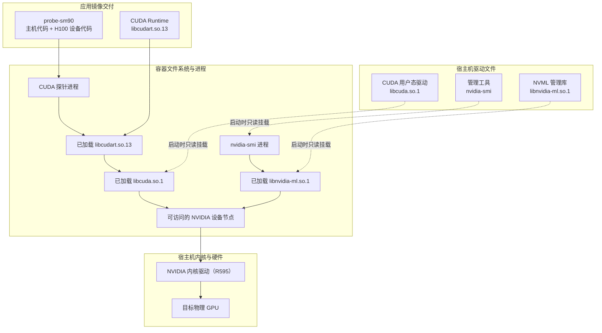

# 容器使用 GPU 的软件依赖与访问路径

容器和宿主机明明共用同一个 Linux 内核。为什么镜像里装好了 CUDA、PyTorch 或 vLLM，一进容器跑 `nvidia-smi`，还是报错找不到 GPU？

这个问题戳中了容器化 GPU 的本质。普通 Linux 容器不会在内部虚拟出 GPU，也不会重新加载驱动。它只是用隔离机制给进程换了一副“眼镜”和一道“门禁”。

## 两道隔离墙：看不到，也进不了门

宿主机上的应用能顺利调用 GPU，有两个前提。它能看到根目录下的驱动库与设备文件，且内核放行了它的设备访问。换成非特权容器后，进程立刻撞上两道墙：

1. **挂载命名空间（Mount Namespace）挡住了视线**：容器启动后切换到镜像自己的根文件系统。宿主机上的 GPU 设备节点（如 `/dev/nvidia*`）、用户态驱动库（`libcuda.so.1`、`libnvidia-ml.so.1`）和 `nvidia-smi` 默认都不在镜像里，进程根本“看不到”。
2. **cgroup 设备白名单挡住了门禁**：即使手动在容器里创建了同名设备文件，默认容器的 cgroup 设备规则只放行 `/dev/null` 等基础字符设备。应用一旦试图打开 GPU 字符设备，内核会直接拒绝访问。

> [!tip] 工程直觉：为什么不干脆把宿主机驱动打进镜像？
> 宿主机上的用户态驱动库（`libcuda.so.1`）必须与内核态驱动模块（R595 `595.91.07`）严格配套。如果把驱动硬塞进训练或推理镜像，集群里只要某批节点升级了驱动补丁，动辄十几 GB 的业务镜像就得全量重打。让镜像只带 CUDA Runtime 与算子库，由宿主机在启动时精准注入匹配的驱动库，才能让同一份镜像在集群中自由漂移。

把这道边界切清楚后，宿主机、启动配置与业务镜像三方的职责便一目了然：

| 参与层次 | 交付的核心内容 | 常见盲区提示 |
| --- | --- | --- |
| **应用镜像** | 可执行程序（如 `probe-sm90`、PyTorch、vLLM）、共享 CUDA Runtime（`libcudart.so.13`）及业务依赖库。 | 镜像带齐了 CUDA Runtime，仍缺少用户态驱动与设备入口，单独运行必然失败。 |
| **启动注入配置** | 目标 GPU 的设备节点、设备访问白名单，以及从宿主机只读挂入的匹配驱动库与工具。 | 配置文件里写进了挂载路径，还需验证动态链接器是否选中它、内核是否放行访问。 |
| **宿主机底座** | 物理 GPU、固件、运行中的 NVIDIA 内核驱动，以及供容器挂载的宿主机用户态驱动文件。 | 宿主机上 `nvidia-smi` 正常，仅说明底座健康，与容器是否获得授权无关。 |

本章只看单机节点 `node-10` 上的一段核心链路：选定目标 GPU 后，怎么把它和驱动文件递进容器。至于集群如何盘点库存并选出哪张卡，我们留到[第 11 章](../11_Kubernetes如何发现与分配GPU/00_内容大纲.md)展开。

## CUDA 计算与 NVML 查询是两条支路

进入容器视角后，[第 03 章](../03_从驱动到CUDA应用的软件依赖/00_内容大纲.md)的管理支路与计算支路会在挂载点彻底分家。



*图 10-01-01：容器内 CUDA 计算支路与 NVML 管理支路的组件分工与数据通路。*

业务进程调用 `cudaMalloc`、选卡和发射 Kernel 时，走的是计算支路。调用链依次经过应用、`libcudart.so.13`、`libcuda.so.1` 与设备节点。直接使用 Driver API 的程序则会跳过 Runtime，直连 `libcuda.so.1`。

运维最常用的 `nvidia-smi` 走的是另一条路。它加载 `libnvidia-ml.so.1`（NVML），与计算支路完全不共享同一个用户态库。

> [!warning] 常见误区：不要把 `nvidia-smi` 正常当成计算通过
> 只要挂入了工具、NVML 库和控制设备，`nvidia-smi` 就能打印出显卡型号和显存。但如果 `libcuda.so.1` 缺失、路径未命中，或者驱动版本与镜像设备代码不兼容，训练和推理进程依然会崩溃。反之，极简生产镜像完全可以不挂 `nvidia-smi`，只挂计算库照常跑满算力。

> [!note] 打包变体与前向兼容边界
> 镜像携带共享版 `libcudart.so.13`、宿主机挂入驱动库是最主流的分工，但并非唯一形态。应用也可静态链接 `libcudart`；跨大版本运行于较旧宿主机驱动时，还可按 CUDA 前向兼容策略在容器内放入 `cuda-compat` 包提供新版用户态驱动组件。排障时永远以**进程实际加载的 `.so` 路径**为准，且无论是否使用兼容包，宿主机都必须提供受支持的内核驱动与硬件。

## 一次健康交付要走到 `output=7`

设备入口、访问许可与驱动库全部就位后，运行探针 `probe-sm90` 的健康路径包含五个检查点：

1. **动态库装载**：动态链接器从镜像加载 `libcudart.so.13`，从启动挂载目录加载 `libcuda.so.1`。若直接依赖缺失，进程往往在进入 `main` 函数之前就已退出。
2. **设备打开与枚举**：驱动打开目标卡的单卡、控制与统一虚拟内存（UVM）等设备入口，`cudaGetDeviceCount` 返回 `cudaSuccess` 且可见数量为 `1`。
3. **选卡与建上下文**：`cudaSetDevice(0)` 成功，后续显存分配和计算提交均锚定在目标卡的上下文中。
4. **提交并等待完成**：驱动提取适用于 H100 的设备代码并发射 Kernel，紧接着 `cudaDeviceSynchronize()` 返回成功，确认设备端计算真正落袋。
5. **结果拷回校验**：主机读回显存中的整数并校验 `output=7`，整条交付链路才算画上句号。

对照下面这张观测表，可以清楚看出每个里程碑各自锁定了哪一层事实：

| 观察项 | 健康结果 | 实际锁定的层次 |
| --- | --- | --- |
| 独立运行 `nvidia-smi` | 列出目标卡的 UUID 与显存信息 | NVML 管理支路与设备控制查询畅通。 |
| `cudaGetDeviceCount` 与身份查询 | 返回 `cudaSuccess`、数量 `1`，序号 `0` 对应目标卡 BDF | CUDA 进程成功枚举目标卡，身份可回查宿主机。 |
| 选卡、显存分配与 Kernel 启动检查 | 均返回 `cudaSuccess` | 主机侧异步提交通过，尚未确认设备端计算完成。 |
| `cudaDeviceSynchronize()` 与拷回 | 同步成功，打印 `output=7` | 镜像产物、驱动库与目标 GPU 完成了端到端计算。 |

## 镜像有文件、挂进了容器、进程加载了，是三件事

排查容器内的动态库故障时，最怕把“宿主机上有”“挂载表里有”和“进程真的加载了”混为一谈。下面三条命令分别锁定这三个环节，使用时需对准同一次启动的目标容器进程：

```sh
# 1. 查看可执行文件声明的直接共享库依赖（DT_NEEDED）与内置搜索路径（DT_RUNPATH）
readelf -d /opt/probe/gpu-probe

# 2. 在宿主机核对目标进程挂载命名空间里的实际挂载来源（<pid> 为宿主机视角 PID）
cat /proc/<pid>/mountinfo | grep -E 'libcuda|nvidia'

# 3. 在同一容器环境中追踪动态链接器的搜索顺序与最终命中的库文件
LD_DEBUG=libs,files /opt/probe/gpu-probe
```

三条命令各有明确的证据边界：

| 取证材料 | 关注字段 | 需注意的盲区 |
| --- | --- | --- |
| `readelf -d` | `DT_NEEDED` 与 `DT_RUNPATH` | 程序运行时经由 `dlopen` 动态加载的库（例如 `libcuda.so.1`）通常不在直接依赖表里。 |
| `/proc/<pid>/mountinfo` | 宿主机源路径 → 容器目标路径 | 文件成功挂入容器，只说明磁盘视图里有候选文件；若符号链接断开或不在搜索路径中，依然加载失败。 |
| `LD_DEBUG=libs,files` | 每次查找路径、最终命中文件或失败报错 | 仅反映当前进程环境；改动 `LD_LIBRARY_PATH`、挂载或用户身份后需重新采集。 |

> [!summary] 核心结论
> GPU 进入容器，本质上是在保持宿主机内核共享的前提下，把**用户态驱动库**、**设备节点**与**访问许可**精准递交进容器边界。镜像负责应用与 Runtime，宿主机负责内核驱动与库来源，运行时配置负责把两者桥接起来。

理清应用需要什么后，下一篇打开底层配置文件。我们看看 OCI 规范怎样把挂载、设备节点与访问规则落到纸面上。

> [!info]- 参考资料
> - **CUDA 运行时与驱动接口**：[CUDA 13.2.1 Runtime 与 Driver API](https://docs.nvidia.com/cuda/archive/13.2.1/cuda-driver-api/driver-vs-runtime-api.html)、[CUDA 13.2.1 设备管理与同步](https://docs.nvidia.com/cuda/archive/13.2.1/cuda-runtime-api/group__CUDART__DEVICE.html)、[CUDA 13.2.1 错误处理](https://docs.nvidia.com/cuda/archive/13.2.1/cuda-runtime-api/group__CUDART__ERROR.html)
> - **驱动组件与前向兼容**：[NVIDIA Linux 驱动已安装组件](https://download.nvidia.com/XFree86/Linux-x86_64/580.65.06/README/installedcomponents.html)、[CUDA 前向兼容适用条件](https://docs.nvidia.com/deploy/cuda-compatibility/forward-compatibility.html)、[NVIDIA SMI 与 NVML 手册](https://docs.nvidia.com/deploy/nvidia-smi/index.html)
> - **Linux 动态链接与挂载取证**：[GNU readelf 文档](https://sourceware.org/binutils/docs/binutils/readelf.html)、[glibc 动态链接器手册（ld.so）](https://man7.org/linux/man-pages/man8/ld.so.8.html)、[Linux `/proc/<pid>/mountinfo` 说明](https://man7.org/linux/man-pages/man5/proc_pid_mountinfo.5.html)
