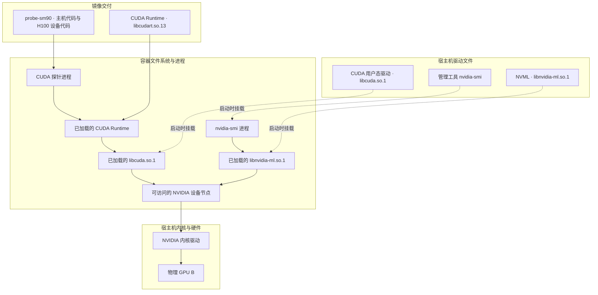

在 `node-10` 上，预编译探针 `probe-sm90` 能选中 H100 GPU B，让一个线程把整数 7 写入显存，再同步并拷回校验。要让同一个探针在容器里得到相同的 `output=7`，不能只把可执行文件复制进镜像：进程的文件视图和可访问设备都发生了变化。本章沿着这些变化，解释已经选定的 GPU 怎样真正交给容器应用。

## 容器隔离环境，不复制宿主机驱动

普通 Linux 容器与宿主机共享同一个内核。挂载命名空间让容器进程看到由镜像和挂载组成的文件树，其他命名空间与 cgroup 进一步隔离进程、资源和设备访问；它们不会在容器里再启动一套 NVIDIA 内核模块，也不会把物理 GPU 变成一台只供容器使用的虚拟计算机。

因此，宿主机与容器各有不能互相替代的职责：

| 位置 | 本例需要提供什么 | 不能由它单独证明什么 |
| --- | --- | --- |
| 应用镜像 | 预编译 `probe-sm90`、其共享 CUDA Runtime 和其他应用运行依赖。探针设备代码面向 H100。 | 镜像含 CUDA 库，不等于进程已经能打开 GPU，也不等于其中包含宿主机内核模块。 |
| 容器启动时的配置 | 目标 GPU 的设备入口与访问授权，以及从宿主机挂入的匹配用户态驱动文件。 | 配置中出现路径，不等于文件已解析、设备已打开或计算已完成。 |
| 宿主机 | GPU、固件、正在运行并管理该 GPU 的 NVIDIA 内核驱动，以及作为注入来源的用户态驱动文件。 | 宿主机管理查询成功，不等于某个容器获得了相同设备和库。 |

这里讨论的是 Linux x86_64 上的普通非特权容器和未切分 H100。主例节点 `node-10` 有 A、B 两张卡，上层已经选定 B。至于由谁根据资源库存选出 B，是第 11 章的问题；本章先回答“选定 B 以后还缺什么”。

## CUDA 计算与 NVML 查询是两条支路

第 03 章已经区分 CUDA Runtime、用户态驱动和内核驱动。放到容器边界中，这些组件的位置如下。



探针调用 `cudaMalloc`、选卡和提交 Kernel 时，经 CUDA Runtime 进入 `libcuda.so.1`。直接使用 Driver API 的应用可从 `libcuda` 进入。`nvidia-smi` 则经 NVML（NVIDIA Management Library，NVIDIA 管理库）查询设备。两条支路最终都访问宿主机驱动管理的设备，但进程加载的用户态库不同，所以管理查询成功不能代替计算验证。 [CUDA 13.2.1 Runtime 与 Driver API](https://docs.nvidia.com/cuda/archive/13.2.1/cuda-driver-api/driver-vs-runtime-api.html) · [NVIDIA SMI 与 NVML](https://docs.nvidia.com/deploy/nvidia-smi/index.html)

本例让镜像交付 `libcudart.so.13`，让启动配置从宿主机挂入 `libcuda.so.1`、NVML 和 `nvidia-smi`。这是常见分工，不是唯一打包方式：`libcudart` 也可静态链接进应用；支持前向兼容的特定部署还可由兼容包提供指定的 CUDA 用户态组件。判断时应以**进程实际加载的文件**为准，不能只看路径名称。兼容包不会改变宿主机仍需提供受支持内核驱动和硬件这一前提。 [NVIDIA Linux 驱动组件](https://download.nvidia.com/XFree86/Linux-x86_64/580.65.06/README/installedcomponents.html) · [CUDA 前向兼容的适用条件](https://docs.nvidia.com/deploy/cuda-compatibility/forward-compatibility.html)

## 一次成功交付要走到 `output=7`

先假设 B 的设备和完整驱动文件已经正确注入，库、权限、设备代码均兼容，进程也未额外过滤设备。最小健康路径可以拆成五个检查点。

1. **装载主机侧共享库。** 动态链接器从镜像找到 `libcudart.so.13`，从启动时挂载的位置找到 `libcuda.so.1`。直接依赖若无法解析，程序可能在进入 `main` 前退出。
2. **打开设备并枚举。** 探针经驱动访问 B 所需的单卡、控制和统一虚拟内存（UVM）等设备入口，`cudaGetDeviceCount` 成功并报告一张可见设备。进程内序号 0 对应 B。
3. **选卡并建立执行状态。** `cudaSetDevice(0)` 成功，后续显存分配和提交都落在 B 的上下文中。
4. **提交并完成设备工作。** Runtime 和驱动取得适用于 H100 的设备代码。Kernel 启动检查通过后，`cudaDeviceSynchronize()` 仍须成功，才能把异步提交与设备完成分开确认。
5. **拷回并校验结果。** 探针将显存中的整数读回主机，得到 `output=7`。这项结果才覆盖本例的完整计算目标。

以下是这组假设下的**教学基线**，不是实机采集：

| 观察 | 教学结果 | 能支持的结论 |
| --- | --- | --- |
| 独立 `nvidia-smi` 查询 | 列出 B 的 UUID（Universally Unique Identifier，通用唯一标识符） | 这次 NVML 管理通路成功。 |
| `cudaGetDeviceCount` 与身份查询 | 返回 `cudaSuccess`、数量 1；序号 0 的 PCI BDF（域、总线、设备、功能地址）为 `0000:81:00.0` | 该 CUDA 进程枚举到 B，身份可回查宿主机。 |
| 选卡、分配与 Kernel 启动检查 | 均返回 `cudaSuccess` | 已越过相应调用，尚不能单凭启动返回值认定设备执行完毕。 |
| `cudaDeviceSynchronize()` 与拷回 | 同步成功，`output=7` | 这份产物在当前进程和驱动环境中完成了预期计算。 |

若管理查询失败而计算成功，应先查管理工具、NVML 或其挂载，不能反推 GPU 不可计算；若管理查询成功而探针失败，则沿第一个失败的 CUDA 检查点回查。 [CUDA 13.2.1 设备管理与同步](https://docs.nvidia.com/cuda/archive/13.2.1/cuda-runtime-api/group__CUDART__DEVICE.html) · [CUDA 13.2.1 错误处理](https://docs.nvidia.com/cuda/archive/13.2.1/cuda-runtime-api/group__CUDART__ERROR.html)

## 镜像有文件、运行时挂入文件、进程加载文件不是一回事

要定位库问题，至少保留三类材料。下面的命令用于说明观察目的，执行时应确保看到的是同一个容器、同一次启动和同一个目标进程。

```sh
# 查看探针声明的直接共享库依赖和搜索路径；不要求目标机安装 nvcc
readelf -d /opt/probe/gpu-probe

# 在目标进程的挂载命名空间中核对文件来源；<pid> 是宿主机可见的进程 PID
cat /proc/<pid>/mountinfo

# 在同一容器启动环境记录动态链接器的搜索与装载过程
LD_DEBUG=libs,files /opt/probe/gpu-probe
```

| 材料 | 应读什么 | 证据边界 |
| --- | --- | --- |
| `readelf` 的 `DT_NEEDED`、`DT_RUNPATH` | 可执行与可链接格式（ELF）文件声明了哪些直接依赖及内置搜索路径。 | 启动后经 `dlopen` 加载的库不一定出现在直接依赖里。 |
| `/proc/<pid>/mountinfo` 与文件清单 | 哪个宿主机路径挂到了哪个容器路径，符号链接及目标是否存在。 | 文件已挂入，不等于加载器会选中它。 |
| `LD_DEBUG=libs,files` | 加载器依次搜索哪里，最终选择哪个对象，或在哪个库名处失败。 | 记录属于这次进程环境；更换 `LD_LIBRARY_PATH`、身份或挂载后需重取。 |

至此，容器内的需求已经能落到三种可检查对象：**进程要加载的库、要打开的设备、宿主机的驱动底座**。下一篇先解释运行时如何用 OCI 配置表达前两类对象，以及设备节点出现后为什么还要检查访问权限。 [GNU readelf](https://sourceware.org/binutils/docs/binutils/readelf.html) · [glibc 动态链接器](https://man7.org/linux/man-pages/man8/ld.so.8.html) · [Linux 进程挂载信息](https://man7.org/linux/man-pages/man5/proc_pid_mountinfo.5.html)
