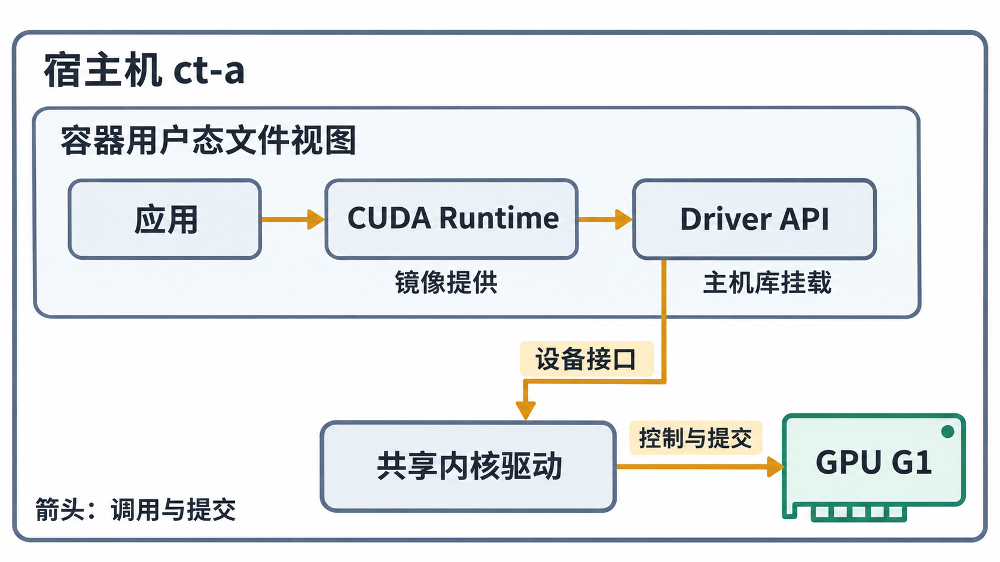

# 容器共享哪部分 GPU 软件栈

## 从一个进程的调用开始

容器里的 CUDA 程序仍是宿主机 Linux 内核管理的进程。镜像提供隔离的文件系统视图和应用依赖；namespace、cgroup 等约束其可见范围与访问行为。GPU 没有因为进入容器就复制出另一套物理设备，也没有为该容器单独启动一个 Linux 内核。

设 `gpu-probe` 做四个元素相加。它的主机代码调用 CUDA Runtime，Runtime 使用 Driver API，进程中的 `libcuda.so.1` 再通过设备接口与宿主机 NVIDIA 内核驱动协作。驱动管理上下文、内存和提交，GPU 执行设备代码。API 调用关系与数据搬运不是同一种箭头；本章讨论前者，不把每次调用都画成 CPU 逐字节搬运数据。

把运行位置写出来，最小关系是：

```text
容器的用户态文件视图
  gpu-probe → libcudart.so.12 → libcuda.so.1
                                    │ 设备接口调用
宿主机共享内核                      ↓
                         NVIDIA 内核驱动 → GPU G1
```

这里 `libcudart` 随应用交付，`libcuda` 的常规来源是宿主机配套用户态驱动，经运行时挂载后在容器内可见。挂载改变的是进程看到的文件视图，程序装载库后仍在自己的用户态执行；不能把图理解成每次 Driver API 都向宿主机另一个进程发 RPC。



图 10-01-01　应用与库均在容器进程的用户态执行；Runtime 随镜像交付，Driver API 库来自本例主机驱动挂载。箭头表示调用与提交，容器进程共享宿主机内核，不表示逐字节数据搬运。

本章采用普通驱动库注入，不使用 `cuda-compat` 替换用户态驱动库；兼容包有特定支持条件，不能用它解释所有容器中的 `libcuda`。宿主机只需具备本应用要求的驱动与接入组件，不因镜像运行 CUDA 程序就必须另装完整 CUDA Toolkit。这个分工见 [NVIDIA Container Toolkit v1.18.0 README](https://github.com/NVIDIA/nvidia-container-toolkit/blob/v1.18.0/README.md)。

## 镜像和宿主机分别交付什么

下面是**本章自拟的物料表**，其中路径是 Ubuntu x86_64 教学路径，不要求其他发行版一致。

| 来源 | 对象 | 在本例中的作用 |
| --- | --- | --- |
| 镜像 | `/opt/lesson/gpu-probe`、`sm_80` 设备代码 | 应用主机程序与 A100 可执行的 Kernel |
| 镜像 | `/usr/local/cuda/lib64/libcudart.so.12` | 动态链接的 CUDA Runtime；本例运行库版本 12.8.90 |
| 镜像 | glibc、动态装载器及应用其他依赖 | 使主机程序及所用库能够装载 |
| 宿主机并在创建时交付 | `libcuda.so.1`、`libnvidia-ml.so.1`、`nvidia-smi` 等 | Driver API 与管理查询，具体集合取决于注入路径和功能选择 |
| 宿主机共享内核 | `nvidia`、本路径需要的 `nvidia_uvm` 等模块 | 控制设备与相关内存机制，不是给容器复制一份 `.ko` |
| 宿主机设备接口，按需在容器内提供 | 选中卡的设备节点及公共控制节点 | 让进程实际进入对应驱动接口 |

镜像标签中的 CUDA 版本说明构建或运行依赖，不能直接当成内核驱动版本。两者有兼容要求，不要求数字完全相同。本例把驱动与 CUDA 版本固定到导读中的组合，避免在容器接入问题里额外混入兼容性变量。若更换镜像，仍须回到[第 03 章的软件兼容性判断](../03_从驱动到CUDA应用的软件依赖/03_从版本号与设备代码判断兼容性.md)。

开发镜像可以含 `nvcc` 和头文件，运行镜像可以只含应用与需要的库。`gpu-probe` 采用动态 Runtime 便于观察依赖；静态链接 Runtime 的其他程序不一定在 `ldd` 中出现 `libcudart`，却仍要调用驱动。由此也能推导：向镜像复制 `nvcc`，解决不了运行时没有交付 `/dev/nvidia1` 的问题。

## 设备文件存在，为什么仍会访问失败

Linux 的字符设备文件把路径关联到主、次设备号；驱动通过这组号码识别接口。目录里出现一个叫 `nvidia1` 的普通文件，不能产生 GPU。即使是真实字符设备，进程仍要同时满足几个条件：设备节点出现在容器文件视图中，设备访问规则允许相应操作，文件权限与 UID/GID 匹配，LSM 等安全策略允许访问，宿主机驱动本身处于可用状态。**LSM（Linux Security Modules）** 是内核安全机制框架，SELinux、AppArmor 等可在这一层施加访问约束；它与设备 cgroup、文件 mode 是分开的检查条件。

以下是 **ct-a 的自拟节点记录**，不是建议手动照抄的设备清单：

```text
路径               类型  主:次设备号  mode  作用
/dev/nvidia1       char     195:1     0666  本轮选中的 G1
/dev/nvidiactl     char     195:255   0666  公共控制接口
/dev/nvidia-uvm    char     511:0     0666  本轮 CUDA 路径需要的 UVM 接口
```

`511` 只是本轮采集值，UVM 的主设备号可以随系统变化，不能把它写死成所有机器的规则。不同平台、驱动和功能还可能需要其他节点；正确做法是由接入组件按实际状态生成，而不是根据本表宣称三个节点永远足够。`/dev/nvidiactl` 等公共接口也不等于把全部 GPU 都交给了容器；每卡访问还受实际交付的设备与规则约束。

文件 mode 的 `r/w` 与设备 cgroup 的允许规则是两层约束。cgroup v1 有设备控制器文件；cgroup v2 通过 cgroup BPF 程序实施设备访问控制，即在该 cgroup 上附加由内核执行的设备访问过滤程序。它没有对应的控制器接口文件，因此不能到 v2 路径里寻找 `devices.allow`，参见 [Linux 内核文档：cgroup v2 Device controller](https://docs.kernel.org/admin-guide/cgroup-v2.html#device-controller)。OCI 配置将设备节点与设备资源规则分别描述，低层运行时据此建立环境，参见 [OCI Runtime Spec 1.2.1：Devices 与 Linux Resources / Devices](https://github.com/opencontainers/runtime-spec/blob/v1.2.1/config-linux.md)。

因此，本例普通容器里 UID 0 也不能自动越过设备 cgroup 的拒绝。反过来，主机普通用户若有正确的访问条件，也不因 UID 非零就必然不能使用 GPU。rootless 容器还涉及用户映射、设备可用性和上层授权，本章不把它与 rootful 配置等同。

## 用两条应用路径定义“可用”

`nvidia-smi` 主要通过 NVML 管理接口查询。CUDA 计算经 Driver API 提交 Kernel。一次管理查询成功，能说明本次 NVML 查询路径成立；它没有执行 `gpu-probe` 的 Kernel，也没有检查该程序的 Runtime、设备代码和数值结果。

本章后续把验证分成三个观察点：**创建成功、管理查询成功、目标计算成功**。它们让排查逐步接近应用目标。目标计算成功要求分配内存、传入输入、启动 Kernel、检查提交错误、同步并检查完成错误、读回结果和核对数值；仅看到“Kernel 已提交”还停在异步执行的中途。

现在已经知道运行环境必须交付哪些条件。下一个问题是：谁在容器创建时把这些条件放进去？

[上一篇：导读](00_导读.md) · [下一篇：沿 containerd 追踪一次设备注入](02_沿containerd追踪一次设备注入.md)
