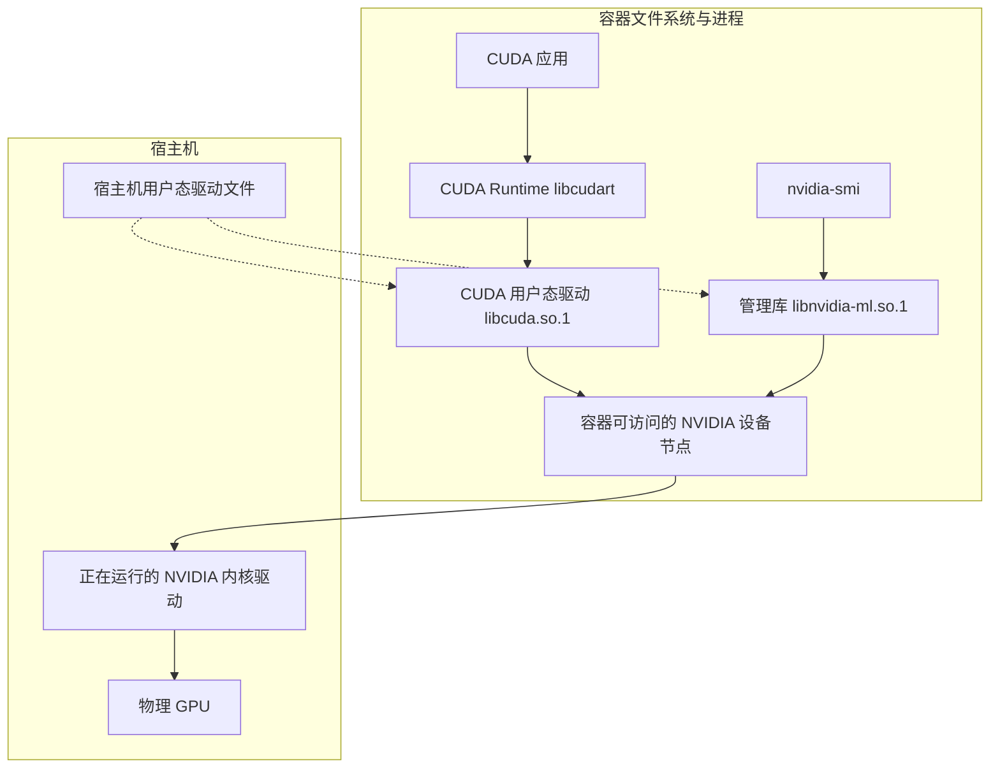

# 容器里的 CUDA 怎样调用宿主机驱动

一台 Linux GPU 节点能运行 `nvidia-smi`，同一节点上的 CUDA 镜像启动后却可能无法计算。宿主机的结果说明主机上的管理工具能够通过驱动查询设备。容器里的应用还需要在自己的文件系统中加载合适的库，并能打开宿主机驱动所管理的设备。本文以 Linux x86_64 上的 NVIDIA H100 为例，讨论共享宿主机内核的普通容器。 [NVIDIA Linux 驱动组件](https://download.nvidia.com/XFree86/Linux-x86_64/580.65.06/README/installedcomponents.html) · [NVIDIA SMI](https://docs.nvidia.com/deploy/nvidia-smi/index.html)

## 从应用跟到设备

以一个用 CUDA Runtime API 编译的应用为例。应用及其所需的 CUDA 库通常随镜像交付。`libcudart` 可以静态链接进应用，也可以作为共享库加载。运行时调用最终进入用户态 CUDA 驱动 `libcuda.so.1`，它通过设备文件与宿主机的 NVIDIA 内核驱动交互。直接使用 CUDA Driver API 的应用从 `libcuda.so.1` 这一层进入。无论镜像使用哪种方式链接 CUDA，处理设备请求的内核驱动都运行在宿主机上。 [CUDA Runtime API 与 Driver API](https://docs.nvidia.com/cuda/archive/13.2.1/cuda-driver-api/driver-vs-runtime-api.html) · [NVIDIA Linux 驱动组件](https://download.nvidia.com/XFree86/Linux-x86_64/580.65.06/README/installedcomponents.html)

`nvidia-smi` 走管理支路。它借助 NVML（Linux 上通常是 `libnvidia-ml.so.1`）查询 GPU 身份、驱动状态等信息。两条支路共用宿主机驱动和设备，但使用不同的用户态入口。管理库及工具能加载、查询能成功时，计算驱动库和 CUDA 应用的依赖仍要分别核对。 [NVIDIA SMI](https://docs.nvidia.com/deploy/nvidia-smi/index.html) · [NVML API](https://docs.nvidia.com/deploy/nvml-api/nvml-api-reference.html)



实线表示调用或访问关系，虚线表示常规注入场景中的驱动文件来源。容器启动时，设备注入机制可将宿主机的驱动文件挂入容器，并准备设备访问。它不改变镜像本身。在支持的系统上，CUDA 前向兼容包也可以提供指定版本的用户态 CUDA 驱动库。是否加载该库取决于进程的库搜索路径，兼容性还取决于 GPU、宿主机驱动分支和应用所需功能。 [NVIDIA Container Toolkit 架构](https://docs.nvidia.com/datacenter/cloud-native/container-toolkit/latest/arch-overview.html) · [CUDA 前向兼容](https://docs.nvidia.com/deploy/cuda-compatibility/forward-compatibility.html)

## 分开检查镜像、挂载和实际加载

以镜像中的 `/opt/probe/gpu-probe` 为预编译探针。交付清单应说明它静态链接还是动态链接 `libcudart`，以及镜像中还有哪些运行依赖。在有 GNU `readelf`、glibc 和对应权限的容器中，可用下面三种观测区分文件从哪里来、程序实际用了哪个文件。 [GNU readelf](https://sourceware.org/binutils/docs/binutils/readelf.html) · [Linux 动态链接器](https://man7.org/linux/man-pages/man8/ld.so.8.html) · [Linux 进程挂载信息](https://man7.org/linux/man-pages/man5/proc_pid_mountinfo.5.html)

```sh
readelf -d /opt/probe/gpu-probe
cat /proc/self/mountinfo
LD_DEBUG=libs,files /opt/probe/gpu-probe
```

| 观测 | 能回答的问题 |
| --- | --- |
| 镜像清单、`DT_NEEDED`、`DT_RUNPATH` | 镜像带了什么，ELF 声明了哪些共享库和搜索路径。运行时按需加载的库可能不在 `DT_NEEDED` 中。 |
| 容器的挂载信息和库文件位置 | 运行时在哪些容器路径放入了文件。挂载到位后，还要核对解析结果。 |
| 同一程序的 `LD_DEBUG` 记录 | 搜索过哪些目录，最后加载了哪个文件，或在哪个库名处失败。 |

对同一镜像，按顺序记录三项能力。`nvidia-smi` 能列出目标 UUID，说明该次管理查询成功。`cudaGetDeviceCount` 和设备身份查询成功，说明该进程能枚举目标设备。最后选卡、提交一个最小 Kernel、检查提交与同步结果，必要时读回一个预期值，才能验证这个程序确实完成了计算。枚举或选卡已经报错时，记录具体调用和返回值，沿该处回查库与设备。 [CUDA 13.2.1 设备管理](https://docs.nvidia.com/cuda/archive/13.2.1/cuda-runtime-api/group__CUDART__DEVICE.html) · [CUDA 13.2.1 错误处理](https://docs.nvidia.com/cuda/archive/13.2.1/cuda-runtime-api/group__CUDART__ERROR.html)
