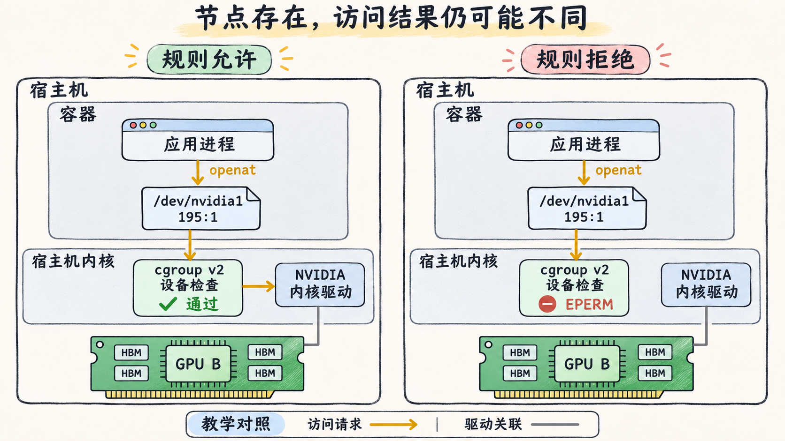
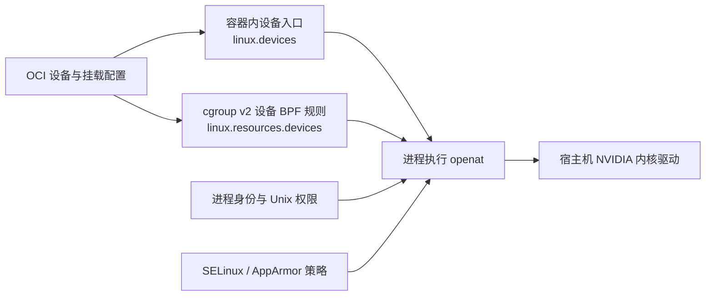

# OCI 设备节点与 GPU 访问权限

上一篇明确了容器跑通 GPU 的三要素：驱动库、设备节点和访问许可。可容器运行时并不懂硬件，它只认一份结构化配置。配置里写清挂什么文件、建什么节点、放行什么权限，底层才会照办。

这份统一契约就是 **OCI（Open Container Initiative，开放容器规范）** 运行时规范。高层运行时（如 `containerd`）负责组装 `config.json`。底层运行时（如 `runc`）则严格照单创建命名空间、挂载、设备节点与 cgroup 规则。

## OCI 配置里的三块核心拼图

下面以交付 `node-10` 上的目标卡为例。这张卡（GPU B）对应宿主机 `/dev/nvidia1`，主次设备号为 `195:1`。下文摘出 `config.json` 最关键的三段配置，省略控制、UVM 节点与基础命名空间字段：

```json
{
  "mounts": [
    {
      "destination": "/usr/lib/x86_64-linux-gnu/libcuda.so.1",
      "type": "bind",
      "source": "/usr/lib/x86_64-linux-gnu/libcuda.so.1",
      "options": ["bind", "ro"]
    }
  ],
  "linux": {
    "devices": [
      { "path": "/dev/nvidia1", "type": "c", "major": 195, "minor": 1 }
    ],
    "resources": {
      "devices": [
        { "allow": true, "type": "c", "major": 195, "minor": 1, "access": "rw" }
      ]
    }
  }
}
```

这三段字段分别回答三个互不替代的问题：

- **`mounts[]`（把库挂进来）**：通过只读 bind 挂载把宿主机的 `libcuda.so.1` 引入容器文件视图。完整交付还会按用途挂入 NVML、`nvidia-smi` 及其他配套驱动库。
- **`linux.devices[]`（把入口建出来）**：指示 `runc` 在容器内创建字符设备节点（`type: "c"`）。内核真正识别驱动设备靠的是**主、次设备号**（`195:1`），而不是文件名里的数字 `1`。
- **`linux.resources.devices[]`（把门禁打开）**：按列表顺序配置设备访问控制规则。上例追加了一条针对字符设备 `195:1` 的读写（`rw`）放行规则；权限字符中的 `m` 代表 `mknod`（创建设备节点权限），与普通读写无关。

> [!warning] 常见误区：访问放行不是独占分配
> `linux.resources.devices` 只是一道内核门禁，它既不负责挑选 GPU，也不记录 Kubernetes 配额，更不会阻止两个同时拿到 `195:1` 放行规则的容器争抢同一张物理卡。设备独占分配与共享隔离属于上层调度与切分机制的职责。

## `/dev/nvidiaN` 只是设备入口的一部分

让容器里的应用跑通一次真实 CUDA 计算，只放进一张卡的单卡节点往往还不够。常见 NVIDIA 整卡交付通常涉及三类设备入口：

- **单卡设备节点（`/dev/nvidiaN`）**：对应具体某一张物理 GPU，由主、次设备号精确绑定内核对象。
- **控制设备节点（`/dev/nvidiactl`）**：承担驱动控制通道与全局状态查询职责。
- **统一虚拟内存节点（`/dev/nvidia-uvm` 等）**：支撑 CUDA 统一虚拟内存（UVM）及相关驱动能力。

具体设备清单会随驱动版本、硬件形态变化。排障时不要套死清单，直接查看容器内的设备属性即可：

```sh
# 查看设备文件类型（c 为字符设备）、属主属组与十进制主次设备号
ls -l /dev/nvidia1
# 示例输出：crw-rw-rw- 1 root root 195, 1 Nov 20 10:00 /dev/nvidia1

# 精确读取文件类型、十六进制主次设备号（%t:%T）及权限属主
stat -c 'type=%F major_minor=%t:%T mode=%a uid=%u gid=%g' /dev/nvidia1
# 示例输出：type=character special file major_minor=c3:1 mode=666 uid=0 gid=0
```

注意一个小细节。GNU `stat` 的 `%t:%T` 用**十六进制**输出主次设备号。十进制 `195:1` 会显示为 `c3:1`（$12 \times 16 + 3 = 195$）。哪怕两容器里都叫 `/dev/nvidia1`，只要设备号不同，它们指向的就不是同一个内核设备。

## 打开设备节点时的四道内核关卡

进程调用 `openat` 打开 `/dev/nvidia1` 时，内核会同时核对四类条件。任意一关不过，系统调用都会直接报错：

| 内核关卡               | 核对内容                                          | 最有区分力的排查材料                                      |
| ------------------ | --------------------------------------------- | ----------------------------------------------- |
| **1. 路径与设备入口**     | 容器挂载视图中是否存在该路径，主次设备号是否匹配目标卡；控制或 UVM 节点是否缺失。   | 失败调用的完整路径、`ENOENT` 返回码、`stat` 输出及挂载信息。          |
| **2. cgroup 设备控制** | 进程所属 cgroup 挂载的 BPF 设备程序是否放行该设备号及 `r/w/m` 操作。 | `/proc/<pid>/cgroup`、运行时生成的有效设备规则及 `openat` 报错。 |
| **3. Unix 文件权限**   | 进程的 UID、GID、补充组与设备节点的 mode、属主属组是否允许 `O_RDWR`。 | `/proc/<pid>/status` 与 `stat` 权限属性，必要时做同身份访问对照。 |
| **4. LSM 安全策略**    | SELinux、AppArmor 等 Linux 安全模块是否拦截了此次打开操作。     | 与失败时间吻合的内核审计（audit）或拒绝日志。                       |

最让初学者困惑的，往往是第二关。明明 `/dev/nvidia1` 就在眼前，权限也是 `666`，为什么打开还会失败？下图直观展示了改变 cgroup v2 设备规则时的对照结果：



*图 10-02-01：同一宿主机上两个容器访问 `/dev/nvidia1`（`195:1`）的对照。两侧均已创建设备节点，且 Unix 权限与安全策略全部放行；左侧通过 cgroup v2 设备检查进入 NVIDIA 内核驱动，右侧则在设备检查处收到 `EPERM`。*

> [!note] cgroup v2 设备控制的底层变化
> 在 Linux 6.8+ 的 cgroup v2 环境中，设备黑白名单改由附加到 cgroup 上的 **BPF（Berkeley Packet Filter）程序**执行，拒绝时返回 `EPERM`。
>
> 与旧版 cgroup v1 不同，cgroup v2 不再提供可直接 `cat` 查看规则的 `devices.list` 文件。哪怕使用 rootful `containerd` 运行容器，非特权进程依然受这套 BPF 严格约束。

把配置输入到内核打开的整条控制关系串起来，可以得到下面这张检查流图：



*图 10-02-02：从 OCI 配置展开到 `openat` 穿过四重内核检查抵达驱动的依赖关系。*

## 从失败返回码反推卡在了哪一层

实际排障时，先抓住失败系统调用的完整路径与返回码（errno），就能迅速把排查范围砍掉大半：

- **返回 `ENOENT`**：文件入口缺失。立刻核对报错的完整路径——容器里有 `/dev/nvidia1`，可能缺的是 `/dev/nvidiactl` 或 `/dev/nvidia-uvm`。
- **返回 `EPERM` 或 `EACCES`**：节点已存在，但被权限或策略拦截。cgroup v2 设备 BPF 拒绝返回 `EPERM`，Unix 权限或 LSM 拒绝常返回 `EACCES` 或 `EPERM`。仅凭返回码本身无法在 cgroup、Unix 权限与 SELinux/AppArmor 之间一锤定音，必须结合有效设备规则、进程身份与审计日志联合定位，切忌粗暴执行 `chmod 777` 掩盖问题。
- **`openat` 成功**：这只闯过了“打开设备”这一关。后续的驱动初始化、CUDA 枚举、建上下文和 Kernel 同步仍各自独立，下一步直接紧盯首个报错的 CUDA API 即可。

> [!summary] 核心结论
> 在 OCI 视角下，把一张 GPU 交给容器至少包含三份配置输入：**只读挂库（`mounts`）**、**建字符设备节点（`linux.devices`）**、**放行设备号规则（`linux.resources.devices`）**。看见设备文件只是第一步，通过 cgroup v2 BPF、Unix 权限与 LSM 检查后，进程才真正碰到了内核驱动。

底层的 OCI 配置既繁琐又易错。设备节点有单卡、控制与 UVM 多类，驱动 `.so` 还紧跟版本变动，总不能每次启 Pod 都手写 JSON。

下一篇我们引入 **CDI**。看看 `containerd` 如何凭一句标准设备全名，自动拼出全部 OCI 修改。

> [!info]- 参考资料
> - **OCI 运行时规范**：[OCI Runtime Spec 1.2.1 主配置](https://github.com/opencontainers/runtime-spec/blob/v1.2.1/config.md)、[OCI Linux 配置总览](https://github.com/opencontainers/runtime-spec/blob/v1.2.1/config-linux.md)、[OCI `linux.devices` 字段](https://github.com/opencontainers/runtime-spec/blob/v1.2.1/config-linux.md#devices)、[OCI 允许设备列表规则](https://github.com/opencontainers/runtime-spec/blob/v1.2.1/config-linux.md#allowed-device-list)
> - **NVIDIA 设备节点与排障**：[NVIDIA SMI 次设备号说明](https://docs.nvidia.com/deploy/nvidia-smi/index.html#minor-number)、[NVIDIA Linux 驱动已安装组件](https://download.nvidia.com/XFree86/Linux-x86_64/580.65.06/README/installedcomponents.html)、[NVIDIA Container Toolkit 1.18.2 设备发现实现](https://github.com/NVIDIA/nvidia-container-toolkit/blob/v1.18.2/pkg/nvcdi/common-nvml.go)、[Toolkit 1.18.2 SELinux 权限故障指南](https://docs.nvidia.com/datacenter/cloud-native/container-toolkit/1.18.2/troubleshooting.html#permission-denied-error-when-running-the-nvidia-docker-wrapper-under-selinux)
> - **Linux cgroup v2 与系统调用手册**：[Linux 6.18 cgroup v2 设备控制器](https://docs.kernel.org/6.18/admin-guide/cgroup-v2.html#device-controller)、[GNU stat 手册](https://man7.org/linux/man-pages/man1/stat.1.html)、[Linux `open(2)` 错误码手册](https://man7.org/linux/man-pages/man2/open.2.html)、[Linux `/proc/<pid>/status` 进程身份手册](https://man7.org/linux/man-pages/man5/proc_pid_status.5.html)
