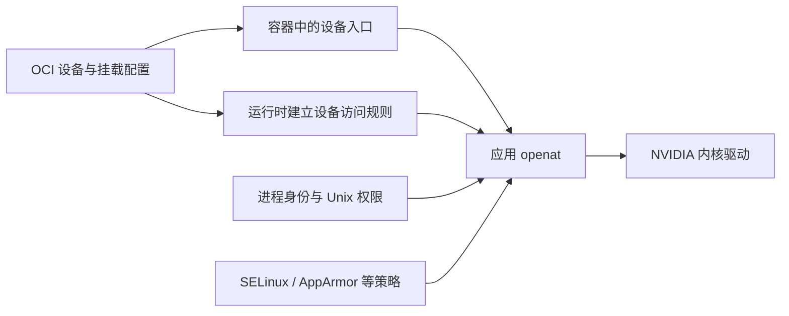
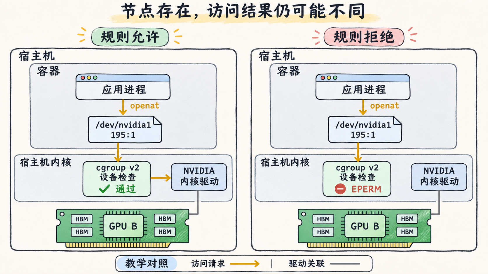

容器应用需要设备入口和驱动库，运行时需要的却是一份明确配置：在容器里的哪个路径创建什么设备节点，允许哪些设备操作，把哪个宿主机文件挂到哪个容器路径。OCI（Open Container Initiative，开放容器倡议）运行时规范定义了这些字段。containerd 等高层运行时组装配置，runc 等低层运行时据此创建容器环境；应用随后才在自己的命名空间里访问这些对象。 [OCI Runtime Spec 1.2.1](https://github.com/opencontainers/runtime-spec/blob/v1.2.1/config.md) · [OCI Linux 配置](https://github.com/opencontainers/runtime-spec/blob/v1.2.1/config-linux.md)

## OCI 配置分别描述挂载、设备节点和访问规则

仍以 B 为例。假设它的宿主机设备节点是 `/dev/nvidia1`，对应字符设备的十进制主、次设备号为 `195:1`。下面是**教学用 OCI 摘录**，只保留本篇要解释的对象；控制与 UVM 节点、NVML 和其他库、基础设备规则、进程字段及命名空间均省略，不能把它当成一份可直接运行的完整 `config.json`。

```json
{
  "mounts": [
    {
      "destination": "/usr/lib/x86_64-linux-gnu/libcuda.so.1",
      "type": "bind",
      "source": "/usr/lib/x86_64-linux-gnu/libcuda.so.1",
      "options": ["bind", "ro"]
    }
  ],
  "linux": {
    "devices": [
      {"path": "/dev/nvidia1", "type": "c", "major": 195, "minor": 1}
    ],
    "resources": {
      "devices": [
        {"allow": true, "type": "c", "major": 195, "minor": 1, "access": "rw"}
      ]
    }
  }
}
```

三段配置回答三个不同问题：

- `mounts[]` 把宿主机文件引入容器的挂载视图。这里的只读 bind 挂载提供计算支路的 `libcuda.so.1`；完整健康配置还需按实际用途提供相关驱动文件。
- `linux.devices[]` 请求在容器中建立字符设备入口。`type: c` 表示字符设备，主、次设备号让该入口关联到相应内核设备，而不是仅凭文件名中的 `nvidia1` 识别 GPU。
- `linux.resources.devices[]` 描述有顺序的设备访问控制规则。本项追加一条对字符设备 `195:1` 读、写的允许规则；`r/w/m` 中的 `m` 是创建设备节点的权限。它不是 Unix 文件模式，也不表示独占分配。最终是否允许仍要结合完整规则顺序和运行时生成的有效策略判断。

因此，“设备节点出现”和“进程获准打开设备”必须分别核对。设备规则也不负责选择 GPU、记录 Kubernetes 配额或防止两个获准访问同设备号的容器相互干扰；这些属于资源分配与共享隔离问题。 [OCI 设备节点](https://github.com/opencontainers/runtime-spec/blob/v1.2.1/config-linux.md#devices) · [OCI 设备访问规则](https://github.com/opencontainers/runtime-spec/blob/v1.2.1/config-linux.md#allowed-device-list)

## `/dev/nvidiaN` 只是其中一类设备入口

Linux 设备节点是进程访问内核设备的文件入口。字符设备由设备类型和主、次设备号标识。普通 NVIDIA 整卡通常有 `/dev/nvidiaN` 单卡节点；实际计算还可能涉及 `/dev/nvidiactl` 控制节点和 `/dev/nvidia-uvm`，后者服务于 NVIDIA 的统一虚拟内存（Unified Virtual Memory，UVM）支持。具体清单随用途、驱动和平台变化，应读取本次注入结果和失败路径，不能用一个固定文件名清单替代。 [NVIDIA SMI 次设备号](https://docs.nvidia.com/deploy/nvidia-smi/index.html#minor-number) · [NVIDIA Linux 驱动组件](https://download.nvidia.com/XFree86/Linux-x86_64/580.65.06/README/installedcomponents.html) · [Toolkit 1.18.2 设备发现](https://github.com/NVIDIA/nvidia-container-toolkit/blob/v1.18.2/pkg/nvcdi/common-nvml.go)

本例的 `195:1` 是教学输入，不应硬编码到通用排障脚本。容器中可用 `ls -l` 或 `stat` 读取实际节点：

```sh
ls -l /dev/nvidia1
stat -c 'type=%F major_minor=%t:%T mode=%a uid=%u gid=%g' /dev/nvidia1
```

GNU `stat` 的 `%t:%T` 以十六进制显示主、次设备号，所以十进制 `195:1` 显示为 `c3:1`。同时记录文件类型、模式、属主和属组。设备路径相同而设备号不同，意味着不能把两次观测直接视为同一个内核入口。 [GNU stat](https://man7.org/linux/man-pages/man1/stat.1.html)

## 打开节点时要分别核对四类条件

先走通健康条件：示例挂载在目标进程的文件视图中存在，`/dev/nvidia1` 是设备号为 `195:1` 的字符节点，有效设备规则允许读写，进程身份、Unix 文件权限和安全策略也允许这次 `O_RDWR` 打开，于是 `openat` 返回有效文件描述符。随后任何一个独立条件改变，都可能在同一台宿主机上得到不同结果。

进程执行 `openat(AT_FDCWD, "/dev/nvidia1", O_RDWR)` 时，内核结合路径、进程身份、设备访问规则和安全策略作出判断。这些检查不是一张可以脱离实现和版本机械套用固定顺序的清单；排障时应从实际失败操作和对应证据归因。

| 条件 | 本例要核对的内容 | 有区分力的材料 |
| --- | --- | --- |
| 路径与设备入口 | 容器挂载命名空间中是否存在目标路径，类型和设备号是否为 `c 195:1`；控制或 UVM 节点是否另行缺失。 | 失败调用的完整路径、`ENOENT`、`stat` 和同一容器的挂载信息。 |
| cgroup 设备控制 | 失败进程所属 cgroup 的有效 BPF 设备程序是否允许该类型、设备号与操作。 | `/proc/<pid>/cgroup`、运行时生成的有效规则及失败的 `openat`。 |
| Unix 文件权限 | 进程 UID、GID、补充组、能力与节点模式、属主和属组是否允许请求的读写操作。 | `/proc/<pid>/status` 与节点属性，必要时做同身份访问对照。 |
| Linux 安全模块（LSM）等安全策略 | SELinux、AppArmor 等是否拒绝该进程对设备或相关操作。 | 与失败同时发生的审计或拒绝记录；不能只凭策略已启用就归因。 |

cgroup v2 的设备控制由附加到 cgroup 的 BPF（Berkeley Packet Filter）程序实现，可按设备类型、主次设备号和 `r/w/m` 操作判定，并以 `EPERM` 拒绝。它没有 cgroup v1 那种可直接读取规则的 `devices.list` 文件。因此，只看一份 OCI 输入不能证明进程当前生效的内核规则；rootful containerd 也不意味着容器进程能绕过设备 BPF。 [Linux 6.18 cgroup v2 设备控制](https://docs.kernel.org/6.18/admin-guide/cgroup-v2.html#device-controller) · [Linux 进程身份与 cgroup](https://man7.org/linux/man-pages/man5/proc_pid_status.5.html)

SELinux、AppArmor 与 Unix 权限是另外的约束来源。即使本次看到 `EACCES`，也应先保存路径、访问模式、进程身份和审计记录，再把拒绝与某条规则对应，而不是直接修改节点为全员可写。 [Linux open 错误码](https://man7.org/linux/man-pages/man2/open.2.html) · [Toolkit 1.18.2 SELinux 故障示例](https://docs.nvidia.com/datacenter/cloud-native/container-toolkit/1.18.2/troubleshooting.html#permission-denied-error-when-running-the-nvidia-docker-wrapper-under-selinux)

## 从失败返回值反推已经走到哪里



- 返回 `ENOENT`，先查被打开的完整路径及对应设备是否进入本次配置。`/dev/nvidia1` 存在并不能证明 `/dev/nvidia-uvm` 也存在。
- 节点存在而返回 `EPERM` 或 `EACCES`，说明这次打开在权限或策略层失败。`EPERM` 可来自设备 BPF，但仅凭 errno 无法在 cgroup、Unix 权限和 LSM 之间作唯一归因。
- `openat` 成功只证明这一次打开通过。后续驱动初始化、CUDA 枚举、上下文或 Kernel 仍可能失败，应保留下一个具体 API 及返回值。



*图 10-02-01　同一宿主机的两种教学情形。两侧都能看到 `/dev/nvidia1`（十进制 `195:1`），且 Unix 文件权限与其他安全策略都允许访问，只改变 cgroup v2 设备规则。左侧允许读写打开，右侧在设备检查处拒绝。图中把内核检查简化为一个观察点，并省略控制/UVM 节点、库挂载和后续 CUDA 调用；一次打开成功还不等于计算完成，现场仍需用有效规则与审计记录确认拒绝来源。*

现在已经知道一份有效的容器配置需要写出哪些对象。下一篇引入 CDI，解释上层只给出“B 的设备全名”时，containerd 怎样找到对应描述并生成这些 OCI 修改。
