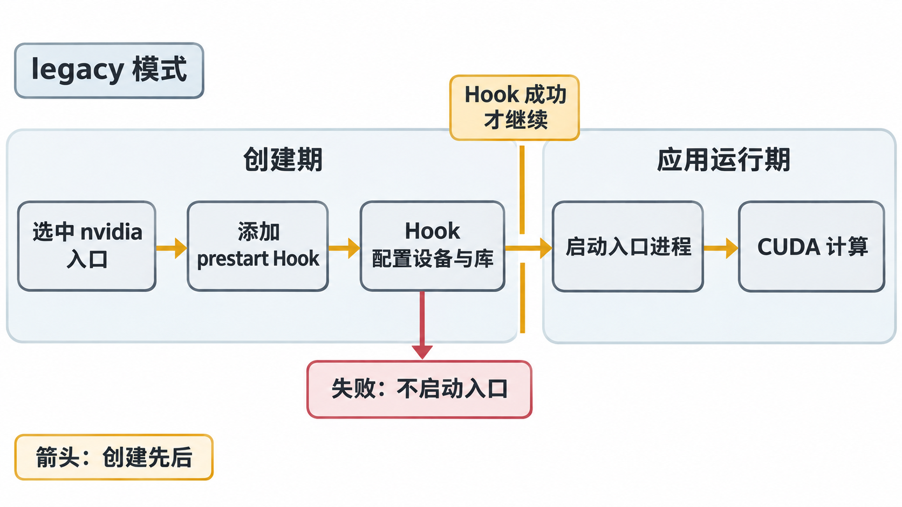

# 沿 containerd 追踪一次设备注入

## 创建配置是连接镜像与设备的地方

镜像层没有记录“在 ct-a 上使用 UUID U1”。这个选择发生在创建具体容器时。高层容器管理组件组织 rootfs 和启动配置，低层 OCI Runtime 按配置建立 namespace、挂载、设备与进程。**OCI Runtime Specification** 规定容器运行配置的结构；其中的 `config.json` 是一次容器实例的运行描述，与镜像 Dockerfile、containerd 服务配置都是不同对象。

在 Kubernetes 使用 containerd 的路径中，kubelet 通过 **CRI（Container Runtime Interface）** 请求创建容器；containerd 的 CRI 插件将请求转成执行所需配置，shim 衔接低层运行时与容器进程生命周期。本章把 shim 的内部细节聚合为启动衔接层。`runc` 是常见的 OCI Runtime；它执行创建流程，不负责根据节点空闲卡数决定把哪张 GPU 分给这个 Pod。

一个可用于推演的职责顺序是：

```text
已经选定 U1 的创建请求
  → containerd CRI：接收设备选择与运行时 handler
  → 生成本次 OCI 配置，并经 shim 调用选定的运行时入口
  → NVIDIA 接入逻辑：补齐 GPU 运行条件
  → runc：按最终配置创建、启动进程
  → 应用：装载库并访问 GPU
```

这是**创建控制流程**，不是 GPU 数据传输链。NVIDIA 接入逻辑究竟发生在修改 OCI 配置时，还是 Hook 阶段，要按模式继续展开。

## Toolkit 包含哪些承担不同任务的组件

**NVIDIA Container Toolkit** 是容器接入工具集合，与 CUDA Toolkit 是两个产品。前者帮助创建 GPU 容器；后者提供 CUDA 开发与运行相关工具库。

| 组件 | 本章需要理解的输入与动作 |
| --- | --- |
| `nvidia-ctk` | 配置运行时入口、生成或列出 CDI 设备描述；是工具命令，不是 CUDA 编译器 |
| `nvidia-container-runtime` | 包装低层运行时，按模式修改创建行为，再调用 `runc` 等运行时 |
| `nvidia-container-runtime-hook` | legacy 路径的 OCI `prestart` Hook，读取配置并调用注入工具 |
| `nvidia-container-cli` 与 `libnvidia-container` | 结合驱动、设备和容器状态，为 legacy 路径配置设备访问及驱动文件等 |

包名和可执行文件名并非一一对应。1.18.0 的 `nvidia-container-toolkit-base` 含 Runtime 与 `nvidia-ctk`；完整 Toolkit 包还带 Hook 及相关依赖。专用 CDI 环境与 legacy 环境需要的组件组合可以不同，不能因为某机器没有 legacy Hook 就断言 GPU 容器都不能运行。组件与包分工见 [Container Toolkit 1.18.0：Architecture Overview](https://docs.nvidia.com/datacenter/cloud-native/container-toolkit/1.18.0/arch-overview.html)。

## 固定 legacy 模式，逐步观察一次创建

先只看 **NVIDIA Runtime 的 legacy 模式**。它便于解释旧资料中常见的环境变量与 Hook。1.18.0 配置默认值是 `auto`，但在本章这种 NVML 平台、未请求完整 CDI 名称的条件下，自动选择已转向即时生成描述的 `jit-cdi`，legacy 在该版本已被弃用但仍受支持。本篇为了观察 Hook 显式设定 `legacy`，不能把它当成 1.18.0 默认路径。配置值与版本变化分别见 [v1.18.0 config.go 的 GetDefault](https://github.com/NVIDIA/nvidia-container-toolkit/blob/v1.18.0/internal/config/config.go) 和 [1.18.0 Release Notes](https://docs.nvidia.com/datacenter/cloud-native/container-toolkit/1.18.0/release-notes.html#nvidia-container-toolkit-1-18-0)。

本轮请求仅交付 U1，功能选择为 `compute,utility`。下面是**自拟过程表**，状态是为了教学归纳的事件，不是厂商原始日志格式：

| 时刻 | 执行者 | 输入与产生的状态 |
| --- | --- | --- |
| t0 | containerd CRI | 已选运行时 handler `nvidia`，本轮设备选择 U1 写入创建环境 |
| t1 | NVIDIA Runtime 包装器 | 读取 OCI 配置，legacy 模式下添加 NVIDIA `prestart` Hook，然后调用低层运行时 |
| t2 | `runc` | 到达 `prestart` 阶段，调用 Hook；应用入口尚未执行 |
| t3 | Hook → CLI/library | 解析 U1 与所需功能，按当前驱动状态配置设备、驱动文件与访问条件 |
| t4 | `runc` | Hook 成功后继续启动入口进程 |
| t5 | `gpu-probe` | 装载 Runtime 与 Driver API，枚举并计算 |

Hook 的执行进程及其权限处于创建流程中，表中的动作不意味着让应用自行 `mknod` 或加载内核模块。Hook 失败可以使容器在入口进程运行前终止；此时排查应用 Kernel 是跳过了失败阶段。



图 10-02-01　在本轮显式选择的 legacy 模式中，NVIDIA prestart Hook 属于应用入口启动前的创建流程。图中聚合了 containerd、shim 与低层运行时的衔接细节；箭头只表示阶段先后。

## 两份配置各自控制哪一段

以下为 **containerd 1.7.27、config version 2 的教学片段**，假设 CRI 已启用，省略了其他服务配置；它表示有效配置应包含的关系，不冒充 `nvidia-ctk` 某次生成文件的逐字输出。

```toml
version = 2
[plugins."io.containerd.grpc.v1.cri".containerd]
  default_runtime_name = "runc"

[plugins."io.containerd.grpc.v1.cri".containerd.runtimes.runc]
  runtime_type = "io.containerd.runc.v2"
  [plugins."io.containerd.grpc.v1.cri".containerd.runtimes.runc.options]
    SystemdCgroup = true

[plugins."io.containerd.grpc.v1.cri".containerd.runtimes.nvidia]
  runtime_type = "io.containerd.runc.v2"
  [plugins."io.containerd.grpc.v1.cri".containerd.runtimes.nvidia.options]
    BinaryName = "/usr/bin/nvidia-container-runtime"
    SystemdCgroup = true
```

这里 `nvidia` 是 CRI 可选择的 handler 名，`BinaryName` 指向 NVIDIA 包装器。`runtime_type` 中的 `runc.v2` 表示 containerd 的 shim 接口类型，并不宣称已绕过包装器；`SystemdCgroup` 则要求相关层的 cgroup 管理方式配套，不能单凭此项声称 GPU 注入成功。字段与 CRI 作用域参见 [containerd v1.7.27 CRI config guide](https://github.com/containerd/containerd/blob/v1.7.27/docs/cri/config.md)。

另一份是 **NVIDIA Runtime 的教学片段**：

```toml
# /etc/nvidia-container-runtime/config.toml，仅摘出本轮有关字段
[nvidia-container-runtime]
  mode = "legacy"
  runtimes = ["runc"]
```

前一份回答“containerd 选择哪个入口”，后一份回答“选中 NVIDIA 入口后使用哪种模式”。安装二进制、修改文件、服务重启并加载配置、请求实际选中该 handler，是连续的不同状态。`nvidia-ctk runtime configure --runtime=containerd` 用于建立相关配置，工具可能维护被 imports 引用的片段；判断应查看实际启动参数、主配置、导入关系与有效配置，不靠文件名猜测生效。工具入口可查 [1.18.0 安装文档：Configuring containerd](https://docs.nvidia.com/datacenter/cloud-native/container-toolkit/1.18.0/install-guide.html#configuring-containerd-for-kubernetes)。

Kubernetes 中可以用 RuntimeClass 选择 handler。以下是**两个相互关联的片段**，Pod 只摘出入口选择字段，尚未表达 GPU 请求：

```yaml
apiVersion: node.k8s.io/v1
kind: RuntimeClass
metadata:
  name: gpu-legacy
handler: nvidia
---
# Pod spec 片段，不是完整 Pod
spec:
  runtimeClassName: gpu-legacy
```

由此只能推出该 Pod 请求名为 `nvidia` 的运行时 handler；它本身没有申请一张 GPU，没有决定 U1，也没有保留空闲资源。如果整个节点默认入口已经是 NVIDIA Runtime，另行指定 RuntimeClass 未必必要。第 11 章补上资源请求到具体设备选择之间的流程。

## 环境变量怎样参与 legacy 路径

本轮创建环境为：

```text
NVIDIA_VISIBLE_DEVICES=GPU-22222222-2222-4222-8222-222222222222
NVIDIA_DRIVER_CAPABILITIES=compute,utility
```

这是**被 NVIDIA 接入逻辑读取的配置输入**。只把变量放进普通 `runc` 进程环境，不会自动添加设备或驱动库。

在 legacy 语义下，`NVIDIA_VISIBLE_DEVICES` 可以是 GPU UUID、索引列表或 `all`；`none` 表示不交付 GPU 但启用所选驱动功能，`void`、空值或未设置时表现为不启用 NVIDIA 注入。镜像可能自带变量，实际值应读取最终创建环境。`NVIDIA_DRIVER_CAPABILITIES` 选择应挂载的驱动功能文件：本例 `compute` 服务 CUDA，`utility` 服务 NVML / `nvidia-smi`，未设置时的默认集合为二者。这些 capability 是 NVIDIA 驱动功能分类，不是 Linux `CAP_SYS_ADMIN` 等进程 capability。定义见 [1.18.0：GPU Enumeration 与 Driver Capabilities](https://docs.nvidia.com/datacenter/cloud-native/container-toolkit/1.18.0/docker-specialized.html)。

这些规则使我们能够预测局部变化：在本轮其他条件不变时只选 `utility`，管理查询可以正常，而计算所需的驱动功能交付不完整。接下来把设备交付的描述从隐含执行中提取出来，理解 CDI。

[上一篇：容器共享哪部分 GPU 软件栈](01_容器共享哪部分GPU软件栈.md) · [下一篇：用 CDI 把设备名变成运行环境](03_用CDI把设备名变成运行环境.md)
