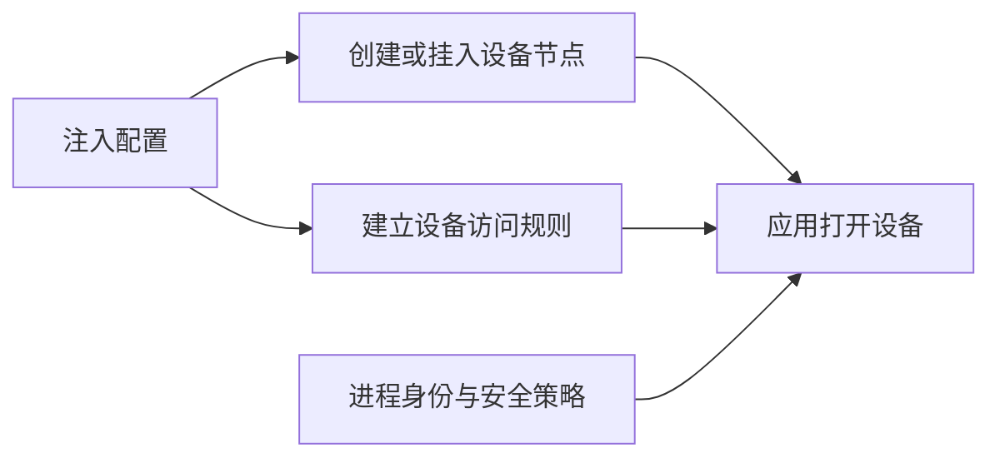
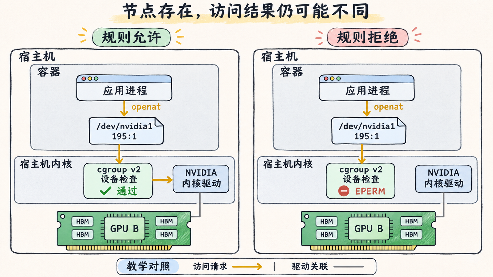

# 设备节点出现后还要通过哪些权限检查

`ls -l /dev/nvidia1` 有输出，CUDA 进程打开它却可能得到 `EPERM`。`ls` 检查路径与文件属性，打开字符设备时，内核还要按实际进程和访问操作检查权限。判断这个问题，需要把文件节点、设备规则和进程身份分别记录。 [OCI Linux 设备配置](https://github.com/opencontainers/runtime-spec/blob/v1.2.1/config-linux.md#devices) · [Linux cgroup v2 设备控制](https://docs.kernel.org/6.18/admin-guide/cgroup-v2.html#device-controller)

## 一个路径对应哪个设备

设备节点是内核设备的文件入口。字符设备用类型和主、次设备号标识。以普通 NVIDIA 整卡为例，`/dev/nvidiaN` 是单卡设备节点，计算还可能需要 `/dev/nvidiactl`、`/dev/nvidia-uvm` 等节点。`nvidiactl` 是控制设备，UVM 节点服务于 NVIDIA 的统一内存管理模块。要按实际用途读取注入清单，并核对报错指向的是单卡节点还是控制或 UVM 节点。 [NVIDIA SMI 次设备号](https://docs.nvidia.com/deploy/nvidia-smi/index.html#minor-number) · [Toolkit 1.18.2 公共设备发现](https://github.com/NVIDIA/nvidia-container-toolkit/blob/v1.18.2/pkg/nvcdi/common-nvml.go) · [NVIDIA Linux 驱动组件](https://download.nvidia.com/XFree86/Linux-x86_64/580.65.06/README/installedcomponents.html)

下面是**教学用 OCI 摘录**。假设节点上的 B 卡对应字符设备 `/dev/nvidia1`，主、次设备号分别为十进制 `195` 和 `1`。控制节点、库挂载及其他基础设备规则省略。`linux.devices` 描述应出现在容器中的设备节点，`linux.resources.devices` 描述设备访问规则。真实配置中还要检查其他规则的顺序和有效限制。 [OCI 设备节点及设备访问规则](https://github.com/opencontainers/runtime-spec/blob/v1.2.1/config-linux.md#devices)

```json
{
  "linux": {
    "devices": [
      {"path": "/dev/nvidia1", "type": "c", "major": 195, "minor": 1}
    ],
    "resources": {
      "devices": [
        {"allow": true, "type": "c", "major": 195, "minor": 1, "access": "rw"}
      ]
    }
  }
}
```

这条设备规则允许读写这个设备号。规则里的 `m` 表示创建设备节点的权限。`r/w/m` 属于设备访问控制，文件模式和属主仍单独参与判断。打开节点时，进程的 UID、GID、补充组及能力会影响 Unix 权限判断。SELinux、AppArmor 等策略也可能拒绝访问。在 cgroup v2 中，设备控制通过附加到 cgroup 的 BPF 程序实现，规则可按设备类型、主次设备号和操作判定，并以 `EPERM` 拒绝。cgroup v2 没有可用来读取这些规则的 `devices.list` 接口文件。 [OCI 设备规则](https://github.com/opencontainers/runtime-spec/blob/v1.2.1/config-linux.md#allowed-device-list) · [Linux cgroup v2 设备控制](https://docs.kernel.org/6.18/admin-guide/cgroup-v2.html#device-controller) · [NVIDIA SELinux 故障示例](https://docs.nvidia.com/datacenter/cloud-native/container-toolkit/1.18.2/troubleshooting.html#permission-denied-error-when-running-the-nvidia-docker-wrapper-under-selinux)

## 节点缺失与打开被拒怎样区分



在**失败进程所在的容器**中看设备路径、主次设备号和文件权限。`ls -l /dev/nvidia1` 的字符设备列显示主次设备号，`stat` 可以补充文件模式和属主。若用 GNU `stat` 的 `%t:%T`，结果是十六进制，上例的十进制 `195:1` 显示为 `c3:1`。在主机侧按该进程的 PID 取 `/proc/<pid>/status` 的 `Uid`、`Gid`、`Groups` 和 `/proc/<pid>/cgroup`，再用同一次启动记录对应进程。 [GNU stat 手册页](https://man7.org/linux/man-pages/man1/stat.1.html) · [Linux 进程状态](https://man7.org/linux/man-pages/man5/proc_pid_status.5.html) · [Linux cgroup v2](https://docs.kernel.org/6.18/admin-guide/cgroup-v2.html)

- 失败调用返回 `ENOENT` 时，先核对被打开的完整路径，以及对应设备有无进入本次配置。控制节点缺失与单卡节点缺失要分别查。
- 节点存在且 `openat` 返回 `EPERM` 或 `EACCES` 时，记录路径、打开模式和 errno，再查进程所属 cgroup 的有效设备策略、文件权限及同一时间的安全审计。OCI 文件描述运行时输入，运行时或后续管理操作可能影响最终生效的规则。
- `openat` 成功而下一次调用失败时，保留实际失败的调用和返回值。设备节点可打开只验证了这一关，驱动初始化及 CUDA 枚举仍有各自的检查点。 [Linux open 错误码](https://man7.org/linux/man-pages/man2/open.2.html) · [NVIDIA 容器运行期间的 GPU 访问故障](https://docs.nvidia.com/datacenter/cloud-native/container-toolkit/1.18.2/troubleshooting.html#containers-losing-access-to-gpus-with-error-failed-to-initialize-nvml-unknown-error)



图 10-02-01　同一宿主机的两种教学情形。两侧都能看到 `/dev/nvidia1`（`195:1`），且 Unix 文件权限与安全策略都允许访问。只改变 cgroup v2 的设备规则，左侧允许以读写模式打开，右侧拒绝。现场排障需要用有效设备规则与审计记录确认拒绝来源。
