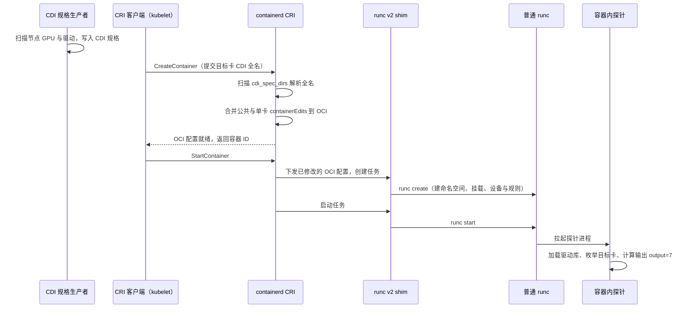

# CDI 设备描述与 containerd 原生注入

如果每个容器引擎都得自己维护 NVIDIA 的驱动库和设备清单，生态很快就会失控。硬件厂商每升级一次驱动，containerd、CRI-O 和 Docker 就得跟着改代码。

怎么把“硬件挂载知识”从容器运行时里彻底剥离？**CDI（Container Device Interface，容器设备接口）** 给出了标准答案。

宿主机只需放一份声明式文件描述设备。上层提交标准设备全名后，任何支持 CDI 的运行时都能自动生成 OCI 修改。

## 谁负责找卡，谁负责注入

在 Kubernetes 节点上，kubelet 通过 **CRI（Container Runtime Interface，容器运行时接口）** 调用 `containerd`。内部接请求的模块叫 CRI 插件。它组装好 OCI 配置后，交由 `runc v2 shim` 拉起普通 `runc` 建立容器。

本篇聚焦 `containerd 2.3.0` 的**原生 CDI 主路径**。底层只跑普通 `runc`，不需要挂载 NVIDIA 专用包装层：

| 参与角色 | 核心输入 | 承担的职责 |
| --- | --- | --- |
| **CDI 规格生产者** | 宿主机设备清单与驱动文件 | 将设备全名与所需 OCI 修改写入节点上的 CDI 规格文件（如由 NVIDIA Container Toolkit 或设备插件生成）。 |
| **CRI 客户端** | 上层已选定的目标卡 CDI 全名 | 在创建容器请求中提交这个设备全名。 |
| **containerd CRI** | CRI 请求、本地 CDI 规格与基础配置 | 解析设备全名，将公共修改与单卡专用修改合并进 OCI 配置。 |
| **shim 与 runc** | 合并完成后的最终 OCI 配置 | 按单建命名空间、挂文件、放行设备规则并启动进程，全程无需理解 CDI。 |
| **容器内应用** | 镜像文件、注入库与设备入口 | 加载动态库、打开目标卡并执行计算。 |

> [!warning] 常见误区：CDI 只做“设备注入”，不做“资源分配”
> CDI 文件里列出了节点上的两张 GPU，只意味着运行时知道“如果有人点名要这张卡，该怎么把它挂进容器”。至于集群还剩几张空闲卡、这张卡该分给哪个 Pod，完全由上层 Kubernetes 调度与设备插件（[第 11 章](../11_Kubernetes如何发现与分配GPU/00_内容大纲.md)）拍板。

## 读懂一份 CDI 1.1.0 设备规格

下面用一份精简 CDI `1.1.0` 规格，演示如何把 `node-10` 上的目标卡（GPU B，节点 `/dev/nvidia1`）交给容器。为突出合并结构，这里只保留计算支路条目。完整规格还会包含 NVML、`nvidia-smi` 及其他配套库：

```yaml
cdiVersion: "1.1.0"
kind: nvidia.com/gpu                             # 设备类别，与下方设备名拼成全名
containerEdits:                                  # 【公共修改】选中本文件任意设备时应用一次
  env:
    - NVIDIA_VISIBLE_DEVICES=void                # 防止混用旧版包装层时触发二次隐式注入
  deviceNodes:
    - path: /dev/nvidiactl                       # 驱动控制节点
    - path: /dev/nvidia-uvm                      # 统一虚拟内存节点
  mounts:
    - hostPath: /usr/lib/x86_64-linux-gnu/libcuda.so.1
      containerPath: /usr/lib/x86_64-linux-gnu/libcuda.so.1
      type: bind
      options: [bind, ro]                        # 只读挂载宿主机用户态驱动库
devices:
  - name: GPU-bbbbbbbb-bbbb-bbbb-bbbb-bbbbbbbbbbbb  # 【单卡条目】目标卡完整 UUID
    containerEdits:                              # 【专用修改】仅在选中这张卡时合并
      deviceNodes:
        - path: /dev/nvidia1
          type: c
          major: 195
          minor: 1
          permissions: rw                        # 请求读写设备访问规则
```

用等号拼接顶层 `kind` 与单卡 `name`，就得到这张卡的**全限定设备名**：

```text
nvidia.com/gpu=GPU-bbbbbbbb-bbbb-bbbb-bbbb-bbbbbbbbbbbb
```

这份 YAML 拆成了“公共修改”和“单卡专用修改”两层：

- **请求单张目标卡时**：containerd 先套用顶层的公共修改（挂入 `libcuda.so.1`、添加控制与 UVM 节点、写入环境变量），再叠加目标卡自己的 `/dev/nvidia1`。
- **同时请求两张卡时**：顶层的公共修改只应用一次，避免重复挂载驱动库；再分别把两张卡各自的 `/dev/nvidia0` 与 `/dev/nvidia1` 合并进来。

还要留心一个容易撞名的概念。这里的 `kind: nvidia.com/gpu` 只是 CDI 的设备类别，与 Kubernetes 计数用的扩展资源键毫无关系。[第 11 章](../11_Kubernetes如何发现与分配GPU/00_内容大纲.md)的 Device Plugin 和 DRA 还会生成不同的 `kind`，核对设备名时必须逐字匹配。

## 从 CRI 设备全名到 OCI 字段

上层发起 CRI 创建请求时，只需把设备全名写进请求列表。下文用 `<目标卡 UUID>` 简写上面的完整 UUID：

```textproto
# CRI CreateContainerRequest 中的设备注入片段
config {
  CDI_devices {
    name: "nvidia.com/gpu=<目标卡 UUID>"
  }
}
```

containerd 命中规格后，由内置 CDI 库把 YAML 直接翻译为 OCI 字段：

| CDI 规格字段 | 转换后的 OCI 目标字段 | 容器内生效效果 |
| --- | --- | --- |
| 公共与单卡 `deviceNodes` | `linux.devices[]` | 建立控制、UVM 及目标卡字符设备入口；未显式写出的主次设备号会从宿主机设备补全。 |
| 节点 `permissions`（如 `rw`） | `linux.resources.devices[]` | 追加允许访问规则；未写 `permissions` 的节点按规范默认追加 `rwm`。 |
| `mounts` | `mounts[]` | 将宿主机驱动库与工具以只读 bind 方式挂入容器。 |
| `env` | `process.env[]` | 写入容器进程环境变量（如 `NVIDIA_VISIBLE_DEVICES=void`）。 |
| 可选的 `hooks` | `hooks` 对应生命周期列表 | 执行更新容器库缓存（`ldconfig`）等辅助动作，与旧版 legacy 设备注入 Hook 截然不同。 |

> [!tip] 工程直觉：`NVIDIA_VISIBLE_DEVICES=void` 会把刚刚注入的卡藏起来吗？
> 不会。原生 CDI 只认 CRI 里的设备全名，完全不看这个环境变量；容器里的 CUDA 进程看的是 `CUDA_VISIBLE_DEVICES`，也不受它影响。规格里特意写入 `void`，是为了在节点同时装有旧版 NVIDIA 运行时包装层时，明确告诉对方“卡已经由 CDI 注入完毕，别再按老办法重复扫一遍”。

## containerd 2.3.0 原生消费全流程

从 containerd `2.0` 起，CRI 插件已默认开启原生 CDI 支持。在 `containerd 2.3.0` 的 `version = 3` 配置中，关键默认值如下：

```toml
# /etc/containerd/config.toml（containerd 2.3.0 默认配置片段）
version = 3

[plugins."io.containerd.cri.v1.runtime"]
  enable_cdi = true                                # 默认开启原生 CDI 解析
  cdi_spec_dirs = ["/etc/cdi", "/var/run/cdi"]     # 依次扫描静态与动态规格目录
```

下面这张时序图完整呈现了一张 GPU 如何沿着原生 CDI 路径从宿主机走进探针进程：



*图 10-03-01：containerd `2.3.0` 原生 CDI 从规格生成、CRI 请求解析到 `runc` 启动容器的完整时序。*

请特别留意 `CreateContainer` 与 `StartContainer` 的时间切分：

- **`CreateContainer` 阶段**：负责解析 CDI 名称并组装 OCI 配置。如果节点显式把 `enable_cdi` 设为 `false`，`containerd 2.3.0` 会直接拒绝带 CDI 请求的调用，而不是悄悄启动一个无卡容器。同样，名称拼错或规格丢失也会在这一步当场报错。
- **`StartContainer` 阶段**：`shim` 才把修改好的 OCI 配置交给普通 `runc`，执行 `create` 与 `start` 真正建立进程环境。

> [!note] 规格自动刷新与版本边界
> 从 NVIDIA Container Toolkit `1.18.0` 起，标准安装会附带 `nvidia-cdi-refresh` systemd 服务：系统开机、安装或升级驱动与 Toolkit 时，自动刷新 `/var/run/cdi/nvidia.yaml`。但若节点发生驱动卸载或 MIG 动态重配，仍需确认自动刷新是否覆盖了最新拓扑。

## 规格在磁盘上，为什么还是注入失败

在 `1.18.2` 节点上，运维常用以下两条命令检查规格状态：

```sh
# 列出当前本机生成的 CDI 设备全名，核对 kind=name 拼写
nvidia-ctk cdi list

# 查看 systemd 自动刷新单元最近的生成日志与报错
journalctl -u nvidia-cdi-refresh.service -n 50 --no-pager
```

即使 `nvidia-ctk cdi list` 正常输出，也只说明文件写好了。`containerd` 究竟读没读到，还得看消费者视角。下面四个单变量场景划清了各环节的边界：

| 仅改变的条件 | 最早暴露的失败点 | 第一步排查动作 |
| --- | --- | --- |
| **请求省略 `CDI_devices`**（沿用普通 `runc`） | 容器正常启动，但内部没有任何 GPU 设备和驱动库。 | 核对 CRI 请求与最终 OCI 配置，别只看节点上有没有 YAML。 |
| **CDI 全名拼写出错** | `CreateContainer` 阶段立即报无法解析设备名，压根进不到容器。 | 将请求全名与有效规格里的 `kind=name` 逐字比对。 |
| **规格落在未扫描目录** | 即使文件名和内容无误，`CreateContainer` 仍找不到设备。 | 核对 `containerd` 生效的 `cdi_spec_dirs` 与文件实际目录。 |
| **规格过期或宿主机库已删** | 名称解析通过，但推迟到 `StartContainer` 挂载或应用访问时才报错。 | 重新生成规格，并核对宿主机设备号、UUID 与库路径是否存在。 |

> [!summary] 核心结论
> 原生 CDI 的威力在于**彻底省去了专用低层运行时**：规格生产者把设备知识写成声明文件，containerd 在 `CreateContainer` 阶段直接把它展开成标准 OCI 字段，普通 `runc` 照单执行即可。

原生 CDI 如此清爽。那许多存量集群里的 `runtimeClassName: nvidia` 与 `NVIDIA_VISIBLE_DEVICES` 又是怎么回事？下一篇拆开 NVIDIA Container Toolkit 的组件家族，把四条路径放进同一张表里看透。

> [!info]- 参考资料
> - **CDI 1.1.0 规范与实现**：[CDI 1.1.0 总规范](https://github.com/cncf-tags/container-device-interface/blob/v1.1.0/SPEC.md)、[CDI 版本规则](https://github.com/cncf-tags/container-device-interface/blob/v1.1.0/SPEC.md#version)、[CDI 规格结构与合并](https://github.com/cncf-tags/container-device-interface/blob/v1.1.0/SPEC.md#specification)、[CDI 1.1.0 缓存与解析实现（`cache.go`）](https://github.com/cncf-tags/container-device-interface/blob/v1.1.0/pkg/cdi/cache.go)、[CDI 到 OCI 字段转换实现（`container-edits.go`）](https://github.com/cncf-tags/container-device-interface/blob/v1.1.0/pkg/cdi/container-edits.go)
> - **containerd 2.3.0 与 CRI**：[containerd 2.0 默认启用 CDI 说明](https://github.com/containerd/containerd/blob/v2.0.0/docs/containerd-2.0.md#cdi-is-now-enabled-by-default)、[containerd 2.3.0 CRI 配置参考](https://github.com/containerd/containerd/blob/v2.3.0/docs/cri/config.md)、[containerd 2.3.0 Runtime v2 架构](https://github.com/containerd/containerd/blob/v2.3.0/docs/runtime-v2.md)、[containerd 2.3.0 CRI 创建容器实现（`container_create_linux.go`）](https://github.com/containerd/containerd/blob/v2.3.0/internal/cri/server/container_create_linux.go)、[Kubernetes CRI v0.36.0 协议定义（`api.proto`）](https://github.com/kubernetes/cri-api/blob/v0.36.0/pkg/apis/runtime/v1/api.proto)
> - **NVIDIA Container Toolkit CDI 支持**：[Toolkit 1.18.2 CDI 生成与刷新指南](https://docs.nvidia.com/datacenter/cloud-native/container-toolkit/1.18.2/cdi-support.html)、[Toolkit 1.18.2 NVML 设备发现实现（`common-nvml.go`）](https://github.com/NVIDIA/nvidia-container-toolkit/blob/v1.18.2/pkg/nvcdi/common-nvml.go)
