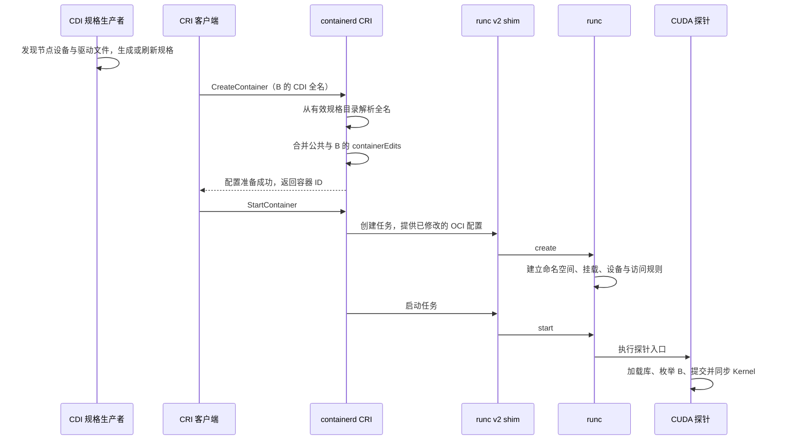

如果每个容器平台都自己理解 NVIDIA 的设备节点、驱动库和工具清单，设备供应商就要反复适配不同运行时。CDI（Container Device Interface，容器设备接口）把这部分知识写成节点上的**设备规格**：用一个全名找到设备，再列出将该设备接入容器所需的 OCI 修改。它不负责发现集群中还有多少空闲 GPU，也不负责决定把卡分给谁；上层先选定设备，CDI 消费者再展开配置。 [CDI 1.1.0 规范](https://github.com/cncf-tags/container-device-interface/blob/v1.1.0/SPEC.md)

本篇以 containerd `2.3.0` 的 CRI 原生 CDI 为唯一主路径。请求来自 kubelet 或其他 CRI 客户端，低层使用普通 runc，不经过 `nvidia-container-runtime` 包装层。规格可由 NVIDIA Container Toolkit（NVIDIA 容器工具包）生成；它提供设备描述和容器运行时集成工具，不是用于编译 CUDA 应用的 CUDA Toolkit，也不是 GPU 驱动。Kubernetes 设备插件等生产者也可以生成自己的规格。

## 一次创建涉及哪些组件

CRI（Container Runtime Interface，容器运行时接口）是 kubelet 与容器运行时服务之间的接口。containerd 的 CRI 实现接收容器配置，组装 OCI 配置；`io.containerd.runc.v2` 对应的 shim 管理容器任务并调用低层运行时。runc 按 OCI 配置建立命名空间、挂载、设备和进程环境。CDI 的修改发生在 containerd 组装 OCI 配置时，所以这条路径不需要 NVIDIA 专用低层运行时。 [CRI v0.36.0 接口](https://github.com/kubernetes/cri-api/blob/v0.36.0/pkg/apis/runtime/v1/api.proto) · [containerd 2.3.0 Runtime v2](https://github.com/containerd/containerd/blob/v2.3.0/docs/runtime-v2.md)

| 参与者 | 输入 | 在主例中完成的工作 |
| --- | --- | --- |
| 规格生产者 | 宿主机设备、驱动文件和生成策略 | 把设备全名及所需 `containerEdits` 写入 CDI 规格。 |
| CRI 客户端 | 已选设备 B 的 CDI 全名 | 在 `CreateContainerRequest` 中提交该名称。 |
| containerd CRI | CRI 请求、规格目录中的 CDI 文件、基础容器配置 | 解析全名，将公共和设备专用修改应用到 OCI 配置。 |
| shim 与 runc | 修改后的 OCI 配置 | 创建并启动实际容器，不再需要解释 CDI 全名。 |
| 容器应用 | 镜像、注入文件、设备入口和进程环境 | 加载库、访问 B，并完成 CUDA 工作。 |

## 一份规格怎样同时描述公共依赖与 B 专用入口

下面是按 CDI 1.1.0 编写的**教学摘录**。`195:1`、文件路径与 UUID 均为教学值。为突出合并规则，只画计算支路所需的少量对象；NVML、`nvidia-smi`、其他驱动库和辅助 Hook 被省略。真实环境应按生成文件的 `cdiVersion`、字段及消费者支持的版本读取，不能把这份摘录当成完整交付清单。 [CDI 版本规则](https://github.com/cncf-tags/container-device-interface/blob/v1.1.0/SPEC.md#version) · [Toolkit 1.18.2 设备发现](https://github.com/NVIDIA/nvidia-container-toolkit/blob/v1.18.2/pkg/nvcdi/common-nvml.go)

```yaml
cdiVersion: "1.1.0"
kind: nvidia.com/gpu
containerEdits:
  env:
    - NVIDIA_VISIBLE_DEVICES=void
  deviceNodes:
    - path: /dev/nvidiactl
    - path: /dev/nvidia-uvm
  mounts:
    - hostPath: /usr/lib/x86_64-linux-gnu/libcuda.so.1
      containerPath: /usr/lib/x86_64-linux-gnu/libcuda.so.1
      type: bind
      options: [bind, ro]
devices:
  - name: GPU-bbbbbbbb-bbbb-bbbb-bbbb-bbbbbbbbbbbb
    containerEdits:
      deviceNodes:
        - path: /dev/nvidia1
          type: c
          major: 195
          minor: 1
          permissions: rw
```

`kind` 与设备条目的 `name` 组成全名：

```text
nvidia.com/gpu=GPU-bbbbbbbb-bbbb-bbbb-bbbb-bbbbbbbbbbbb
```

这里的 `kind` 是 CDI 规格中的设备类别，不是 Kubernetes 扩展资源键，也不承担资源计数语义。第 11 章的 Device Plugin 与 DRA 还会根据各自生成路径使用不同的 kind；判断注入对象时应逐字匹配实际全名。

规格顶层的 `containerEdits` 是这类设备的公共修改，选中本规格中的设备时应用；`devices[].containerEdits` 是某个设备的专用修改。请求 B 时，公共部分提供控制、UVM 节点和示例计算库，B 的条目再提供 `/dev/nvidia1`。若同一请求选择多个设备，公共修改应用一次，再合并各选中设备的修改。 [CDI 规格结构与合并](https://github.com/cncf-tags/container-device-interface/blob/v1.1.0/SPEC.md#specification) · [CDI 1.1.0 缓存与注入实现](https://github.com/cncf-tags/container-device-interface/blob/v1.1.0/pkg/cdi/cache.go)

这里的 `NVIDIA_VISIBLE_DEVICES=void` 只是规格要求写入 OCI `process.env` 的一项环境变量。原生 CDI 的消费者用上面的**全名**选择 B，不会改用这个环境变量选卡；它也不能替代第 05 篇的 `CUDA_VISIBLE_DEVICES`。该值在混合使用 NVIDIA Runtime 时还有避免旧式隐式注入的作用，第 04 篇再对照。

## 从 CRI 全名到 OCI 字段

CRI 客户端在创建请求中提交设备全名。下面只摘出设备请求，使用 protobuf 文本格式；`CDI_devices` 是协议字段名，对应 containerd Go 源码中的 `CDIDevices`。 [CRI v0.36.0 `CDIDevice`](https://github.com/kubernetes/cri-api/blob/v0.36.0/pkg/apis/runtime/v1/api.proto)

```textproto
config {
  CDI_devices {
    name: "nvidia.com/gpu=GPU-bbbbbbbb-bbbb-bbbb-bbbb-bbbbbbbbbbbb"
  }
}
```

containerd 找到名称后，把规格转换成 OCI 修改。对照第 02 篇，可以得到下面的推导，而不是只记住“CDI 注入了 GPU”。

| CDI 描述 | 应用后的 OCI 结果 | 对应用的意义 |
| --- | --- | --- |
| 公共与 B 的 `deviceNodes` | 在 `linux.devices` 增加控制、UVM 与 `/dev/nvidia1` 等设备项；可从宿主机设备补全未显式写出的设备属性。 | 容器中获得相应内核设备入口。 |
| 设备节点的 `permissions: rw` 等访问信息 | 在 `linux.resources.devices` 追加相应允许规则。 | 提供设备访问许可输入；最终仍受完整规则顺序、运行时有效策略、Unix 权限与安全策略影响。 |
| `mounts` | 在 OCI `mounts` 增加宿主机到容器路径的 bind 挂载。 | 本例的计算进程能够找到挂载来源中的 `libcuda.so.1`。 |
| `env` | 合并到 `process.env`。 | 改变进程环境，不代表已经发生设备分配。 |
| 规格中可能存在的 `hooks` | 加入相应 OCI 生命周期 Hook。 | 可执行辅助动作；不能见 Hook 就认定为 legacy 设备注入。 |

设备节点到 OCI 设备与访问规则的转换、环境及挂载合并由 CDI 库完成。辅助 Hook 与 NVIDIA Runtime 的 legacy 设备配置 Hook 是不同来源，判断路径时要看谁写入了它、它执行什么。 [CDI 1.1.0 ContainerEdits 到 OCI 的实现](https://github.com/cncf-tags/container-device-interface/blob/v1.1.0/pkg/cdi/container-edits.go)

## containerd 在哪一步消费规格

containerd 自 2.0 起在 CRI 中默认启用 CDI。`2.3.0` 的 `version = 3` 配置在 `plugins."io.containerd.cri.v1.runtime"` 下默认 `enable_cdi = true`，默认规格目录为：

```toml
# containerd 2.3.0 的相关默认值示意；实际节点以有效配置为准
[plugins."io.containerd.cri.v1.runtime"]
  enable_cdi = true
  cdi_spec_dirs = ["/etc/cdi", "/var/run/cdi"]
```

正常主例的时序如下。`CreateContainer` 负责准备容器配置，`StartContainer` 才创建并启动容器任务；所以“已返回容器 ID”与“runc 已成功创建任务、应用已运行”是不同进度。 [containerd 2.0 默认值变更](https://github.com/containerd/containerd/blob/v2.0.0/docs/containerd-2.0.md#cdi-is-now-enabled-by-default) · [containerd 2.3.0 CRI 配置](https://github.com/containerd/containerd/blob/v2.3.0/docs/cri/config.md) · [containerd 2.3.0 创建与启动实现](https://github.com/containerd/containerd/blob/v2.3.0/internal/cri/server/container_create_linux.go)



若显式设置 `enable_cdi = false`，containerd `2.3.0` 会拒绝带非空 `CDIDevices` 的 CRI 请求，而不是把它静默当成普通容器。若 CDI 已启用但名称无法解析，失败也发生在创建配置阶段，不能到容器里找应用日志。 [containerd 2.3.0 CDI 请求检查与配置应用](https://github.com/containerd/containerd/blob/v2.3.0/internal/cri/server/container_create_linux.go)

这条主路径的完整教学结果为：容器内实际节点与 B 的设备号一致，挂载来源中的 `libcuda.so.1` 被探针加载，独立 NVML 查询列出 B，CUDA 序号 0 的 UUID/BDF 与 B 相同，最终同步成功并得到 `output=7`。NVML 与计算依赖的完整文件来自未裁剪规格；上面省略 NVML 工具的 YAML 只用于解释字段合并。到这一步，才能把“名称解析成功”“容器启动成功”和“GPU 计算成功”分别打上完成标记。

如果规格中另有 A 的设备条目，在同一请求里选择 A、B，公共 `containerEdits` 仍只应用一次，A、B 各自的设备专用修改分别合并。这个非故障变体说明公共驱动文件不需要按卡复制两份，但每张整卡的入口与身份仍需分别核对。

## 规格存在，不代表每次请求都会成功

Toolkit 从 1.12.0 起支持生成 CDI 规格。自 1.18.0 起，具备相应 systemd 单元的安装可由 `nvidia-cdi-refresh` 在 Toolkit 或驱动安装、升级及开机时生成 `/var/run/cdi/nvidia.yaml`。驱动卸载、MIG 重配等变化需要单独检查刷新是否覆盖；其他设备插件也可能生成自己的 `kind` 和临时规格，不能要求所有路径都使用本例的 `nvidia.com/gpu`。 [Toolkit 1.18.2 CDI 生成与刷新](https://docs.nvidia.com/datacenter/cloud-native/container-toolkit/1.18.2/cdi-support.html)

在 `1.18.2` 节点上，可用 `nvidia-ctk cdi list` 观察本机能列出的设备名，用 `journalctl -u nvidia-cdi-refresh.service` 查看该刷新单元的记录；随后还要核对 containerd 的实际扫描目录与本次请求，因为“生产者写出了文件”和“这个消费者读到了文件”是两项证据。

| 只改变的条件 | 最早可预期的分叉 | 下一项核对 |
| --- | --- | --- |
| 省略 `CDI_devices`，其余沿用普通 runc | 基础 OCI 配置不会应用 B 的修改，容器可以启动但没有这次 CDI 注入。 | 对照请求和修改后的 `linux.devices`、`mounts`，不要只查节点是否有规格。 |
| 全名末尾拼错 | containerd 在解析阶段找不到设备，`CreateContainer` 失败。 | 将请求全名与有效规格中的 `kind=name` 逐字对照。 |
| 名称正确，但文件只在未扫描目录 | 消费者仍无法解析该名称。 | 核对有效 `cdi_spec_dirs`、规格解析错误和缓存所见的文件。 |
| 名称可解析，但规格已过期或引用的宿主机路径不存在 | 解析通过不等于后续挂载、设备或身份正确，失败可能推迟到任务创建或应用访问。 | 重新生成并核对设备号、UUID、主机文件及同一轮创建记录。 |

原生 CDI 已经把“B 的全名”变成了普通 runc 能执行的 OCI 配置。下一篇再改变运行时入口，观察 NVIDIA Container Toolkit 的包装层如何在低层 `create` 前或 Hook 阶段完成类似目标，以及为什么相同环境变量在不同路径上有不同结果。
