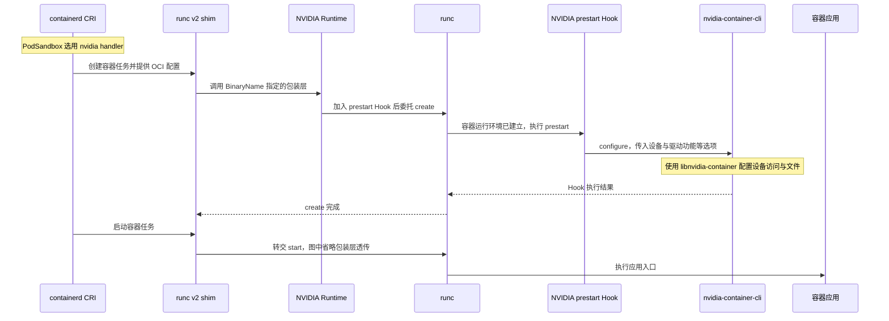

# containerd 如何接上 NVIDIA Container Toolkit

Toolkit 已安装，首先要看本次容器创建走哪条运行时路径。以 Linux x86_64、containerd `2.3.0`、NVIDIA Container Toolkit `1.18.2` 为例，containerd 可以让 shim 直接调用 runc，也可以先调用 `nvidia-container-runtime` 包装层，再由它把修改后的 OCI 配置交给 runc。包装层的模式决定它会做哪些修改。 [containerd 2.3.0 CRI 配置](https://github.com/containerd/containerd/blob/v2.3.0/docs/cri/config.md) · [NVIDIA Runtime 1.18.2](https://github.com/NVIDIA/nvidia-container-toolkit/blob/v1.18.2/cmd/nvidia-container-runtime/README.md)

## 从 RuntimeClass 读到低层可执行文件

CRI 是 kubelet 与容器运行时服务之间的接口。Kubernetes 的 `RuntimeClass.handler` 选定 `RunPodSandbox` 请求的运行时名称，Pod 中的 `runtimeClassName` 引用的是 RuntimeClass 对象名。CRI 的 `runtime_handler` 为空时使用默认运行时。containerd 随后为容器组装 OCI 配置，其中包括进程环境、根文件系统、挂载和设备等。`io.containerd.runc.v2` 指定 shim 类型，shim 的 `BinaryName` 指定调用哪个低层可执行文件。登记某个 handler 与实际请求选择它是两项独立证据。 [Kubernetes RuntimeClass](https://kubernetes.io/docs/concepts/containers/runtime-class/) · [CRI v0.36.0 接口](https://github.com/kubernetes/cri-api/blob/v0.36.0/pkg/apis/runtime/v1/api.proto) · [containerd 2.3.0 CRI 配置](https://github.com/containerd/containerd/blob/v2.3.0/docs/cri/config.md)

| 组件 | 在启动链里的职责 |
| --- | --- |
| containerd CRI | 处理 CRI 请求，按 handler 选运行时配置并组装 OCI 配置。 |
| `containerd-shim-runc-v2`、runc | shim 管理容器任务并调用低层可执行文件。runc 按 OCI 配置创建容器环境并启动进程。 |
| `nvidia-container-runtime` | 可选的低层包装层。在 `create` 路径上按模式修改 OCI 配置，再委托 runc 等低层运行时。 |
| `nvidia-container-runtime-hook` | legacy 路径使用的 OCI `prestart` Hook。根据容器配置调用 `nvidia-container-cli`。 |
| `nvidia-container-cli`、`libnvidia-container` | CLI 调用库提供的能力，发现 NVIDIA 设备及相关文件，并按传入选项配置容器。 |
| `nvidia-ctk` | 配置 Toolkit 与容器引擎，并可生成 CDI 设备描述。 |

组件分工对应 NVIDIA 的架构说明与 containerd 的 Runtime v2 接口。 [NVIDIA Container Toolkit 架构](https://docs.nvidia.com/datacenter/cloud-native/container-toolkit/latest/arch-overview.html) · [containerd Runtime v2](https://github.com/containerd/containerd/blob/v2.3.0/docs/runtime-v2.md)

## 显式选择 legacy Hook 的配置

下面三段是同一套**教学配置的相关部分**。`nvidia-ctk runtime configure --runtime=containerd` 在 Toolkit `1.18.2` 的默认布局下写入 `99-nvidia.toml`，并更新主配置的 `imports`。示例保留 `runc` 为默认，并假设包装层安装在 `/usr/bin/nvidia-container-runtime`。路径和已有 `imports` 以实际节点为准。 [Toolkit 1.18.2 安装指南](https://docs.nvidia.com/datacenter/cloud-native/container-toolkit/1.18.2/install-guide.html#configuring-containerd-for-kubernetes) · [containerd 2.3.0 CRI 配置](https://github.com/containerd/containerd/blob/v2.3.0/docs/cri/config.md)

```toml
# /etc/containerd/config.toml
version = 3
imports = ["/etc/containerd/conf.d/99-nvidia.toml"]

[plugins."io.containerd.cri.v1.runtime".containerd]
  default_runtime_name = "runc"
```

```toml
# /etc/containerd/conf.d/99-nvidia.toml
version = 3

[plugins."io.containerd.cri.v1.runtime".containerd.runtimes.nvidia]
  runtime_type = "io.containerd.runc.v2"

[plugins."io.containerd.cri.v1.runtime".containerd.runtimes.nvidia.options]
  BinaryName = "/usr/bin/nvidia-container-runtime"
```

```toml
# /etc/nvidia-container-runtime/config.toml
[nvidia-container-runtime]
  mode = "legacy"
  runtimes = ["runc"]
```

本例的 PodSandbox 选择 handler `nvidia`。在容器请求中，假定 `NVIDIA_VISIBLE_DEVICES=GPU-bbbbbbbb-bbbb-bbbb-bbbb-bbbbbbbbbbbb` 选择 B 卡，`NVIDIA_DRIVER_CAPABILITIES=compute,utility` 选择 CUDA 计算和 NVML／`nvidia-smi` 所需的驱动功能。这组 UUID 是教学值。`NVIDIA_VISIBLE_DEVICES` 选择要暴露的设备，`NVIDIA_DRIVER_CAPABILITIES` 影响随功能注入的驱动库与工具。例如只要求 `utility` 时，能查询管理信息的容器仍可能缺少计算驱动库。显式 `legacy` 在 `1.18.2` 中仍受支持，已被弃用。从 `1.18.0` 起，本例的 NVML 平台在 `auto` 下使用普通 GPU 选择器时默认转向即时 CDI。 [Toolkit 1.18.2 GPU 与驱动功能变量](https://docs.nvidia.com/datacenter/cloud-native/container-toolkit/1.18.2/docker-specialized.html) · [Toolkit 1.18.2 默认配置](https://github.com/NVIDIA/nvidia-container-toolkit/blob/v1.18.2/internal/config/config.go) · [1.18.0 发行说明](https://docs.nvidia.com/datacenter/cloud-native/container-toolkit/1.18.0/release-notes.html)

## Hook 在创建阶段执行



在 containerd `2.3.0` 的 CRI 实现中，`CreateContainer` 先准备容器配置，`StartContainer` 才创建并启动任务。图中的 `prestart` 属于任务创建期间的 OCI `create` 操作，此时容器命名空间已建立，应用尚未运行。因此 Hook 出错可能表现为 CRI `StartContainer` 失败。核对 legacy 挂载时，也要分清看到的是交给包装层之前的配置，还是 Hook 执行后的实际文件和设备。 [containerd 2.3.0 启动实现](https://github.com/containerd/containerd/blob/v2.3.0/internal/cri/server/container_start.go) · [OCI prestart 生命周期](https://github.com/opencontainers/runtime-spec/blob/v1.2.1/config.md#prestart) · [Toolkit 1.18.2 Hook 实现](https://github.com/NVIDIA/nvidia-container-toolkit/blob/v1.18.2/cmd/nvidia-container-runtime-hook/main.go)

核对本次启动时，先对照 PodSandbox 的 handler 和 containerd 实际加载的主配置及 drop-in，再查 NVIDIA Runtime 记录的模式和 Hook 调用。若 handler 留空，上例按默认 `runc` 路径走。仅在镜像中设 `NVIDIA_VISIBLE_DEVICES` 无法让普通 runc 路径自动进入 legacy Hook。`ctr`、`nerdctl` 与 CRI 的入口不同，直接用这些客户端成功启动 GPU 容器只能验证对应入口。 [containerd 2.3.0 CRI 配置](https://github.com/containerd/containerd/blob/v2.3.0/docs/cri/config.md) · [NVIDIA Toolkit 调试日志](https://docs.nvidia.com/datacenter/cloud-native/container-toolkit/1.18.2/troubleshooting.html#generating-debugging-logs)
