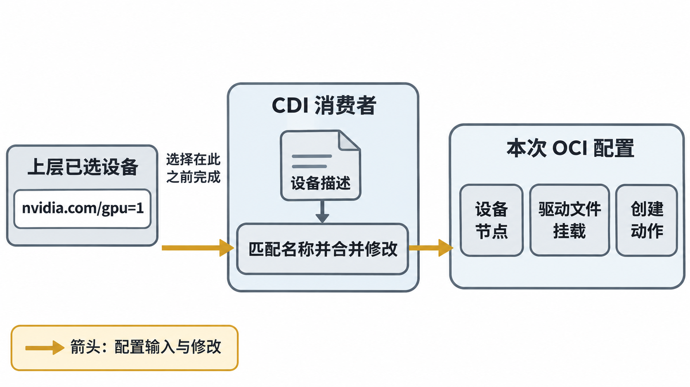
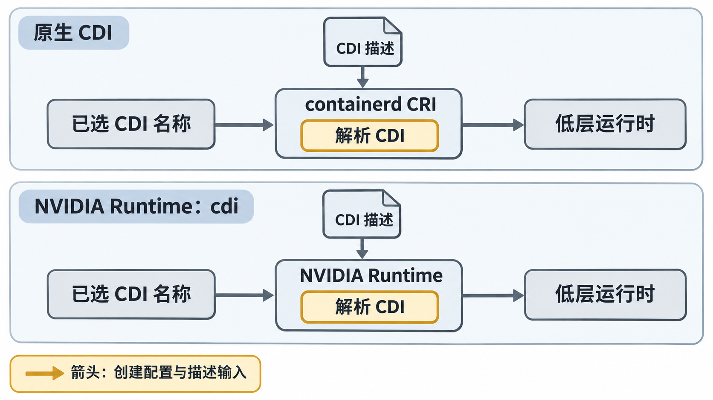

# 用 CDI 把设备名变成运行环境

## 将“使用这个设备需要什么”写成描述

上一条路径让 NVIDIA Hook 在创建过程中配置 GPU。若另一种容器引擎也要支持 NVIDIA GPU，希望它理解一个统一的设备描述，而不是为每个厂商重新约定一组私有注入逻辑。**CDI（Container Device Interface）** 就把一个设备对应的 OCI 配置修改描述出来：交付哪些设备节点、挂载哪些文件、添加哪些环境或创建 Hook。

一个完整 CDI 设备名由 `kind` 与设备 `name` 组合而成，例如 `nvidia.com/gpu=1`。斜线前后表示厂商域与设备类别，等号后是描述中的设备名称。这里的 `1` 只有在该文件使用索引命名策略且当前映射成立时才对应 G1；它不是规范强制规定的物理插槽号。NVIDIA 工具还支持 UUID 命名。1.18.0 的生成器默认同时提供索引与 UUID 名称，这些可以是同一张卡的不同名称，不代表多出了 GPU。参见 [v1.18.0 generate.go：device-name-strategy](https://github.com/NVIDIA/nvidia-container-toolkit/blob/v1.18.0/cmd/nvidia-ctk/cdi/generate/generate.go)。

CDI 的输入是**已选定的设备名**，输出是创建环境的修改。它没有全局空闲卡账本，也不决定两个请求能否同时占有一张卡。



图 10-03-01　给定当前索引名 1 对应 G1，CDI 消费者把选定名称展开为本次创建配置的修改。图中列的是可描述的修改类别，不是完整 GPU 配置；资源选择与所有权由上层负责。

## 逐字段读一个最小描述

下面是**按 CDI 字段自拟并大幅缩减的 JSON 教学文件**。它声明 0.5.0，因为所用字段在该版本已存在；这不是 Toolkit 1.18.0 完整生成物，也不是足以直接部署的 GPU 配置。为了看清结构，仅保留 G1、一个公共节点和一个驱动库挂载，省略 UVM、其他库、符号链接、动态库缓存更新及实际所需 Hook。不要将它写入真实节点的 CDI 搜索目录。

```json
{
  "cdiVersion": "0.5.0",
  "kind": "nvidia.com/gpu",
  "devices": [
    {
      "name": "1",
      "containerEdits": {
        "deviceNodes": [
          {"path": "/dev/nvidia1", "permissions": "rw"}
        ]
      }
    }
  ],
  "containerEdits": {
    "deviceNodes": [
      {"path": "/dev/nvidiactl", "permissions": "rw"}
    ],
    "mounts": [
      {
        "hostPath": "/usr/lib/x86_64-linux-gnu/libcuda.so.570.124.06",
        "containerPath": "/usr/lib/x86_64-linux-gnu/libcuda.so.570.124.06",
        "options": ["ro", "bind"]
      }
    ]
  }
}
```

读取顺序可以从请求倒推：请求 `nvidia.com/gpu=1`，先匹配 `kind`，再匹配 `devices` 中 `name: "1"`，合并该设备的修改与文件级公共修改。于是选中卡的节点与公共控制节点、驱动库挂载一同进入创建环境。只请求另一设备时不会因为本文件“列出了 1”就自动合并 1 的设备级修改；公共修改则在选用该描述中的任一设备时应用。当前字段语义见 [CDI v0.8.0 Specification：CDI Devices 与 OCI Edits](https://github.com/cncf-tags/container-device-interface/blob/v0.8.0/SPEC.md)，示例声明版本另与 [v0.5.0 规范](https://github.com/cncf-tags/container-device-interface/blob/v0.5.0/SPEC.md)交叉核对。

`path` 是容器内节点路径；省略 `hostPath` 时用同一主机路径查找。`permissions: "rw"` 描述设备访问规则，不是将文件 mode 改成 0666。`mounts` 的主机源路径必须存在于当前节点。JSON 结构正确却指向旧驱动文件，仍会在解析或创建阶段出问题。完整生成器还会处理链接、库发现与相关创建动作，不能从本片段推断只挂一个带版本号的 `.so` 就能让 `libcuda.so.1` 正常装载。

## 谁来消费 CDI：两条不同入口

第一条是**容器运行环境原生消费 CDI**：例如支持并启用了 CDI 的 containerd CRI 收到 CDI 设备名，读取搜索目录中的描述，将相应修改合并到 OCI 配置，再让普通低层运行时创建容器。这条路径不以经过 `nvidia-container-runtime` 包装器为前提，但仍依赖有效的 NVIDIA 驱动、生成描述所需的工具和描述中引用的文件或 Hook。

在 containerd **1.7.27 的 CRI 配置**中，原生 CDI 支持默认关闭。本章为原生路径显式给出以下**教学片段**，其他配置沿用独立的可用 CRI 环境：

```toml
version = 2
[plugins."io.containerd.grpc.v1.cri"]
  enable_cdi = true
  cdi_spec_dirs = ["/etc/cdi", "/var/run/cdi"]
```

字段、默认值和搜索目录来自 [containerd 1.7.27 CRI config guide 的 enable_cdi 与 cdi_spec_dirs](https://github.com/containerd/containerd/blob/v1.7.27/docs/cri/config.md)。这里还需要请求通过受支持的接口实际携带 CDI 名称；单独启用解析器不会替请求选择设备。该配置只作用于 CRI 插件，不能用一次 `ctr` 调用结果代替 CRI 路径验证。其他版本的配置结构和默认值应另行核对。

第二条是**NVIDIA Runtime 的 `cdi` 模式**：创建仍先经过 NVIDIA 包装器，由它消费 CDI 描述并修改 OCI 配置，再调用低层运行时。它能够衔接不原生消费 CDI 的入口。在这种模式下，不再添加 legacy NVIDIA `prestart` 注入 Hook；CDI 描述自身仍可以含创建 Hook，所以“CDI 没有任何 Hook”同样不成立。两种入口的差别见 [Toolkit 1.18.0：Using CDI with Non-CDI-Enabled Runtimes](https://docs.nvidia.com/datacenter/cloud-native/container-toolkit/1.18.0/cdi-support.html#using-cdi-with-non-cdi-enabled-runtimes)。

若将前篇的包装器方案切换为本节示例，需要在 NVIDIA Runtime 配置中显式设 `mode = "cdi"`，让请求的 `NVIDIA_VISIBLE_DEVICES` 使用当前文件实际存在的完整 CDI 名称，例如 `nvidia.com/gpu=GPU-22222222-2222-4222-8222-222222222222`；containerd 仍需选中该包装器入口。这与原生 CDI 在上游请求接口中传递 CDI 名称是两种入口，不能只把前篇的 `mode` 改掉就认定其余条件自动完整。

对照以下**控制流程**，比较的是谁负责读取 CDI，而不是两条 GPU 数据路径：

| 入口 | 名称如何传来 | 谁解析 CDI 描述 | 后续创建者 |
| --- | --- | --- | --- |
| containerd CRI 原生 CDI | 上游请求经受支持接口携带 CDI 名称 | 已启用 CDI 的 CRI 路径 | 低层 OCI Runtime |
| NVIDIA Runtime `cdi` 模式 | NVIDIA 包装器接收设备选择，例如 `NVIDIA_VISIBLE_DEVICES` 中的 CDI 名称 | NVIDIA Runtime | 包装器随后调用低层 OCI Runtime |
| 前篇 legacy 模式 | NVIDIA 环境变量表达 UUID / 索引与功能集合 | 不依靠预生成 CDI 描述，由 legacy Hook/CLI 配置 | 低层 Runtime 执行 Hook 后启动 |



图 10-03-02　原生路径由已启用 CDI 的 containerd CRI 消费描述；包装器路径由 NVIDIA Runtime 的 cdi 模式消费。两行表示独立方案，聚合了其他创建细节；未画 legacy 注入 Hook，不代表 CDI 描述不能含创建 Hook。

1.18.0 还需要辨认 `jit-cdi`：包装器在创建时为请求的 NVIDIA 设备即时生成内存中的 CDI 描述，再据此修改配置。它与本节显式 `cdi` 模式消费预先存在的描述不同，不应因缺少 `/var/run/cdi/nvidia.yaml` 就断言所有包装器路径都必然失败。本章的显式 `cdi` 与原生 CDI 示例固定使用已生成描述；legacy 示例均显式选择 legacy。`auto` 对完整 CDI 名称选择 `cdi`、对本章 NVML 平台常规请求选择 `jit-cdi` 的条件可查 [v1.18.0 auto.go](https://github.com/NVIDIA/nvidia-container-toolkit/blob/v1.18.0/internal/info/auto.go)。

这里不将 legacy 的 `NVIDIA_DRIVER_CAPABILITIES` 规则直接套给原生 CDI。原生 CDI 消费者按所选描述中的修改交付文件；想知道哪些库会进入容器，应查看实际描述。若同时对同一容器启用原生 CDI 与旧式自动注入 Hook，可能重复添加挂载或产生冲突。应先确定本次创建采用哪条注入路径，再核对最终配置，而不是不断叠加开关。

## 描述存在，还要与当前主机状态一致

描述的生成、读取和使用发生在不同时间。NVIDIA Toolkit 1.18.0 提供 `nvidia-cdi-refresh` 的 systemd path/service 单元，按支持的事件生成 `/var/run/cdi/nvidia.yaml`；工具安装或升级、驱动安装或升级、重启属于自动更新的场景。该版本文档列出的限制包括驱动移除与 MIG 重配置，需要手动触发重新生成。机制和限制见 [1.18.0：Automatic CDI Specification Generation](https://docs.nvidia.com/datacenter/cloud-native/container-toolkit/1.18.0/cdi-support.html#automatic-cdi-specification-generation)。

以下是**自拟、删节的观察材料**，说明这些命令要回答什么：

```text
$ systemctl status nvidia-cdi-refresh.path
Active: active (waiting)

$ systemctl status nvidia-cdi-refresh.service
Active: inactive (dead)
ExecStart=... nvidia-ctk cdi generate --output=/var/run/cdi/nvidia.yaml
Result: success

$ nvidia-ctk cdi list
# 此处仅保留本题使用的两个名称，其他名称和工具日志省略
nvidia.com/gpu=1
nvidia.com/gpu=GPU-22222222-2222-4222-8222-222222222222
```

path 单元在等待触发；一次性生成任务成功退出后 service 不常驻运行，是正常状态之一。需要结合退出结果、日志与文件状态判断，不能仅凭 `inactive` 就认定失败。两个列出名称在本模型中对应同一 G1。列出成功说明 `nvidia-ctk` 在其搜索条件下能解析描述，不能证明 containerd 的搜索目录、权限和 CDI 版本支持完全相同。

如果驱动由版本 A 升至 B，描述仍引用 A 的绝对文件路径，即使 GPU UUID 没变，也要更新描述。反过来，重新生成描述不会把已经运行的容器的所有挂载原地替换成新驱动；新建容器需要重新走创建流程，运行中作业的变更处理归第 19 章。读者现在已能区分“生成过”“当前能解析”“本轮确实消费”“应用能计算”四种证据。

下一篇保持运行环境不变，只切换观察位置，看同一张卡为什么会出现多个编号。

[上一篇：沿 containerd 追踪一次设备注入](02_沿containerd追踪一次设备注入.md) · [下一篇：把容器内的 GPU 对应回宿主机](04_把容器内的GPU对应回宿主机.md)
