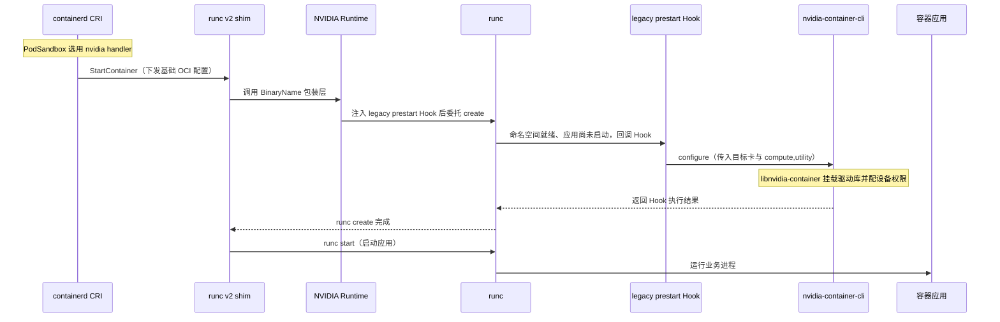

# NVIDIA Container Toolkit 的运行时路径

containerd `2.3.0` 已经能原生消费 CDI 规格。可许多现有集群依然写着 `runtimeClassName: nvidia`，还靠 `NVIDIA_VISIBLE_DEVICES` 挂卡，这是为什么？

原因在于 GPU 容器化有两代模式。原生 CDI 是新一代标准路径。更早普及、至今仍在广泛运行的旧路径，则由 **NVIDIA Container Toolkit（NVIDIA 容器工具包）** 的包装层在底层改写 OCI 配置。

## NVIDIA Container Toolkit 里到底装着什么

先拆穿一个高频误解。**NVIDIA Container Toolkit 不是 GPU 驱动，也不是编译代码用的 CUDA Toolkit** 。它是一组宿主机容器集成工具，负责把现有驱动和卡接进容器运行时：

| 组件名 | 角色与职责 | 原生 CDI 路径是否必需 |
| --- | --- | --- |
| **`nvidia-ctk`** | 运维配置与 CDI 工具，用来修改 containerd 配置、生成或列出 CDI 规格。 | 可用它生成规格；但 containerd 消费现成规格时不会调用它。 |
| **`nvidia-container-runtime`** | 可选的低层运行时包装层（简称 **NVIDIA Runtime**）。在调用 `runc` 前按模式修改 OCI 配置。 | 原生 CDI 不需要；JIT CDI、包装层 `cdi` 与 legacy 需要。 |
| **`nvidia-container-runtime-hook`** | legacy 路径使用的 OCI `prestart` Hook，负责触发底层配置 CLI。 | 仅在走 legacy 路径时出场。 |
| **`nvidia-container-cli` + `libnvidia-container`** | 负责扫描设备与驱动文件、直接配置容器挂载与权限的 CLI 和底层库。 | legacy 路径的核心执行者。 |
| **Toolkit CDI 生成库** | 从 NVML 收集宿主机设备与驱动信息，产出 CDI 结构并转换为 OCI 修改。 | 既可写持久 YAML，也供 JIT CDI 在内存中即时生成。 |

这些组件只管“把卡放进容器”。配额统计、健康上报与选卡属于上层职责。至于如何在集群里自动化部署它们，留到[第 12 章](../12_GPUOperator如何管理节点软件/00_内容大纲.md)展开。

## RuntimeClass 的 handler 决定是否走进包装层

Kubernetes 用 `RuntimeClass` 把 Pod 的 `runtimeClassName` 映射成 `handler`。kubelet 创建 PodSandbox 时，将这个 `handler` 传给 containerd。若 Pod 未填写，则落回默认运行时。

下面演示 `nvidia-ctk runtime configure --runtime=containerd` 在 `1.18.2` 中生成的典型配置。示例故意保留默认运行时为 `runc`，把 `nvidia` 作为可选 handler：

```toml
# /etc/containerd/config.toml（主配置导入 drop-in 目录）
version = 3
imports = ["/etc/containerd/conf.d/99-nvidia.toml"]

[plugins."io.containerd.cri.v1.runtime".containerd]
  default_runtime_name = "runc"                    # 未指定 RuntimeClass 时走普通 runc
```

```toml
# /etc/containerd/conf.d/99-nvidia.toml（登记 nvidia 包装层 handler）
version = 3

[plugins."io.containerd.cri.v1.runtime".containerd.runtimes.nvidia]
  runtime_type = "io.containerd.runc.v2"           # 仍使用标准 runc v2 shim
[plugins."io.containerd.cri.v1.runtime".containerd.runtimes.nvidia.options]
  BinaryName = "/usr/bin/nvidia-container-runtime" # shim 调起包装层，而非直接调 runc
```

这段配置清晰划出了两条分岔路：

- **Pod 选中 `nvidia` handler**：`shim` 会先调起 `BinaryName` 指向的 `nvidia-container-runtime`，包装层改完 OCI 配置后再转交给 `runc`。
- **Pod 未指定 handler**：`shim` 直接调普通 `runc`。哪怕镜像里写了 `NVIDIA_VISIBLE_DEVICES`，普通 `runc` 根本不认这个环境变量，不会自动挂卡。

> [!tip] 工程直觉：装了 `nvidia` runtime，和本次 Pod 用上它，是两回事
> 排障时看到 `99-nvidia.toml` 存在，或者手动用 `docker`、`nerdctl`、`ctr` 跑通了测试容器，都说明不了这次 Kubernetes Pod 走了同一条入口。必须回到本次 CRI 请求，确认 PodSandbox 实际命中的 `handler` 名字。

## 四条注入路径一张表看透

自 Toolkit `1.18.0` 起，包装层在默认的 `mode = "auto"` 下有了重要变化。在常见 NVML 平台上，只要传入普通 GPU UUID 或索引，它就会默认启用**即时（Just-In-Time，JIT）CDI**。

这种模式不再读取磁盘上的持久 YAML，而是在内存里即时拼出 CDI 描述并改写 OCI 配置。把原生 CDI 与包装层的三种模式放在一起，主流的四条路径一目了然：

| 注入路径 | 触发与设备输入 | 谁在何时修改 OCI 配置 | 是否依赖磁盘持久 CDI 规格 |
| --- | --- | --- | --- |
| **1. containerd 原生 CDI** | 默认 `runc`；CRI `CDI_devices` 传入全限定名 | **containerd CRI** 在 `CreateContainer` 组装配置时修改。 | **是**，读取 `cdi_spec_dirs`。 |
| **2. 包装层 JIT CDI**（1.18+ `auto` 默认） | `nvidia` handler + `mode=auto` + 普通 UUID/索引选择器 | **NVIDIA Runtime** 在低层 `create` 前于内存中即时生成并修改。 | **否**，不读磁盘上的持久 YAML。 |
| **3. 包装层 `cdi` 模式** | `nvidia` handler + 传入全限定 CDI 名（或显式 `mode=cdi`） | **NVIDIA Runtime** 在低层 `create` 前查规格并修改。 | **是**，但消费者是包装层而非 containerd。 |
| **4. 包装层显式 legacy** | `nvidia` handler + `mode=legacy` + `NVIDIA_VISIBLE_DEVICES` 等环境变量 | 包装层注入 `prestart` Hook，**runc 创建容器时**由 Hook 调 CLI 配置。 | **否**，走 `libnvidia-container` 旧链路。 |

> [!note] 为什么 JIT CDI 能在没有 `/var/run/cdi/nvidia.yaml` 时成功？
> 在 `1.18.2` 的默认 `auto` 模式下，JIT CDI 直接在进程内存里调用 Toolkit 的 CDI 生成库构造修改项。因此，就算节点上的持久 YAML 被删掉或损坏，走 JIT CDI 的 Pod 依然能拿到 GPU；反过来，JIT CDI 成功也不意味着 containerd 原生 CDI 的磁盘规格是好的。

## 看懂存量集群里的 legacy Hook 路径

Toolkit `1.18.2` 已将显式 `legacy` 标记为弃用，但老集群里依然常见。启用它需在包装层配置中明确指定：

```toml
# /etc/nvidia-container-runtime/config.toml
[nvidia-container-runtime]
  mode = "legacy"
  runtimes = ["runc"]
```

容器请求则通过两组经典环境变量控制注入内容：

```sh
NVIDIA_VISIBLE_DEVICES=<目标卡 UUID>           # 指定把哪张物理卡交给容器
NVIDIA_DRIVER_CAPABILITIES=compute,utility     # 指定挂载哪些驱动能力与工具
```

`NVIDIA_DRIVER_CAPABILITIES` 用来控制挂载哪些驱动能力。`compute` 对应 `libcuda.so.1` 等计算库，`utility` 对应 NVML 与 `nvidia-smi` 管理工具。

一旦有人只填了 `utility` 却漏掉 `compute`，就会触发经典故障：容器里能跑 `nvidia-smi`，跑训练或推理却报找不到 `libcuda.so.1`。

legacy 的修改时机也与其他三条路不同。包装层并不直接改挂载，而是往 OCI 里塞入一个 `prestart` Hook：



*图 10-04-01：NVIDIA Runtime 显式 legacy 路径经由 OCI `prestart` Hook 注入 GPU 设备与驱动文件的执行时序。*

注意两个核心时间点：

1. **Hook 执行瞬间**：按 OCI `1.2.1` 规范，`prestart` 在低层 `create` 阶段、容器命名空间已经建立但尚未切换根文件系统（`pivot_root`）和拉起应用入口前触发，Hook 进程本身运行在宿主机的 runtime namespace 中。
2. **报错落点不同**：原生 CDI 解析失败发生在 `CreateContainer` 阶段；而 legacy Hook 出错发生在随后的 `StartContainer` 阶段。仅仅看 Kubernetes 上层一句笼统的“容器启动失败”，根本分不清卡在了哪一步。

## 混合配置与辅助 Hook 的识别边界

集群升级过渡期，常出现原生 CDI 与包装层同时开启的情况。面对混合现场，记住两条辨别法则：

- **确认是否发生双重修改**：前面提到的 `NVIDIA_VISIBLE_DEVICES=void` 可以抑制旧式隐式选卡，但稳妥做法依然是核对包装层日志里的实际解析模式与最终 OCI 配置，确认只由唯一主体完成了注入。
- **看到 OCI `hooks` 别急着判为 legacy**：CDI 规格自身也可挂载辅助 Hook（例如在 Toolkit `1.18.2` 中用 `createContainer` Hook 更新容器 `ldconfig` 缓存）。
  - 区分二者的标准很明确：看该 Hook 由谁写入、挂在 `createContainer` 还是 `prestart`、以及它是在刷缓存还是调用 `nvidia-container-cli` 发现设备。

> [!summary] 核心结论
> 面对任何一条 GPU 容器交付链路，先问三个问题就能立刻定性：**Pod 的 handler 有没有进包装层？进包装层后命中的是 JIT CDI、`cdi` 还是 `legacy`？OCI 究竟是在 `CreateContainer` 还是 `StartContainer` 被改写的？**

到这里，容器已经拿到了设备入口与驱动库。下一篇切入容器内部，揭开另一个常见谜题。为什么宿主机 1 号卡进容器变成了 `cuda:0`，同容器两个进程的 `cuda:0` 还能指向不同物理卡？

> [!info]- 参考资料
> - **NVIDIA Container Toolkit 架构与配置**：[Toolkit 1.18.2 架构总览](https://docs.nvidia.com/datacenter/cloud-native/container-toolkit/1.18.2/arch-overview.html)、[Toolkit 1.18.2 containerd 配置指南](https://docs.nvidia.com/datacenter/cloud-native/container-toolkit/1.18.2/install-guide.html#configuring-containerd-for-kubernetes)、[Toolkit 1.18.2 CDI 与 JIT CDI 文档](https://docs.nvidia.com/datacenter/cloud-native/container-toolkit/1.18.2/cdi-support.html)、[Toolkit 1.18.2 CDI 工作负载说明](https://docs.nvidia.com/datacenter/cloud-native/container-toolkit/1.18.2/cdi-support.html#running-a-workload-with-cdi)、[Toolkit 1.18.2 GPU 选择与驱动能力说明](https://docs.nvidia.com/datacenter/cloud-native/container-toolkit/1.18.2/docker-specialized.html)、[Toolkit 1.18.0 发行说明（默认 JIT CDI 变更）](https://docs.nvidia.com/datacenter/cloud-native/container-toolkit/1.18.0/release-notes.html)
> - **Toolkit 1.18.2 关键实现源码**：[模式自动选择（`auto.go`）](https://github.com/NVIDIA/nvidia-container-toolkit/blob/v1.18.2/internal/info/auto.go)、[CDI OCI 修改器（`cdi.go`）](https://github.com/NVIDIA/nvidia-container-toolkit/blob/v1.18.2/internal/modifier/cdi.go)、[CDI 辅助 Hook 生成（`hooks.go`）](https://github.com/NVIDIA/nvidia-container-toolkit/blob/v1.18.2/internal/discover/hooks.go#L180-L193)、[NVML 驱动文件发现（`driver-nvml.go`）](https://github.com/NVIDIA/nvidia-container-toolkit/blob/v1.18.2/pkg/nvcdi/driver-nvml.go)、[legacy Hook 入口（`nvidia-container-runtime-hook/main.go`）](https://github.com/NVIDIA/nvidia-container-toolkit/blob/v1.18.2/cmd/nvidia-container-runtime-hook/main.go)
> - **Kubernetes、CRI、containerd 与 OCI 生命周期**：[Kubernetes RuntimeClass 文档](https://kubernetes.io/docs/concepts/containers/runtime-class/)、[Kubernetes CRI v0.36.0 协议定义](https://github.com/kubernetes/cri-api/blob/v0.36.0/pkg/apis/runtime/v1/api.proto)、[containerd 2.3.0 CRI 配置参考](https://github.com/containerd/containerd/blob/v2.3.0/docs/cri/config.md)、[containerd 2.3.0 容器启动实现（`container_start.go`）](https://github.com/containerd/containerd/blob/v2.3.0/internal/cri/server/container_start.go)、[OCI Runtime Spec 1.2.1 `prestart` 生命周期](https://github.com/opencontainers/runtime-spec/blob/v1.2.1/config.md#prestart)
