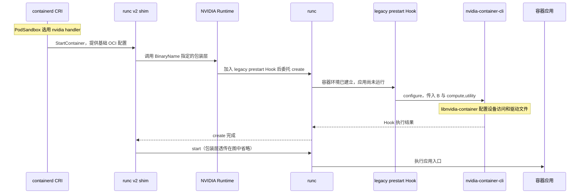

NVIDIA Container Toolkit 不是单一程序，也不等于 GPU 驱动。它包含可选的 `nvidia-container-runtime` 包装层（下文简称 NVIDIA Runtime）、legacy Hook 所需的 CLI 与库，以及配置和 CDI 生成工具 `nvidia-ctk`。第 03 篇的原生 CDI 路径只要求节点上有可消费的规格；规格可以由 Toolkit 生成，也可以由 Kubernetes 设备插件等组件生成，不要求低层调用 NVIDIA 包装层。 [Toolkit 1.18.2 架构](https://docs.nvidia.com/datacenter/cloud-native/container-toolkit/1.18.2/arch-overview.html)

## 组件各在哪一层工作

| 组件 | 类别与职责 | 在主路径中是否必需 |
| --- | --- | --- |
| `nvidia-ctk` | 配置与设备描述工具。可配置容器引擎，也可生成、列出 CDI 设备描述。 | 可由它生成规格，但 containerd 消费已有规格时不调用它。 |
| `nvidia-container-runtime` | 可选的低层运行时包装层。在 `create` 路径按模式修改 OCI 配置，再委托 runc 等低层运行时。 | 原生 CDI 不需要；JIT CDI、包装层 `cdi` 和 legacy 需要。 |
| `nvidia-container-runtime-hook` | legacy 路径使用的 OCI `prestart` Hook，根据请求调用配置 CLI。 | 只有实际走 legacy Hook 时才是设备配置主体。 |
| `nvidia-container-cli` 与 `libnvidia-container` | CLI 调用库提供的设备与驱动文件发现、容器配置能力。 | legacy 的核心执行者；不要把它与 containerd 原生 CDI 解析混为一步。 |
| Toolkit 的 CDI 生成库 | 从 NVML 等平台信息形成设备描述和 OCI 修改。 | 可用于持久规格，也可供 JIT CDI 在内存中生成描述。 |

这些组件准备的是容器访问条件，不负责 Kubernetes 的资源计数、设备健康上报或选卡。驱动、Toolkit、Device Plugin 的安装与版本协调由第 12 章展开。

## handler 决定本次是否进入包装层

Kubernetes 的 `RuntimeClass` 把 Pod 的 `runtimeClassName` 映射到一个 `handler`。kubelet 在创建 PodSandbox 时传递运行时名称；空 handler 使用 containerd 的默认运行时。containerd 再按该名称读取 runtime 配置。`runtime_type = "io.containerd.runc.v2"` 选择 shim 类型，`BinaryName` 决定 shim 调用普通 runc 还是 NVIDIA 包装层。登记了一个名为 `nvidia` 的 runtime 与本次实际选中它，是两项独立证据。 [Kubernetes RuntimeClass](https://kubernetes.io/docs/concepts/containers/runtime-class/) · [CRI v0.36.0 接口](https://github.com/kubernetes/cri-api/blob/v0.36.0/pkg/apis/runtime/v1/api.proto) · [containerd 2.3.0 CRI 配置](https://github.com/containerd/containerd/blob/v2.3.0/docs/cri/config.md)

下面三段是同一套**教学配置的相关部分**。假设 `nvidia-ctk runtime configure --runtime=containerd` 在 Toolkit `1.18.2` 的默认布局下写入 drop-in，并更新主配置的 `imports`；已有导入项和安装路径须以实际节点为准。示例故意保留 `runc` 为默认运行时，便于说明“安装”与“选中”的区别。 [Toolkit 1.18.2 配置 containerd](https://docs.nvidia.com/datacenter/cloud-native/container-toolkit/1.18.2/install-guide.html#configuring-containerd-for-kubernetes)

```toml
# /etc/containerd/config.toml
version = 3
imports = ["/etc/containerd/conf.d/99-nvidia.toml"]

[plugins."io.containerd.cri.v1.runtime".containerd]
  default_runtime_name = "runc"
```

```toml
# /etc/containerd/conf.d/99-nvidia.toml
version = 3

[plugins."io.containerd.cri.v1.runtime".containerd.runtimes.nvidia]
  runtime_type = "io.containerd.runc.v2"

[plugins."io.containerd.cri.v1.runtime".containerd.runtimes.nvidia.options]
  BinaryName = "/usr/bin/nvidia-container-runtime"
```

若 PodSandbox 使用 `nvidia` handler，shim 调用 `/usr/bin/nvidia-container-runtime`；若 handler 为空，上例使用默认 `runc`。此时即使镜像写了 `NVIDIA_VISIBLE_DEVICES`，普通 runc 也不会据此发现 NVIDIA 设备并追加 legacy Hook。`RuntimeClass` 选择运行时入口，不负责选择 GPU。直接用 `ctr`、`nerdctl` 或 Docker 成功启动 GPU 容器，也只能证明各自客户端和配置入口，不能替代本次 CRI 请求的证据。

## 四种注入路径要按“谁修改 OCI”区分

Toolkit 自 `1.18.0` 起在本例这类 NVML 平台的 `mode=auto` 下，对普通 GPU 选择器默认采用即时 CDI。下面的比较以 `1.18.2` 为版本锚点；实际节点仍须结合平台、选择器语法和包装层日志确认解析出的模式。 [Toolkit 1.18.0 默认模式变化](https://docs.nvidia.com/datacenter/cloud-native/container-toolkit/1.18.0/release-notes.html) · [Toolkit 1.18.2 模式选择](https://github.com/NVIDIA/nvidia-container-toolkit/blob/v1.18.2/internal/info/auto.go)

| 路径 | 设备选择输入 | 谁、在何时修改 OCI | 是否读取节点上的持久 CDI 规格 |
| --- | --- | --- | --- |
| containerd 原生 CDI | CRI `CDI_devices` 的全限定设备名 | containerd CRI 在 `CreateContainer` 组装配置时应用修改。 | 是，由其有效规格目录提供。 |
| NVIDIA Runtime 即时（Just-In-Time，JIT）CDI | 选中 NVIDIA 包装层，`mode=auto`，在 NVML 平台使用普通 GPU UUID 或索引选择器 | 包装层在低层 `create` 前按请求在内存生成 CDI 描述并应用修改。 | 这条 JIT 主路径不依赖事先生成的持久规格。 |
| NVIDIA Runtime `cdi` 模式 | 选中包装层，并传入全限定 CDI 名；`auto` 可据此解析为 `cdi`，也可显式配置 | 包装层在低层 `create` 前查找规格并应用修改。 | 是，但消费者是包装层，不是第 03 篇的 containerd CRI。 |
| NVIDIA Runtime 显式 legacy | `NVIDIA_VISIBLE_DEVICES` 选择设备，`NVIDIA_DRIVER_CAPABILITIES` 选择驱动功能 | 包装层先加入 `prestart` Hook，runc 创建时由 Hook 调用 CLI 配置容器。 | 不以持久 CDI 规格作为这条路径的设备描述。 |

四者最后都能让 runc 面对包含 GPU 访问条件的容器，但请求字段、修改者和失败时点不同。排障时先画实际经过的列，再查对应证据；不要把“节点有 `/var/run/cdi/nvidia.yaml`”当成所有路径的必经条件。 [Toolkit 1.18.2 CDI 与 JIT CDI](https://docs.nvidia.com/datacenter/cloud-native/container-toolkit/1.18.2/cdi-support.html) · [Toolkit 1.18.2 CDI 修改实现](https://github.com/NVIDIA/nvidia-container-toolkit/blob/v1.18.2/internal/modifier/cdi.go)

## legacy 用环境变量选择设备和驱动功能

显式 legacy 在 `1.18.2` 中仍受支持，但已弃用。为看清它的机制，本例只在这一对照路径设置：

```toml
# /etc/nvidia-container-runtime/config.toml
[nvidia-container-runtime]
  mode = "legacy"
  runtimes = ["runc"]
```

并假设容器请求含：

```text
NVIDIA_VISIBLE_DEVICES=GPU-bbbbbbbb-bbbb-bbbb-bbbb-bbbbbbbbbbbb
NVIDIA_DRIVER_CAPABILITIES=compute,utility
```

`NVIDIA_VISIBLE_DEVICES` 选择要暴露的 B。`NVIDIA_DRIVER_CAPABILITIES` 选择随功能准备的驱动文件和工具：`compute` 对应 CUDA 等计算库，`utility` 对应 NVML 与 `nvidia-smi` 等管理能力。只选择 `utility` 时，管理查询可能成功而计算驱动库仍不完整；这不是“可见设备相同就证明注入内容相同”的反例，而是输入中的驱动功能已经不同。 [Toolkit 1.18.2 GPU 选择与驱动功能](https://docs.nvidia.com/datacenter/cloud-native/container-toolkit/1.18.2/docker-specialized.html)

legacy 包装层并不直接在 shim 调用时完成全部设备配置，而是给 OCI 配置加入 `prestart` Hook。按 OCI 1.2.1 的定义，`prestart` 在低层 `create` 中、容器命名空间建立之后执行，早于 `pivot_root` 或等价操作及用户应用入口，Hook 本身位于 runtime namespace。Hook 再调用 `nvidia-container-cli`，由 `libnvidia-container` 发现设备和文件并配置容器。 [OCI 1.2.1 `prestart` 生命周期](https://github.com/opencontainers/runtime-spec/blob/v1.2.1/config.md#prestart) · [Toolkit 1.18.2 Hook 实现](https://github.com/NVIDIA/nvidia-container-toolkit/blob/v1.18.2/cmd/nvidia-container-runtime-hook/main.go)



containerd `2.3.0` 的 CRI `CreateContainer` 已先准备配置，低层任务创建发生在 `StartContainer`。因此 legacy Hook 出错可能表现为 `StartContainer` 失败，而不是第 03 篇原生 CDI 名称解析时的 `CreateContainer` 失败。取证时还要区分交给包装层前的 OCI 配置、包装层加 Hook 后的配置，以及 Hook 执行后容器中的实际文件和设备。 [containerd 2.3.0 启动实现](https://github.com/containerd/containerd/blob/v2.3.0/internal/cri/server/container_start.go)

## 混合配置时先确认实际模式与修改来源

原生 CDI 也可能与 NVIDIA 包装层同时出现在一条创建链中。例如 CRI 已应用 CDI 修改，shim 又调用包装层。CDI 规格中的 `NVIDIA_VISIBLE_DEVICES=void` 用于避免旧式设备选择再造成隐式注入，但最终仍要以包装层解析出的模式、实际 Hook 和生效配置核对，不能凭一个环境变量假定其他修改不存在。

同样，CDI 规格可以加入更新容器库缓存等辅助 Hook。Toolkit `1.18.2` 的此类生成逻辑使用 `createContainer` 生命周期，与上述 legacy `prestart` 不是同一个执行点。看到 `hooks` 不等于走了 legacy；关键问题是这个 Hook 由谁写入、在哪个生命周期执行、是否承担 NVIDIA 设备发现与配置。分别保留 CRI 请求、containerd 组装结果、包装层日志和容器内结果，才能避免把两次修改误认为一次。 [Toolkit 1.18.2 CDI 工作负载说明](https://docs.nvidia.com/datacenter/cloud-native/container-toolkit/1.18.2/cdi-support.html#running-a-workload-with-cdi) · [Toolkit 1.18.2 CDI 辅助 Hook](https://github.com/NVIDIA/nvidia-container-toolkit/blob/v1.18.2/internal/discover/hooks.go#L180-L193) · [NVIDIA 驱动文件生成](https://github.com/NVIDIA/nvidia-container-toolkit/blob/v1.18.2/pkg/nvcdi/driver-nvml.go)

到这里，四条路径都能解释“设备访问条件由谁准备”。下一篇解决另一个独立问题：即使注入成功，主机索引、`/dev/nvidiaN` 和程序里的 `cuda:0` 也未必使用同一套编号，必须用设备身份把它们重新对齐。
