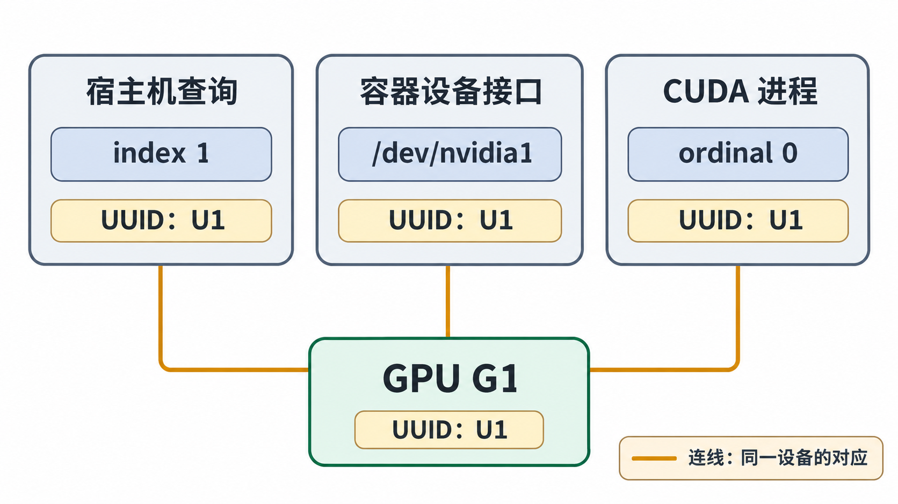

# 把容器内的 GPU 对应回宿主机

## 三种编号回答三个问题

宿主机查询 `index 1`、容器中的 `/dev/nvidia1`、应用中的 `cuda:0` 可以同时指向 G1。它们分别是管理工具本轮枚举的索引、Linux 设备节点路径、CUDA 进程本轮的逻辑序号。把三种数字直接相等，会让“应用在 0 号卡出错”变成含糊的故障记录。

本章用完整 GPU UUID 关联同一个整卡设备，再用 PCI Bus ID 确认当前主机位置。UUID 不依赖本轮 CUDA 的序号；但更换物理卡会改变 UUID，MIG 实例还有自己的标识和生命周期，不能把这里的整卡结论无限延伸。Bus ID 是当前 PCIe 枚举的位置，拓扑改变后也应重新采集。

## 先交付 G1，再观察应用枚举

下面是 **ct-a 的自拟输出**，字段顺序由命令给定，省略无关信息：

```text
$ nvidia-smi --query-gpu=index,uuid,pci.bus_id --format=csv,noheader
0, GPU-11111111-1111-4111-8111-111111111111, 00000000:31:00.0
1, GPU-22222222-2222-4222-8222-222222222222, 00000000:B1:00.0
```

创建容器 C1 时，运行时仅交付 U1 及所需公共接口。C1 未设置 `CUDA_VISIBLE_DEVICES`，应用可访问的 CUDA 整卡集合只有 G1。容器内的**自拟材料**为：

```text
$ ls -l /dev/nvidia1
crw-rw-rw- 1 root root 195, 1 ... /dev/nvidia1
# 同时存在本路径所需的公共接口，不存在 /dev/nvidia0

$ nvidia-smi --query-gpu=uuid,pci.bus_id --format=csv,noheader
GPU-22222222-2222-4222-8222-222222222222, 00000000:B1:00.0

$ /opt/lesson/gpu-probe --enumerate
cuda_count=1
cuda_ordinal=0 uuid=GPU-22222222-2222-4222-8222-222222222222 pci=0000:b1:00.0
```

探针字段 `cuda_ordinal` 是 CUDA API 返回的本进程设备序号，`uuid` 和 `pci` 是它查询到的设备身份。PCI 输出格式中的 domain 零填充和字母大小写不同，规范化后均为同一 `b1:00.0` 位置。管理查询有一个设备，应用枚举也有一个设备，两者通过 UUID 连在一起；应用的 0 因而对应宿主机当前 index 1。设备文件仍叫 `/dev/nvidia1`，本例没有将字符设备重命名成 0。



图 10-04-01　容器仅获交付 G1 且未设 CUDA 过滤时，CUDA 将唯一设备编号为 0；宿主机本轮查询 index 与节点后缀仍为 1。U1 是 `GPU-22222222-2222-4222-8222-222222222222` 的短代号，连线表示身份对应，不表示数据搬运。

后续启动器若为 C1 中唯一进程设 `LOCAL_RANK=0`，应用可以按约定选择 `cuda:0`；Local Rank 是启动器提供的进程角色编号，不是宿主机 GPU index。第 05 章的 Rank 映射在容器中仍成立，只需把“本进程能枚举到的设备集合”纳入映射。

## NVIDIA_VISIBLE_DEVICES 与 CUDA_VISIBLE_DEVICES 改变不同阶段

前者在本章的 NVIDIA 注入路径中参与**创建时交付**；后者由 CUDA 在进程初始化时读取，控制**本进程 CUDA 枚举的过滤与顺序**。一个容器可以包含多个进程，使用不同的 CUDA 枚举设置，却仍共享创建时交付的设备范围。

为了做确定推演，另建 C2，交付两张卡，设定本题未过滤时 CUDA 顺序为 `[U0,U1]`，此顺序是明确给定的教学条件，不由宿主机查询 index 自动推断。每行启动一个新进程，比较如下：

| C2 内进程环境 | `cuda_count` | `cuda:0` | `cuda:1` |
| --- | --- | --- | --- |
| 不设 `CUDA_VISIBLE_DEVICES` | 2 | U0 | U1 |
| `CUDA_VISIBLE_DEVICES=1,0` | 2 | U1 | U0 |
| `CUDA_VISIBLE_DEVICES=GPU-22222222-2222-4222-8222-222222222222` | 1 | U1 | 不存在 |
| `CUDA_VISIBLE_DEVICES=-1` | 0 | 不存在 | 不存在 |

重新排序后 `cuda:0` 仍只是当前进程的第一个可见设备。若 C1 只获交付 U1，把 `CUDA_VISIBLE_DEVICES` 改成 U0 的 UUID，也无法让 U0 的设备权限与接口凭空出现。相反，C2 原本交付两卡，仅用 `CUDA_VISIBLE_DEVICES` 隐藏一张，属于 CUDA API 的进程级选择，不能当作防止其他进程访问那张卡的安全边界。变量与枚举顺序依据见 [CUDA 12.8.1 Programming Guide：CUDA Environment Variables](https://docs.nvidia.com/cuda/archive/12.8.1/cuda-c-programming-guide/index.html#env-vars)。

`nvidia-smi` 使用 NVML；不要要求它的行数或 index 必须随着 `CUDA_VISIBLE_DEVICES` 变化。上表的结论来自 CUDA 探针，并未假定 NVML 与 CUDA 的枚举编号完全一致。故障材料应保留 UUID，而不是把两种工具都出现的“0”当作关联键。

## 从映射继续走到计算完成

仅有一个可见设备后，探针在 `cuda:0` 分配缓冲，传入 `[1,2,3,4]` 与 `[10,20,30,40]`，执行逐元素相加，检查 Kernel 提交错误和同步返回，读回并比对四个元素。以下是 **C1 的自拟成功记录**：

```text
selected_cuda_ordinal=0
selected_uuid=GPU-22222222-2222-4222-8222-222222222222
allocate=ok h2d=ok launch_check=ok sync=ok d2h=ok
expected=[11,22,33,44]
actual=[11,22,33,44]
verify=PASS
```

这份记录支持“C1 中这个应用，在本次运行中使用 U1 完成了给定计算并获得正确结果”。它不产生两卡 P2P、NCCL、RDMA 或性能基线的结论；那些目标各有自己的路径和材料。接下来借助同样的观察点阅读失败记录。

[上一篇：用 CDI 把设备名变成运行环境](03_用CDI把设备名变成运行环境.md) · [下一篇：从失败记录追到缺失环节](05_从失败记录追到缺失环节.md)
