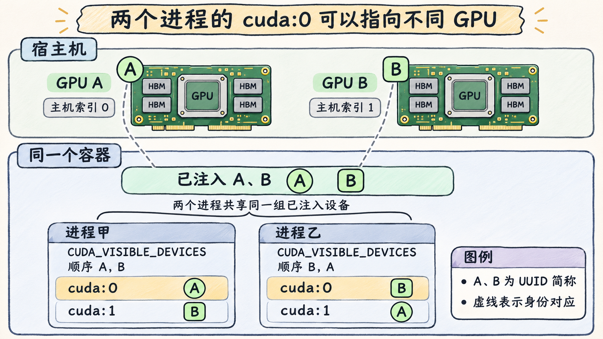

# GPU UUID、设备节点与 CUDA 进程序号

排障多卡容器时，常遇到一个怪现象。宿主机上的 1 号卡，进容器后怎么变成了 `cuda:0`？甚至同一个容器里的两个进程，它们的 `cuda:0` 还能指向不同物理卡。

原因其实很直接。宿主机管理索引、设备文件名和 CUDA 进程序号，本来就属于三套独立编号。跨层认卡时，唯一稳固的锚点是 **UUID**。在同节点上，再配 **PCI BDF** 核对物理槽位。

## 先建立宿主机设备清单

分配设备前，先在 `node-10` 上查出两张 H100 的身份基线：

```sh
# 采集宿主机索引、全局唯一 UUID、PCI BDF 与驱动版本
nvidia-smi --query-gpu=index,uuid,pci.bus_id,driver_version --format=csv
# 示例输出：
# index, uuid, pci.bus_id, driver_version
# 0, GPU-aaaaaaaa-aaaa-aaaa-aaaa-aaaaaaaaaaaa, 00000000:41:00.0, 595.91.07
# 1, GPU-bbbbbbbb-bbbb-bbbb-bbbb-bbbbbbbbbbbb, 00000000:81:00.0, 595.91.07
```

再用 `nvidia-smi -q` 或 `stat /dev/nvidia*` 补齐节点路径与次设备号。后文简称这两张卡为 GPU A 与 GPU B：

| 简称 | 宿主机 `nvidia-smi` 索引 | 设备节点与次设备号 | PCI BDF | 完整 UUID |
| --- | ---: | --- | --- | --- |
| **GPU A** | `0` | `/dev/nvidia0`（次设备号 `0`） | `0000:41:00.0` | `GPU-aaaaaaaa-aaaa-aaaa-aaaa-aaaaaaaaaaaa` |
| **GPU B** | `1` | `/dev/nvidia1`（次设备号 `1`） | `0000:81:00.0` | `GPU-bbbbbbbb-bbbb-bbbb-bbbb-bbbbbbbbbbbb` |

> [!tip] 工程直觉：两个容易踩坑的细节
> 1. **索引巧合不可推广**：上表里主机索引 `0/1` 恰好与 `/dev/nvidia0`、`/dev/nvidia1` 一致，但这只是当前启动周期的巧合。节点重启或热插拔后，管理工具的索引顺序可能发生变化，切忌写死“索引 N 就是 `/dev/nvidiaN`”。
> 2. **BDF 域宽格式差异**：`nvidia-smi` 常输出 8 位域号（`00000000:81:00.0`），而 `lspci` 与 CUDA API 常输出 4 位域号（`0000:81:00.0`）。两者表示同一个物理地址，比对时按数值对齐即可。

## 三层可见范围分别由谁拍板

一张物理卡变成代码里的 `cuda:0`，要经过三道独立的视图过滤：

1. **容器启动时的设备集合（硬边界）**：由 CDI 规格或 Toolkit 包装层决定挂入哪些设备节点、放行哪些 cgroup 设备规则。这道边界由内核兜底，容器内任何环境变量都无法越权突破。
2. **容器内的 NVML 管理视图**：容器里运行 `nvidia-smi` 时，经由 NVML 查询可见设备。它走的是管理支路，受限于 NVML 的枚举与句柄访问语义，其索引顺序独立于上层 CUDA 进程变量。
3. **单个 CUDA 进程的可见列表（软视图）**：每个 CUDA 进程启动时读取自己的 `CUDA_VISIBLE_DEVICES` 环境变量，对容器内可用 GPU 进行筛选与重新排序，再从 `0` 开始顺序编号。

未设置 `CUDA_VISIBLE_DEVICES` 时，默认排序由 `CUDA_DEVICE_ORDER` 控制（如按 PCI 总线排序）。请特别区分两种状态：**未设置变量**会保留默认枚举；**设为空字符串 `""`** 则会彻底清空该进程的可见列表。

## 三种常见场景如何改变进程序号

假设驱动库与设备权限全部健康。下表对比三种交付与环境变量组合的结果（真实环境需填完整 UUID，表中简记为 A、B）：

| 容器注入的 GPU | 进程 `CUDA_VISIBLE_DEVICES` | 容器内独立 NVML 查询 | 该 CUDA 进程的枚举结果 |
| --- | --- | --- | --- |
| **仅 GPU B** | 未设置 | 按 UUID 列出 GPU B | 可见数量 `1`，`cuda:0 → GPU B`。 |
| **GPU A 与 B** | `B,A`（反序） | 列出 GPU A 与 GPU B | 可见数量 `2`，`cuda:0 → GPU B`、`cuda:1 → GPU A`。 |
| **仅 GPU B** | `""`（空字符串） | 按 UUID 仍列出 GPU B | 无可用 CUDA 设备，API 返回 `cudaErrorNoDevice`。 |

在双卡容器里，同时拉起进程甲（`A,B`）与进程乙（`B,A`）。它们共享同一组设备，各自的 `cuda:0` 却指向了相反的物理卡：



*图 10-05-01：同一双卡容器中两个进程因 `CUDA_VISIBLE_DEVICES` 顺序相反，导致各自的 `cuda:0` 分别映射到物理 GPU A 与 GPU B。*

> [!warning] 常见误区：进程看不到卡，别急着怀疑容器没挂卡
> 上表第三行清楚地展示了这一点：`CUDA_VISIBLE_DEVICES=""` 只影响当前这个 CUDA 进程。宿主机驱动、容器设备节点与独立 NVML 查询全都安然无恙。排查“程序报无 GPU”时，第一时间先打印该进程的环境变量，能省下大量误查基础设施的时间。

## 在代码和日志里把序号回查为物理卡

既然 `cuda:0` 在不同进程里随时会变，训练和推理日志绝不能只打一句 `Using cuda:0`。正确做法是在 `cudaGetDeviceCount` 成功后，再查清物理身份。用 `cudaGetDeviceProperties` 读出 UUID，用 `cudaDeviceGetPCIBusId` 读出 BDF 并落盘：

```text
# 单卡容器（仅注入 GPU B、未设置 CUDA_VISIBLE_DEVICES）的探针回查记录
enumerate: cudaSuccess
visible_devices=1
device_ordinal=0 uuid=GPU-bbbbbbbb-bbbb-bbbb-bbbb-bbbbbbbbbbbb
pci_bus_id=0000:81:00.0
select: cudaSuccess
synchronize: cudaSuccess
output=7
```

对照开篇的宿主机清单，跨层对齐一秒完成：

- **UUID 锁定整卡**：进程内的 `device_ordinal=0` 确凿无疑地对应宿主机上的 GPU B。
- **BDF 核对物理槽位**：`0000:81:00.0` 吻合 `node-10` 上本次主机索引 `1` 对应的插槽。
- **严谨处理无卡错误**：当 `cudaGetDeviceCount` 返回 `cudaErrorNoDevice` 时，程序应当立即保留错误码并中止枚举，切忌继续读取未初始化的计数值或强行访问 `0` 号卡。

> [!summary] 核心结论
> 宿主机的 `0/1`、容器里的 `/dev/nvidia1`、程序里的 `cuda:0` 属于三张不同的编号表。**跨层追踪永远认准 UUID，同机定位再核对 BDF**；改变 `CUDA_VISIBLE_DEVICES` 只重排或屏蔽单个 CUDA 进程，既动不了内核权限，也改不了 NVML 查询结果。

MIG 实例的切分标识将在[第 14 章](../14_GPU共享、切分与隔离/00_内容大纲.md)展开。整卡交付机制已全部就位。下一篇我们串起前五篇知识，专治“宿主机有卡、容器用不了”的排障难题。

> [!info]- 参考资料
> - **CUDA 环境变量与设备 API**：[CUDA 13.2.1 环境变量总览（含 `CUDA_DEVICE_ORDER`）](https://docs.nvidia.com/cuda/archive/13.2.1/cuda-programming-guide/05-appendices/environment-variables.html)、[CUDA 13.2.1 `CUDA_VISIBLE_DEVICES` 规则](https://docs.nvidia.com/cuda/archive/13.2.1/cuda-programming-guide/05-appendices/environment-variables.html#cuda-visible-devices)、[CUDA 13.2.1 Runtime 设备管理 API](https://docs.nvidia.com/cuda/archive/13.2.1/cuda-runtime-api/group__CUDART__DEVICE.html)
> - **NVIDIA SMI 与 NVML 枚举语义**：[NVIDIA SMI 查询与设备属性手册](https://docs.nvidia.com/deploy/nvidia-smi/index.html)、[NVML 头文件设备计数与句柄定义（`nvml.h`）](https://github.com/NVIDIA/go-nvml/blob/v0.13.0-1/gen/nvml/nvml.h#L4190-L4279)
