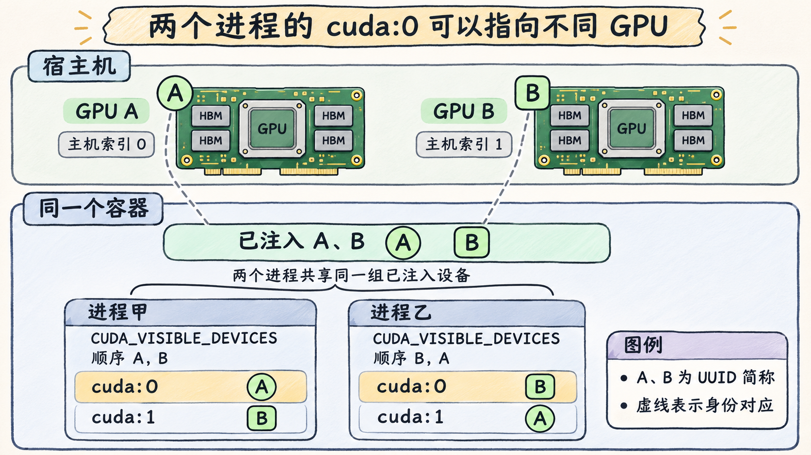

宿主机上的 1 号 GPU 可以是容器应用的 `cuda:0`，同一个容器里的另一个进程也可以把 `cuda:0` 指向另一张卡。原因是主机管理索引、设备文件名和 CUDA 进程序号服务于不同范围。跨层对齐时，先用 UUID（Universally Unique Identifier，通用唯一标识符）确认整卡身份，再用同节点、同一轮的 PCI BDF 核对物理位置。以下只讨论未切分的完整 GPU。 [NVIDIA SMI 设备标识](https://docs.nvidia.com/deploy/nvidia-smi/index.html) · [CUDA 13.2.1 设备枚举](https://docs.nvidia.com/cuda/archive/13.2.1/cuda-programming-guide/05-appendices/environment-variables.html#cuda-visible-devices)

## 先建立宿主机设备清单

`node-10` 的两张 H100 使用下面的**教学标识**。本次 `nvidia-smi` 将 A、B 列为 0、1，并假定对应 `/dev/nvidia0`、`/dev/nvidia1` 的次设备号也恰好为 0、1。这个巧合不能推出通用公式：不能凭主机管理索引直接拼出设备文件名，跨启动或重新配置后还要重新采集。

| 卡 | 本次主机 `nvidia-smi` 索引 | 主机设备路径及次设备号 | PCI BDF | 教学 UUID |
| --- | ---: | --- | --- | --- |
| A | 0 | `/dev/nvidia0`，0 | `0000:41:00.0` | `GPU-aaaaaaaa-aaaa-aaaa-aaaa-aaaaaaaaaaaa` |
| B | 1 | `/dev/nvidia1`，1 | `0000:81:00.0` | `GPU-bbbbbbbb-bbbb-bbbb-bbbb-bbbbbbbbbbbb` |

主机与容器可用同一查询收集管理视角，次设备号另从 `nvidia-smi -q` 或设备节点属性核对：

```sh
nvidia-smi --query-gpu=index,uuid,pci.bus_id,driver_version --format=csv
```

PCI BDF 由域、总线、设备和功能号组成，可沿第 01、04 章的方法回查硬件拓扑。工具可能分别打印 `00000000:81:00.0` 与 `0000:81:00.0`，两者只是域字段宽度不同，应按地址字段的数值对齐。UUID 适合跨层关联整卡；BDF 用于验证它在该节点的物理位置，不宜单独作为跨节点全局身份。NVIDIA 也说明工具索引顺序可能在重启后变化。 [NVIDIA SMI 查询与设备属性](https://docs.nvidia.com/deploy/nvidia-smi/index.html)

## 三层可见范围分别由什么决定

1. **容器启动时的设备集合。** 原生 CDI 按请求全名展开 B 的设备和访问规则，legacy 则按 `NVIDIA_VISIBLE_DEVICES` 等输入配置。设备节点、cgroup 设备规则、Unix 权限与安全策略共同形成实际访问边界。
2. **NVML 管理查询。** 容器中的 `nvidia-smi` 经 NVML 取得管理视图。注入清单不能单独决定 NVML 的自然枚举集合和索引；NVML 的设备计数甚至可能包含随后无法取得句柄的设备，因此要按具体 API 和本次输出记录。它使用管理支路，不能直接替代 CUDA 进程的可见性和计算检查。 [NVML 计数、句柄与索引语义](https://github.com/NVIDIA/go-nvml/blob/v0.13.0-1/gen/nvml/nvml.h#L4190-L4279)
3. **每个 CUDA 进程的可见列表。** `CUDA_VISIBLE_DEVICES` 可在进程启动环境中筛选并重排 CUDA 设备，序号为该列表中的位置。它不会扩大内核已经拒绝的设备访问范围；改变一个进程的环境，也不会自动改变同容器的其他进程。

`CUDA_VISIBLE_DEVICES` 未设置时，`CUDA_DEVICE_ORDER` 可改变 CUDA 默认枚举顺序，例如按 PCI 总线地址排序。显式用 `CUDA_VISIBLE_DEVICES` 给出设备列表时，本例按给定顺序推导。空字符串与变量未设置是两种状态：前者让 CUDA 可见列表为空，后者保留默认枚举行为。CUDA 文档还明确区分 NVML 与该变量的作用范围，所以 CUDA 进程没有可见设备时，独立 NVML 查询仍可能列出 B。 [CUDA 13.2.1 可见设备与枚举顺序](https://docs.nvidia.com/cuda/archive/13.2.1/cuda-programming-guide/05-appendices/environment-variables.html)

## 三种条件变体怎样改变序号

假设每轮使用同一镜像，设备节点、访问规则、库和驱动均满足要求。管理列只记录题设查询结果，**不能由“只注入 B”推出 B 的 NVML 索引必然为 0**；跨层对齐使用 UUID。A、B 在真实 `CUDA_VISIBLE_DEVICES` 中应替换为完整 UUID。

| 容器启动时提供的 GPU | 进程 `CUDA_VISIBLE_DEVICES` | 容器内 NVML 查询示例 | 该 CUDA 进程的结果 |
| --- | --- | --- | --- |
| 仅 B | 未设置 | 按 UUID 查询到 B；NVML index 以实际输出为准 | 一张可见设备，`cuda:0 → B`。 |
| A、B | `B,A` | 本次给定观测为 `0 → A`，`1 → B` | 两张可见设备，`cuda:0 → B`，`cuda:1 → A`。 |
| 仅 B | 空字符串 | 按 UUID 查询到 B；NVML index 以实际输出为准 | 没有有效 CUDA 序号；检查 API 返回状态，可能报告 `cudaErrorNoDevice`。 |

第二行若另启一个进程，设置 `CUDA_VISIBLE_DEVICES=A,B`，该进程的 `cuda:0` 就指向 A。两个进程共享同一组容器设备，但各自的可见列表顺序相反，所以日志中相同的 `cuda:0` 不能跨进程直接比较。



*图 10-05-01　上方是硬件视图，下方是同一宿主机上的容器视图。虚线把物理卡关联到容器已提供的设备集合。两个 CUDA 进程以相反顺序枚举同一组设备，所以各自的 `cuda:0` 指向不同卡。A、B 是教学 UUID 简称，实际设置使用完整 UUID。*

第三行只改变 CUDA 进程环境，B 的设备与驱动文件仍在容器中，独立 NVML 查询也仍可成功。由此可把一个容易混淆的判断拆开：**进程环境隐藏了设备**，不等于**容器启动时没有注入设备**，更不等于**宿主机没有检测到 GPU**。

## 探针怎样把序号回查为物理卡

CUDA 探针先检查 `cudaGetDeviceCount` 的返回值，调用成功后再读取计数。对每个有效序号，可用 `cudaGetDeviceProperties` 读取 UUID，用 `cudaDeviceGetPCIBusId` 读取 BDF，再与同轮管理清单对齐。不能只打印一个设备数就声称知道它选中了哪张卡。 [CUDA 13.2.1 Runtime 设备 API](https://docs.nvidia.com/cuda/archive/13.2.1/cuda-runtime-api/group__CUDART__DEVICE.html)

以“仅 B、变量未设置”为例，探针记录为：

```text
enumerate: cudaSuccess
visible_devices=1
device_ordinal=0 uuid=GPU-bbbbbbbb-bbbb-bbbb-bbbb-bbbbbbbbbbbb
pci_bus_id=0000:81:00.0
select: cudaSuccess
synchronize: cudaSuccess
output=7
```

这是一段**教学记录**。UUID 将进程序号 0 对到 B，BDF 再对到 `node-10` 上本次主机索引 1 的卡；同步与回读说明确实在 B 上完成了探针计算。若枚举报告 `cudaErrorNoDevice`，应保留错误并停止读取无效序号，而不是把预先清零的计数变量当成一次成功枚举的证明。

MIG 实例、共享切分及不同设备标识由第 14 章展开。本章的整卡映射已经足以支撑故障定位：下一篇会把请求、OCI 修改、设备打开、库装载、枚举身份和计算完成串成同一条证据链。
