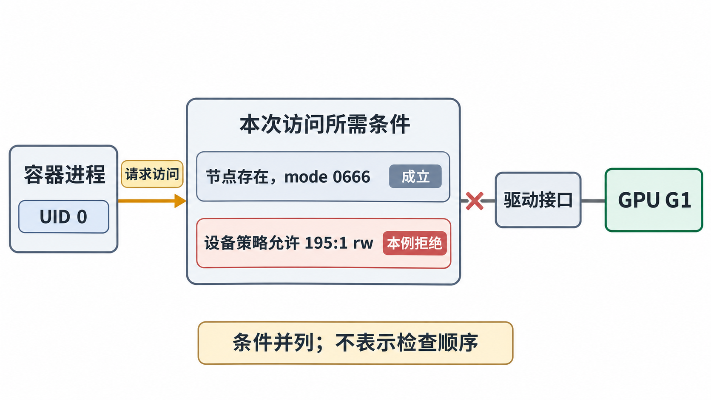

# 从失败记录追到缺失环节

## 先确定最后完成的阶段

“宿主机能看到 GPU、容器里不可用”还没有指出故障位置。先问入口进程是否运行：若 OCI 创建已经失败，应用内部日志不会出现；若进程已运行，才继续看库装载、枚举、内存与计算。再把本轮选择的 UUID、注入模式和实际装载文件连起来，能比单独收集更多错误字符串更快缩小范围。

下面各组都是**独立、自拟教学材料**；除明确改变的条件外，使用导读中的 ct-a 软件与设备基线。归纳字段如 `requested_handler`、`loader_summary` 是教学记录格式，不冒充某个版本的原始日志。它们给出各自推导需要的事实，真实排查时要从容器引擎、运行时日志、OCI 配置和进程装载记录获得对应信息。

| 已完成的观察 | 本轮已建立的事实 | 下一段需要的证据 |
| --- | --- | --- |
| 宿主机查询 U1，并运行同一计算成功 | 此时主机的管理与该计算路径可用 | 容器请求与实际选中的入口、设备选择 |
| OCI 创建成功，入口进程已运行 | 创建流程未在此前中止 | 容器节点、设备规则、挂载及实际装载路径 |
| 容器 NVML 查询到 U1 | 本次管理路径可以访问该设备 | CUDA Driver/Runtime 初始化与枚举 |
| CUDA 枚举到 U1 | 本进程此时可发现目标 CUDA 设备 | 分配、复制、Kernel 提交、同步和结果 |
| 同步与结果校验通过 | 本次目标计算已完成 | 若目标扩展到通信或性能，需要对应专项材料 |

## A：环境变量在，GPU 注入入口没有执行

```text
host_probe: uuid=GPU-22222222-2222-4222-8222-222222222222 verify=PASS
container_id=C-A
requested_handler=runc
effective_binary=/usr/bin/runc
native_cdi_request=none
NVIDIA_VISIBLE_DEVICES=GPU-22222222-2222-4222-8222-222222222222
oci_nvidia_hook=absent
entrypoint_started=yes
container_device=/dev/nvidia1 absent
loader_summary=libcudart.so.12 present; libcuda.so.1 not found
```

本轮请求直接使用普通 runc，没有原生 CDI 请求，也没有 legacy Hook。因此变量无人消费，容器文件视图里没有本次需要的设备与驱动库。缺口在创建入口到注入之间；并非看到 `libcuda` 缺失就该先在镜像里安装整套驱动。

修订应使这次请求走已配置的 NVIDIA legacy handler，或改为一条条件完整的 CDI 路径。随后核对最终设备、权限和挂载，再运行同一探针。这里并未提供 Kubernetes 资源分配记录，不能顺便断言设备插件有故障。

## B：管理功能交付了，计算驱动功能没交付

```text
container_id=C-B
handler=nvidia mode=legacy
NVIDIA_VISIBLE_DEVICES=GPU-22222222-2222-4222-8222-222222222222
NVIDIA_DRIVER_CAPABILITIES=utility
entrypoint_started=yes
device_and_access=U1 and required common interfaces available
nvidia-smi_query_uuid=GPU-22222222-2222-4222-8222-222222222222
loader_summary=NVML present; libcudart.so.12 present; libcuda.so.1 absent
cuda_init=failed
```

NVML 与 `nvidia-smi` 的成功和 CUDA 初始化失败在这里并不矛盾：本轮 legacy 功能集合明确只有 `utility`，且装载材料确认缺少 Driver API 库。将功能集合补成应用要求的 `compute,utility`，重新创建容器后复核。若原生 CDI 路径出现类似现象，应检查描述中的实际修改，不能直接套用此变量作为修复。

这条材料同时给出了选择、交付和装载结果，所以可以得出确定结论；若只有一行“CUDA 初始化失败”，则还不足以选中这一原因。

## C：节点看得见，设备访问规则拒绝

```text
container_id=C-C
entrypoint_started=yes
process_uid=0 user_namespace_remap=no
/dev/nvidia1=char 195:1 mode 0666
driver_libraries=correct host version, loaded successfully
device_policy_audit=deny char 195:1 read/write
open_trace=openat(..., "/dev/nvidia1", O_RDWR) = -1 EPERM
```

字符设备路径和文件权限均成立，本轮审计又明确记录设备策略拒绝 `195:1`。因此应追踪运行时生成的设备允许规则及其应用过程，而不是反复 `chmod 666`。单独看到 EPERM 仍可能涉及其他策略；这里有配对审计才把拒绝归到设备规则。



图 10-05-01　在本例其他条件成立时，节点存在与文件权限允许，仍不能覆盖设备策略对 195:1 读写的拒绝。图把条件并列呈现，不规定内核检查顺序；UID 0 指普通容器中的进程。

以 privileged 容器跑通，只能说明改变了包括设备访问在内的一组限制。它不能证明其中哪项原配置错误。当前材料已经足以定位设备规则，下一步应保留普通容器约束，修正交付过程并复查该规则与同一探针结果，而不把 privileged 作为普通 CUDA 容器的必需条件。

## D：CDI 名称能匹配，描述引用旧文件

本组改用 **containerd CRI 原生 CDI**，普通低层运行时创建。主机驱动已从旧版本升级到本章基线，运行中的主机探针使用新库成功：

```text
container_id=C-D
native_cdi=enabled
request=nvidia.com/gpu=GPU-22222222-2222-4222-8222-222222222222
resolved_file=/var/run/cdi/nvidia.yaml
matched_uuid=GPU-22222222-2222-4222-8222-222222222222
mount_source=/usr/lib/x86_64-linux-gnu/libcuda.so.535.104.05
host_file_exists=no
create_result=failed while preparing mount source
entrypoint_started=no
```

名称解析已经成功，失败发生在将描述落实为挂载时。重生成符合当前驱动文件与设备状态的描述，确认消费者读到新版本，再新建容器。只改请求索引、改 `CUDA_VISIBLE_DEVICES` 或修改应用程序，均没有补回缺失的源文件。

若连设备名都无法解析，则还要看请求拼写、当前命名策略、搜索目录、文件格式和 CDI 版本支持。那是更早的阶段，不应和本题的“匹配后挂载失败”合并。

## E：开始时成功，后来失去 GPU 访问

```text
container_id=C-E mode=legacy
t0: created; UUID=U1; probe verify=PASS
t1: systemd units reloaded; container update observed
t2: container nvidia-smi -> Failed to initialize NVML: Unknown Error
t2: host query and host probe -> PASS
```

legacy Hook 的部分修改发生在低层运行时所跟踪的 OCI 配置之外；后续容器更新可能丢失这部分设备访问条件。NVIDIA 文档记录了 systemd cgroup 环境中 daemon-reload 触发相关更新的已知问题，参见 [1.18.0 Troubleshooting：Containers losing access to GPUs](https://docs.nvidia.com/datacenter/cloud-native/container-toolkit/1.18.0/troubleshooting.html#containers-losing-access-to-gpus-with-error-failed-to-initialize-nvml-unknown-error)。这为本记录提供一个待核查的机制，不能把同一句 NVML 错误当作唯一原因。

应继续对比更新前后的设备访问状态、运行时记录与主机状态。本材料足以将注意力放到运行中容器的访问变化，尚未提供策略差异来完成最终归因。文档所述故障涉及重新创建容器才能恢复访问；在真实作业中须先按作业机制保存或恢复状态，再重建受影响实例。原生 CDI 将设备修改纳入运行时创建配置，有助于避开这类 legacy 修改不可见问题，但仍不能代替驱动健康、版本支持与实际验证。

## 应用装载记录比“库文件在”更接近事实

还有一类情况：设备交付正确，镜像自己的 `LD_LIBRARY_PATH` 却让程序先装载了一份旧驱动库或构建用 stub。stub 用于构建链接，不提供可运行的 GPU 驱动实现。故障材料需要确认运行中进程的实际装载路径，可从动态装载器诊断或 `/proc/<pid>/maps` 采集，而不是只看镜像目录、`nvcc --version` 或 `ldconfig -p` 的候选列表。

如果应用使用 `dlopen` 在运行中加载 `libcuda`，`ldd` 未列出它并不等于程序不需要 Driver API。将实际装载版本与宿主机内核驱动对应，才能区别镜像路径覆盖、注入缺失和宿主机驱动不一致。动态链接与驱动故障的完整基础见[第 03 章](../03_从驱动到CUDA应用的软件依赖/04_内核更新与库装载为何使GPU失效.md)。

至此，排查顺序可以稳定为：**本轮请求与入口 → 注入描述或 Hook → 最终设备/规则/挂载 → 实际库装载 → UUID 枚举 → 同步后的计算结果**。这个顺序让每份证据回答一个具体问题，下一篇用交付材料独立走完它。

[上一篇：把容器内的 GPU 对应回宿主机](04_把容器内的GPU对应回宿主机.md) · [下一篇：用交付材料完成综合推演](06_用交付材料完成综合推演.md)
