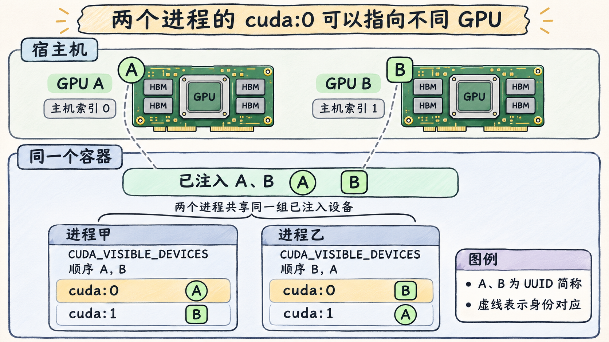

# 怎样对齐主机、容器与 CUDA 进程的 GPU 编号

宿主机上的 1 号 GPU 可以是容器内应用的 `cuda:0`。当 CUDA 进程只枚举到一张 GPU 时，它的设备序号从 0 开始。管理工具索引、设备文件次设备号和 CUDA 序号各自有作用，跨层对齐时应先对 UUID，再核对 PCI 位置。以下只讨论完整 GPU。 [NVIDIA SMI 设备标识](https://docs.nvidia.com/deploy/nvidia-smi/index.html) · [CUDA 13.2.1 枚举环境变量](https://docs.nvidia.com/cuda/archive/13.2.1/cuda-programming-guide/05-appendices/environment-variables.html#cuda-visible-devices)

## 先建立宿主机的设备清单

下面用同一节点的两张 H100 做**教学推演**。假设宿主机 `nvidia-smi` 本次将 A、B 列为 `0`、`1`，并假定 `nvidia-smi -q` 中的次设备号分别是 `0`、`1`。这两个数字恰好相同。跨启动或跨环境时，不能据索引直接推导 `/dev/nvidiaN` 的 `N`。 [NVIDIA SMI 枚举与 GPU 属性](https://docs.nvidia.com/deploy/nvidia-smi/index.html)

| 卡 | 本次主机 `nvidia-smi` 索引 | 主机设备路径及次设备号 | PCI BDF | 教学 UUID |
| --- | --- | --- | --- | --- |
| A | `0` | `/dev/nvidia0`，`0` | `0000:41:00.0` | `GPU-aaaaaaaa-aaaa-aaaa-aaaa-aaaaaaaaaaaa` |
| B | `1` | `/dev/nvidia1`，`1` | `0000:81:00.0` | `GPU-bbbbbbbb-bbbb-bbbb-bbbb-bbbbbbbbbbbb` |

在主机和容器里用同一查询收集管理视角，次设备号另从 `nvidia-smi -q` 或设备节点属性对照。PCI BDF 由域、总线、设备和功能号组成。若工具对域字段使用不同宽度，例如 `00000000:81:00.0` 与 `0000:81:00.0`，按字段数值对齐。UUID 用于稳定关联整卡，BDF 用于验证同节点的物理位置。NVIDIA 说明工具索引顺序可能在重启后变化。 [NVIDIA SMI 查询及设备标识](https://docs.nvidia.com/deploy/nvidia-smi/index.html)

```sh
nvidia-smi --query-gpu=index,uuid,pci.bus_id,driver_version --format=csv
```

## 再看启动注入与进程枚举

容器启动时，原生 CDI 可按设备全名注入 B，显式 legacy 则可用 `NVIDIA_VISIBLE_DEVICES` 的 UUID 选择 B。启动应用时，可通过进程环境中的 `CUDA_VISIBLE_DEVICES` 控制该进程的可见设备及枚举顺序。它只能从该进程有条件使用的设备中选择，容器实际访问范围仍由设备节点、内核权限与安全策略决定。未设置筛选变量时，`CUDA_DEVICE_ORDER` 可改变 CUDA 的默认枚举顺序。 [Toolkit 1.18.2 GPU 选择](https://docs.nvidia.com/datacenter/cloud-native/container-toolkit/1.18.2/docker-specialized.html#gpu-enumeration) · [CUDA 13.2.1 枚举环境变量](https://docs.nvidia.com/cuda/archive/13.2.1/cuda-programming-guide/05-appendices/environment-variables.html) · [Linux cgroup v2 设备控制](https://docs.kernel.org/6.18/admin-guide/cgroup-v2.html#device-controller)

假设每轮使用同一镜像，设备节点、访问规则和驱动库均满足所选设备的要求。表中的容器 `nvidia-smi` 索引是**示意观测值**。A、B 在进程环境里应替换成完整 UUID，表中只写简称。 [CUDA 13.2.1 可见设备与枚举顺序](https://docs.nvidia.com/cuda/archive/13.2.1/cuda-programming-guide/05-appendices/environment-variables.html#cuda-visible-devices)

| 容器注入 | 进程 `CUDA_VISIBLE_DEVICES` | 容器内管理查询示例 | CUDA 可见数量与序号 |
| --- | --- | --- | --- |
| 仅 B | 未设置 | `0 → B` | 1 张，`0 → B`。 |
| A、B | `B,A` | `0 → A`，`1 → B` | 2 张，`0 → B`，`1 → A`。 |
| 仅 B | 空字符串 | `0 → B` | 0 张，无有效 CUDA 序号。 |

第二行若另启一个进程并设置 `CUDA_VISIBLE_DEVICES=A,B`，该进程的 `cuda:0` 就会指向 A。同一个容器中的两个进程可以对同一序号得到不同身份。第三行只改变 CUDA 进程的环境，已注入的 B 仍可由独立的 NVML 查询观察。空字符串与变量未设置是两种状态。 [CUDA 13.2.1 枚举环境变量](https://docs.nvidia.com/cuda/archive/13.2.1/cuda-programming-guide/05-appendices/environment-variables.html#cuda-visible-devices) · [NVIDIA SMI 与 NVML](https://docs.nvidia.com/deploy/nvidia-smi/index.html)



图 10-05-01　上方是硬件视图，下方是同一宿主机上的容器视图。虚线把物理卡关联到容器的已注入设备集合，按 A、B 标签对齐身份。两个 CUDA 进程以相反顺序枚举同一组设备，所以各自的 `cuda:0` 指向不同的卡。A、B 是教学 UUID 简称，实际设置使用完整 UUID。

CUDA 探针先记录 `cudaGetDeviceCount` 的返回值，调用成功再读计数。逐个用 `cudaGetDeviceProperties` 取 UUID、用 `cudaDeviceGetPCIBusId` 取 BDF，再与管理清单对齐。例如第一行得到序号 `0`、B 的 UUID 和 `0000:81:00.0`，可追溯到宿主机的 B，即本次宿主机索引 `1` 对应的物理卡。若枚举报告 `cudaErrorNoDevice`，应保留错误，区分枚举报错和 API 成功返回计数。 [CUDA 13.2.1 设备 API](https://docs.nvidia.com/cuda/archive/13.2.1/cuda-runtime-api/group__CUDART__DEVICE.html)
