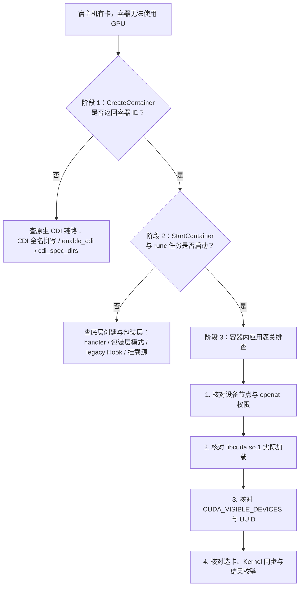

# 容器 GPU 故障的分层定位

宿主机上 `nvidia-smi` 一切正常，业务 Pod 却死活跑不起来。有人急着重装驱动，有人盲目重打十几 GB 的镜像。

其实容器 GPU 交付只有三个阶段。别盯着某句报错猜原因。顺着**同一次启动的时间线**切三刀，先锁定失败阶段，再逐层缩小范围。

## 先切三刀：按阶段收窄故障域



*图 10-06-01：容器 GPU 故障三阶段分层定位决策树。*

每个阶段都有明确的完成标志和第一手取证材料：

| 阶段 | 正常完成条件 | 优先核对的材料 |
| --- | --- | --- |
| **1. CRI `CreateContainer`** | containerd 接受请求、解析原生 CDI 全名、组装好 OCI 配置并返回容器 ID。 | 请求中的 CDI 全名、`cdi_spec_dirs` 生效配置、创建报错与生成的 OCI 配置。 |
| **2. CRI `StartContainer` 与底层创建** | shim 调用实际 `BinaryName`，runc `create/start` 成功；若走 legacy，Hook 完成设备与库挂载。 | PodSandbox handler、containerd runtime 配置、包装层解析模式与 Hook 日志。 |
| **3. 容器应用执行** | 进程加载驱动库、打开设备、枚举目标卡、选卡并完成同步计算。 | 容器内挂载与设备属性、`openat` 返回码、动态加载追踪、环境变量与 CUDA API 返回值。 |

> [!tip] 工程直觉：先看死在 `CreateContainer` 还是 `StartContainer`
> 在 `containerd 2.3.0` 中，原生 CDI 名称解析失败卡在 **`CreateContainer`**；而 NVIDIA Runtime 的 legacy `prestart` Hook 报错则卡在随后的 **`StartContainer`**。切开这两个时点，一眼就能分清问题出在 CDI 配置阶段还是低层启动阶段。

## 应用跑起来之后：六个检查点精准切分

容器顺利拉起后，按六个检查点取证。各程序加载库和打开设备的先后略有差异。排障时始终以**首个失败的系统调用或 API** 为起点：

| 检查点 | 已确认的事实 | 尚待继续验证的环节 |
| --- | --- | --- |
| **1. 挂载与文件存在** | 所需驱动库在容器视图里有候选文件。 | 动态链接器是否选中它、库与驱动版本是否兼容。 |
| **2. `openat` 返回有效 FD** | 当前进程以目标模式成功打开该设备入口。 | 控制/UVM 节点是否齐全、CUDA 初始化能否通过。 |
| **3. `nvidia-smi` 列出目标卡** | NVML 管理支路与工具链正常。 | `libcuda.so.1` 是否就位、CUDA 进程是否屏蔽了设备。 |
| **4. `dlopen("libcuda.so.1")` 成功** | 用户态计算驱动库已被解析并加载进进程。 | 它与宿主机内核模块及设备代码架构是否匹配。 |
| **5. CUDA 枚举并查出 UUID/BDF** | 当前进程拿到了指向目标物理卡的有效序号。 | 显存分配、Kernel 发射与设备端同步是否正常。 |
| **6. 选卡、同步与回读 `output=7`** | 探针在目标卡上完成了端到端计算。 | 交付验收闭环（更换镜像或驱动后需重验）。 |

进容器若连 `nvidia-smi` 都找不到，先查 `PATH` 与挂载，再跑探针测计算支路。若选卡通过却在首次 Kernel 报错，按[第 03 章](../03_从驱动到CUDA应用的软件依赖/00_内容大纲.md)查 cubin、PTX JIT 与驱动兼容。

## 一条健康基线与五类典型故障实战

先在 `node-10` 上锚定一条健康基线。环境为 `containerd 2.3.0`、`Toolkit 1.18.2`、cgroup v2 与普通 `runc`。目标卡是 GPU B（BDF `0000:81:00.0`，节点 `/dev/nvidia1`）：

```text
T+00s [host/node-10]  nvidia-smi 列出 GPU B，BDF=0000:81:00.0，驱动 R595 正常
T+01s [cri/r0 -> c0]  普通 runc + CDI_devices=["nvidia.com/gpu=<GPU B UUID>"]
                      CreateContainer 与 StartContainer 均返回成功
T+02s [container/c0]  NVML 列出 GPU B；探针成功加载 libcuda.so.1
                      cudaGetDeviceCount=1（cudaSuccess），cuda:0 映射至 GPU B
T+03s [container/c0]  cudaSetDevice(0)、Kernel launch、cudaDeviceSynchronize() 全通过
                      回读校验 output=7
```

固定上述环境、镜像与目标卡。下面五条记录各自**只改了一个条件**，看如何精准锁死根因层次：

| 故障编号 | 现场记录 | 最早锁定的根因层次 | 下一项区分性排查与单变量复核 |
| --- | --- | --- | --- |
| **案例 A** | CRI 请求漏掉 `CDI_devices`，走默认 `runc`；容器正常启动。本机 CDI 规格里明明有目标卡，但容器里缺 `/dev/nvidia1`。 | **缺少注入输入**：请求未触发原生 CDI，磁盘上的规格不会自动生效。 | 保持镜像与运行时不变，补全目标卡的 CDI 全名重新创建，核对 OCI 设备挂载并跑通探针。 |
| **案例 B** | 提交原生 CDI 请求，但全名末尾误写为 `…bbbc`。`CreateContainer` 报 `unresolvable CDI devices`，而 `nvidia-ctk cdi list` 末尾为 `…bbbb`。 | **CDI 名称解析失败**：死在配置组装阶段，容器压根未创建。 | 修正全名重试；若仍报同错，核对 containerd 生效的 `cdi_spec_dirs` 与规格文件语法错误。 |
| **案例 C** | 容器已启动，`stat` 显示 `/dev/nvidia1` 为 `c3:1`；进程执行 `openat("/dev/nvidia1", O_RDWR)` 返回 `-1 EPERM`。 | **设备打开被拒**：节点存在且设备号正确，请求倒在权限或策略门禁前。 | 按失败 PID 核对有效 cgroup 设备规则、安全审计日志（SELinux/AppArmor）与 Unix 权限；修复后以同身份重测打开与计算。 |
| **案例 D** | 容器已启动，NVML 正常列出目标卡。探针执行 `dlopen("libcuda.so.1", RTLD_NOW)` 返回空，报错 `cannot open shared object file`。 | **计算支路库解析失败**：管理支路畅通，问题孤立在 `libcuda.so.1`。 | 对照 OCI `mounts`、容器内符号链接与 `LD_DEBUG=libs,files` 搜索路径，区分未挂入与路径未命中；修复后核对加载路径与 `output=7`。 |
| **案例 E** | 容器已启动，NVML 正常列出目标卡。探针环境中 `CUDA_VISIBLE_DEVICES=""`，`cudaGetDeviceCount` 报 `cudaErrorNoDevice`；同容器清除该变量后计算通过。 | **进程级可见性屏蔽**：容器设备注入完好，仅该进程环境隐藏了设备。 | 对齐两次运行的容器 ID、环境变量与 GPU B 的 UUID，确认注入未变，并留存完整计算输出。 |

在真实节点上核对上述证据时，下面这组精简命令可以直接上手：

```sh
# 阶段 1：检查本机 CDI 规格名与 containerd 生效的 CDI 配置目录
nvidia-ctk cdi list
containerd config dump | grep -A 3 'enable_cdi'

# 阶段 2：查看指定容器的 CRI 状态与底层 OCI 挂载/设备快照
crictl inspect <container_id> | grep -E 'runtimeHandler|nvidia|cdi'

# 阶段 3：在容器内追踪设备打开返回码、驱动库搜索与进程可见掩码
strace -e trace=openat /opt/probe/gpu-probe 2>&1 | grep nvidia
LD_DEBUG=libs,files /opt/probe/gpu-probe 2>&1 | grep libcuda
env | grep -E '^(CUDA|NVIDIA)_'
```

> [!note] 切到 NVIDIA Runtime 包装层时的额外排查点
> 若 Pod 走的是 `nvidia` handler 而非原生 CDI，在阶段 2 务必多查两件事：handler 是否真的命中包装层，以及日志里实际解析出的模式是 JIT CDI、`cdi` 还是 `legacy`。
>
> 遇到 legacy Hook 导致 `StartContainer` 失败时，刷新 containerd 的 `/var/run/cdi` 毫无帮助；反之，JIT CDI 跑通也无法证明持久 YAML 无误。开启 Toolkit 调试日志即可看清最终模式与修改过程。

## 单变量修复与端到端复核

锁死首个失败点后，切忌同时动镜像、驱动和运行时。固定无关变量，只改一个条件。先复核局部症状，再走完端到端计算：

1. **局部复核**：名称解析错就看新的 `CreateContainer` 响应；设备被拒就以原身份重测 `openat`；库缺失就看 `LD_DEBUG` 实际命中的路径；空掩码就核对新进程枚举出的 UUID 与 BDF。
2. **终点验收**：局部障碍清除后，继续让同一探针跑完选卡、Kernel 发射、`cudaDeviceSynchronize()` 与 `output=7` 校验（在线服务场景则跑通模型加载与一次短推理请求），确认下游不存在第二个隐藏故障。

> [!warning] 常见误区：别拿“报错消失”或 `nvidia-smi` 当验收终点
> 很多线上事故在修复第一处配置后就草草放行，结果业务 Pod 启动加载模型权重时才触发驱动与算子不兼容。只有真正完成一次同步计算校验，才算把这条容器 GPU 链路闭环。

> [!summary] 核心结论
> 容器 GPU 排障遵循“**三阶段定位 → 六检查点取证 → 单变量修复 → 端到端计算复核**”的黄金法则。把 `CreateContainer`、`StartContainer` 和容器内应用清晰切开，绝大部分看似玄学的“宿主机有卡、容器无卡”都能在几分钟内水落石出。

下一篇我们进入综合实战检验。通过配置手算、路径判别、双卡对齐与故障定位五道题，把全章知识彻底打通。

> [!info]- 参考资料
> - **containerd 2.3.0 与 CDI 解析源码**：[containerd 2.3.0 CRI 创建容器（`container_create_linux.go`）](https://github.com/containerd/containerd/blob/v2.3.0/internal/cri/server/container_create_linux.go)、[containerd 2.3.0 CRI 启动容器（`container_start.go`）](https://github.com/containerd/containerd/blob/v2.3.0/internal/cri/server/container_start.go)、[CDI 1.1.0 设备解析报错实现（`cache.go`）](https://github.com/cncf-tags/container-device-interface/blob/v1.1.0/pkg/cdi/cache.go)
> - **NVIDIA Container Toolkit 与 CUDA 排障参考**：[Toolkit 1.18.2 调试日志开启指南](https://docs.nvidia.com/datacenter/cloud-native/container-toolkit/1.18.2/troubleshooting.html#generating-debugging-logs)、[CUDA 13.2.1 设备管理 API](https://docs.nvidia.com/cuda/archive/13.2.1/cuda-runtime-api/group__CUDART__DEVICE.html)、[CUDA 13.2.1 错误处理手册](https://docs.nvidia.com/cuda/archive/13.2.1/cuda-runtime-api/group__CUDART__ERROR.html)、[NVIDIA CUDA 兼容性指南](https://docs.nvidia.com/deploy/cuda-compatibility/latest/)
> - **Linux 权限与系统调用手册**：[Linux 6.18 cgroup v2 设备控制器](https://docs.kernel.org/6.18/admin-guide/cgroup-v2.html#device-controller)、[Linux `open(2)` 错误码手册](https://man7.org/linux/man-pages/man2/open.2.html)
