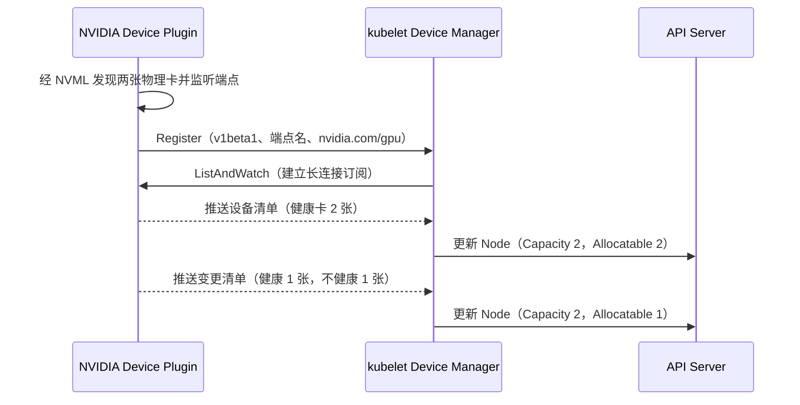

# Device Plugin 的定位、注册与 GPU 资源上报

宿主机执行 `nvidia-smi -L` 明明能列出两张 GPU。可把训练或推理 Pod 交给 Kubernetes 时，调度器还是不知道这台机器能放几个请求。容器启动时，节点还得决定把哪张物理卡暴露进去。这两个问题落在不同层次，需要不同粒度的信息。

理解 Kubernetes 管理 GPU，先记住一条核心边界：**调度器只看“数量账本与节点标签”选节点。kubelet 加上本地设备插件，才在节点上“挑具体哪张物理卡”并交接给 CDI。**

> [!summary] 核心结论
> Kubernetes 传统 GPU 交付分为**两次独立决策**。控制面调度器只做节点级筛选与整数计数，不认识物理卡 UUID。节点侧 kubelet 在 Pod 绑定后，才结合本地清单选出具体物理卡，再通过 CDI 交给容器运行时。

## 什么是 Device Plugin 与扩展资源

Kubernetes 核心代码不内置各家加速卡的私有发现逻辑。它通过统一的插件框架对接硬件。

**Device Plugin（设备插件）** 是运行在每个 GPU 节点上的适配程序。NVIDIA Device Plugin（本文以 `v0.20.1` 为基准）通过宿主机驱动与 NVML 发现物理 GPU。它向本机 kubelet 上报每张卡的设备 ID 与健康状态，并在分配时返回容器所需的交接信息。

kubelet 拿到逐卡清单后，会把数量汇总为 Node 状态里的整数资源 `nvidia.com/gpu`。这类以厂商域名为前缀、按整数随 Pod 请求计数的非内置资源，叫作**扩展资源（Extended Resource）**。在整卡模式下，1 个 `nvidia.com/gpu` 单位对应 1 张完整物理 GPU。

## 一次单卡交付如何走完两次选择

假设一台高显存节点上有两张健康 GPU：第一张已被既有任务占用，第二张空闲。集群中还有另一台不同卡型的节点。一个需要高显存单卡的推理或训练 Pod 提交后，会按四步完成交付：

1. **节点上报数量账本**：设备插件把两张健康卡上报给本机 kubelet。kubelet 向 API Server 发布 `nvidia.com/gpu` 的可分配总量为 `2`。
2. **调度器按节点选落点**：调度器检查节点型号标签与数量余量。目标高显存节点已计入 `1` 个请求，还剩 `1` 个余量，于是将 Pod 绑定到该节点。
3. **kubelet 本地挑卡交接**：节点 kubelet 接纳 Pod 后，从本地健康清单中剔除已占用的卡，选出唯一空闲卡。插件收到该卡 ID 后，返回对应的 CDI 交接信息。
4. **运行时注入与计算验收**：容器运行时按 CDI 规格组装设备节点、权限规则与驱动库挂载。容器启动后，进程以本进程序号 `0` 看到这张卡，核对 UUID 与宿主机一致。跑通一次同步且校验结果的 CUDA 计算，整条交付链才算闭环。

第 10 章已拆解第 4 步的容器内部访问机制。本章前四篇聚焦第 1—3 步，先看设备插件如何把硬件库存送进 Kubernetes。

## 插件注册与 `ListAndWatch` 上报链路

设备插件与 kubelet 运行在同一台宿主机上。双方通过 `/var/lib/kubelet/device-plugins/` 目录下的 Unix Domain Socket 建立 gRPC 通信。完整交互过程如图 11-01-01 所示。



*图 11-01-01：Device Plugin 注册、`ListAndWatch` 持续上报以及健康状态变化传导至 Node 资源计数的时序。*

这段握手包含四个关键动作：

1. **插件先监听自身端点**：插件通过 NVML 枚举宿主机 GPU，在 `/var/lib/kubelet/device-plugins/` 下监听自身 gRPC Socket（整卡资源常见端点为 `nvidia-gpu.sock`）。
2. **插件主动向 kubelet 注册**：插件连接同目录下的 `kubelet.sock`，发起 `Register` 请求。请求携带协议版本 `v1beta1`、端点名 `nvidia-gpu.sock` 和资源名 `nvidia.com/gpu`。
3. **kubelet 反向订阅设备流**：kubelet 内部的 Device Manager 连回插件端点，先查询可选扩展接口，再发起 `ListAndWatch` 长连接。插件立刻推送完整设备清单（含设备 ID、健康状态及可选拓扑提示）。此后每当卡的状态变化，插件都沿同一条流重发最新清单。
4. **kubelet 汇总并发布 Node 状态**：kubelet 按清单统计两个字段。`status.capacity["nvidia.com/gpu"]` 统计清单内全部设备（健康与不健康都计入）。`status.allocatable["nvidia.com/gpu"]` 只统计健康设备。

> [!tip] 工程直觉：Allocatable 不是“当前空闲卡数”
> 已分给运行中 Pod 的健康卡，仍计入 `status.allocatable`。`Allocatable` 表达的是**这台节点健康可供给的上限**。扣除已占名额的减法由调度器在账本里完成（下一篇详算）。

节点 `node-h100` 完成注册上报后，控制面与节点日志会呈现如下对应证据：

```text
# 1) kubectl describe node node-h100（关键节录）
Capacity:
  cpu:                64
  memory:             512Gi
  nvidia.com/gpu:     2        # 清单内总卡数（健康 + 不健康）
Allocatable:
  cpu:                63
  memory:             500Gi
  nvidia.com/gpu:     2        # 当前健康、可参与分配的上限

# 2) kubelet 日志（开启 -v=2 级别可见列表更新记录）
I1120 10:02:14.218 kubelet "Got device plugin resource update"
  resourceName="nvidia.com/gpu" totalCount=2 healthyCount=2
```

## 设备变不健康时，`Capacity` 与 `Allocatable` 如何变化

如果节点上的第二张物理卡发生硬件异常，插件会将其标为 `Unhealthy`，但仍保留在设备清单中。新清单经 `ListAndWatch` 推给 kubelet 并同步到 API Server 后，节点计数随之变化：

| `node-h100` 状态快照 | 第一张 H100 | 第二张 H100 | `Capacity` | `Allocatable` |
| --- | --- | --- | ---: | ---: |
| 初始健康状态 | 健康（已占用） | 健康（空闲） | 2 | 2 |
| 第二张卡触发异常并同步 | 健康（已占用） | 不健康（仍在清单） | 2 | 1 |

此时节点可分配上限从 `2` 降为 `1`。新提交的 GPU 请求将不再把故障卡算作供给。

如果故障发生前这张卡已分给运行中的 Pod，原分配仍绑在这张卡上。Kubernetes 不会替容器自动热换卡。在 Kubernetes v1.36 中，默认启用的 beta 特性 `ResourceHealthStatus` 会把已分配设备的健康状态写进容器的 `allocatedResourcesStatus` 字段，便于上层平台及时重建。

> [!warning] 常见误区：两个极易踩坑的运行边界
> 1. **kubelet 重启会清空旧 Socket**：kubelet 重启时会清理 `/var/lib/kubelet/device-plugins/` 下的旧文件。设备插件必须监听目录变化并重新注册，否则节点会丢失 `nvidia.com/gpu` 资源键。
> 2. **健康变化存在异步传播窗口**：插件检测故障、kubelet 更新本地缓存、Node 状态写回 API Server，三步之间存在短暂时间差。这段窗口可能引发“调度成功但本地接纳失败”，第 04 篇专门拆解。

如果宿主机 `nvidia-smi -L` 正常列出 GPU，Node 却缺少 `nvidia.com/gpu` 字段，按三步就能快速切开问题：
- 先查设备插件 Pod 是否正常运行，并确认其成功调用 `Register`。
- 再看 kubelet 日志中的 `resourceName`、`totalCount` 与 `healthyCount`，确认已收到设备清单。
- 最后比对 Node 状态的更新时间戳，区分“从未上报”与“同步延迟”。

---

> [!info]- 参考资料
> - **Kubernetes Device Plugins 概念与注册**：[Kubernetes v1.36 Device Plugins](https://v1-36.docs.kubernetes.io/docs/concepts/extend-kubernetes/compute-storage-net/device-plugins/)、[Device Plugin Registration](https://v1-36.docs.kubernetes.io/docs/concepts/extend-kubernetes/compute-storage-net/device-plugins/#device-plugin-registration)
> - **健康状态与 kubelet 重启处理**：[Device Plugin and Unhealthy Devices](https://v1-36.docs.kubernetes.io/docs/concepts/extend-kubernetes/compute-storage-net/device-plugins/#device-plugin-and-unhealthy-devices)、[Handling kubelet Restarts](https://v1-36.docs.kubernetes.io/docs/concepts/extend-kubernetes/compute-storage-net/device-plugins/#handling-kubelet-restarts)
> - **GPU 调度与设备识别**：[Scheduling GPUs (v1.36)](https://v1-36.docs.kubernetes.io/docs/tasks/manage-gpus/scheduling-gpus/)、[NVIDIA SMI 文档](https://docs.nvidia.com/deploy/nvidia-smi/index.html)、[CUDA 13.2.1 可见设备变量](https://docs.nvidia.com/cuda/archive/13.2.1/cuda-programming-guide/05-appendices/environment-variables.html#cuda-visible-devices)
> - **源码参考**：[NVIDIA Device Plugin v0.20.1](https://github.com/NVIDIA/k8s-device-plugin/tree/v0.20.1)、[NVIDIA v0.20.1 server.go](https://github.com/NVIDIA/k8s-device-plugin/blob/v0.20.1/internal/plugin/server.go)、[kubelet v1.36.0 Device Manager](https://github.com/kubernetes/kubernetes/blob/v1.36.0/pkg/kubelet/cm/devicemanager/manager.go)
