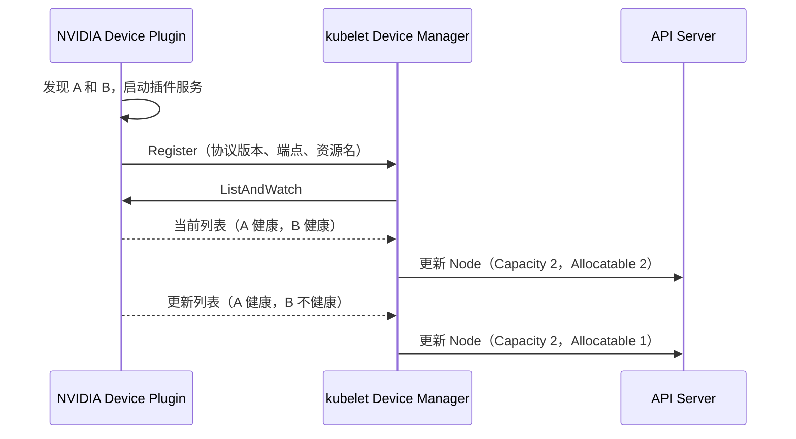

训练或推理容器要使用一张 GPU。宿主机上的 `nvidia-smi -L` 已经能列出两张卡，但调度器通过 Kubernetes API 观察节点，需要知道这台节点能接受几个 GPU 请求。容器启动时还要知道该开放哪张卡的设备访问。这两个问题需要不同粒度的信息。

**Device Plugin（设备插件）** 是运行在节点上的设备适配程序。NVIDIA 的插件通过宿主机驱动及 **NVML（NVIDIA Management Library，NVIDIA 管理库）** 发现 GPU，向本机 kubelet 报告各卡的标识和健康状态，并在 kubelet 分配设备时返回容器所需的交接信息。kubelet 把逐卡清单汇总成 Node 可发布的整数资源 `nvidia.com/gpu`。这类由厂商域名限定、可随 Pod 请求计数的资源叫作**扩展资源**。在本章的整卡配置中，一个单位就是一张完整 GPU。 [Kubernetes v1.36 设备插件框架](https://v1-36.docs.kubernetes.io/docs/concepts/extend-kubernetes/compute-storage-net/device-plugins/) · [NVIDIA Device Plugin v0.19.2](https://github.com/NVIDIA/k8s-device-plugin/tree/v0.19.2)

## 单卡 Pod 的放置与设备交付

主例采用普通单容器 Pod、Linux 节点、默认调度器、完整 NVIDIA GPU，关闭 MIG（Multi-Instance GPU，硬件分区）与共享。节点 `gpu-h` 装有两张同型 H100 SXM，记作 A、B。另一个节点 `gpu-a` 装有两张同型 A100，记作 C、D。字母代表各自的 GPU UUID（设备的全局唯一标识），案例和记录均为教学推演。

以 `gpu-h` 为例，A、B 都健康，A 已分给一个 Pod，B 尚未分配。假设除要讨论的 GPU 条件外，其他放置和启动条件都已满足。一次正常交付按以下顺序发生。

1. 插件把两张卡报告给 kubelet。kubelet 发布 `nvidia.com/gpu` 的可分配总量 2。
2. 新 Pod 要一张 H100。调度器检查节点型号标签和 GPU 数量，看到 `gpu-h` 已计入一个请求，还有一个单位的余量，便可将 Pod 绑定到 `gpu-h`。
3. kubelet 处理已绑定的 Pod，在本机选出 B。插件收到 B 的 ID 后返回设备交接信息，kubelet 把它传给容器运行时。
4. 运行时建立 B 的设备节点、访问规则和库文件等容器配置。容器启动后若仅有 B 对 CUDA 进程可见，且进程没有进一步屏蔽设备，应用用本进程的序号 `0` 访问 B，用 UUID 与主机清单核对。一次同步且校验结果成功的计算才完成应用侧验收。 [Kubernetes GPU 调度与节点选择](https://v1-36.docs.kubernetes.io/docs/tasks/manage-gpus/scheduling-gpus/) · [NVIDIA UUID 标识](https://docs.nvidia.com/deploy/nvidia-smi/index.html) · [CUDA 13.2.1 可见设备](https://docs.nvidia.com/cuda/archive/13.2.1/cuda-programming-guide/05-appendices/environment-variables.html#cuda-visible-devices)

这里有两次选择。调度器用数量和节点条件选择 Pod 的落点。kubelet 用节点上的设备清单确定容器可获得的卡。第 10 章从第四步解释容器访问，本章先从第一步追这两次选择所依赖的信息。

## 从插件注册到 Node 状态

插件需要把本地服务的地址和所管理的资源告诉 kubelet，然后才能持续报告设备。以下接口和日志按 Kubernetes v1.36.0 与独立 NVIDIA Device Plugin v0.19.2 说明。

1. **插件先监听自己的端点。** 插件在节点的 `/var/lib/kubelet/device-plugins/` 中启动 gRPC 服务，一种通过接口发送请求和响应的进程间通信方式。完整 GPU 资源的典型插件端点为 `nvidia-gpu.sock`。
2. **插件发起注册。** 它连接同目录中 kubelet 的 `kubelet.sock`，发送 `Register`。例中 `Version=v1beta1` 是插件协议版本，`Endpoint=nvidia-gpu.sock` 指向插件服务，`ResourceName=nvidia.com/gpu` 是要发布的资源名。
3. **kubelet 反向订阅。** kubelet 的设备管理器（Device Manager）连接插件端点，查询可选能力，并调用 `ListAndWatch`。插件先返回当前清单，每项有设备 ID 和健康状态，协议也允许附带拓扑信息。状态发生变化时，插件通过同一个流再次发送当前列表。
4. **kubelet 发布计数。** 对本例已注册、已上报的资源，`status.capacity["nvidia.com/gpu"]` 统计列表内的健康与不健康设备，`status.allocatable["nvidia.com/gpu"]` 统计其中健康的设备。健康的已占用设备也计入 `Allocatable`，其占用由调度器在请求账本中另算。 [Kubernetes 注册与接口定义](https://v1-36.docs.kubernetes.io/docs/concepts/extend-kubernetes/compute-storage-net/device-plugins/#device-plugin-registration) · [NVIDIA v0.19.2 注册与列表实现](https://github.com/NVIDIA/k8s-device-plugin/blob/v0.19.2/internal/plugin/server.go) · [kubelet v1.36.0 设备管理器](https://github.com/kubernetes/kubernetes/blob/v1.36.0/pkg/kubelet/cm/devicemanager/manager.go)

## 设备健康如何改变可分配总量

只改变 B 的健康状态。B 仍在设备列表中，只是被插件标记为 `Unhealthy`。等新列表被 kubelet 处理并发布到 API 后，两个快照如下。 [Kubernetes v1.36 设备健康更新](https://v1-36.docs.kubernetes.io/docs/concepts/extend-kubernetes/compute-storage-net/device-plugins/#device-plugin-and-unhealthy-devices)

| 教学快照 | A | B | Capacity | Allocatable |
| --- | --- | --- | ---: | ---: |
| 初始列表已生效 | 健康 | 健康 | 2 | 2 |
| 健康更新已生效 | 健康 | 不健康，仍在列表 | 2 | 1 |

变化发生在健康集合，所以同一资源还能用于节点分配的设备总量由 2 降到 1。若故障前已有 Pod 分到 B，原分配仍关联 B，Kubernetes 不会自动换卡。Kubernetes v1.36 中，默认启用的 beta 特性 `ResourceHealthStatus` 可在容器状态的 `allocatedResourcesStatus` 中报告已分配设备的健康。 [Kubernetes v1.36 设备健康与 Pod 状态](https://v1-36.docs.kubernetes.io/docs/concepts/extend-kubernetes/compute-storage-net/device-plugins/#device-plugin-and-unhealthy-devices)

若主机能枚举 A、B，但 Node 缺少扩展资源键，先核对插件是否为该资源完成注册。然后看 kubelet V(2) 日志里的 `resourceName`、`totalCount`、`healthyCount`，确认它处理过设备清单，并对照同节点稍后的 Node 状态。kubelet 重启会清理设备插件目录中的旧 socket，需确认插件重新建立端点、注册并恢复列表上报。健康状态变化与调度器看到更新可能相隔一段时间。 [Kubernetes kubelet 重启处理](https://v1-36.docs.kubernetes.io/docs/concepts/extend-kubernetes/compute-storage-net/device-plugins/#handling-kubelet-restarts) · [v1.36.0 列表更新日志](https://github.com/kubernetes/kubernetes/blob/v1.36.0/pkg/kubelet/cm/devicemanager/manager.go)
