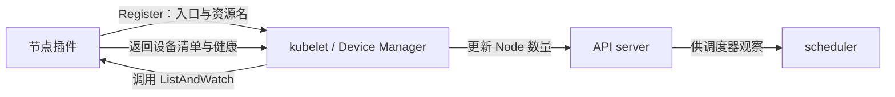

# 从设备清单走到节点资源

## 把厂商设备知识交给节点侧插件

Linux 驱动能发现 GPU，不意味着 Kubernetes 已有它的资源账本。调度器不会为每个 Pod 登录节点执行 `nvidia-smi`，也不直接扫描 `/dev/nvidia*`。它需要通过 API 得到可比较的节点资源信息。

**Device Plugin** 是节点上的厂商适配进程：把驱动侧识别的设备集合、健康状态和容器接入信息交给 kubelet。NVIDIA 实现通过 NVML 等厂商接口认识卡；kubelet 内的 **Device Manager** 保存设备集合与节点内分配状态，将资源数量纳入 Node 状态。插件可以由 DaemonSet 运行，但 DaemonSet 是部署形式，不是另一个设备分配协议。框架分工见 [Kubernetes Device Plugins](https://kubernetes.io/docs/concepts/extend-kubernetes/compute-storage-net/device-plugins/)，1.34 行为同时对照[该版文档源文件](https://github.com/kubernetes/website/blob/release-1.34/content/en/docs/concepts/extend-kubernetes/compute-storage-net/device-plugins.md)。

设备 ID 是插件协议内的身份，不能从资源名推出来。`nvidia.com/gpu` 的 `nvidia.com` 是资源命名域，`gpu` 是资源类型；它表达“这种资源有几个单位”。U1 的完整 UUID 才能在本例中回答“是哪张卡”。相同资源类型可以在许多节点出现，同一 UUID 不应被当作两份独立整卡资源发布。

## 注册建立协议入口，上报才带来设备清单

插件先启动 Unix socket 上的 gRPC 服务，再向 kubelet 的注册服务提交协议版本、插件 socket 名和资源名。kubelet 接受注册后，才能使用该插件的接口；知道插件入口和知道设备数量是不同步骤。

以下是**自拟教学记录**，字段沿协议归纳，非某个二进制的逐字日志。U0—U3 在记录中是导读完整 UUID 的排版缩写：

```text
节点 gpu-a
P0 plugin server listening:
   /var/lib/kubelet/device-plugins/nvidia-gpu.sock
P1 Register -> /var/lib/kubelet/device-plugins/kubelet.sock
   version=v1beta1
   endpoint=nvidia-gpu.sock
   resource_name=nvidia.com/gpu
P2 Register accepted
P3 kubelet opens ListAndWatch stream to plugin
P4 ListAndWatchResponse:
   devices=[{ID:U0,health:Healthy},{ID:U1,health:Healthy},
            {ID:U2,health:Healthy},{ID:U3,health:Healthy}]
P5 kubelet publishes Node status: capacity=4, allocatable=4
```

P0 的 socket 属于插件服务，P1 的 `kubelet.sock` 属于 kubelet 注册服务。插件 `Register` 的 `version=v1beta1` 是 **Device Plugin gRPC 协议版本**，与 Kubernetes 发行版 1.34、Pod 的 `apiVersion: v1` 是不同版本轴。不能据 `v1beta1` 将整个设备插件框架判成未稳定。

协议的 `ListAndWatch` 是 kubelet 发起、插件持续返回设备清单的流。发生健康变化后，插件再返回新清单，不是让调度器逐卡订阅 NVML。`Device` 必须有 ID 和健康状态；还可带 NUMA 拓扑信息，后者供节点内资源对齐使用，不会自动变成集群调度器掌握的完整 GPU—NIC 拓扑。字段与调用签名可查 [Kubernetes v1.34.0 Device Plugin api.proto](https://github.com/kubernetes/kubernetes/blob/v1.34.0/staging/src/k8s.io/kubelet/pkg/apis/deviceplugin/v1beta1/api.proto)。



图 11-M1　箭头表示注册、调用或状态信息的方向，标签分别定义含义；双向线不表示 GPU 数据传输。聚合了同一节点内 kubelet 与 Device Manager。

Node 上发布的是聚合数量；逐设备 ID 仍由节点内 Device Manager 使用。

<!-- 配图 fig-11-01-01：置于本段后，强调设备清单和 Node 数量的不同粒度，不重复注册调用图。 -->

## 健康变化改变可分配数，不搬走原有容器

继续场景 P，U0、U1 已分配给运行中的 `old/worker`，U2、U3 尚未分配。现给定插件确实判定 U3 不健康，并完成了新一轮清单上报与 Node 状态传播：

```text
# 自拟 ListAndWatch 与 Node 状态配对摘要
U0 Healthy; U1 Healthy; U2 Healthy; U3 Unhealthy
Node gpu-a:
  status.capacity["nvidia.com/gpu"]    = 4
  status.allocatable["nvidia.com/gpu"] = 3
existing allocation: old/worker -> [U0,U1]
```

`Capacity` 保留这份清单的设备总数 4，`Allocatable` 下降到健康设备数 3；已分配的 U0/U1 仍占有自己的设备，U2 是本例剩下的健康候选。**Allocatable 不是“现在还空闲几张卡”**，下一篇再将它与 Pod 请求相减。

如果坏的是已经分配的 U1，健康更新也不会自动给该容器换成 U2，更不会迁移 CUDA 上下文和显存状态。原 Pod 仍关联 U1，应用可能报错、退出或被其控制器重建；恢复任务状态还需要应用与上层作业组件配合。[官方文档的 Device plugin and unhealthy devices 小节](https://kubernetes.io/docs/concepts/extend-kubernetes/compute-storage-net/device-plugins/#device-plugin-and-unhealthy-devices)说明了数量变化与已有 Pod 关联的区别。

健康字段也有观测范围。NVIDIA 0.17.1 的健康实现订阅并筛选 NVML 事件，存在被忽略的应用类 Xid 和可配置行为；“Healthy”不等于所有 CUDA、NCCL、温度或性能测试都已通过。这里不要求背诵 Xid 清单，只需理解**插件给出的健康判断是调度输入，实际负载结果是另一类证据**。机制可查 [v0.17.1 health.go](https://github.com/NVIDIA/k8s-device-plugin/blob/v0.17.1/internal/rm/health.go)。

## 插件与 kubelet 重启如何影响判断

插件进程退出后，它先前完成的文件挂载和设备访问配置不会因为进程消失就从所有运行容器中撤销；但新的上报和 Allocate 调用会受影响。判断一个新 Pod 能否启动，需要知道接口当前是否可达，不能拿旧容器仍能计算作为充分依据。

kubelet 重启会清理设备插件目录下的现存 socket，插件要观察这个变化并重新建立服务、注册和上报。重启期间 API 中资源状态也有传播窗口；应比较同一时段的 socket、注册结果、清单和 Node 状态。不要为“恢复资源数量”手动修改 Node 的 kubelet 管理字段，绕开真实设备清单。

本篇建立了“插件认识设备 → kubelet 保有清单 → API 暴露数量”。下一步是用这个数量解释 Pod 的请求为何能放下，或为何等待。

[返回导读](00_导读.md) · [下一篇：用数量请求判断 Pod 能放在哪里](02_用数量请求判断Pod能放在哪里.md)
