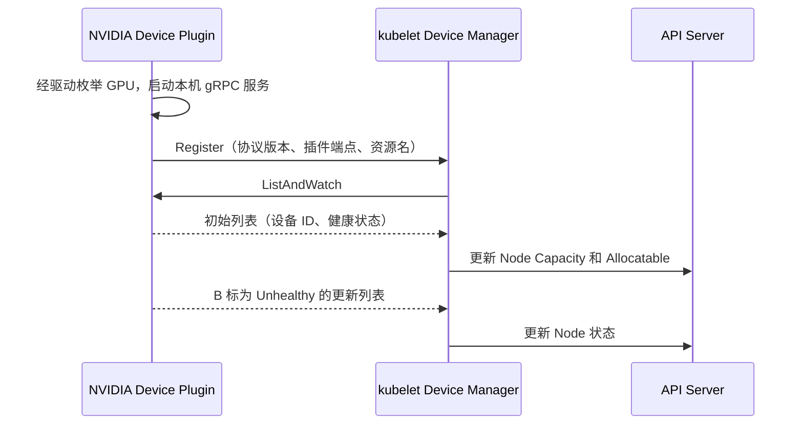

# 设备插件怎样让 Node 出现 GPU 资源

在 `gpu-h` 上运行 `nvidia-smi -L`，能列出两张 H100。调度器要安排一个申请 GPU 的 Pod，还需要在 Node 对象里看到可分配的 GPU 数量。NVIDIA Device Plugin 先把设备列表交给本机 kubelet，再由 kubelet 更新 Node 状态。Pod 绑定节点后，节点还要给容器分配具体设备，并通过运行时让容器访问它。后续排查时，用主机 GPU 的 UUID 追踪设备，同一张卡在容器里的 CUDA 序号可以从 0 重新编号。 [Kubernetes v1.36 Device Plugins](https://v1-36.docs.kubernetes.io/docs/concepts/extend-kubernetes/compute-storage-net/device-plugins/) · [NVIDIA SMI 设备标识](https://docs.nvidia.com/deploy/nvidia-smi/index.html)

本章的 Device Plugin 案例依据 Kubernetes v1.36 的文档与 v1.36.0 源码，使用独立的 NVIDIA Device Plugin v0.19.2。除非另有说明，案例使用普通单容器 Pod、Linux 节点、完整 GPU，关闭 MIG 与共享。`gpu-h` 的两张卡用 A、B 代指各自的 UUID。设备清单、状态变化和配置摘录均用于教学推演。

## 插件注册后，kubelet 才开始接收设备清单

1. NVIDIA 插件通过节点上的 NVIDIA 驱动及 NVML 发现和管理 GPU。插件先启动 gRPC 服务，为 `nvidia.com/gpu` 监听本机的 `/var/lib/kubelet/device-plugins/nvidia-gpu.sock`。
2. 插件向同目录下 kubelet 的 `kubelet.sock` 发起 `Register`，传入 `Version`、`Endpoint` 和 `ResourceName`。本例分别为 `v1beta1`、`nvidia-gpu.sock` 和 `nvidia.com/gpu`。`Version` 指插件协议版本。
3. kubelet 的 Device Manager 连到插件端点，读取支持的可选接口，通过 `ListAndWatch` 得到设备列表。每项包含设备 ID 和健康状态，也可以携带拓扑信息。列表变化时，插件在同一流上发送更新后的全量列表。
4. kubelet 下次发布 Node 状态时，将设备数写入 `status.capacity["nvidia.com/gpu"]`，将健康设备数写入 `status.allocatable["nvidia.com/gpu"]`。调度器通过 API 中的 Node 状态看到资源变化。

注册的请求方向是插件到 kubelet，设备列表的订阅方向是 kubelet 到插件。看到注册成功后，还可以用 kubelet V(2) 日志中的 `resourceName`、`totalCount`、`healthyCount` 验证列表已处理，再按节点与时间对照 API 返回的 Node。以上字段来自指定版本的源码。 [Kubernetes 注册与接口说明](https://v1-36.docs.kubernetes.io/docs/concepts/extend-kubernetes/compute-storage-net/device-plugins/#device-plugin-registration) · [NVIDIA 插件 v0.19.2 注册实现](https://github.com/NVIDIA/k8s-device-plugin/blob/v0.19.2/internal/plugin/server.go) · [kubelet v1.36.0 设备管理器](https://github.com/kubernetes/kubernetes/blob/v1.36.0/pkg/kubelet/cm/devicemanager/manager.go)

## 一张卡变为不健康，Node 上的哪项数字会变

假设 A、B 已经上报，B 变为 `Unhealthy` 后仍在插件提供的设备列表中。等 kubelet 将这次变更发布到 Node，得到以下教学快照。 [Kubernetes 的设备健康更新](https://v1-36.docs.kubernetes.io/docs/concepts/extend-kubernetes/compute-storage-net/device-plugins/#device-plugin-and-unhealthy-devices)

| 同一节点的两个时点 | `ListAndWatch` 设备状态 | Capacity | Allocatable |
| --- | --- | ---: | ---: |
| 更新前 | A 健康，B 健康 | 2 | 2 |
| 更新后 | A 健康，B 不健康 | 2 | 1 |

如果 B 已经分给某个 Pod，原分配继续关联 B。应用能否继续运行取决于故障和应用的行为，重启策略也会影响后续现象。在 v1.36 中，`ResourceHealthStatus` 为默认启用的 beta 功能。需要查已分配设备的健康信息时，可以看对应容器状态的 `allocatedResourcesStatus`，并结合节点侧的分配查询确认关联对象。`Allocatable` 下降说明可供分配的健康设备总量变了，调度还要计入已有请求。 [Kubernetes 的设备健康更新及 Pod 状态](https://v1-36.docs.kubernetes.io/docs/concepts/extend-kubernetes/compute-storage-net/device-plugins/#device-plugin-and-unhealthy-devices)

若宿主机枚举正常，Node 上却找不到 `nvidia.com/gpu`，可依次查插件初始化与注册、kubelet 接收的设备列表、Node 状态更新时间。重启 kubelet 时，它会清理设备插件目录中的旧 socket。此时先确认 NVIDIA 插件已重新注册并恢复 `ListAndWatch`，再读新的 Node 状态。 [Kubernetes 的 kubelet 重启处理](https://v1-36.docs.kubernetes.io/docs/concepts/extend-kubernetes/compute-storage-net/device-plugins/#handling-kubelet-restarts)
