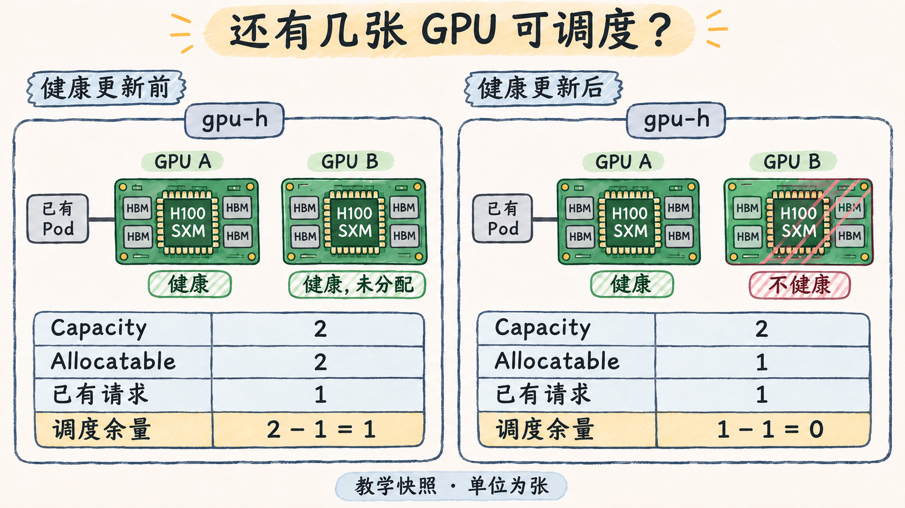

# GPU 请求、Allocatable 与调度余量

上线 2 卡推理副本或单机多卡训练 Pod 时，常会遇到两个反直觉现象。明明两台节点加起来还有 2 张空闲 GPU，新 Pod 却卡在 `Pending`。有时 `nvidia-smi` 显示显存和算力利用率全是 0%，调度事件依然报错 `Insufficient nvidia.com/gpu`。

原因很简单：**Kubernetes 调度器既不看实时硬件利用率，也不跨节点拼凑单 Pod 卡数。** 它只在每台节点上独立核对一本严格守恒的整数请求账本。本篇基于 Kubernetes v1.36 默认调度器，拆清这套余量核算逻辑。

## 单容器如何声明整卡请求

在 Device Plugin 整卡路径下，Pod 用扩展资源键 `nvidia.com/gpu` 申请 GPU。与 CPU、内存不同，GPU 扩展资源**不可超额承诺**，且必须是正整数。

提交 Pod 清单时，API 校验器执行三条硬规则：
- **只写 `limits`**：若没有其他默认注入机制，Kubernetes 会自动将 `limits` 的值同步为 `requests`。
- **同时写 `requests` 与 `limits`**：两者数值必须完全相等，否则直接被校验拒绝。
- **只写 `requests` 不写 `limits`**：校验直接拒绝。

下面是一份标准的单卡 Pod 声明（暂未加入卡型标签条件）：

```yaml
apiVersion: v1
kind: Pod
metadata:
  name: probe
  namespace: gpu-example
spec:
  containers:
    - name: workload
      image: registry.example/gpu-probe:v1
      resources:
        limits:
          nvidia.com/gpu: 1   # 整卡必须为整数；未写 requests 时自动等价于 requests: 1
```

## 单节点余量不等式与状态推演

默认调度器的 `NodeResourcesFit` 插件在过滤阶段，会对每台候选节点单独核算 GPU 数量。设节点上报的可分配上限为 $T$（`Allocatable`），调度器快照中已计入的有效请求总量为 $R$，新 Pod 的请求量为 $q$。

接纳新 Pod 后的总承诺不能突破健康上限。新请求必须满足：

$$R + q \le T \iff q \le T - R$$

其中 $T - R$ 即为该节点的**当前调度余量**。只要 $q > 0$，一旦余量 $T - R \le 0$，节点立刻在过滤阶段出局。

需要注意，$R$ 取自调度器的内存缓存快照。它不仅包含已绑定的活跃 Pod，也包含调度器刚预占、正在异步完成绑定的 Pod。

以装有两张 H100 的 `node-h100` 为例，已有占用与健康更新生效后的账本变化如下：

| `node-h100` 状态快照 | `Capacity` | `Allocatable` ($T$) | 已计入请求 ($R$) | 调度余量 ($T - R$) | 请求 1 张 | 请求 2 张 |
| --- | ---: | ---: | ---: | ---: | --- | --- |
| 两卡均健康且空闲 | 2 | 2 | 0 | 2 | 通过 | 通过 |
| 第 1 张已占，第 2 张健康空闲 | 2 | 2 | 1 | 1 | 通过 | 不通过 |
| 第 1 张仍占，第 2 张变不健康 | 2 | 1 | 1 | 0 | 不通过 | 不通过 |

> [!warning] 常见误区：硬件空闲 ≠ 调度有余量
> 上表第二行中，即使占用第一张卡的推理服务暂时没有流量、`nvidia-smi` 利用率为 `0%`，只要该 Pod 仍活跃，它的 `1` 个请求就占在账本 $R$ 里。`nvidia-smi` 看的是瞬时硬件活动。排查“为何放不进去”，必须查 Node 的 `Allocatable` 与 `Allocated resources`。

图 11-02-01 将表格第二行与第三行并排呈现。可以对照观察健康变化前后 `Capacity`、`Allocatable` 与余量的变化。



*图 11-02-01：第二张卡标记为不健康后仍留在 Capacity，但会从 Allocatable 扣除；图中以 `gpu-h` 简记 `node-h100`，GPU A 为已有 Pod 占用的健康卡，GPU B 故障后调度余量从 1 降至 0。*

## 单节点装箱边界与调度事件判读

余量不等式按**单台节点独立判定**。调度器不能把跨节点的零散空位拼在一起。

假设 `node-h100` 和 `node-a100` 各剩 `1` 张空闲卡，整个集群共有 `2` 张空卡。此时提交一个申请 `nvidia.com/gpu: 2` 的单 Pod（例如两卡张量并行推理容器），调度器逐台核算发现两台节点余量都只有 `1`。

同一 Pod 内的容器必须落在同一台宿主机上。因此这两张零散空卡无法拼在一起，Pod 只能停留在 `Pending`。

> [!summary] 核心结论
> 集群总空闲卡数 $\ge q$ 不能保证单 Pod 调度成功。必须存在至少一台节点同时满足 $T - R \ge q$，并通过 CPU、内存、污点容忍与标签选择等全部过滤条件，调度器才会执行绑定。

当 Pod 卡在 `Pending` 时，最直接的组合检查是节点已分配账本与 Pod 事件：

```text
# 1) kubectl describe node node-h100（核对已承诺请求 R）
Allocated resources:
  Resource           Requests    Limits
  --------           --------    ------
  cpu                4 (6%)      8 (12%)
  nvidia.com/gpu     1           1        # 当前账本 R = 1；若 T = 1，则余量 T - R = 0

# 2) kubectl describe pod probe（核对未放置原因）
Conditions:
  Type           Status  Reason
  PodScheduled   False   Unschedulable
Events:
  Warning  FailedScheduling  default-scheduler  0/2 nodes are available:
    1 Insufficient nvidia.com/gpu, 1 node(s) didn't match Pod's node affinity/selector.
```

如果 `FailedScheduling` 同时报告 `Insufficient nvidia.com/gpu` 与 `didn't match Pod's node affinity/selector`，说明不同节点死在了不同关卡。回到各节点分别核对 $T - R$ 和标签，就能看清每台节点被排除的准确原因。

回到单卡请求主线：如果 `node-h100` 余量为 `1`、`node-a100` 余量为 `2`，两台节点都过了数量关。但两者的硬件卡型完全不同。下一篇看 Kubernetes 如何借助 NFD 与 GFD 把 GPU 型号写进节点标签，帮调度器选对机器。

---

> [!info]- 参考资料
> - **Kubernetes 扩展资源与 GPU 请求规则**：[Manage Resources for Containers - Extended Resources (v1.36)](https://v1-36.docs.kubernetes.io/docs/concepts/configuration/manage-resources-containers/#extended-resources)、[Scheduling GPUs - Using Device Plugins (v1.36)](https://v1-36.docs.kubernetes.io/docs/tasks/manage-gpus/scheduling-gpus/#using-device-plugins)
> - **调度器概念与 Pod 条件**：[Kubernetes Scheduler (v1.36)](https://v1-36.docs.kubernetes.io/docs/concepts/scheduling-eviction/kube-scheduler/)、[Pod Conditions (v1.36)](https://v1-36.docs.kubernetes.io/docs/concepts/workloads/pods/pod-lifecycle/#pod-conditions)
> - **源码参考**：[NodeResourcesFit fit.go (v1.36.0)](https://github.com/kubernetes/kubernetes/blob/v1.36.0/pkg/scheduler/framework/plugins/noderesources/fit.go)、[Scheduler Cache (v1.36.0)](https://github.com/kubernetes/kubernetes/blob/v1.36.0/pkg/scheduler/backend/cache/cache.go)、[Core Resource Validation (v1.36.0)](https://github.com/kubernetes/kubernetes/blob/v1.36.0/pkg/apis/core/validation/validation.go)
