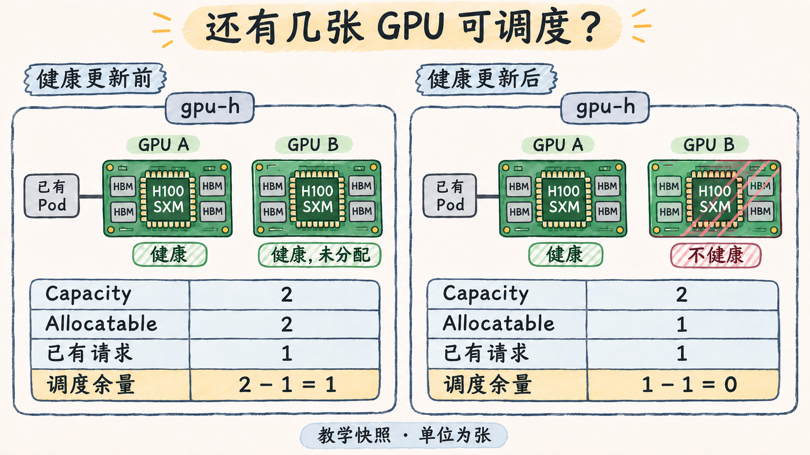

# 调度器怎样判断 GPU 数量是否足够

`gpu-h` 的 `Allocatable` 为 2，节点上已有一个 Pod 请求并获得一张 GPU。留给新请求的余量只有一张，即使已有 Pod 此刻没有运行 GPU 计算。下面以 Kubernetes v1.36 的默认调度行为和 Device Plugin 提供的整卡资源为例。 [NodeResourcesFit v1.36.0 的标量资源检查](https://github.com/kubernetes/kubernetes/blob/v1.36.0/pkg/scheduler/framework/plugins/noderesources/fit.go)

## 怎样写一张 GPU 的请求

在这个案例中，`nvidia.com/gpu` 是节点级扩展资源名，每个单位对应一张完整 GPU。有效数量必须是整数，扩展资源不可超额承诺。以下 YAML 均摘自容器的 `resources` 位置，三份片段独立阅读。 [Kubernetes v1.36 GPU 请求规则](https://v1-36.docs.kubernetes.io/docs/tasks/manage-gpus/scheduling-gpus/#using-device-plugins) · [Kubernetes v1.36 扩展资源](https://v1-36.docs.kubernetes.io/docs/concepts/configuration/manage-resources-containers/#extended-resources)

只写 limit，可据此得到值为 1 的 request。

```yaml
resources:
  limits:
    nvidia.com/gpu: 1
```

同时声明时，request 和 limit 须相等。这里两项的值都是一个整卡资源单位。

```yaml
resources:
  requests:
    nvidia.com/gpu: 1
  limits:
    nvidia.com/gpu: 1
```

只写 GPU request 且提交的 Pod 仍缺少对应 limit 时，API 校验会拒绝它。 [Kubernetes v1.36.0 资源字段校验](https://raw.githubusercontent.com/kubernetes/kubernetes/v1.36.0/pkg/apis/core/validation/validation.go#L7318-L7328)

```yaml
resources:
  requests:
    nvidia.com/gpu: 1
```

## 用 Node 状态和已有请求计算余量

`Capacity` 是 kubelet 为该资源公布的容量。`Allocatable` 是可以分配给 Pod 的总量，在本例随插件报告的健康设备数变化。默认调度器的 `NodeResourcesFit` 检查新 Pod 的有效请求是否超过 `Allocatable − 已计入的 Pod 请求量`。已有请求取自调度器对节点上 Pod 的资源记账，计算所用的节点状态与 Pod 清单要对齐时点。应用的 GPU 利用率只描述采样时的活动，资源记账也覆盖拿到卡后尚未开始计算的 Pod。 [Kubernetes v1.36 资源管理](https://v1-36.docs.kubernetes.io/docs/concepts/configuration/manage-resources-containers/) · [NodeResourcesFit v1.36.0 源码](https://github.com/kubernetes/kubernetes/blob/v1.36.0/pkg/scheduler/framework/plugins/noderesources/fit.go)

教学算例固定同一个节点、完整 GPU 以及单容器 Pod。各行假定健康更新和已有请求都已进入调度所用的状态，CPU、内存及其他约束均满足。

| `gpu-h` 的状态 | Capacity | Allocatable | 已计入请求 | 数量余量 | 新请求 1 张 | 新请求 2 张 |
| --- | ---: | ---: | ---: | ---: | --- | --- |
| A、B 健康，尚未分配 | 2 | 2 | 0 | `2 − 0 = 2` | 通过 | 通过 |
| A 已分配，B 健康且未分配 | 2 | 2 | 1 | `2 − 1 = 1` | 通过 | 不通过 |
| A 的请求仍在，B 已标为不健康 | 2 | 1 | 1 | `1 − 1 = 0` | 不通过 | 不通过 |



图 11-02-01　B 被标记为不健康后仍在上报列表中。Node 状态完成更新后，健康设备总数由 2 降到 1。A 的整卡请求在两个时点都占一个单位，因此新请求的余量由 1 降到 0。

通过这一项检查只意味着该节点的 GPU 数量够用。调度还要考虑节点标签、污点、CPU 和内存等条件。如果没有合适的节点，从 Pod 的 `PodScheduled=False` 和 `FailedScheduling` 事件入手。源码在数量不足时生成 `Insufficient nvidia.com/gpu` 这样的原因。它随其他节点的失败原因一并汇总。例如 `gpu-h` 只有一张的余额，`gpu-a` 虽有两张却不符合型号选择，待调度 Pod 仍然无处放置。若已有请求或节点状态变化，下一次调度可以得到不同结果。 [NodeResourcesFit 的失败原因](https://github.com/kubernetes/kubernetes/blob/v1.36.0/pkg/scheduler/framework/plugins/noderesources/fit.go) · [Kubernetes v1.36 Pod 条件](https://v1-36.docs.kubernetes.io/docs/concepts/workloads/pods/pod-lifecycle/#pod-conditions)
