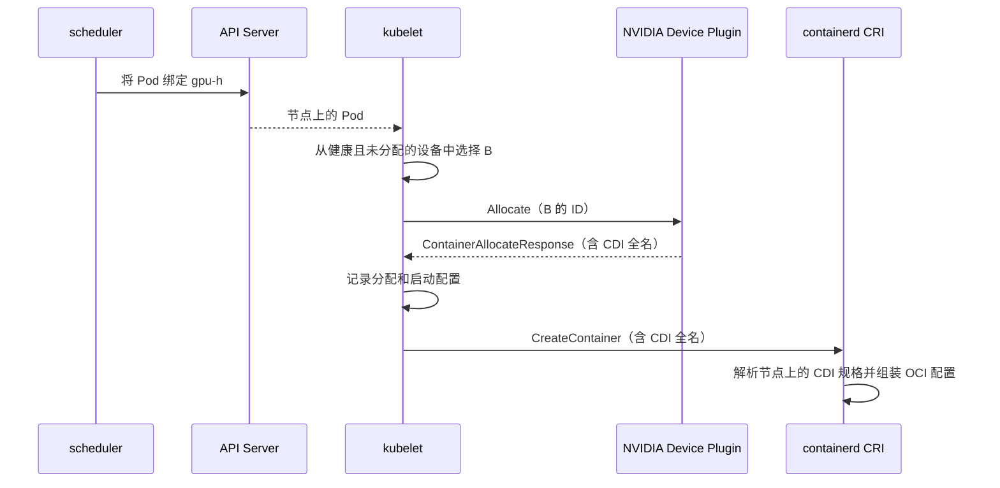

# Pod 绑定节点后怎样拿到具体 GPU

一个请求一张 `nvidia.com/gpu` 的 Pod 已绑定 `gpu-h`。这台节点的 GPU A 已分给别的 Pod，B 是唯一健康且未分配的设备。调度器使用资源数量选择节点，接下来由 kubelet 的 Device Manager 选出 B 并交给插件处理。以下使用 Kubernetes v1.36.0、独立 NVIDIA Device Plugin v0.19.2 和 containerd v2.3.0，配置和请求均为教学摘录。 [kubelet v1.36.0 设备选择与分配](https://github.com/kubernetes/kubernetes/blob/v1.36.0/pkg/kubelet/cm/devicemanager/manager.go)

## kubelet 选 ID，插件返回容器配置

在节点接纳 Pod 时，Device Manager 从健康设备中排除已经分配的设备，根据容器的请求数量选 ID。若插件提供 `GetPreferredAllocation` 且走到可用的分配分支，kubelet 可采用它给出的优先建议。B 是本例唯一候选，因此无需推测选卡次序。kubelet 将 B 的 ID 传给插件的 `Allocate`。插件校验 ID 并返回每个容器的 `ContainerAllocateResponse`，协议允许携带环境变量、设备节点、挂载、注解或 CDI 名称。`PreStartContainer` 是插件声明支持时才调用的接口，v0.19.2 的 NVIDIA 插件未实现额外的启动前操作。 [Kubernetes Device Plugin 接口](https://v1-36.docs.kubernetes.io/docs/concepts/extend-kubernetes/compute-storage-net/device-plugins/#device-plugin-implementation) · [kubelet 分配实现](https://github.com/kubernetes/kubernetes/blob/v1.36.0/pkg/kubelet/cm/devicemanager/manager.go) · [NVIDIA v0.19.2 Allocate 实现](https://github.com/NVIDIA/k8s-device-plugin/blob/v0.19.2/internal/plugin/server.go)

kubelet 以 Pod UID 和容器名等信息保存分配和启动配置，并持久化到本地检查点。稍后创建容器时，kubelet 取回配置，经 CRI（Container Runtime Interface）向 containerd 提交创建请求。Pod 终止后，Device Manager 随活跃 Pod 状态清理不再占用的设备记录。 [kubelet 容器配置衔接](https://github.com/kubernetes/kubernetes/blob/v1.36.0/pkg/kubelet/cm/container_manager_linux.go) · [kubelet 分配记录与回收](https://github.com/kubernetes/kubernetes/blob/v1.36.0/pkg/kubelet/cm/devicemanager/manager.go)



## 从插件策略追到 CRI 和 CDI 规格

下面是插件配置摘录。NVIDIA 插件用整卡的 GPU UUID 作为上报给 kubelet 的设备 ID。本例选择 `cdi-cri`，在分配响应中携带 CDI 全名，并通过 `deviceIDStrategy: uuid` 让传给运行时的名称保留 UUID。Kubernetes 自 v1.31 起将 Device Plugin 返回 CDI 全名的支持转为 GA。运行时仍需启用 CDI 并能读取相关规格。CDI（Container Device Interface）用全名查找设备需要的容器配置修改，例如添加设备节点和库挂载。 [NVIDIA v0.19.2 设备 ID 源码](https://raw.githubusercontent.com/NVIDIA/k8s-device-plugin/v0.19.2/internal/rm/devices.go) · [NVIDIA v0.19.2 插件配置](https://github.com/NVIDIA/k8s-device-plugin/tree/v0.19.2#configuration-option-details) · [Kubernetes 的 Device Plugin CDI 支持](https://v1-36.docs.kubernetes.io/docs/concepts/extend-kubernetes/compute-storage-net/device-plugins/#device-plugin-implementation) · [CDI 规范](https://github.com/cncf-tags/container-device-interface/blob/v1.1.0/SPEC.md)

```yaml
version: v1
flags:
  migStrategy: none
  plugin:
    deviceListStrategy: cdi-cri
    deviceIDStrategy: uuid
```

假设 B 的 UUID 是 `GPU-bbbbbbbb-bbbb-bbbb-bbbb-bbbbbbbbbbbb`。该版本独立插件使用 `k8s.device-plugin.nvidia.com/gpu` 作为整卡 CDI kind，启动时生成规格，官方 Helm 模板将 `/var/run/cdi` 映射到宿主机。对照这次分配的三份摘录，分配响应中的 CDI 名应出现在创建请求中，并能由节点规格的 `kind` 与 `devices[].name` 拼出。 [NVIDIA v0.19.2 CDI 生成调用](https://raw.githubusercontent.com/NVIDIA/k8s-device-plugin/v0.19.2/cmd/nvidia-device-plugin/plugin-manager.go) · [插件 CDI 生成实现](https://github.com/NVIDIA/k8s-device-plugin/blob/v0.19.2/internal/cdi/cdi.go) · [官方 Helm 模板](https://raw.githubusercontent.com/NVIDIA/k8s-device-plugin/v0.19.2/deployments/helm/nvidia-device-plugin/templates/daemonset-device-plugin.yml) · [CRI v0.36.0 协议](https://raw.githubusercontent.com/kubernetes/cri-api/v0.36.0/pkg/apis/runtime/v1/api.proto)

| 交接点 | 本例应出现的值 |
| --- | --- |
| `Allocate` 响应的容器条目 | CDI 设备名 `k8s.device-plugin.nvidia.com/gpu=GPU-bbbbbbbb-bbbb-bbbb-bbbb-bbbbbbbbbbbb` |
| `CreateContainerRequest.config` | `CDI_devices[].name` 为同一个全名。Go 字段名为 `CDIDevices`。 |
| 节点上的 CDI 规格 | `kind` 为 `k8s.device-plugin.nvidia.com/gpu`，B 的 `devices[].name` 为 B 的 UUID。 |

containerd v2.3.0 的配置版本为 3 时，CRI 在 `plugins."io.containerd.cri.v1.runtime"` 下默认 `enable_cdi = true`，扫描 `/etc/cdi` 与 `/var/run/cdi`。检查本机有效配置时，以实际启用状态和目录为准。containerd 消费原生 CDI 时，低层可以直接使用 runc。独立插件 v0.19.2 默认使用 `envvar` 策略，将设备选择交给 `NVIDIA_VISIBLE_DEVICES`，需要本次容器走能够处理它的 NVIDIA Runtime 路径。另两种策略 `volume-mounts` 和 `cdi-annotations` 分别以挂载和注解传递设备选择。 [containerd v2.3.0 的 CRI 配置](https://github.com/containerd/containerd/blob/v2.3.0/docs/cri/config.md) · [NVIDIA v0.19.2 设备列表策略](https://github.com/NVIDIA/k8s-device-plugin/tree/v0.19.2#configuration-option-details)

## 怎样确认交到进程手里的是 B

先对照 kubelet V(4) 中发起分配时的 `devices`、`resourceName`、`pod` 和 `containerName`，再看分配返回与运行时收到的创建输入。该日志在发起 RPC 前记录候选 ID。对已运行的 Pod，可用节点本地 PodResources API 的 `List` 按命名空间、Pod 名和容器名查 `resource_name` 和 `device_ids`。在本例中，后者应列出 B 的 UUID。该接口默认从 kubelet 的本地 socket `/var/lib/kubelet/pod-resources/kubelet.sock` 提供。 [kubelet v1.36.0 分配日志](https://github.com/kubernetes/kubernetes/blob/v1.36.0/pkg/kubelet/cm/devicemanager/manager.go) · [Kubernetes v1.36 PodResources API](https://v1-36.docs.kubernetes.io/docs/concepts/extend-kubernetes/compute-storage-net/device-plugins/#monitoring-device-plugin-resources)

最后，在宿主机与工作容器分别读 `nvidia-smi -L`，用 UUID 核对同一张卡。假设应用只看到 B 且未进一步筛选，B 在进程中的 CUDA 序号是 0。管理查询成功后，可用兼容镜像中的最小 CUDA 探针确认枚举、选卡和一次小 Kernel 的同步结果。已选设备、已注入设备、可执行 CUDA 计算分别由分配记录、容器枚举和探针结果支持。 [NVIDIA SMI 标识](https://docs.nvidia.com/deploy/nvidia-smi/index.html) · [CUDA 设备枚举与可见性](https://docs.nvidia.com/cuda/archive/13.2.1/cuda-programming-guide/05-appendices/environment-variables.html#cuda-visible-devices) · [CUDA 同步 API](https://docs.nvidia.com/cuda/archive/13.2.1/cuda-runtime-api/group__CUDART__DEVICE.html)
