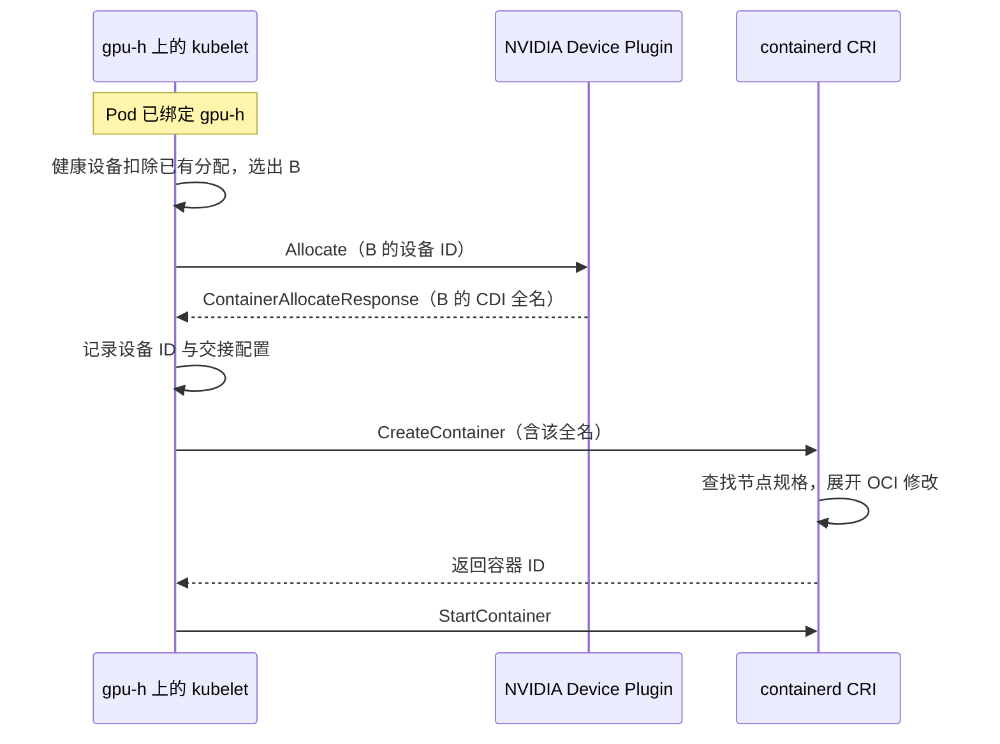

Pod `gpu-example/probe` 请求一张 `nvidia.com/gpu`，已通过型号与数量检查并绑定到 `gpu-h`。调度器的输出是节点名。此时 kubelet 要接纳这个 Pod，再以本机逐卡状态为准，确定哪张 GPU 能交给 `workload` 容器。这一篇用 Kubernetes v1.36.0、独立 NVIDIA Device Plugin v0.19.2、containerd v2.3.0 和普通 runc 说明交付。 [kubelet v1.36.0 的设备分配](https://github.com/kubernetes/kubernetes/blob/v1.36.0/pkg/kubelet/cm/devicemanager/manager.go)

## 从健康集合和已分配集合选出 B

只考虑本例的一种完整 GPU 资源和单容器 Pod，其他本地接纳条件都满足。插件上报的健康集合为 `{A, B}`，设备管理器已有的分配记录占用 `{A}`。从健康集合扣除已分配设备，得到 `{B}`。容器要一个单位，而 B 是唯一候选，因此无需假定插件或 kubelet 的偏好顺序。

如果候选有多张卡，具体选择还可能受节点拓扑与插件偏好影响。插件声明支持时，kubelet 可通过 `GetPreferredAllocation` 请求建议，并结合本地约束决定使用哪些 ID。选定 ID 后，kubelet 调用插件的 `Allocate`。v0.19.2 的 NVIDIA 插件验证传入 ID，再为容器返回 `ContainerAllocateResponse`。协议允许响应包含设备、挂载、环境变量、注解或 CDI（Container Device Interface，容器设备接口）名称。另一个可选接口 `PreStartContainer` 需由插件声明支持，这个 NVIDIA 版本未启用它。 [Kubernetes Device Plugin 接口](https://v1-36.docs.kubernetes.io/docs/concepts/extend-kubernetes/compute-storage-net/device-plugins/#device-plugin-implementation) · [kubelet v1.36.0 选卡实现](https://github.com/kubernetes/kubernetes/blob/v1.36.0/pkg/kubelet/cm/devicemanager/manager.go) · [NVIDIA v0.19.2 Allocate 实现](https://github.com/NVIDIA/k8s-device-plugin/blob/v0.19.2/internal/plugin/server.go)

分配成功后，设备管理器按 Pod UID、容器名和资源名保存设备 ID 及交接配置，并写入本地检查点。创建容器时，kubelet 取出对应配置。Pod 不再活跃后，设备管理器随活跃 Pod 状态清理分配，健康的设备可再次成为候选。 [kubelet v1.36.0 持久化与回收](https://github.com/kubernetes/kubernetes/blob/v1.36.0/pkg/kubelet/cm/devicemanager/manager.go) · [kubelet 容器配置衔接](https://github.com/kubernetes/kubernetes/blob/v1.36.0/pkg/kubelet/cm/container_manager_linux.go)

## 从 Allocate 响应到运行时创建请求

**容器运行时接口 CRI（Container Runtime Interface）** 承接 kubelet 发出的创建与启动请求。第 10 章介绍的 CDI 定义节点上的设备描述，供运行时按全名展开设备节点、访问规则和库挂载等配置。此处要追的输入是形如 `设备类别=设备名` 的 CDI 全名。containerd 的 CRI 实现在 `CreateContainer` 中用该名称查规格，组装 OCI（Open Container Initiative）运行时配置。创建成功后，kubelet 经 `StartContainer` 启动容器。 [CRI v0.36.0 接口](https://github.com/kubernetes/cri-api/blob/v0.36.0/pkg/apis/runtime/v1/api.proto) · [CDI 1.1.0 规范](https://github.com/cncf-tags/container-device-interface/blob/v1.1.0/SPEC.md) · [containerd v2.3.0 容器创建实现](https://github.com/containerd/containerd/blob/v2.3.0/internal/cri/server/container_create_linux.go)



下例是独立插件的教学配置摘录，省略了部署、卷和容器运行时配置。整卡在插件清单中以 GPU UUID 作为设备 ID。`deviceIDStrategy: uuid` 使插件对外传递设备选择时也保留 UUID，`cdi-cri` 使它把 CDI 全名放入分配响应。Kubernetes 自 v1.31 起将 Device Plugin 返回 CDI 全名的支持转为稳定版。 [NVIDIA v0.19.2 设备 ID](https://github.com/NVIDIA/k8s-device-plugin/blob/v0.19.2/internal/rm/devices.go) · [NVIDIA v0.19.2 配置选项](https://github.com/NVIDIA/k8s-device-plugin/tree/v0.19.2#configuration-option-details) · [Kubernetes CDI 设备插件支持](https://v1-36.docs.kubernetes.io/docs/concepts/extend-kubernetes/compute-storage-net/device-plugins/#device-plugin-implementation)

```yaml
version: v1
flags:
  migStrategy: none
  plugin:
    deviceListStrategy: cdi-cri
    deviceIDStrategy: uuid
```

把 B 的教学 UUID 记作 `GPU-bbbbbbbb-bbbb-bbbb-bbbb-bbbbbbbbbbbb`。将同一次创建请求中的三处字段逐字对齐，就能检查运行时是否有条件获得 B 的配置。

| 位置 | 本例的对应值 |
| --- | --- |
| `Allocate` 返回的容器条目 | `k8s.device-plugin.nvidia.com/gpu=GPU-bbbbbbbb-bbbb-bbbb-bbbb-bbbbbbbbbbbb` |
| `CreateContainerRequest.config` | `CDI_devices[].name` 为相同全名，Go 字段名为 `CDIDevices`。 |
| 节点上的 CDI 规格 | `kind` 为 `k8s.device-plugin.nvidia.com/gpu`，`devices[].name` 中的 B 为该 UUID。 |

本例的 CDI kind 由 v0.19.2 的独立插件决定，扩展资源键 `nvidia.com/gpu` 则用于 Kubernetes 计数。插件启动时生成规格，官方 Helm 模板把 `/var/run/cdi` 映射到宿主机。containerd v2.3.0 的版本 3 配置中，`io.containerd.cri.v1.runtime` 默认开启 `enable_cdi`，扫描 `/etc/cdi` 与 `/var/run/cdi`。要证实一次交付，需检查本次请求、实际生成的全名和运行时的有效规格集合。 [NVIDIA v0.19.2 规格生成](https://github.com/NVIDIA/k8s-device-plugin/blob/v0.19.2/internal/cdi/cdi.go) · [插件启动与规格生成](https://github.com/NVIDIA/k8s-device-plugin/blob/v0.19.2/cmd/nvidia-device-plugin/plugin-manager.go) · [官方 Helm 模板](https://github.com/NVIDIA/k8s-device-plugin/blob/v0.19.2/deployments/helm/nvidia-device-plugin/templates/daemonset-device-plugin.yml) · [containerd v2.3.0 配置](https://github.com/containerd/containerd/blob/v2.3.0/docs/cri/config.md)

独立插件 v0.19.2 的默认策略是 `envvar`。这条路用 `NVIDIA_VISIBLE_DEVICES` 传递已选设备，要求本次创建经过能消费这个变量的 NVIDIA Runtime。其他策略还可用 `volume-mounts` 传挂载标记，或用 `cdi-annotations` 传 CDI 注解，由相应消费者解析。改变策略会改变交接的媒介和消费者。第 10 章用运行时 handler 与实际创建记录说明怎样辨认这些路径。 [NVIDIA v0.19.2 设备列表策略](https://github.com/NVIDIA/k8s-device-plugin/tree/v0.19.2#configuration-option-details)

## 从分配 ID 验证到 CUDA 计算

同一个 Pod 的各项证据应按节点、Pod UID、容器名和时间对齐。kubelet V(4) 发起分配前的 `devices`、`resourceName`、`pod`、`containerName` 说明它准备请求哪些 ID。后续还需看 RPC 结果。对正在运行的 Pod，可从 kubelet 本地 `/var/lib/kubelet/pod-resources/kubelet.sock` 查询 PodResources `List`，按命名空间、Pod 名和容器名定位 `resource_name`、`device_ids`。本例的设备 ID 应是 B 的 UUID。 [kubelet v1.36.0 分配日志](https://github.com/kubernetes/kubernetes/blob/v1.36.0/pkg/kubelet/cm/devicemanager/manager.go) · [Kubernetes v1.36 PodResources API](https://v1-36.docs.kubernetes.io/docs/concepts/extend-kubernetes/compute-storage-net/device-plugins/#monitoring-device-plugin-resources)

主机和容器各运行 `nvidia-smi -L`，用 UUID 核对容器枚举的卡。若 B 是 CUDA 进程唯一可见的卡，且进程没有额外掩码，则 CUDA 序号为 0。最后在兼容镜像中运行一轮探针，按 UUID 确认设备，让一个 Kernel 写入整数 7，同步后拷回并校验。分配记录、管理枚举和探针结果分别覆盖本地分配、设备可见和计算成功。 [NVIDIA SMI 设备查询](https://docs.nvidia.com/deploy/nvidia-smi/index.html) · [CUDA 13.2.1 枚举](https://docs.nvidia.com/cuda/archive/13.2.1/cuda-programming-guide/05-appendices/environment-variables.html#cuda-visible-devices) · [CUDA 13.2.1 同步 API](https://docs.nvidia.com/cuda/archive/13.2.1/cuda-runtime-api/group__CUDART__DEVICE.html)

## 绑定与本地接纳之间的健康变化

如果 B 在节点绑定之后、kubelet 分配之前被标记为不健康，并且设备管理器已处理更新，本地健康集合就变成 `{A}`。扣除 A 的已有分配后候选为空，即使 API 中还显示旧的 `Allocatable: 2`，kubelet 在这个阶段也无法选出一张卡。此时应按时间对齐设备列表和本地分配记录。若已经发出 `Allocate`，则再查该调用的返回，找出失败发生在本地选择还是插件处理。 [kubelet v1.36.0 健康检查与设备分配](https://github.com/kubernetes/kubernetes/blob/v1.36.0/pkg/kubelet/cm/devicemanager/manager.go)
