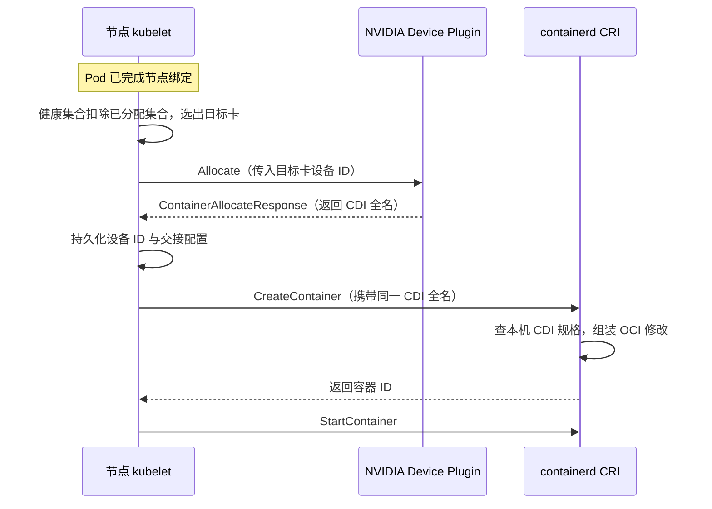

# kubelet 的 GPU 选卡、Allocate 与 CDI 交接

调度器完成过滤与打分后，只把节点名写入 Pod 的 `spec.nodeName`。它从未接触过具体的物理 GPU UUID。从这一刻起，接力棒正式交给目标节点上的 kubelet。

节点侧要办成两件事：**从本机健康设备中挑出确切的物理卡**，并**把交接信息准确传给容器运行时**。本篇以 Kubernetes v1.36、NVIDIA Device Plugin v0.20.1 与 containerd 2.3.0 为基准，拆解这条本地交付链路。

## 从本地健康集合里挑出目标卡

目标节点的 kubelet 接纳新 Pod 时，其 Device Manager 按本机实时状态算出空闲候选集合：

$$\text{本地空闲候选} = \text{健康设备集合} \setminus \text{已分配设备集合}$$

以 `node-h100` 为例，插件上报的健康清单包含两张 H100。第一张已被活跃 Pod 占用。相减后，唯一剩余的第二张卡自然成为本次分配对象。

如果节点有两张以上空闲卡，kubelet 按以下三步敲定分配并落盘：
- **征询偏好与拓扑**：若插件声明支持 `GetPreferredAllocation`，kubelet 会先向插件请求选卡建议（如优先同一互联域），再结合本地拓扑约束拍板（第 15 章详讲 Topology Manager）。
- **调用插件 `Allocate`**：选定设备 ID 后，kubelet 调用插件 `Allocate`。插件校验 ID 合法后返回 `ContainerAllocateResponse`，可携带设备节点、挂载点、环境变量、注解或 CDI 全名（可选的 `PreStartContainer` 钩子需插件声明，NVIDIA `v0.20.1` 未启用）。
- **持久化与回收**：分配成功后，Device Manager 按“Pod UID + 容器名 + 资源名”把设备 ID 与交接配置写入本地检查点。容器创建时取出使用；Pod 不再活跃后清理占用，健康卡重回候选池。

## 从 `Allocate` 响应到 containerd 原生 CDI 注入

拿到 `Allocate` 响应后，kubelet 经 CRI 向 containerd 发起 `CreateContainer`。原生 CDI 路径的交接非常干脆，如图 11-04-01 所示。



*图 11-04-01：Pod 绑定后，kubelet 本地选卡、调用插件 `Allocate` 并经由 CRI 将 CDI 全名交接给 containerd 的完整时序。*

要让 NVIDIA Device Plugin `v0.20.1` 走这条原生 CDI 路径，只需关注三项核心参数（自 Kubernetes v1.31 起，Device Plugin 返回 CDI 全名的支持已转稳定版）：

```yaml
version: v1
flags:
  migStrategy: none               # 整卡模式，关闭 MIG 切分
  plugin:
    deviceListStrategy: cdi-cri   # 通过 CRI 原生字段传递 CDI 全名
    deviceIDStrategy: uuid        # 以 GPU UUID 作为设备标识
```

整卡清单中，插件默认使用 GPU UUID 作为设备 ID。启用 `cdi-cri` 后，插件启动时会在宿主机 `/var/run/cdi` 生成节点 CDI 规格（官方 Helm 模板将该目录挂进插件容器）。

宿主机另一侧，containerd 2.3.0 的 `version = 3` 配置默认开启 `enable_cdi`。它会自动扫描 `/etc/cdi` 与 `/var/run/cdi` 两个目录。

设目标 H100 的 UUID 为 `GPU-bbbbbbbb-bbbb-bbbb-bbbb-bbbbbbbbbbbb`。排查交接是否畅通，只需逐字对齐下面三处字符串：

| 观察位置 | 本例应完全一致的对应值 |
| --- | --- |
| `Allocate` 响应的 CDI 条目 | `k8s.device-plugin.nvidia.com/gpu=GPU-bbbbbbbb-bbbb-bbbb-bbbb-bbbbbbbbbbbb` |
| CRI `CreateContainerRequest.config` | `CDI_devices[].name`（Go 字段名 `CDIDevices`）携带相同全名 |
| 宿主机 `/var/run/cdi` 规格文件 | `kind` 为 `k8s.device-plugin.nvidia.com/gpu`，`devices[].name` 含该 UUID |

> [!note] 其他交接策略：为什么独立部署常见 `envvar`？
> 独立 NVIDIA Device Plugin `v0.20.1` 的默认 `deviceListStrategy` 仍是 `envvar`。该模式通过 `NVIDIA_VISIBLE_DEVICES` 环境变量传递已选卡，因此容器创建必须走能消费该变量的 NVIDIA Container Runtime 包装层（见第 10 章第 04 篇）。
>
> 此外插件还支持 `volume-mounts` 与 `cdi-annotations`。更换策略只改变交接媒介与消费者，资源计数与选卡逻辑保持不变。

## 跨层核验：从本地分配到容器计算闭环

确认一次整卡交付真正成功，要把“节点分配、容器可见、算子跑通”三层证据对齐到同一个 Pod UID 和容器名：

```text
# 1) kubelet 本地分配日志（-v=4 级别，确认发起 Allocate 前的选中结果）
I1120 10:05:11.042 kubelet "Allocated devices"
  pod="gpu-example/probe" containerName="workload"
  resourceName="nvidia.com/gpu" devices=["GPU-bbbbbbbb-bbbb-bbbb-bbbb-bbbbbbbbbbbb"]

# 2) 查询本机 PodResources API（/var/lib/kubelet/pod-resources/kubelet.sock）
#    确认运行中容器绑定的 resource_name="nvidia.com/gpu" 与 device_ids 一致

# 3) 宿主机与容器内分别执行 nvidia-smi -L 核对 UUID，再跑最小 CUDA 探针
$ kubectl -n gpu-example exec probe -- nvidia-smi -L
GPU 0: NVIDIA H100 80GB HBM3 (UUID: GPU-bbbbbbbb-bbbb-bbbb-bbbb-bbbbbbbbbbbb)
# 仅此卡可见且无额外掩码时，容器内 CUDA 进程序号为 0；
# 运行兼容探针写入整数 7、同步并拷回校验通过，即完成计算验收。
```

> [!tip] 工程直觉：三层证据各管一摊
> PodResources `List` 证明 kubelet 本地账本已把目标 UUID 分给容器。`nvidia-smi -L` 证明管理通道可见。最小 CUDA 探针同步回读成功，才最终排除第 10 章讲过的驱动库失配或设备权限拦截。

## 竞态变体：绑定之后、选卡之前卡突然坏了

设想一个真实的时序竞态。调度器读缓存看到 `node-h100` 的 `Allocatable` 为 `2`、已占 `1`，于是把新 Pod 绑定过去。就在绑定完成到 kubelet 选卡的短短间隙，空闲的第二张卡突然故障，插件立刻推来新清单将其标为 `Unhealthy`。

kubelet 处理完新清单后，本机健康集合瞬间只剩已占用的第一张卡。再做集合减法，空闲候选为空。此时即使 API Server 里的 Node 状态尚未刷新、仍挂着旧的 `Allocatable: 2`，kubelet 也会在**本地接纳选卡阶段直接失败**，根本走不到调用 `Allocate` 那一步。

> [!warning] 常见误区：API 里还有余量，本地为何接纳失败？
> 调度器看到的 `Allocatable` 是异步同步的控制面快照，kubelet 选卡则以本机实时健康集合为准。遇到“已绑定却本地分配失败”，务必按时间戳对齐节点 `ListAndWatch` 健康更新、本地分配记录与 `Allocate` 调用返回，先切清究竟死在本地选卡还是插件 RPC。

至此，Device Plugin 整卡路径已完整闭合。回到第 03 篇留下的问题：如果集群有混装节点，或业务想直接按“显存大于 40 GiB”逐卡申请，整数扩展资源已经力不从心。下一篇正式切入下一代机制——DRA。

---

> [!info]- 参考资料
> - **Kubernetes Device Plugin 实现与监控**：[Device Plugin Implementation (v1.36)](https://v1-36.docs.kubernetes.io/docs/concepts/extend-kubernetes/compute-storage-net/device-plugins/#device-plugin-implementation)、[Monitoring Device Plugin Resources - PodResources API (v1.36)](https://v1-36.docs.kubernetes.io/docs/concepts/extend-kubernetes/compute-storage-net/device-plugins/#monitoring-device-plugin-resources)
> - **CRI、CDI 与 containerd 规范**：[CRI v0.36.0 api.proto](https://github.com/kubernetes/cri-api/blob/v0.36.0/pkg/apis/runtime/v1/api.proto)、[CDI 1.1.0 Specification](https://github.com/cncf-tags/container-device-interface/blob/v1.1.0/SPEC.md)、[containerd v2.3.0 CRI 配置](https://github.com/containerd/containerd/blob/v2.3.0/docs/cri/config.md)、[containerd v2.3.0 container_create_linux.go](https://github.com/containerd/containerd/blob/v2.3.0/internal/cri/server/container_create_linux.go)
> - **NVIDIA 设备插件 v0.20.1 源码与配置**：[Configuration Option Details](https://github.com/NVIDIA/k8s-device-plugin/tree/v0.20.1#configuration-option-details)、[server.go](https://github.com/NVIDIA/k8s-device-plugin/blob/v0.20.1/internal/plugin/server.go)、[devices.go](https://github.com/NVIDIA/k8s-device-plugin/blob/v0.20.1/internal/rm/devices.go)、[cdi.go](https://github.com/NVIDIA/k8s-device-plugin/blob/v0.20.1/internal/cdi/cdi.go)、[plugin-manager.go](https://github.com/NVIDIA/k8s-device-plugin/blob/v0.20.1/cmd/nvidia-device-plugin/plugin-manager.go)、[Helm DaemonSet 模板](https://github.com/NVIDIA/k8s-device-plugin/blob/v0.20.1/deployments/helm/nvidia-device-plugin/templates/daemonset-device-plugin.yml)
> - **kubelet 与 CUDA 核验参考**：[kubelet v1.36.0 Device Manager](https://github.com/kubernetes/kubernetes/blob/v1.36.0/pkg/kubelet/cm/devicemanager/manager.go)、[kubelet v1.36.0 container_manager_linux.go](https://github.com/kubernetes/kubernetes/blob/v1.36.0/pkg/kubelet/cm/container_manager_linux.go)、[NVIDIA SMI](https://docs.nvidia.com/deploy/nvidia-smi/index.html)、[CUDA 13.2.1 可见设备](https://docs.nvidia.com/cuda/archive/13.2.1/cuda-programming-guide/05-appendices/environment-variables.html#cuda-visible-devices)、[CUDA 13.2.1 同步 API](https://docs.nvidia.com/cuda/archive/13.2.1/cuda-runtime-api/group__CUDART__DEVICE.html)
