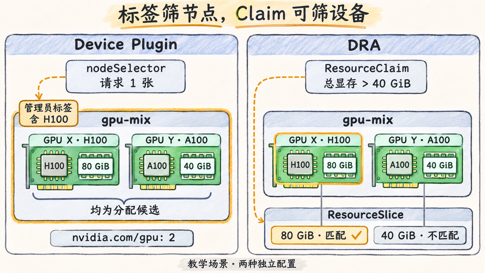

# 型号、显存与卡数怎样参与节点筛选

两台节点都上报了 `nvidia.com/gpu: 2`，其中 `gpu-h` 装的是 H100，`gpu-a` 装的是 A100。若应用指定用 H100，可以让 Pod 同时匹配节点的型号标签并请求一张 `nvidia.com/gpu`。节点标签用于筛选节点，资源请求让调度器检查数量余量。 [Kubernetes v1.36 GPU 调度](https://v1-36.docs.kubernetes.io/docs/tasks/manage-gpus/scheduling-gpus/#manage-clusters-with-different-types-of-gpus)

## NFD 找通用特征，GFD 补 GPU 属性

Node Feature Discovery（NFD）发现 CPU、PCI 等主机特征，并将配置允许的特征发布为节点标签。以 NVIDIA Device Plugin v0.19.2 Helm chart 附带的 NFD 配置为例，PCI 来源匹配指定设备类，标签名只取厂商 ID。匹配的 NVIDIA PCI 设备可产生 `feature.node.kubernetes.io/pci-10de.present: "true"`，这里 `10de` 是厂商 ID。更改 PCI 白名单或 `deviceLabelFields` 会影响标签是否出现以及标签名。 [NFD 特征标签](https://nfd.sigs.k8s.io/usage/features.html#pci) · [NFD worker PCI 配置](https://nfd.sigs.k8s.io/reference/worker-configuration-reference#sourcespci) · [NVIDIA v0.19.2 Helm 值](https://raw.githubusercontent.com/NVIDIA/k8s-device-plugin/v0.19.2/deployments/helm/nvidia-device-plugin/values.yaml)

GPU Feature Discovery（GFD）从 NVIDIA 设备取得 GPU 型号、显存等属性。启用 GFD 后，v0.19.2 默认使用 NFD 的 `NodeFeature` API 发布特征，再由 NFD 更新 Node 标签。GFD 的默认发布方式与 chart 是否启用 GFD 是两项配置。NFD 的 `NodeFeatureRule` 还可显式配置扩展资源。本例的特征发现使用标签，`nvidia.com/gpu` 的数量由 kubelet 根据 Device Plugin 的上报发布。 [GFD v0.19.2 发布配置](https://github.com/NVIDIA/k8s-device-plugin/blob/v0.19.2/cmd/gpu-feature-discovery/main.go) · [GFD 标签定义](https://github.com/NVIDIA/k8s-device-plugin/blob/main/docs/gpu-feature-discovery/README.md#generated-labels) · [NFD 扩展资源](https://nfd.sigs.k8s.io/usage/features.html#extended-resources)

以下是 `gpu-h` 的教学摘录，假设装有两张同型整卡，MIG 与共享关闭。型号文本和显存数值采用示意值，实际筛选时应读取节点上的标签原值。`nvidia.com/gpu.memory` 的单位是 MiB，`nvidia.com/gpu.count` 描述 GFD 发现的设备数量。可分配总量查看 Node 状态中的 `allocatable["nvidia.com/gpu"]`。 [GFD 标签定义](https://github.com/NVIDIA/k8s-device-plugin/blob/main/docs/gpu-feature-discovery/README.md#generated-labels) · [Kubernetes 设备插件资源上报](https://v1-36.docs.kubernetes.io/docs/concepts/extend-kubernetes/compute-storage-net/device-plugins/#device-plugin-registration)

```yaml
metadata:
  name: gpu-h
  labels:
    feature.node.kubernetes.io/pci-10de.present: "true"
    nvidia.com/gpu.product: NVIDIA-H100-80GB-HBM3
    nvidia.com/gpu.count: "2"
    nvidia.com/gpu.memory: "81920"
status:
  capacity:
    nvidia.com/gpu: "2"
  allocatable:
    nvidia.com/gpu: "2"
```

## 用型号和数量各筛一次

以下是 Pod 规格摘录。`registry.example/gpu-probe:v1` 代表教学案例的工作镜像。`spec.nodeSelector` 要求节点的标签值完全匹配。容器请求一张整卡，由扩展资源检查该节点能否在满足已有请求后再容纳一个单位。 [Kubernetes v1.36 nodeSelector](https://v1-36.docs.kubernetes.io/docs/concepts/scheduling-eviction/assign-pod-node/#nodeselector) · [NodeResourcesFit v1.36.0 源码](https://github.com/kubernetes/kubernetes/blob/v1.36.0/pkg/scheduler/framework/plugins/noderesources/fit.go)

```yaml
spec:
  nodeSelector:
    nvidia.com/gpu.product: NVIDIA-H100-80GB-HBM3
  containers:
    - name: workload
      image: registry.example/gpu-probe:v1
      resources:
        limits:
          nvidia.com/gpu: 1
```

假设其他调度条件均满足，以下三个节点状态分别独立判断。

| 候选节点 | 型号匹配 | `Allocatable − 已计入请求` | 结果 |
| --- | --- | ---: | --- |
| `gpu-h`，A 已分配，B 还可分配 | 是 | `2 − 1 = 1` | 可以放置。 |
| `gpu-h`，两张卡的请求都已计入 | 是 | `2 − 2 = 0` | GPU 数量检查失败。 |
| `gpu-a`，两张 A100 都未分配 | 否 | `2 − 0 = 2` | 节点标签检查失败。 |

如果节点有 PCI 或 GFD 标签，但 Node 状态中缺少 `nvidia.com/gpu`，可以确认相应的发现机制曾提供标签，再查设备插件的注册、设备上报和 kubelet 的 Node 状态更新。如果一台节点混装不同型号，且插件以同一个资源名上报所有卡，那么型号标签只约束落在哪台节点。节点内仍可能选到同一资源名下的另一种卡。需要逐卡保证型号或显存时，调度器要能看到并匹配每个设备的属性。 [Kubernetes 节点选择规则](https://v1-36.docs.kubernetes.io/docs/concepts/scheduling-eviction/assign-pod-node/#nodeselector) · [Kubernetes v1.36 DRA](https://v1-36.docs.kubernetes.io/docs/concepts/scheduling-eviction/dynamic-resource-allocation/)



图 11-04-01　两种独立配置中的两张整卡均健康且未分配。左侧 `nodeSelector` 匹配管理员添加的「含 H100」标签，容器另以 `nvidia.com/gpu` 请求一个资源单位。两张卡同属该资源名，均可成为节点内分配的候选。右侧 `ResourceClaim` 按 `ResourceSlice` 中每张卡报告的总显存筛选，只有 80 GiB 的 H100 严格大于 40 GiB。
