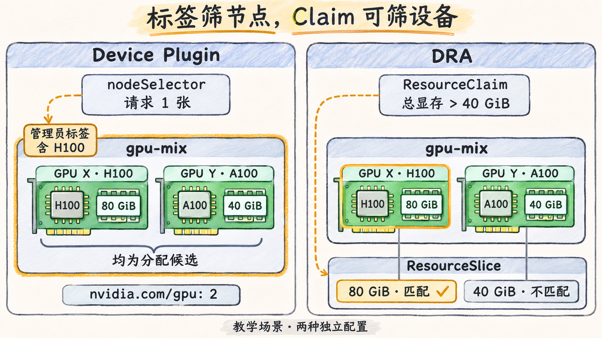

一个应用需要**一张总显存严格大于 40 GiB 的 GPU**。在同型节点池中，已知每台节点的 GPU 完全同型，可以用节点标签和整卡数量间接表达这一条件。但在混装节点上，用“含 H100”的标签匹配整台节点后，`nvidia.com/gpu` 的可选设备中可能仍有 40 GiB 的卡。要在同一个请求里保证单卡容量，参与调度的库存就要细到每张卡。

**动态资源分配（Dynamic Resource Allocation，DRA）** 是 Kubernetes 的设备申请与分配机制。驱动将设备清单发布到 API，负载通过申请对象声明所需设备，调度器在检查 Pod 放置时把可访问的具体设备一并纳入决策。分配结果随后由节点插件兑现。本篇使用 Kubernetes v1.36 和 NVIDIA DRA Driver v0.5.1 的整卡路径。 [Kubernetes v1.36 DRA](https://v1-36.docs.kubernetes.io/docs/concepts/scheduling-eviction/dynamic-resource-allocation/) · [NVIDIA 整卡分配](https://dra-driver-nvidia-gpu.sigs.k8s.io/docs/concepts/gpu-allocation/#full-gpus)

## 设备库存、设备类与申请对象

在最小场景中，驱动发布一个 `ResourceSlice`，其中写有节点上可供选择的设备。管理员或驱动提供一个 `DeviceClass`，约定哪些设备属于某类，例如 NVIDIA 的整卡类 `gpu.nvidia.com`。随后，Pod 引用一份 `ResourceClaim`（设备申请，简称 Claim），请求该类中的一张卡，可以附加容量等条件。调度器读这三类对象以及已有分配，在节点约束下寻找具体设备。成功时把结果写入 Claim，Pod 上的容器获得使用该 Claim 所分设备的资格。 [Kubernetes v1.36 DRA 对象与工作流](https://v1-36.docs.kubernetes.io/docs/concepts/scheduling-eviction/dynamic-resource-allocation/#dra-terminology) · [NVIDIA 设备类与切片字段](https://dra-driver-nvidia-gpu.sigs.k8s.io/docs/reference/resourceslice-attributes/)

| 对象 | 解释本例中的哪一件事 |
| --- | --- |
| `ResourceSlice` | 驱动有哪些设备、每个设备有哪些属性和容量、从哪些节点可访问。 |
| `DeviceClass` | 哪些设备满足公共的类别约定，本例选择 NVIDIA 完整 GPU。 |
| `ResourceClaim` | 此次请求的类别、数量、附加条件，以及分配后选中了什么、允许谁使用。 |
| `ResourceClaimTemplate` | 当多个 Pod 各自需要一份同样规格的 Claim 时，供控制器生成实际申请的模板。 |

切片与设备类都是集群级对象，Claim 和模板则属于命名空间。一个资源池可横跨多张切片，`generation` 与 `resourceSliceCount` 描述一个发布代次和该代的切片总数。本例 NVIDIA 驱动每节点一个池，设备由 `driver/pool/device` 三元组定位，所以两台节点可以各有名为 `gpu-1` 的设备。下列是驱动发布的切片教学摘录，省略 A 的条目和 B 的其他属性。物理身份用设备的 `uuid` 字段回查。 [ResourceSlice v1 API](https://v1-36.docs.kubernetes.io/docs/reference/kubernetes-api/resource/resource-slice-v1/) · [NVIDIA v0.5.1 设备字段实现](https://github.com/kubernetes-sigs/dra-driver-nvidia-gpu/blob/v0.5.1/cmd/gpu-kubelet-plugin/deviceinfo.go)

```yaml
apiVersion: resource.k8s.io/v1
kind: ResourceSlice
metadata:
  name: gpu-h-inventory
spec:
  driver: gpu.nvidia.com
  pool:
    name: gpu-h
    generation: 1
    resourceSliceCount: 1
  nodeName: gpu-h
  devices:
    - name: gpu-1
      attributes:
        type:
          string: gpu
        uuid:
          string: GPU-bbbbbbbb-bbbb-bbbb-bbbb-bbbbbbbbbbbb
      capacity:
        memory:
          value: 80Gi
```

## 从逐卡匹配推到 Pod 的可放置节点

DRA 算例采用独立的快照，节点和设备简称沿用 `gpu-h` 的 A、B 及 `gpu-a` 的 C、D。假定驱动分别给 A/B 发布 `80Gi`、给 C/D 发布 `40Gi`，A 已分给另一份整卡 Claim，其余设备可用，且没有其他节点约束。这些数值是教学输入。这里的 `memory` 表示驱动报告的总容量，运行时的空闲显存需另测。 [NVIDIA 切片显存定义](https://dra-driver-nvidia-gpu.sigs.k8s.io/docs/reference/resourceslice-attributes/) · [Kubernetes v1.36 DRA 分配工作流](https://v1-36.docs.kubernetes.io/docs/concepts/scheduling-eviction/dynamic-resource-allocation/#how-resource-allocation-with-dra-works)

| 节点 | 池内设备 | 显存 | 通过 `> 40Gi` | 能用于本次申请 |
| --- | --- | ---: | --- | --- |
| `gpu-h` | `gpu-0`（A） | `80Gi` | 是 | 否，已分配。 |
| `gpu-h` | `gpu-1`（B） | `80Gi` | 是 | 是，可从 `gpu-h` 访问。 |
| `gpu-a` | `gpu-0`（C） | `40Gi` | 否，等于阈值 | 否。 |
| `gpu-a` | `gpu-1`（D） | `40Gi` | 否，等于阈值 | 否。 |

四张设备均通过整卡类的条件。显存条件把候选缩到 A、B。A 仍在驱动发布的库存里，调度器根据其他 Claim 的分配把它排除。最后 B 的可达范围又把 Pod 的可行节点限定为 `gpu-h`。若 Pod 另外要求落在 `gpu-a`，条件的交集即为空。若 B 被别的 Claim 占用，在 `gpu-a` 增加更多 `40Gi` 的卡也无济于事，因为表达式检查每张设备本身。

把这套方法用到混装节点 `gpu-mix`，就能看到调度依据的粒度如何改变。图中 X 与 Y 分别代表独立对照的 H100 和 A100，两张都健康且未分配。



图 11-05-01　两种独立的资源供给配置。左侧的 `nodeSelector` 对应管理员标签，另由容器扩展资源请求声明卡数，两张卡均可参与节点内分配。右侧读取逐卡容量，只有 X 的 80 GiB 严格大于 40 GiB。

## 容器引用与显存选择表达式

下面是同一命名空间中的模板与 Pod，工作镜像为占位。模板的内层 `spec` 是控制器要复制给 Claim 的规格。请求 `card` 用 `ExactCount` 申请一个满足整卡类及附加条件的设备。CEL（Common Expression Language，通用表达式语言）逐个评估设备。驱动发布的裸键 `memory` 在表达式中通过驱动域 `gpu.nvidia.com` 读取，`quantity("40Gi")` 构造比较所用的容量值。 [ResourceClaim v1 API](https://v1-36.docs.kubernetes.io/docs/reference/kubernetes-api/resource/resource-claim-v1/) · [NVIDIA 整卡显存选择示例](https://dra-driver-nvidia-gpu.sigs.k8s.io/docs/guides/gpu-allocation/allocating-gpus/#select-a-gpu-by-memory-size)

```yaml
apiVersion: resource.k8s.io/v1
kind: ResourceClaimTemplate
metadata:
  name: large-gpu
  namespace: gpu-example
spec:
  spec:
    devices:
      requests:
        - name: card
          exactly:
            deviceClassName: gpu.nvidia.com
            allocationMode: ExactCount
            count: 1
            selectors:
              - cel:
                  expression: >-
                    device.capacity['gpu.nvidia.com'].memory.isGreaterThan(quantity("40Gi"))
---
apiVersion: v1
kind: Pod
metadata:
  name: probe
  namespace: gpu-example
spec:
  resourceClaims:
    - name: accelerator
      resourceClaimTemplateName: large-gpu
  containers:
    - name: workload
      image: registry.example/gpu-probe:v1
      resources:
        claims:
          - name: accelerator
```

Pod 先用 `spec.resourceClaims` 将模板 `large-gpu` 引入为 Pod 内的名字 `accelerator`，容器再用 `resources.claims` 引用这个名字。本例容器引用整个 Claim，`card` 是 Claim 内部的设备请求名。控制器根据模板创建实际 Claim。在 Pod 的 `status.resourceClaimStatuses` 中找到 `name: accelerator`，即可从对应的 `resourceClaimName` 读出本例的 `probe-accelerator-7m2pk`。模板生成的 Claim 随所属 Pod 管理。如果在 `spec.resourceClaims` 中用 `resourceClaimName` 直接引用一个预先创建的同命名空间 Claim，其生命周期由创建方管理，多份 Pod 引用同一个名称会指向同一份设备申请。 [Kubernetes v1.36 Claim 与模板](https://v1-36.docs.kubernetes.io/docs/concepts/scheduling-eviction/dynamic-resource-allocation/#resourceclaims-and-resourceclaimtemplates) · [Kubernetes v1.36 Pod API](https://v1-36.docs.kubernetes.io/docs/reference/kubernetes-api/core/pod-v1/)

## Claim 状态中的设备与消费者

对于本例尚未分配的显式 Claim，默认调度器在筛选节点时为各节点尝试设备组合。选定 `gpu-h` 后，调度器先在内部登记 B 的待提交分配，让后续调度周期能计入这项占用。随后在绑定前写入 Claim 的设备结果和获准使用的消费者，最后才将 Pod 绑定到节点。这样，kubelet 开始处理已绑定的 Pod 时就有可读取的分配依据。 [Kubernetes v1.36 DRA 工作流](https://v1-36.docs.kubernetes.io/docs/concepts/scheduling-eviction/dynamic-resource-allocation/#workflow-for-kubernetes) · [v1.36.0 DynamicResources 的 Filter、Reserve 与 PreBind](https://github.com/kubernetes/kubernetes/blob/v1.36.0/pkg/scheduler/framework/plugins/dynamicresources/dynamicresources.go)

下面是已分配 Claim 的教学摘录，省略对象头和其他字段。`request: card` 指回申请，三元组 `gpu.nvidia.com / gpu-h / gpu-1` 指向 B。用 `reservedFor` 中的 UID 与 Pod 的 `metadata.uid` 核对消费者。此处只能确认本次控制面分配，节点还要把这个结果转换成容器能消费的设备配置。 [ResourceClaim v1 状态字段](https://v1-36.docs.kubernetes.io/docs/reference/kubernetes-api/resource/resource-claim-v1/)

```yaml
metadata:
  name: probe-accelerator-7m2pk
  namespace: gpu-example
  uid: 22222222-2222-4222-8222-222222222222
status:
  allocation:
    devices:
      results:
        - request: card
          driver: gpu.nvidia.com
          pool: gpu-h
          device: gpu-1
  reservedFor:
    - resource: pods
      name: probe
      uid: 11111111-1111-4111-8111-111111111111
```
