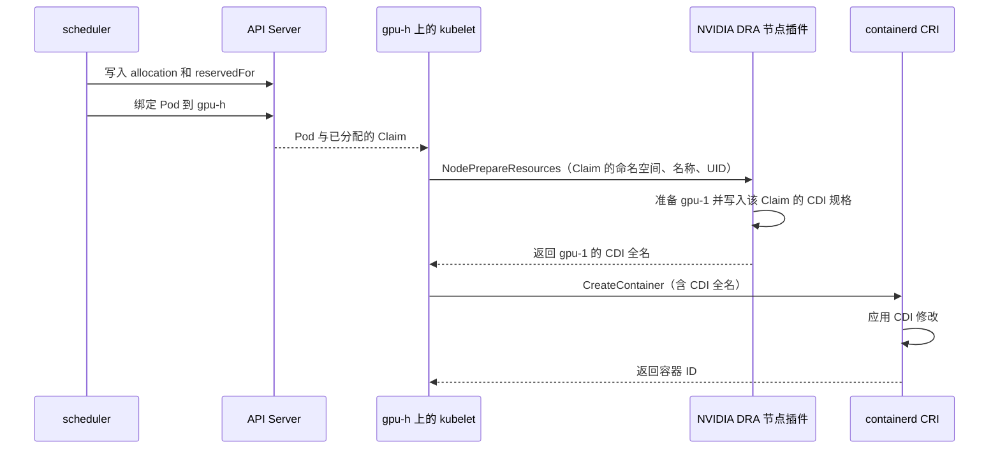
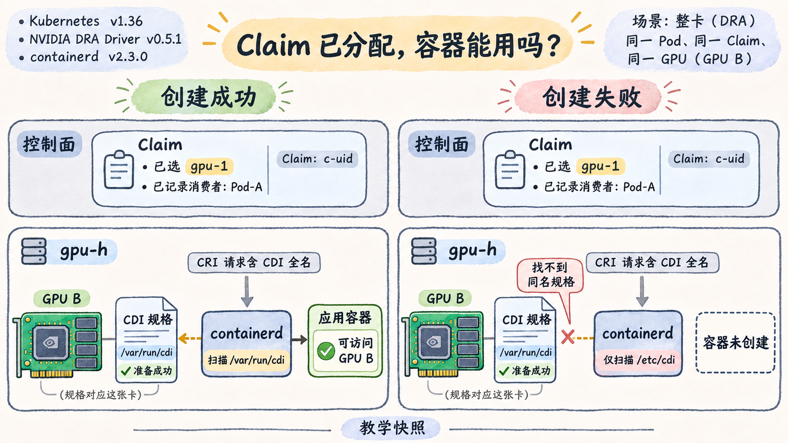

# Claim 分配后怎样准备并注入 GPU

一个 Pod 已绑定 `gpu-h`，它的 `ResourceClaim.status.allocation` 指定了 `gpu.nvidia.com / gpu-h / gpu-1`，`status.reservedFor` 也列出了该 Pod 的 UID。这些字段记录调度阶段的分配与消费者。容器能访问 GPU 之前，节点上的 NVIDIA DRA 插件还要准备这份 Claim，containerd 才能按返回的设备名注入。下例用 Kubernetes v1.36.0、NVIDIA DRA Driver v0.5.1、containerd v2.3.0 和完整 GPU。 [ResourceClaim v1 状态](https://v1-36.docs.kubernetes.io/docs/reference/kubernetes-api/resource/resource-claim-v1/#resourceclaimstatus) · [NVIDIA GPU 分配时序](https://dra-driver-nvidia-gpu.sigs.k8s.io/docs/concepts/gpu-allocation/#how-scheduling-works)

## kubelet 怎样请求节点准备

1. kubelet 读取 Pod 所用的 Claim，检查该 Pod 是否在允许使用的消费者中，根据分配结果中的 `driver` 找到本节点注册的 DRA 插件。
2. kubelet 向该插件发出 `NodePrepareResources`，用命名空间、名称和 UID 标识待准备的 Claim。NVIDIA 插件收到 Claim 后，依据分配结果找到并准备本地设备。在整卡例中，插件根据 GPU UUID 取得设备配置，为该 Claim 写入临时 CDI 规格，并返回设备的 CDI 全名。
3. kubelet 按容器引用的 Claim 取用准备结果，在 CRI 的创建请求中附上这些名称。containerd 在有效的 CDI 目录中查找对应规格，将设备节点、库挂载等修改应用到 OCI 配置，然后才能创建容器。CDI 从准备结果接收指定的设备名，具体设备由更早的 Claim 分配环节决定。

步骤和时序取自指定版本的实现。kubelet 缓存成功的准备结果，驱动具体返回的 CDI 名可按完整名称核对。 [kubelet v1.36.0 DRA 管理器](https://github.com/kubernetes/kubernetes/blob/v1.36.0/pkg/kubelet/cm/dra/manager.go) · [NVIDIA v0.5.1 节点准备](https://github.com/kubernetes-sigs/dra-driver-nvidia-gpu/blob/v0.5.1/cmd/gpu-kubelet-plugin/driver.go) · [NVIDIA v0.5.1 CDI 规格生成](https://raw.githubusercontent.com/kubernetes-sigs/dra-driver-nvidia-gpu/v0.5.1/cmd/gpu-kubelet-plugin/cdi.go)

## 用 Claim UID 串起准备与注入

以下是同一次请求的教学推演。假设 Claim UID 是 `22222222-2222-4222-8222-222222222222`，分到的物理卡 B 的 UUID 是 `GPU-bbbbbbbb-bbbb-bbbb-bbbb-bbbbbbbbbbbb`。NVIDIA v0.5.1 的 CDI 设备名由 Claim UID 与设备名拼成，使用 `k8s.gpu.nvidia.com/claim` 这个 kind。`gpu-1` 是资源池里的名字，GPU UUID 则从同一条切片中的 `attributes.uuid` 获取。 [NVIDIA v0.5.1 CDI 命名源码](https://raw.githubusercontent.com/kubernetes-sigs/dra-driver-nvidia-gpu/v0.5.1/cmd/gpu-kubelet-plugin/cdi.go) · [NVIDIA 切片属性](https://dra-driver-nvidia-gpu.sigs.k8s.io/docs/reference/resourceslice-attributes/)

| 环节 | 应核对的字段或观测 |
| --- | --- |
| Claim 已分配 | Claim 的 `metadata.uid`、允许消费者的 Pod UID、结果 `gpu.nvidia.com / gpu-h / gpu-1`。 |
| 节点已准备 | 用 Claim UID 对照节点插件的准备结果，例如源码中成功准备新设备的 V(1) 日志，以及生成规格时的 V(6) 日志。返回的 CDI 全名应为 `k8s.gpu.nvidia.com/claim=22222222-2222-4222-8222-222222222222-gpu-1`。 |
| 运行时收到设备名 | `CreateContainerRequest.config` 的 CDI 设备列表应含同一个全名。节点规格的 `kind` 和 `devices[].name` 应能组成该名称。 |
| 容器能访问 B | 容器已启动后，`nvidia-smi -L` 应能列出与切片、宿主机一致的 B 的 UUID。CUDA 计算另用兼容镜像中的探针检查。 |

只改变一个条件，便可以看出失败发生在哪一层。

- **节点插件不可用。** Claim 和节点绑定已经存在，kubelet 找不到 `gpu.nvidia.com` 的节点插件，或准备 RPC 报错。优先查 `gpu-h` 上同一驱动的注册与运行状态，以及本次请求的 Claim UID 和错误。此时卡已经分给 Claim，节点准备尚未成功。 [kubelet v1.36.0 的插件查找与准备响应检查](https://github.com/kubernetes/kubernetes/blob/v1.36.0/pkg/kubelet/cm/dra/manager.go)
- **准备已成功，CRI 无法解析名称。** 假设驱动仍把规格写到默认的 `/var/run/cdi`，而 containerd 的有效 `cdi_spec_dirs` 只有 `/etc/cdi`，且该目录没有同名规格。此时 kubelet 已拿到并传递全名，运行时查找时失败。用实际的请求名、规格 `kind` 与设备条目、运行时扫描目录和解析记录交叉验证。 [NVIDIA v0.5.1 CDI 规格目录](https://raw.githubusercontent.com/kubernetes-sigs/dra-driver-nvidia-gpu/v0.5.1/cmd/gpu-kubelet-plugin/cdi.go) · [containerd v2.3.0 CDI 配置](https://github.com/containerd/containerd/blob/v2.3.0/docs/cri/config.md)

图 11-06-01　两份教学快照使用同一个 Pod、同一份 Claim 和同一个 CDI 全名。其他创建条件均满足时，左侧扫描到 `/var/run/cdi` 下的同名规格，容器获得 GPU B 的访问。右侧只扫描 `/etc/cdi`，该目录没有同名规格，创建在 CDI 查找阶段失败。

Pod 结束后，kubelet 处理节点上的准备状态。同一节点还有其他 Pod 使用同一 Claim 时，先移除结束的 Pod 引用。最后一个本地消费者结束后，kubelet 调用 `NodeUnprepareResources`，NVIDIA 插件清理准备状态和临时 CDI 规格。控制面的控制器另外清理消费者记录。在本例由调度器分配的 Claim 中，当最后一项有效的消费者记录被移除时，控制器会清空分配，设备由此可供其他 Claim 选择。由模板生成的 Claim 随所属 Pod 管理，手工创建的 Claim 可以保留下来供后续请求使用。 [kubelet v1.36.0 解除准备实现](https://github.com/kubernetes/kubernetes/blob/v1.36.0/pkg/kubelet/cm/dra/manager.go) · [NVIDIA CDI 清理实现](https://raw.githubusercontent.com/kubernetes-sigs/dra-driver-nvidia-gpu/v0.5.1/cmd/gpu-kubelet-plugin/cdi.go) · [Kubernetes v1.36.0 Claim 控制器](https://raw.githubusercontent.com/kubernetes/kubernetes/v1.36.0/pkg/controller/resourceclaim/controller.go#L1360-L1393)

## Kubernetes 与 NVIDIA 组件各有版本条件

Kubernetes v1.34 将 DRA 的核心功能和 `resource.k8s.io/v1` 转为稳定版，v1.35 起 DRA 核心始终启用。要在 GPU Operator v26.7 的新装 `GPUCluster` 路径中使用 NVIDIA DRA Driver v0.5.1，还须满足平台支持矩阵，并具备 Kubernetes v1.34.2 或更新版本、可用的 `DeviceClass` API、版本 580 或更新的 NVIDIA GPU 驱动，以及已配置 CDI 的容器运行时。托管文档将整卡分配列为 GA。动态 MIG 和该驱动的 NVML 设备健康检查仍有各自的 alpha 开关。本文的 H100 整卡示例只用 GPU 分配功能，ComputeDomain 面向满足额外条件的多节点 NVLink 环境。 [Kubernetes v1.34 DRA 稳定版](https://v1-35.docs.kubernetes.io/blog/2025/09/01/kubernetes-v1-34-dra-updates/) · [Kubernetes v1.35 发布说明](https://kubernetes.io/blog/2025/12/17/kubernetes-v1-35-release/) · [GPU Operator v26.7 DRA 支持条件](https://docs.nvidia.com/datacenter/cloud-native/gpu-operator/26.7/dra-intro-install.html)
