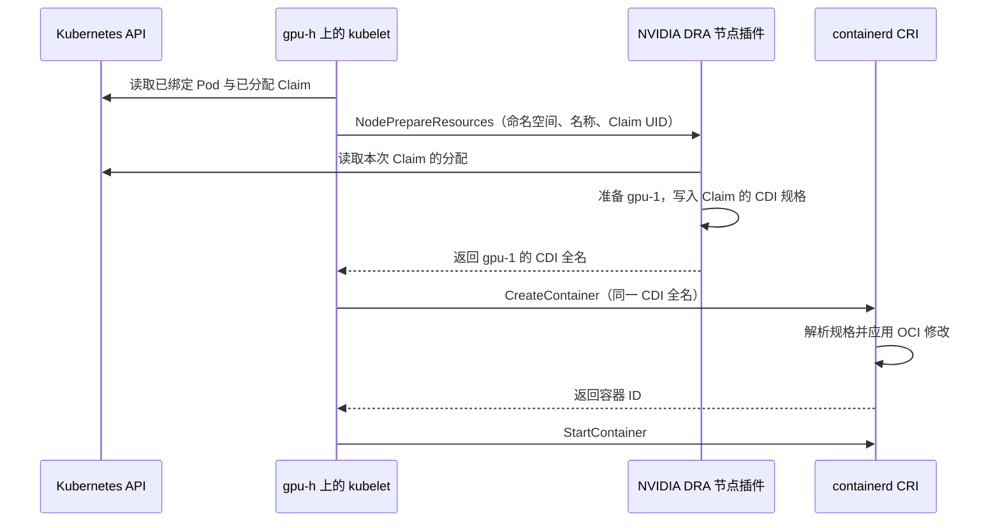

`gpu-example/probe` 已绑定到 `gpu-h`。其 Claim 的 `status.allocation` 指向 `gpu.nvidia.com / gpu-h / gpu-1`，也就是物理卡 B，`status.reservedFor` 中有该 Pod 的 UID。此时控制面已确定设备和消费者。为了把 B 交给容器，kubelet 还要请本机驱动准备设备，再把准备结果传给运行时。本篇用 Kubernetes v1.36.0、NVIDIA DRA Driver v0.5.1 与 containerd v2.3.0 追踪这个过程。 [ResourceClaim v1 状态](https://v1-36.docs.kubernetes.io/docs/reference/kubernetes-api/resource/resource-claim-v1/) · [NVIDIA GPU 分配与注入流程](https://dra-driver-nvidia-gpu.sigs.k8s.io/docs/concepts/gpu-allocation/#how-scheduling-works)

## kubelet 按 Claim 请求节点准备

1. **确定应由哪个驱动处理。** kubelet 取得 Pod 所用的 Claim，核对该 Pod 是否获准使用它，根据分配结果的 `driver` 查找本机已注册的 DRA 插件。即使 API 中已有库存和分配，准备仍依赖目标节点上该驱动的服务。
2. **让驱动兑现既有分配。** kubelet 发出 `NodePrepareResources`，传入 Claim 的命名空间、名称和 UID。NVIDIA 的节点插件按该 Claim 对象的分配结果找到 `gpu-1`，生成该 Claim 的临时 CDI（Container Device Interface，容器设备接口）规格，返回这张设备的 CDI 全名。kubelet 缓存成功的准备结果。
3. **将准备结果交给指定容器。** `workload` 通过容器级 Claim 引用取用该设备。kubelet 将准备得到的名称填入容器运行时接口 CRI（Container Runtime Interface）的创建请求，containerd 用自己的有效 CDI 规格集合解析它。运行时按规格把设备节点、访问规则及库挂载等修改写入 OCI 配置，然后才可创建、启动容器。 [kubelet v1.36.0 Claim 准备与容器资源实现](https://github.com/kubernetes/kubernetes/blob/v1.36.0/pkg/kubelet/cm/dra/manager.go) · [NVIDIA v0.5.1 节点插件](https://github.com/kubernetes-sigs/dra-driver-nvidia-gpu/blob/v0.5.1/cmd/gpu-kubelet-plugin/driver.go) · [containerd v2.3.0 创建实现](https://github.com/containerd/containerd/blob/v2.3.0/internal/cri/server/container_create_linux.go)

## 从池内设备名回查 GPU UUID

以下沿用 Claim `probe-accelerator-7m2pk` 的教学记录。Pod UID 用来核对消费者，Claim UID 用来核对节点准备记录。NVIDIA v0.5.1 的整卡实现使用 `k8s.gpu.nvidia.com/claim` 作为 CDI kind，条目名由 Claim UID 与设备的规范名称拼接。池内名 `gpu-1` 需要与驱动和池一起定位，只有回到切片条目才能得到物理 UUID。 [NVIDIA v0.5.1 CDI 规格生成与命名](https://github.com/kubernetes-sigs/dra-driver-nvidia-gpu/blob/v0.5.1/cmd/gpu-kubelet-plugin/cdi.go) · [NVIDIA v0.5.1 设备字段](https://github.com/kubernetes-sigs/dra-driver-nvidia-gpu/blob/v0.5.1/cmd/gpu-kubelet-plugin/deviceinfo.go)

| 观察点 | 本例中应关联的证据 |
| --- | --- |
| Claim 已分配，且保留给该 Pod | `metadata.uid` 是 `22222222-2222-4222-8222-222222222222`；消费者的 UID 为 `11111111-1111-4111-8111-111111111111`；分配结果指向 `gpu.nvidia.com / gpu-h / gpu-1`。 |
| 节点已准备 | 用 Claim UID 对照准备调用的成功结果，例如驱动生成规格时的 V(6) 记录。返回全名为 `k8s.gpu.nvidia.com/claim=22222222-2222-4222-8222-222222222222-gpu-1`。 |
| 请求与节点规格对应 | `CreateContainerRequest.config.CDI_devices[].name` 包含相同全名，节点规格的 `kind` 与 `devices[].name` 可拼出这个名称。 |
| 容器交付并完成计算 | 用 `gpu-h` 切片中 B 的 `attributes.uuid.string` 关联宿主机和容器的 `nvidia-smi -L`。再用兼容的 CUDA 探针在 B 上同步并校验结果。 |

## 准备失败与 CDI 解析失败的分界

两个独立变体都从已分配、已绑定的状态开始。

- **准备请求失败。** 假如 kubelet 找不到注册的 `gpu.nvidia.com` 节点插件，或插件为该 Claim 返回错误，下一项证据是 `gpu-h` 上按驱动名、Claim UID 对齐的注册状态及 RPC 结果。这一步还未向运行时提供可用的准备结果。 [kubelet v1.36.0 插件查找与准备响应检查](https://github.com/kubernetes/kubernetes/blob/v1.36.0/pkg/kubelet/cm/dra/manager.go)
- **CRI 收到全名后解析失败。** 假如节点准备已成功，规格写在驱动默认的 `/var/run/cdi`，但 containerd 的有效 `cdi_spec_dirs` 只有 `/etc/cdi`，且该目录没有对应条目，那么运行时无法找到该名称，创建在解析阶段失败。先核对全名与目录，再用同一个请求验证运行时能否加载正确规格。 [NVIDIA v0.5.1 默认 CDI 目录](https://github.com/kubernetes-sigs/dra-driver-nvidia-gpu/blob/v0.5.1/cmd/gpu-kubelet-plugin/cdi.go) · [containerd v2.3.0 CDI 配置](https://github.com/containerd/containerd/blob/v2.3.0/docs/cri/config.md)

图 11-06-01　图中的 Pod-A 和 c-uid 分别代表本例的 `probe` 与 Claim UID。左侧表示运行时的有效目录包含 `/var/run/cdi` 且其他创建条件满足。右侧仅改变运行时的扫描目录，Claim、节点准备和创建请求中的全名均相同。

## 节点解除准备与控制面回收

当一个 Pod 结束并由 kubelet 清理时，节点侧先处理本地引用。若同一节点仍有其他 Pod 在用这份 Claim，kubelet 删除结束的 Pod 的本地引用，保留准备状态。最后一个本地消费者结束后，kubelet 可按 Claim 调用 `NodeUnprepareResources`，驱动清理本地准备记录和临时 CDI 规格。 [kubelet v1.36.0 解除准备实现](https://github.com/kubernetes/kubernetes/blob/v1.36.0/pkg/kubelet/cm/dra/manager.go) · [NVIDIA v0.5.1 节点清理](https://github.com/kubernetes-sigs/dra-driver-nvidia-gpu/blob/v0.5.1/cmd/gpu-kubelet-plugin/driver.go) · [NVIDIA v0.5.1 CDI 规格清理](https://github.com/kubernetes-sigs/dra-driver-nvidia-gpu/blob/v0.5.1/cmd/gpu-kubelet-plugin/cdi.go)

控制面另有 Claim 控制器负责清理消费者。在本例这种由调度器分配的 Claim 中，控制器移除最后一项有效消费者记录时会清空分配，B 由此可进入后续调度的候选集合。模板生成的 Claim 由系统随拥有它的 Pod 管理，手工创建的 Claim 可以保留，供后续 Pod 引用和重新分配。解除准备属于节点清理，消除分配属于 API 状态更新，取证时应分别观察这两项。 [Kubernetes v1.36.0 Claim 控制器](https://github.com/kubernetes/kubernetes/blob/v1.36.0/pkg/controller/resourceclaim/controller.go#L1360-L1448)

## DRA 核心功能与 NVIDIA 托管路径的版本条件

Kubernetes v1.34 将 DRA 核心功能和 `resource.k8s.io/v1` 转为稳定版，v1.35 起核心功能始终启用。使用 GPU Operator v26.7 的新装 `GPUCluster` 路径托管 NVIDIA DRA Driver v0.5.1 时，还需符合平台支持矩阵：Kubernetes 至少 v1.34.2、有可用的 `DeviceClass` API、NVIDIA 驱动至少为 580，运行时也要配置好 CDI。该托管版本将完整 GPU 分配列为 GA（正式可用）。动态 MIG、NVML 设备健康检查等能力有独立的开关和成熟度，本例只使用整卡分配。第 12 章将这些条件接到组件的部署与验收。 [Kubernetes v1.34 DRA 更新](https://v1-35.docs.kubernetes.io/blog/2025/09/01/kubernetes-v1-34-dra-updates/) · [Kubernetes v1.35 发布说明](https://kubernetes.io/blog/2025/12/17/kubernetes-v1-35-release/#continued-innovation-in-dynamic-resource-allocation-dra) · [GPU Operator v26.7 DRA 前置条件与成熟度](https://docs.nvidia.com/datacenter/cloud-native/gpu-operator/26.7/dra-intro-install.html)
