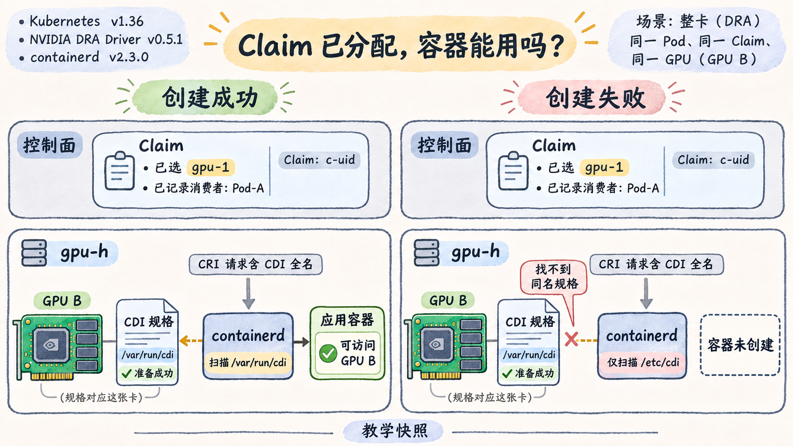
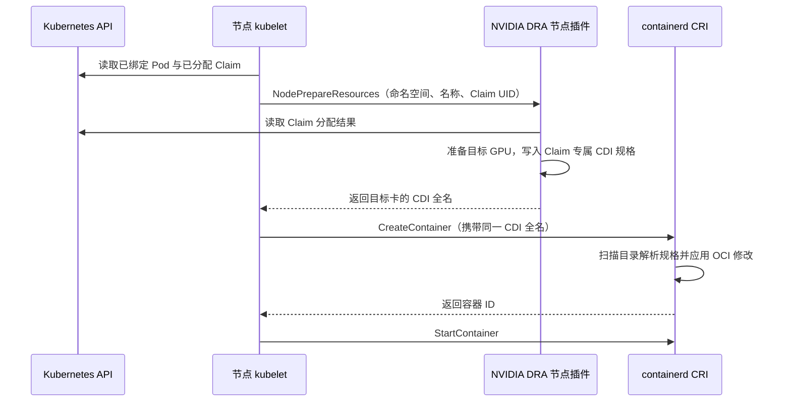

# DRA 节点准备、CDI 注入与资源释放

调度器已经把 Pod 绑定到目标节点，也把设备三元组写进了 `ResourceClaim`。但容器运行时 containerd 不认识 `ResourceClaim` 对象，它只认标准的 CDI 设备全名。

谁把控制面分配翻译成宿主机上的 CDI 规格，又在 Pod 退出后清理干净？先看图 11-06-01：控制面分配完全相同，为何左侧顺利拿卡、右侧却创建失败？本篇基于 Kubernetes v1.36、NVIDIA DRA Driver v0.5.1 与 containerd 2.3.0 拆解全流程。

*图 11-06-01：Claim 分配与节点准备均成功后，containerd 是否扫描 `/var/run/cdi` 决定容器能否创建；图中 `gpu-h`、`GPU B`、`Pod-A`、`c-uid` 分别对应 `node-h100`、目标 H100、`probe` 与 Claim UID。*

## kubelet 按 Claim 触发节点准备与注入

目标节点的 kubelet 收到已绑定 Pod 后，需要跨越三道关口才能完成容器交付：

1. **校验资格并查找驱动插件**：kubelet 读取 Pod 引用的 `ResourceClaim`，确认 Pod UID 在 `status.reservedFor` 中。随后按分配结果的 `driver`（`gpu.nvidia.com`）查找本机已注册的 DRA 插件。
2. **发起 `NodePrepareResources` 生成临时规格**：kubelet 向插件发送 `NodePrepareResources`，传入 Claim 的命名空间、名称与 UID。NVIDIA DRA 节点插件读取分配结果，在默认目录 `/var/run/cdi` 写入 Claim 专属的临时 CDI 规格，并返回对应的 CDI 全名。kubelet 随即缓存这次成功结果。
3. **经 CRI 交由 containerd 注入容器**：kubelet 将该 CDI 全名填入目标容器的 CRI `CreateContainer` 请求。containerd 从有效扫描目录解析规格，组装设备节点、权限与驱动库的 OCI 修改，随后调用 `StartContainer` 启动进程。

完整时序如图 11-06-02 所示。可见无论上半场用 Device Plugin 还是 DRA，下半场都在标准 CDI 处汇合。

*图 11-06-02：控制面完成 DRA 分配后，节点 kubelet 调用插件准备资源并经由 CRI/CDI 完成容器注入的时序。*

## 跨层身份核对：从池内名回查物理 UUID

排查 DRA 交付时，最容易断链的是跨层命名转换。NVIDIA DRA Driver v0.5.1 的整卡路径使用固定 CDI `kind`：`k8s.gpu.nvidia.com/claim`。设备条目名由 **Claim UID 与池内规范设备名拼接**而成。

这与 Device Plugin 的 `k8s.device-plugin.nvidia.com/gpu=<UUID>` 完全不同。以节点 `node-h100` 上 Claim `probe-accelerator-7m2pk` 分到的 `gpu-1` 为例，沿四层证据即可串齐身份：

| 观察层次 | 应核对的关键证据 |
| --- | --- |
| **控制面分配** | Claim `metadata.uid` 为 `22222222-2222-4222-8222-222222222222`；`reservedFor` 包含 Pod UID `11111111-1111-4111-8111-111111111111`；分配三元组指向 `gpu.nvidia.com / node-h100 / gpu-1`。 |
| **节点插件准备** | 按同一 Claim UID 对照插件准备成功记录（生成规格的 V(6) 日志），确认返回全名 `k8s.gpu.nvidia.com/claim=22222222-2222-4222-8222-222222222222-gpu-1`。 |
| **CRI 与 CDI 规格** | `CreateContainerRequest.config.CDI_devices[].name` 携带相同全名；宿主机 `/var/run/cdi` 临时规格中 `kind` 与 `devices[].name` 恰好拼出该名称。 |
| **物理卡与计算** | 回到 `node-h100` 切片读取 `gpu-1` 的 `attributes.uuid.string`，与宿主机和容器内 `nvidia-smi -L` 逐字对齐，再跑兼容 CUDA 探针同步校验。 |

> [!tip] 工程直觉：从 CDI 前缀一眼辨认后端
> 在 CRI 请求或容器创建日志里看到 `k8s.gpu.nvidia.com/claim=...`，即可断定来自 **NVIDIA DRA 驱动**。看到 `k8s.device-plugin.nvidia.com/gpu=...`，则来自 **NVIDIA Device Plugin**。

## 切分两类典型失败：准备失败 vs CDI 解析失败

回到图 11-06-01 的排查视角。当 Pod 已绑定、Claim 已分配，容器却创建失败时，关键一刀是切清死在 `NodePrepareResources` 还是死在 containerd 解析：

- **节点准备失败**：目标节点找不到注册的 `gpu.nvidia.com` 插件，或 `NodePrepareResources` 返回错误。此时流程尚未进入 CRI，应按驱动名与 Claim UID 检查本机插件注册状态与准备 RPC 日志。
- **CDI 解析失败**：节点准备已成功，临时规格也写入 `/var/run/cdi`，但 containerd 的 `cdi_spec_dirs` 仅扫描 `/etc/cdi`（如图 11-06-01 右侧）。此时 containerd 在 `CreateContainer` 阶段报找不到同名设备，直接核对全名与扫描目录即可，切勿回头修改调度条件。

## 双平面资源回收：节点解除准备与控制面释放

Pod 结束退出时，清理工作分属节点与控制面两个独立循环：

- **节点侧解除准备（`NodeUnprepareResources`）**：kubelet 维护本机对 Claim 的活跃引用计数。同节点还有其他活跃 Pod 共用这份 Claim 时，kubelet 只移除已退出 Pod 的本地引用，保留准备状态。直到本机最后一个消费者退出，kubelet 才调用 `NodeUnprepareResources`，由驱动删除准备记录与 `/var/run/cdi` 临时规格。
- **控制面清空分配（Claim 控制器）**：控制面 Claim 控制器独立追踪消费者退出并更新 `status.reservedFor`。对调度器动态分配的 Claim，移除最后一项有效消费者后会清空 `status.allocation`，物理卡重返可调度库存。模板生成的 Claim 随所属 Pod 自动回收，手工预建的 Claim 则保留外壳供后续复用。

> [!summary] 核心结论
> 节点清理临时 CDI 文件，控制面释放集群调度占用。排查卡退不回库存或规格残留，必须分别核查节点 `NodeUnprepareResources` 日志与 API 中 Claim 的 `reservedFor` / `allocation` 状态。

> [!note] 版本基线与 GPU Operator 托管条件
> 本章统一基于 **Kubernetes v1.36**（DRA 核心与 `resource.k8s.io/v1` 自 v1.34 起转为稳定版，v1.35 起默认始终启用）。
>
> 若通过 **GPU Operator v26.7.2** 的新装 `GPUCluster` 路径托管 NVIDIA DRA Driver v0.5.1，需满足四项前提：Kubernetes 至少 `v1.34.2`、启用 `DeviceClass` API、驱动不低于 R580，且运行时已开启 CDI。
>
> 该托管版本中，整卡分配已达 GA（正式可用）；动态 MIG 与 NVML 健康检查拥有独立开关与成熟度。第 12 章将把这些条件接到 Operator 的完整部署与入池验收中。

---

> [!info]- 参考资料
> - **Kubernetes DRA API 与控制器源码**：[ResourceClaim v1 API](https://v1-36.docs.kubernetes.io/docs/reference/kubernetes-api/resource/resource-claim-v1/)、[kubelet v1.36.0 DRA Manager](https://github.com/kubernetes/kubernetes/blob/v1.36.0/pkg/kubelet/cm/dra/manager.go)、[Kubernetes v1.36.0 ResourceClaim Controller](https://github.com/kubernetes/kubernetes/blob/v1.36.0/pkg/controller/resourceclaim/controller.go#L1360-L1448)
> - **NVIDIA DRA 节点插件实现**：[NVIDIA GPU 分配与注入流程](https://dra-driver-nvidia-gpu.sigs.k8s.io/docs/concepts/gpu-allocation/#how-scheduling-works)、[gpu-kubelet-plugin 目录 (v0.5.1)](https://github.com/kubernetes-sigs/dra-driver-nvidia-gpu/tree/v0.5.1/cmd/gpu-kubelet-plugin)、[driver.go (v0.5.1)](https://github.com/kubernetes-sigs/dra-driver-nvidia-gpu/blob/v0.5.1/cmd/gpu-kubelet-plugin/driver.go)、[cdi.go (v0.5.1)](https://github.com/kubernetes-sigs/dra-driver-nvidia-gpu/blob/v0.5.1/cmd/gpu-kubelet-plugin/cdi.go)、[deviceinfo.go (v0.5.1)](https://github.com/kubernetes-sigs/dra-driver-nvidia-gpu/blob/v0.5.1/cmd/gpu-kubelet-plugin/deviceinfo.go)
> - **containerd CDI 配置与实现**：[containerd v2.3.0 CRI 配置](https://github.com/containerd/containerd/blob/v2.3.0/docs/cri/config.md)、[containerd v2.3.0 container_create_linux.go](https://github.com/containerd/containerd/blob/v2.3.0/internal/cri/server/container_create_linux.go)
> - **版本演进与托管前置条件**：[Kubernetes v1.34 DRA Updates](https://v1-35.docs.kubernetes.io/blog/2025/09/01/kubernetes-v1-34-dra-updates/)、[Kubernetes v1.35 Release Notes](https://kubernetes.io/blog/2025/12/17/kubernetes-v1-35-release/#continued-innovation-in-dynamic-resource-allocation-dra)、[GPU Operator v26.7.2 DRA Intro & Install](https://docs.nvidia.com/datacenter/cloud-native/gpu-operator/26.7/dra-intro-install.html)
