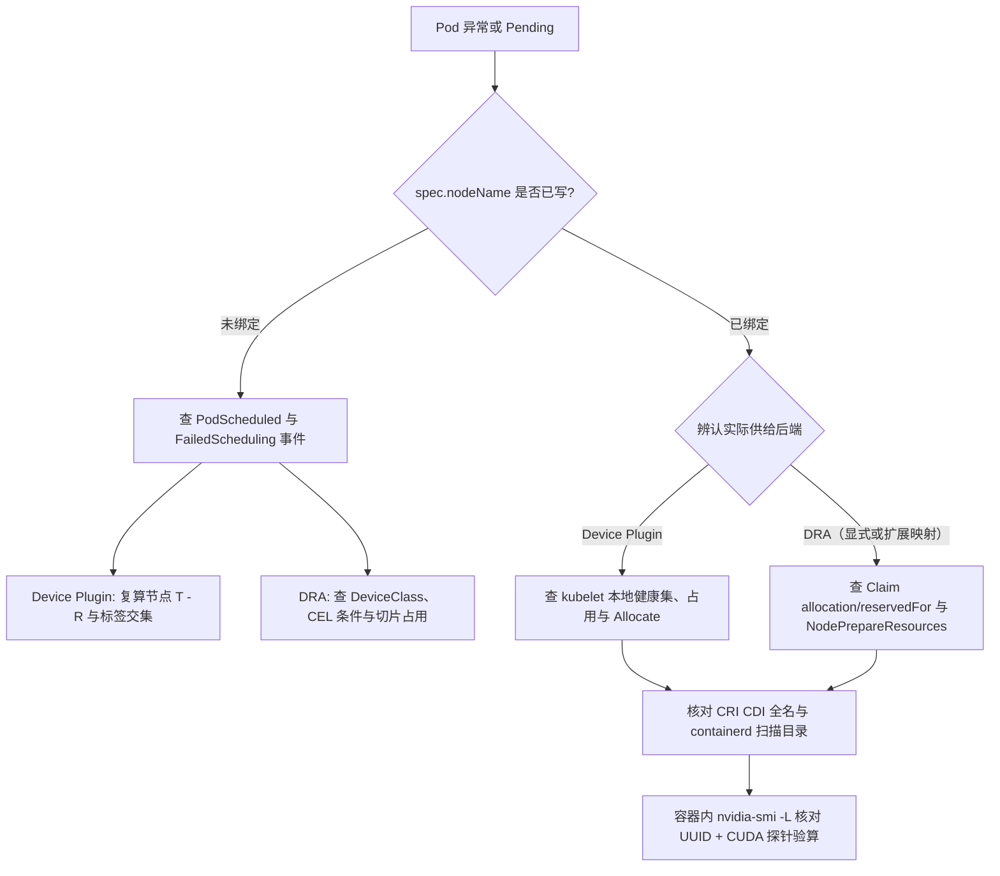

# GPU 供给路径与故障证据

两个申请 GPU 的 Pod 在 `kubectl get pods` 里都显示 `Pending`。表面看一模一样，背后却可能天差地别。一个压根没找到合适节点，另一个已绑定到机器却卡死在容器创建。

更隐蔽的情况是，两份清单写着相同的 `limits["nvidia.com/gpu"]: 1`。在 Kubernetes v1.36 集群里，它们却可能分别由 Device Plugin 和 DRA 承接。排障时必须先切清阶段，再辨认后端，最后定点取证。

## 双后端全景对比：数量账本 vs 逐卡库存

把两条 GPU 供给路径拉到同一张对照表上，每个交接点的差异一目了然：

| 观察维度 | Device Plugin（扩展资源路径） | 显式 Claim 的 DRA 路径 |
| --- | --- | --- |
| **Pod 声明方式** | 容器以 `nvidia.com/gpu` 声明整数张数。 | Pod 引用 `ResourceClaim` 或模板，容器按别名取用。 |
| **调度器决策依据** | Node `Allocatable` 扣减已计入请求，再叠加节点标签过滤。 | `ResourceSlice`、`DeviceClass`、CEL 条件、可达节点与已有 Claim 占用。 |
| **分配结果落在哪** | 绑定后记在节点 kubelet 本地（可用 PodResources `List` 查询设备 ID）。 | 绑定前写进 Claim 的 `status.allocation` 与 `status.reservedFor`。 |
| **谁提供 CDI 全名** | 采用 `cdi-cri` 时，由 Device Plugin 在 `Allocate` 响应中返回。 | 由 DRA 节点插件在 `NodePrepareResources` 成功后返回。 |
| **如何对齐物理卡** | 分配 ID（UUID）直接对照宿主机与容器的 `nvidia-smi -L`。 | 用三元组回查切片中的 `attributes.uuid.string`，再核对 `nvidia-smi -L`。 |

两条路径的下半场可以共用 containerd 原生 CDI。单凭 CRI 请求里出现了一个 CDI 全名，只能确认运行时收到了名称。要反推究竟由谁分配，还须回查名称源自本地 `Allocate` 还是按 Claim 发起的 `NodePrepareResources`。



*图 11-07-01：从 Pod 状态分流到双后端取证，最终在 CDI 解析与容器计算验收处汇合的排查决策图。*

## 相同 YAML 语法，背后可能是 DRA：`DRAExtendedResource`

看到 Pod 只写了 `limits["nvidia.com/gpu"]: 1`，先别急着断定它一定走 Device Plugin。

在 Kubernetes v1.36 中，`DRAExtendedResource` 是默认启用的 beta 特性（最早在 v1.34 作为默认关闭的 alpha 特性引入）。启用后，管理员可在 `DeviceClass` 中设置 `spec.extendedResourceName`，把传统扩展资源名映射到 DRA 设备类。

```yaml
# 1) 管理员将扩展资源名映射到 DRA 整卡类
apiVersion: resource.k8s.io/v1
kind: DeviceClass
metadata:
  name: nvidia-gpu-extended
spec:
  extendedResourceName: nvidia.com/gpu   # 接管同名扩展资源请求
  selectors:
    - cel:
        expression: "device.driver == 'gpu.nvidia.com'"
---
# 2) Pod 仍只写 limits["nvidia.com/gpu"]: 1，绑定 DRA 节点后由调度器自动生成 Claim
status:
  extendedResourceClaimStatus:
    resourceClaimName: probe-extended-resources-9k4xz   # 自动生成的特殊 Claim
    requestMappings:
      - containerName: workload
        resourceName: nvidia.com/gpu
        requestName: container-0-request-0              # 映射到 Claim 内具体请求条目
```

当 Pod 请求 `nvidia.com/gpu: 1` 且调度器选定 DRA 节点时，调度器会自动创建一份特殊的 `ResourceClaim`。Pod 的 `status.extendedResourceClaimStatus` 会记下这份 Claim 名称及容器与请求条目的映射关系。

> [!note] 特殊资源前缀与托管模式边界
> 即使 `DeviceClass` 未填写 `extendedResourceName`，工作负载也能用 `deviceclass.resource.kubernetes.io/<类名>` 按数量申请。
>
> 例如 GPU Operator v26.7.2 默认整卡类对应 `deviceclass.resource.kubernetes.io/gpu.nvidia.com`。若想沿用 `nvidia.com/gpu`，需另建带映射的 `DeviceClass`。
>
> 另外要区分两层能力：Kubernetes 支持不同节点用不同后端供给同名扩展资源（单节点按一个后端处理）。而 GPU Operator v26.7.2 在同一集群安装中，需在 DRA 的 `GPUCluster` 与 Device Plugin 的 `ClusterPolicy` 之间二选一。

因此，辨认一个 `limits["nvidia.com/gpu"]: 1` 请求走哪条路，不能只看 Pod `spec`：
- **已绑定 Pod**：先查 `status.extendedResourceClaimStatus` 是否指向一份分配并保留给当前 Pod UID 的 Claim。若有则走 DRA 准备链；否则查目标节点的 Device Plugin 注册与 `Allocate`。
- **未绑定 Pod**：此时特殊 Claim 可能尚未生成。需结合候选节点的供给形态（`ResourceSlice` 还是 `Allocatable`）和调度事件判断。

## 六阶段分层取证与常用命令清单

排障第一条铁律是**先锁身份再拉日志**。Pod 名称删除重建后可以复用。只有把命名空间、Pod 名、Pod UID、节点名（及 DRA 下的 Claim 名与 Claim UID）一并固定，跨组件时间线才不会错位。

```sh
# 1) 锁定 Pod UID、绑定节点、extendedResourceClaimStatus / resourceClaimStatuses
kubectl -n gpu-example get pod probe -o yaml

# 2) 查看 PodScheduled 条件与最新 FailedScheduling / 容器创建事件
kubectl -n gpu-example describe pod probe

# 3) 核对节点硬件标签、Capacity / Allocatable 与 Allocated resources 账本
kubectl get node node-h100 -o yaml

# 4) DRA 路径：检查 Claim UID、allocation 设备三元组与 reservedFor 消费者 UID
kubectl -n gpu-example get resourceclaim probe-accelerator-7m2pk -o yaml

# 5) DRA 路径：查看节点切片中的设备属性、显存容量与物理 GPU UUID
kubectl get resourceslices -o yaml
```

拿到初始现象后，对照下表直接选取**区分度最高**的下一项检查，避免盲目试错：

| 已观察到的故障现象 | 下一项最关键的缩小范围检查 |
| --- | --- |
| 宿主机能枚举 GPU，Node 有型号标签但无 `nvidia.com/gpu` | 查节点插件注册与 `ListAndWatch` 日志；比对 kubelet `healthyCount` 与 Node 状态时间戳，区分未上报与同步延迟。 |
| Pod 未绑定，Device Plugin 数量检查报错 | 逐台候选节点复算 $T - R$，并比对 `nodeSelector` 与其他过滤项，确认是单节点余量不足还是标签交集为空。 |
| Pod 未绑定，显式 Claim 的 `status.allocation` 为空 | 对照 `DeviceClass` 与 CEL 表达式逐卡核查 `ResourceSlice`，同时检查合格卡是否已被其他 Claim 占用及调度事件。 |
| Pod 已绑定，节点设备分配或 Claim 准备报错 | Device Plugin 路径按时间戳核对本地健康集、占用与 `Allocate` 返回；DRA 路径按节点、驱动名与 Claim UID 查插件注册与 `NodePrepareResources`。 |
| CRI 请求已有 CDI 全名，containerd 报无法解析 | 核对 containerd 有效 `cdi_spec_dirs` 与目标目录下规格文件的 `kind` 和 `devices[].name`，确认全名逐字匹配。 |
| 容器已启动且 UUID 可枚举，但业务计算失败 | 记录 CUDA 探针最早报错的 API 与返回码，按第 10 章路径核对设备权限、加载库路径与进程可见设备掩码。 |

> [!tip] 工程直觉：绝不在下游故障时乱改上游配置
> 例如 `probe` 已绑定 `node-h100`、Claim 已分配且 `NodePrepareResources` 成功，但 `CreateContainer` 报无法解析 CDI 全名。此时去改 CEL 显存阈值毫无意义——调度早就通过了。
>
> 正确动作是用同一 Claim UID 和 CDI 全名，直接比对 `/var/run/cdi` 下的规格与 containerd 的有效扫描目录。修好后从同名解析一路验到 `nvidia-smi -L` 与 CUDA 探针，整条交付链才算复核闭环。

---

> [!info]- 参考资料
> - **Kubernetes Pod 状态与对象身份**：[Pod Lifecycle (v1.36)](https://v1-36.docs.kubernetes.io/docs/concepts/workloads/pods/pod-lifecycle/)、[Object Names and IDs (v1.36)](https://v1-36.docs.kubernetes.io/docs/concepts/overview/working-with-objects/names/)
> - **Device Plugin 与 DRA 流程对照**：[Kubernetes v1.36 Device Plugins](https://v1-36.docs.kubernetes.io/docs/concepts/extend-kubernetes/compute-storage-net/device-plugins/)、[How Resource Allocation with DRA Works (v1.36)](https://v1-36.docs.kubernetes.io/docs/concepts/scheduling-eviction/dynamic-resource-allocation/#how-resource-allocation-with-dra-works)、[Allocate Devices with DRA Task (v1.36)](https://v1-36.docs.kubernetes.io/docs/tasks/configure-pod-container/assign-resources/allocate-devices-dra/)、[NVIDIA DRA 分配与注入](https://dra-driver-nvidia-gpu.sigs.k8s.io/docs/concepts/gpu-allocation/#how-scheduling-works)
> - **DRA 扩展资源映射与源码**：[Extended Resource Allocation by DRA (v1.36)](https://v1-36.docs.kubernetes.io/docs/concepts/scheduling-eviction/dynamic-resource-allocation/#extended-resource-allocation-by-dra)、[Extended Resource Allocation by DRA (v1.34 历史引入参考)](https://v1-34.docs.kubernetes.io/docs/concepts/scheduling-eviction/dynamic-resource-allocation/#extended-resource-allocation-by-dra)、[Kubernetes API v0.36.0 core/v1 types.go](https://github.com/kubernetes/api/blob/v0.36.0/core/v1/types.go)
> - **节点 CDI 与 Operator 托管参考**：[NVIDIA DRA v0.5.1 cdi.go](https://github.com/kubernetes-sigs/dra-driver-nvidia-gpu/blob/v0.5.1/cmd/gpu-kubelet-plugin/cdi.go)、[containerd v2.3.0 CRI 配置](https://github.com/containerd/containerd/blob/v2.3.0/docs/cri/config.md)、[GPU Operator v26.7.2 DRA Intro & Install](https://docs.nvidia.com/datacenter/cloud-native/gpu-operator/26.7/dra-intro-install.html)
