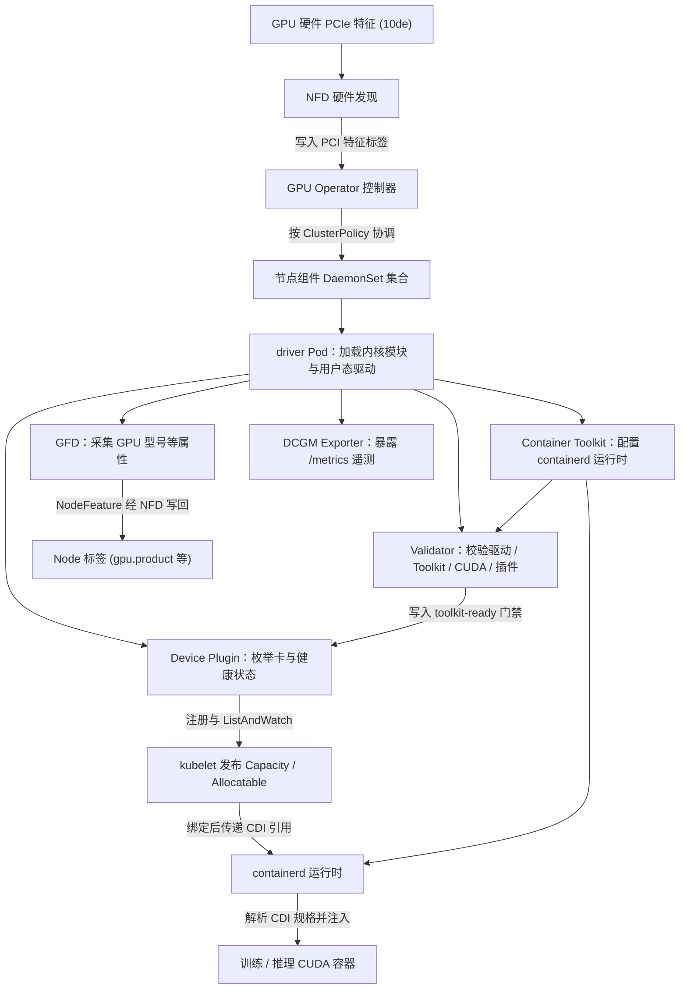

# GPU Operator 的定位与节点组件

想象一个正在扩容的集群。几十台 GPU 服务器陆续上架，既要承接多机同步训练，也要支撑弹性扩缩的在线推理。

每台机器都要装内核驱动、配 NVIDIA Container Toolkit、改 containerd 配置，再拉起 Device Plugin、GFD 和 DCGM Exporter。一旦集群升级驱动，只要手工脚本漏跑几台，全集群立刻陷入版本漂移。

更直观的困惑往往出现在新节点刚接入时。主机 PCIe 已经识别到两张 GPU，`kubectl get node` 也显示节点 `Ready`。可提交一张卡的 Pod，却依然卡在 `Pending`。

原因很简单。**`Ready` 只代表节点能跑普通容器，不代表 GPU 软件栈已经就位**。节点至少要跨过三道门槛：宿主机能驱动硬件、Kubernetes 掌握设备库存、容器运行时能把卡注入容器。**NVIDIA GPU Operator** 正是为此而生。

## 什么是 GPU Operator

**GPU Operator** 是运行在 Kubernetes 集群内的控制器体系，专门自动化部署与维护全集群的 GPU 节点软件栈。它的核心机制是**持续协调（Reconcile）**。控制器不断比对集群策略与节点实态，自动创建、更新或修复节点上的各类组件 DaemonSet。

运维团队不再逐台登录机器跑脚本，而是把整套软件的期望版本与开关写进集群策略对象。新节点一入池，控制器自动补齐整套组件。策略有变更，所有目标节点按统一基线同步收敛。

> [!note] 职责边界
> GPU Operator 只负责把节点软件装好并保持健康，**不参与业务 Pod 的调度和选卡**。Pod 落到哪台节点由 kube-scheduler 决策。具体把哪张物理卡交给容器，由 kubelet 与设备插件协作完成。

## 一张 GPU 从硬件变成容器可用设备的三步主线

以一台新入池节点上的单张 GPU 为例。节点已运行 kubelet 和 containerd，并采用整卡独占的 Device Plugin 路径。整套软件沿三步接力把硬件变成容器内的算力：

1. **宿主机启用驱动**：driver Pod 将 NVIDIA 内核模块加载到宿主机内核，并在节点目录提供用户态驱动库。镜像里的 CUDA 应用发起请求，宿主机驱动操控硬件。在对应驱动路径下执行 `nvidia-smi -L`，即可确认驱动已枚举到卡。
2. **发布节点库存**：Device Plugin 通过驱动枚举本机 GPU，向 kubelet 注册并上报设备标识与健康状态。kubelet 据此更新 Node 的 `Capacity` 和 `Allocatable`。调度器绑定请求 `nvidia.com/gpu: 1` 的 Pod 后，kubelet 再向插件取得交付参数。
3. **运行时注入容器**：NVIDIA Container Toolkit 负责配置运行时接入。在 CDI 路径下，Device Plugin 返回选中设备的 CDI 全名。containerd 按本地 CDI 规格完成设备节点与库挂载，容器内 CUDA 进程随即用上这张卡。

> [!warning] 常见误区：组件先后存在硬依赖
> 这三步顺序由输入输出决定，缺一不可。驱动未加载时，插件无法枚举设备，节点没有库存，调度器直接跳过。即便库存已上报且 Pod 绑定成功，若 containerd 无法解析返回的 CDI 名称，容器仍会卡在创建阶段。

## 发现、标签、验收与遥测的协作全景

除计算交付主链外，GPU Operator 还把硬件发现、型号打标、自动验收与遥测采集收束进同一张节点依赖图：

- **NFD**：在驱动尚未加载前读取 PCIe 枚举中的 NVIDIA 厂商 ID（`10de`），帮助 Operator 发现需要纳管的 GPU 节点。
- **GFD**：驱动就绪后采集卡型、显存等属性。在默认 Linux 部署中，GFD 发布 `NodeFeature` 对象，由 NFD 写回为节点标签（如 `nvidia.com/gpu.product`）。
- **DCGM Exporter**：通过 HTTP `/metrics` 暴露 GPU 算力、显存与错误指标。`v26.7.2` 默认启用 Exporter 并关闭独立 DCGM DaemonSet，直接使用内嵌 host engine。
- **Validator**：串联驱动、Toolkit、CUDA 与插件四道校验。它既是组件间的就绪门禁，也是排查入池故障的第一抓手。
- **MIG Manager**：在支持硬件切分的节点上应用 MIG 配置（第 14 章展开；本章聚焦未切分的整卡交付）。

*图 12-01-01：GPU Operator 节点软件依赖与交付全景图。箭头表示运行时前置依赖与协作方向；DaemonSet 可并行创建各组件 Pod，具体容器再通过 init 门禁按序启动。*

这张图也划清了**计算链**与**辅助支路**的边界。GFD 即使已打出型号标签，只要 Device Plugin 注册前退出，节点仍无可用库存。反之，若单卡 CUDA 已跑通而指标抓取失败，计算链已有成功证据，问题只需收敛在遥测支路排查。

> [!summary] 核心结论
> GPU Operator 把节点软件收编为三条脉络：**控制面协调**（NFD 发现 + Operator 纳管）、**计算交付主链**（驱动 → Toolkit → Device Plugin → 运行时注入）与**标签/遥测支路**（GFD 与 DCGM Exporter）。训练池与推理池都建在这张稳定基座之上。

## 本章贯穿环境与组件版本锚点

为方便对照配置、计数与排障日志，全章固定一套最小多节点集群。原理段落统一用语义角色，命令、配图与检验题对应下表节点名：

| 语义角色 | 节点名 | 硬件规格 | 初始状态 |
| --- | --- | --- | --- |
| 普通 CPU 节点 | `cpu-0` | 无 GPU | 已 `Ready`，位于 GPU 组件部署范围外 |
| 已有就绪节点 | `gpu-h0` | 2 × H100 PCIe（无 NVSwitch） | 全套 GPU 软件已运行，两张整卡可调度 |
| 新入池节点 | `gpu-h1` | 2 × H100 PCIe（无 NVSwitch） | 刚加入集群，待 GPU Operator 自动纳管 |

全章软件基线统一为 **Kubernetes `v1.36`**、**GPU Operator `v26.7.2`**、**x86_64 Ubuntu 24.04 LTS** 与 **containerd `2.3.0`**。主线使用 chart 内置 NFD，由 Operator 托管驱动与 Toolkit，开启原生 CDI 并关闭 NRI（Node Resource Interface）插件。

> [!note] 版本与组件说明
> `GPU Operator v26.7.2` 默认搭载开源驱动 `595.91.07`、Device Plugin 与 GFD `0.20.1`、DCGM Exporter `4.8.4`，以及配套的 Container Toolkit `1.20.1`。

已有节点已经跑起整套组件，新入池节点不需要人工重装 Helm。下一篇我们直接追踪一份配置如何穿过 Helm、`ClusterPolicy` 与 DaemonSet，自动把组件落到新节点上。

> [!info]- 参考资料
> - **GPU Operator 概览与发布**：[NVIDIA GPU Operator 概览](https://docs.nvidia.com/datacenter/cloud-native/gpu-operator/26.7/overview.html)、[GPU Operator v26.7.2 发布说明](https://github.com/NVIDIA/gpu-operator/releases/tag/v26.7.2)、[NVIDIA v26.7 平台与组件矩阵](https://docs.nvidia.com/datacenter/cloud-native/gpu-operator/26.7/platform-support.html)
> - **驱动、安装与 CDI 接入**：[NVIDIA 驱动容器项目](https://github.com/NVIDIA/gpu-driver-container)、[NVIDIA 安装方式](https://docs.nvidia.com/datacenter/cloud-native/gpu-operator/26.7/getting-started.html)、[GPU Operator 的 CDI 支持](https://docs.nvidia.com/datacenter/cloud-native/gpu-operator/26.7/cdi.html)、[containerd 2.3.0 的容器 CDI 接入](https://raw.githubusercontent.com/containerd/containerd/v2.3.0/internal/cri/server/container_create_linux.go)
> - **Kubernetes 节点与设备插件**：[Kubernetes Node 状态](https://v1-36.docs.kubernetes.io/docs/reference/node/node-status/)、[Kubernetes Device Plugin 接口](https://v1-36.docs.kubernetes.io/docs/concepts/extend-kubernetes/compute-storage-net/device-plugins/)
> - **v26.7.2 节点发现、组件配置与遥测源码**：[v26.7.2 chart 默认值](https://raw.githubusercontent.com/NVIDIA/gpu-operator/v26.7.2/deployments/gpu-operator/values.yaml)、[Operator 节点识别源码](https://raw.githubusercontent.com/NVIDIA/gpu-operator/v26.7.2/controllers/state_manager.go)、[v26.7.2 插件配置转换](https://raw.githubusercontent.com/NVIDIA/gpu-operator/v26.7.2/controllers/object_controls.go)、[GFD v0.20.1 的发布逻辑](https://raw.githubusercontent.com/NVIDIA/k8s-device-plugin/v0.20.1/cmd/gpu-feature-discovery/main.go)、[Validator 清单](https://raw.githubusercontent.com/NVIDIA/gpu-operator/v26.7.2/assets/state-operator-validation/0500_daemonset.yaml)、[DCGM Exporter](https://github.com/NVIDIA/dcgm-exporter)、[NVIDIA MIG Manager](https://docs.nvidia.com/datacenter/cloud-native/gpu-operator/26.7/gpu-operator-mig.html)
