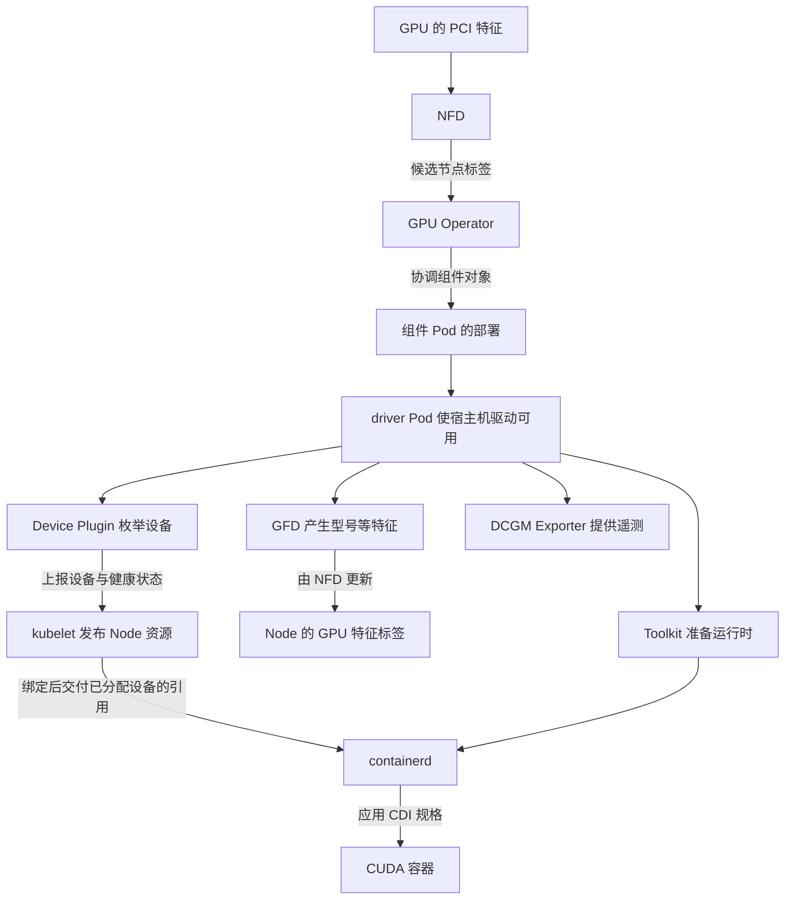

新节点 `gpu-h1` 插着两张 H100，主机的 PCIe 枚举已经能看到设备，Kubernetes 也报告节点 `Ready`。此时提交一个请求一张 GPU 的 Pod，仍可能等不到这个节点。`Ready` 描述的是 Kubernetes 节点的运行状况。GPU 交付还需要主机能操作硬件、Kubernetes 掌握设备库存、容器能访问分到的卡。少量节点可以逐台装软件。节点持续增减时，还要让新节点自动获得对应组件，并让集群里的配置可追踪。 [Kubernetes Node 状态](https://v1-36.docs.kubernetes.io/docs/reference/node/node-status/) · [NVIDIA GPU Operator 概览](https://docs.nvidia.com/datacenter/cloud-native/gpu-operator/26.7/overview.html)

NVIDIA GPU Operator 是部署和维护 NVIDIA GPU 节点软件的 Kubernetes Operator。集群中的控制器读取策略和节点状态，持续调整负责安装和运行软件的对象，这个过程称为**协调**。节点组件随后分别执行驱动安装、设备上报、运行时接入等工作。Pod 的节点选择由调度器完成，选定节点上的设备分配由 kubelet 与相应插件协作完成。 [NVIDIA GPU Operator 概览](https://docs.nvidia.com/datacenter/cloud-native/gpu-operator/26.7/overview.html) · [Kubernetes Device Plugin 接口](https://v1-36.docs.kubernetes.io/docs/concepts/extend-kubernetes/compute-storage-net/device-plugins/)

## 一张 GPU 从硬件变成容器可用的设备

取 `gpu-h1` 上的一张卡，先看它怎样交给一个普通 Pod。节点已经有运行中的 kubelet 和 containerd，管理方选定整卡独占的 Device Plugin 路径。

1. **在宿主机启用 GPU。** driver Pod 安装 NVIDIA 驱动，把模块加载到宿主机内核，并在节点上提供配套的用户态驱动文件。这里用到第 03 章的两层软件。镜像里的 CUDA 应用和运行库向驱动发起请求，内核驱动操作设备。用与安装位置对应的 `nvidia-smi -L` 能检查驱动侧是否已枚举设备。 [NVIDIA 驱动容器项目](https://github.com/NVIDIA/gpu-driver-container) · [NVIDIA 安装方式](https://docs.nvidia.com/datacenter/cloud-native/gpu-operator/26.7/getting-started.html)
2. **把 GPU 发布为节点资源。** Device Plugin 通过驱动枚举设备，在本机向 kubelet 注册并报告设备标识和健康状态。kubelet 据此把数量写到 Node 的 `status.capacity` 和 `status.allocatable`。一个请求 `nvidia.com/gpu: 1` 的 Pod 经调度器绑定节点后，kubelet 再在本机选择具体设备，向插件取得交付该设备所需的信息。 [Kubernetes Device Plugin 注册与分配](https://v1-36.docs.kubernetes.io/docs/concepts/extend-kubernetes/compute-storage-net/device-plugins/)
3. **把已经分配的卡交给容器。** NVIDIA Container Toolkit 是配置容器运行时和设备访问的工具包。这里使用第 10 章的 CDI（Container Device Interface，容器设备接口）。CDI 规格用设备全名描述创建容器时要加入的设备节点、挂载等配置。Toolkit 准备运行时接入，插件在分配响应中提供所选设备的 CDI 引用，containerd 消费该引用并配置容器。容器内的 CUDA 算例随后经驱动使用这张卡。 [GPU Operator 的 CDI 支持](https://docs.nvidia.com/datacenter/cloud-native/gpu-operator/26.7/cdi.html) · [v26.7.2 插件配置转换](https://raw.githubusercontent.com/NVIDIA/gpu-operator/v26.7.2/controllers/object_controls.go)

顺序取决于组件所需的输入。没有可用的驱动，插件就无法枚举设备。缺少库存时，调度器无法用该节点满足 GPU 请求。如果有资源数量，Pod 可以绑定节点。此后若运行时无法解析已分配设备的 CDI 名称，应用容器仍会在创建阶段失败。 [Kubernetes Device Plugin 接口](https://v1-36.docs.kubernetes.io/docs/concepts/extend-kubernetes/compute-storage-net/device-plugins/) · [containerd 2.3.0 的容器 CDI 接入](https://raw.githubusercontent.com/containerd/containerd/v2.3.0/internal/cri/server/container_create_linux.go)

## 硬件发现、型号标签与遥测

驱动尚未加载时，NFD（Node Feature Discovery，节点特征发现）可以从 PCI 枚举读取 NVIDIA 厂商 ID `10de`，并发布节点特征。Operator 用这些特征找到可以部署组件的节点。驱动可用后，GFD（GPU Feature Discovery，GPU 特征发现）通过驱动获取 GPU 型号等属性。按本章的 Linux 配置，GFD 发布 `NodeFeature` 对象，由 NFD 把特征写成 Node 标签。于是 `nvidia.com/gpu.product` 可用来筛节点，GPU 请求仍由 kubelet 上报的资源数量承接。即使 GFD 已发布型号，插件在注册前退出也会使该节点缺少新上报的 GPU 资源。 [v26.7.2 NFD 配置与节点识别](https://raw.githubusercontent.com/NVIDIA/gpu-operator/v26.7.2/deployments/gpu-operator/values.yaml) · [Operator 节点识别源码](https://raw.githubusercontent.com/NVIDIA/gpu-operator/v26.7.2/controllers/state_manager.go) · [GFD v0.20.1 的发布逻辑](https://raw.githubusercontent.com/NVIDIA/k8s-device-plugin/v0.20.1/cmd/gpu-feature-discovery/main.go)

DCGM（Data Center GPU Manager）采集 GPU 遥测，DCGM Exporter 把指标通过 HTTP `/metrics` 提供给采集端。本章版本的 chart 默认启用 Exporter，关闭独立的 DCGM DaemonSet，由 Exporter 启动内嵌的 DCGM host engine。Validator 在驱动、Toolkit、CUDA 和插件路径上执行安装验证。支持 MIG（Multi-Instance GPU，多实例 GPU）的节点还可由 MIG Manager 应用设备切分配置，本章只用未切分、未共享的整卡。若单卡计算通过但 Exporter 的指标采集失败，计算链已获得一次成功证据，遥测链仍要查 Exporter 和采集端。 [v26.7.2 chart 默认值](https://raw.githubusercontent.com/NVIDIA/gpu-operator/v26.7.2/deployments/gpu-operator/values.yaml) · [DCGM Exporter](https://github.com/NVIDIA/dcgm-exporter) · [Validator 清单](https://raw.githubusercontent.com/NVIDIA/gpu-operator/v26.7.2/assets/state-operator-validation/0500_daemonset.yaml) · [NVIDIA MIG Manager](https://docs.nvidia.com/datacenter/cloud-native/gpu-operator/26.7/gpu-operator-mig.html)

图中的箭头表示协作关系，可以先创建组件对象，组件的容器再等各自的启动条件。

## 全章使用的节点与配置

集群已有 CPU 节点 `cpu-0` 和两卡节点 `gpu-h0`，新加入 `gpu-h1`。两台 GPU 节点各有两张 H100 PCIe，无 NVSwitch。本章与第 11 章的独立插件案例分别取样。这里固定 GPU Operator `v26.7.2`、Kubernetes v1.36、x86_64 Ubuntu 24.04 LTS 和 containerd 2.3。主例由 Helm chart 安装 NFD，由 Operator 管理驱动与 Toolkit，启用 CDI，关闭用于运行时扩展的 NRI（Node Resource Interface）插件。后文的对象和日志状态按这一环境构造。 [NVIDIA v26.7 平台与组件矩阵](https://docs.nvidia.com/datacenter/cloud-native/gpu-operator/26.7/platform-support.html) · [v26.7.2 chart 默认值](https://raw.githubusercontent.com/NVIDIA/gpu-operator/v26.7.2/deployments/gpu-operator/values.yaml)

`gpu-h0` 已有可用组件，新节点只需要被同一套配置覆盖。接下来跟踪 Toolkit 如何随策略落到 `gpu-h1`，就能解释这次扩容由哪几个控制器完成。
