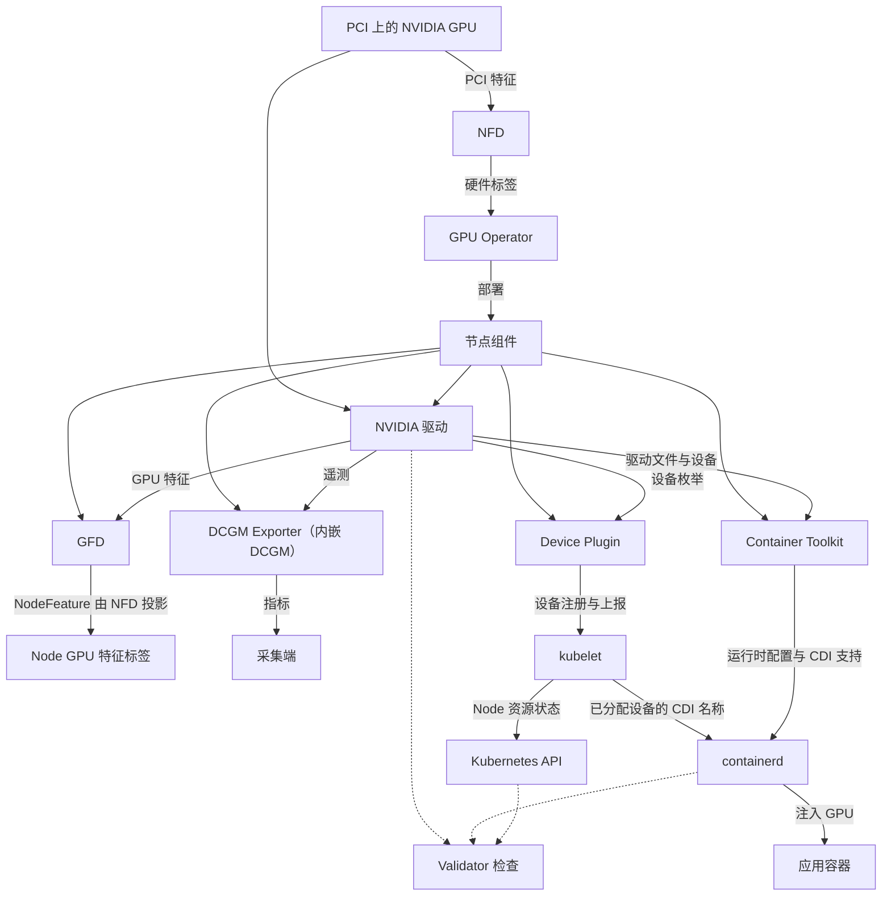

# 哪些组件把 GPU 交付给 Kubernetes

一台服务器加入 Kubernetes 后，节点可以先进入 `Ready`，随后才出现 `nvidia.com/gpu`。这段时间里，集群要先识别 GPU 节点，再准备宿主机驱动和容器运行时，让 kubelet 得到可分配设备清单。GPU Operator 按策略部署和协调这些软件。实际加载内核模块、上报设备、注入容器和采集指标的工作由相应组件在节点上执行。 [NVIDIA GPU Operator 组件概览](https://docs.nvidia.com/datacenter/cloud-native/gpu-operator/26.7/overview.html) · [Kubernetes v1.36 Device Plugins](https://v1-36.docs.kubernetes.io/docs/concepts/extend-kubernetes/compute-storage-net/device-plugins/)

本章以 GPU Operator `v26.7.2` 的 `ClusterPolicy` 和 Device Plugin 路径为主。教学集群运行 Kubernetes v1.36，GPU 节点使用 x86_64 Ubuntu 24.04 LTS 和 containerd 2.3。集群已有 `cpu-0` 和 `gpu-h0`，再加入 `gpu-h1`。两台 GPU 节点各装两张 H100 PCIe，采用整卡独占，不涉及 NVSwitch。主例由 chart 安装 NFD，Operator 交付驱动与 Toolkit，启用 CDI，关闭 NRI。状态和故障记录按这个环境推演。 [NVIDIA v26.7 平台支持矩阵](https://docs.nvidia.com/datacenter/cloud-native/gpu-operator/26.7/platform-support.html) · [GPU Operator v26.7.2 chart 默认值](https://raw.githubusercontent.com/NVIDIA/gpu-operator/v26.7.2/deployments/gpu-operator/values.yaml)

## 从 PCI 设备到调度资源

**Node Feature Discovery（NFD）让 Operator 找到候选节点。** NFD 可以从 PCI 枚举识别 NVIDIA 厂商 ID `10de`。本章的 chart 配置按 PCI 厂商生成标签，Operator 识别 `feature.node.kubernetes.io/pci-10de.present=true` 后将节点纳入 GPU 组件的部署范围。硬件识别可以先于 NVIDIA 驱动加载。 [GPU Operator v26.7.2 的 NFD 配置](https://raw.githubusercontent.com/NVIDIA/gpu-operator/v26.7.2/deployments/gpu-operator/values.yaml) · [Operator 识别的 PCI 标签](https://raw.githubusercontent.com/NVIDIA/gpu-operator/v26.7.2/controllers/state_manager.go)

**NVIDIA 驱动让宿主机的软件能够访问 GPU。** 容器化驱动由节点上的 driver Pod 安装并在宿主机内核加载模块，同时提供与驱动配套的用户态文件。应用镜像中的 CUDA 用户态代码经驱动访问硬件。驱动就绪后，可以用与其安装位置对应的 `nvidia-smi -L` 枚举设备。 [NVIDIA 驱动容器项目](https://github.com/NVIDIA/gpu-driver-container) · [NVIDIA GPU Operator 安装方式](https://docs.nvidia.com/datacenter/cloud-native/gpu-operator/26.7/getting-started.html)

**NVIDIA Container Toolkit 准备容器对设备和驱动文件的访问。** 容器拿到 GPU 需要运行时按设备描述设置设备节点和所需驱动文件的挂载。主例使用 Container Device Interface（CDI）。插件报告已分配设备的 CDI 名称，运行时据此找到规格并应用容器配置。Toolkit 与运行时的接入状态可以通过有效配置、节点 CDI 规格和容器中的实际访问来验证。 [NVIDIA Container Toolkit 架构](https://docs.nvidia.com/datacenter/cloud-native/container-toolkit/latest/arch-overview.html) · [GPU Operator 的 CDI 支持](https://docs.nvidia.com/datacenter/cloud-native/gpu-operator/26.7/cdi.html)

**Device Plugin 让 Kubernetes 知道节点有多少 GPU。** 插件通过驱动枚举 GPU，在本机向 kubelet 注册，并持续发送设备及其健康状态。kubelet 将相应数量写入 Node 的 `status.capacity` 和 `status.allocatable`。调度器据此判断节点能否容纳 GPU 请求，Pod 绑定节点后，kubelet 才处理该容器的具体设备分配。 [Kubernetes v1.36 Device Plugins](https://v1-36.docs.kubernetes.io/docs/concepts/extend-kubernetes/compute-storage-net/device-plugins/)

## 发现、监控和验证分别提供什么证据

GPU Feature Discovery（GFD）通过驱动发现型号等 GPU 特征。在本章的 Linux 配置下，GFD 默认发布 `NodeFeature`，由 NFD 将特征反映为 Node 标签。Pod 可用 `nvidia.com/gpu.product` 筛选节点，再用 `resources.limits["nvidia.com/gpu"]` 申请数量。假设设备插件在注册前退出，已发布的型号标签仍可见，调度器却缺少这个插件提供的 GPU 资源。 [GFD v0.20.1 发布逻辑](https://raw.githubusercontent.com/NVIDIA/k8s-device-plugin/v0.20.1/cmd/gpu-feature-discovery/main.go) · [Kubernetes GPU 请求与节点筛选](https://v1-36.docs.kubernetes.io/docs/tasks/manage-gpus/scheduling-gpus/)

DCGM 读取 GPU 遥测数据，DCGM Exporter 通过 HTTP `/metrics` 暴露这些数据。v26.7.2 的 chart 默认设 `dcgm.enabled: false`、`dcgmExporter.enabled: true`，由 Exporter 启动内嵌的 host engine。因此只看到 Exporter DaemonSet 也符合默认配置。若 `gpu-h1` 的 Exporter 端点无法采集，但节点上的单卡验证 Pod 成功运行 CUDA，证据分别指向该次计算已通过和监控路径需继续检查。 [DCGM Exporter 项目说明](https://github.com/NVIDIA/dcgm-exporter) · [GPU Operator v26.7.2 chart 默认值](https://raw.githubusercontent.com/NVIDIA/gpu-operator/v26.7.2/deployments/gpu-operator/values.yaml)

Validator 在驱动、Toolkit、CUDA 和插件路径上做不同检查。MIG Manager 则在符合条件的节点上处理 MIG 配置，本章的整卡案例采用默认的 `all-disabled`。图中箭头标的是依赖或信息传递，组件对象可以先创建，Pod 再等待各自的前置条件。 [Validator DaemonSet 清单](https://raw.githubusercontent.com/NVIDIA/gpu-operator/v26.7.2/assets/state-operator-validation/0500_daemonset.yaml) · [NVIDIA MIG Manager 配置](https://docs.nvidia.com/datacenter/cloud-native/gpu-operator/26.7/gpu-operator-mig.html)

