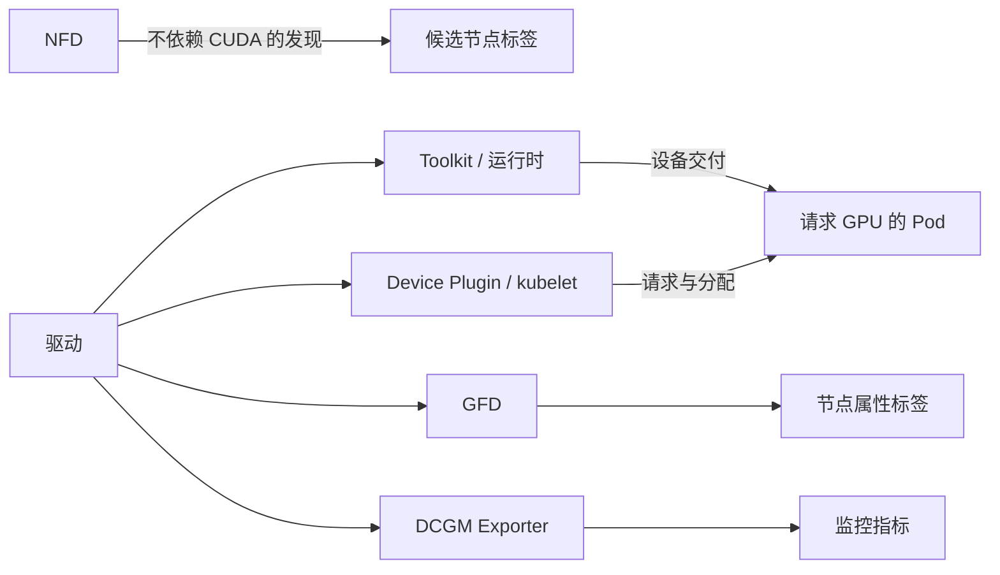

# 把软件依赖与管理责任放在一起

第 10 章解释运行时怎样把 GPU 交给容器，第 11 章解释插件怎样上报与分配设备。如果每台节点都手工安装这些组件，新增节点、配置漂移与版本变更就需要逐台协调。GPU Operator 将这部分维护工作表达成 Kubernetes 中的配置与控制过程，使节点向相同目标靠近。

这里的 Operator 是持续观察实际状态、尝试使它符合期望配置的控制程序。它部署和配置的组件常称为 **operand**，本章称“受管理组件”。Operator 本身、驱动容器、Device Plugin 是三个不同的进程或工作负载，不能把它们的职责合并成“Operator 直接给应用一张卡”。组件总体范围可查 [GPU Operator 25.3.0 Overview](https://docs.nvidia.com/datacenter/cloud-native/gpu-operator/25.3.0/overview.html)。

## 驱动容器仍然改变宿主机

应用容器可以自带 CUDA Runtime，却必须通过宿主机驱动访问硬件。Operator 管理的驱动容器负责把所需驱动文件准备好，并参与当前宿主机内核模块的安装、装载和驱动生命周期。普通驱动容器路径还可能需要为**正在运行的内核**准备匹配的头文件与编译依赖。

“驱动在容器里”描述的是交付与执行载体，内核模块最终运行在宿主机共享的内核中。它不是在每个应用容器里启动一份独立 GPU 内核，也不会因为镜像能拉取就自动满足模块签名、内核接口和设备初始化条件。第 03 章的驱动约束仍然存在。

本章管理路径把驱动文件暴露在宿主机 `/run/nvidia/driver`，供后续组件按驱动根目录寻找库与工具。若改为宿主机预装，文件位置和组件使用的 driver root 也要相应一致；仅把某个 Pod 删掉，并没有完成文件布局与责任切换。驱动变更需要停用客户端、卸载和重新装载模块，见 [GPU Driver Upgrades 的 About 小节](https://docs.nvidia.com/datacenter/cloud-native/gpu-operator/25.3.0/gpu-driver-upgrades.html)。

<!-- 配图 fig-12-01-01：置于本段后，解释驱动容器对宿主机共享内核的作用。 -->

Toolkit 的作用也越过普通容器文件系统。它的节点工作负载会准备 NVIDIA 运行时工具并配置容器引擎接入，而 containerd 服务本体仍属于节点平台。镜像里有 Toolkit 二进制、配置文件已写入目标路径、运行中的 containerd 已接受配置，是三个逐步成立的事实。配置写到了未被服务读取的路径时，第二项可以成立，第三项仍失败。相关挂载边界可对照 [v25.3.0 Toolkit DaemonSet](https://github.com/NVIDIA/gpu-operator/blob/v25.3.0/assets/state-container-toolkit/0500_daemonset.yaml)。

这些节点工作负载需要主机路径、设备访问和某些特权，原因是其工作对象就是宿主机驱动与服务；普通业务 Pod 不因此需要同样权限。部署阶段应满足既定平台的准入规则，否则可能在任何驱动逻辑执行前就被拒绝。依据见 [Security Considerations 的 Pod Security Context 小节](https://docs.nvidia.com/datacenter/cloud-native/gpu-operator/25.3.0/security.html)。

## 依赖在驱动之后分叉

先把“谁使用谁”与“谁部署谁”分开。下面是本章的**功能依赖表**，不是控制器逐项阻塞执行的脚本：

| 组件 | 使用的前提 | 产生的可观察结果 | 结果的含义 |
| --- | --- | --- | --- |
| NFD | 节点上可读的 PCI、系统等特征；配置覆盖所需来源 | `feature.node.kubernetes.io/...` 标签 | 帮助识别 GPU 候选节点，不要求先能运行 CUDA |
| 驱动 | 支持的 GPU、当前内核、模块与用户态驱动配套 | NVML / `nvidia-smi` 可访问设备 | 设备管理接口可工作 |
| Toolkit 与运行时接入 | 正确驱动根、目标引擎路径、权限与生效配置 | NVIDIA handler 能创建带 GPU 访问条件的容器 | 接上第 10 章的交付链 |
| Device Plugin | 驱动设备可枚举、kubelet 插件接口可用 | 注册、健康上报；kubelet 发布 GPU 数量 | 接上第 11 章的资源账本 |
| GFD | 驱动/NVML 与发现配置 | GPU 型号等标签 | 提供节点属性，标签不是可扣减余额 |
| DCGM / Exporter | 驱动访问、采集配置及服务条件 | 指标端点及采样数据 | 提供观测支路；不执行 GPU 数量分配 |
| Validator | 当前检查项目对应的前提 | 分项检查、状态文件、可选验证工作负载结果 | 为特定步骤提供证据 |

图中 NFD 支路是候选节点发现，其结果供后文的部署选择使用；驱动支路表达功能依赖与输出。NFD 不以驱动/CUDA 就绪为前提，因此两部分没有伪造一条串行箭头。生成插图验收后可替换此图。

关键分叉是：驱动为 Toolkit、设备插件、GFD 与监控提供基础；插件通过 kubelet 建立资源数量，Toolkit 帮助运行时创建容器。它们需要在应用运行时汇合，但“插件已经上报数量”并不自动证明运行时已经能够交付设备。反过来，手工指定 GPU 的独立容器能计算，也未必证明 kubelet 已收到插件注册。

功能依赖之外，Operator 的部署模板还可以增加启动门槛。本章 v25.3.0 的插件、GFD 和 Exporter 初始化会等待 `toolkit-ready` 信号，Toolkit 自身先等待驱动检查。因此在这套受管理布局中，驱动失败会沿等待链阻止这些组件启动；不能把“插件的核心功能依赖驱动”误读成“这个部署模板完全不等待 Toolkit”。具体入口见 [Device Plugin DaemonSet](https://github.com/NVIDIA/gpu-operator/blob/v25.3.0/assets/state-device-plugin/0500_daemonset.yaml)。

监控与发现又是两条不同的支路。Exporter 故障不必导致资源从 Node 上消失；GFD 标签存在也不等于设备健康。组件可以由同一 Operator 体系维护，但依赖关系决定了它们可以在哪些地方一起失败、在哪些地方分别失败。

<!-- 配图 fig-12-01-02：替换上方功能依赖 Mermaid 及紧接图解，保留后续因果分析。 -->

本章不启用独立 DCGM DaemonSet，而由 Exporter 使用内嵌 hostengine。因而“没有名为 nvidia-dcgm 的 DaemonSet”在本章是预期布局。不要把其他部署的组件清单当成这里必须出现的清单；读取 `dcgm.enabled` 与 Exporter 实际配置后才能判断缺项。

## 先给每项能力指定一个维护者

维护者要负责安装、配置、升级、故障恢复和版本留存。所谓“由 Operator 管理”，不能只理解为第一次安装由它完成，随后任意在宿主机修改仍期望保持一致。

下面给出三个**互斥的责任设计**。NFD、设备插件等也必须纳入盘点，不能只盘点驱动。

| 能力 | 全部纳入本章 Operator 体系 | 主机预装驱动 | 主机预装驱动与 Toolkit |
| --- | --- | --- | --- |
| OS、内核、containerd 服务本体 | 节点平台 | 节点平台 | 节点平台 |
| 驱动 | Operator，`driver.enabled=true` | 节点平台，`driver.enabled=false` | 节点平台，`driver.enabled=false` |
| Toolkit 及 NVIDIA 运行时接入 | Operator，`toolkit.enabled=true` | Operator，`toolkit.enabled=true` | 节点平台，`toolkit.enabled=false` |
| Device Plugin、GFD、Exporter | Operator | Operator | Operator |
| NFD | 本 release 的依赖 chart | 若已有 NFD，则归原平台、`nfd.enabled=false` | 同左，先确认服务和标签覆盖 |

`enabled=false` 的含义是“不由这条配置部署该组件”，不是“本集群不再需要这项能力”，更不是“Operator 将自动升级预装版本”。预装驱动仍然需要与当前内核、容器注入和应用兼容；预装 Toolkit 仍需把运行时接入配置好。预装场景及开关依据 [25.3.0 Install 的 Common Deployment Scenarios](https://docs.nvidia.com/datacenter/cloud-native/gpu-operator/25.3.0/getting-started.html)。

该版本驱动初始化还包含预装驱动探测逻辑，可能给节点加上标签使驱动 Pod 不再调度。这是实现中的避让行为，不能替代明确责任表。否则主机镜像团队以为 Operator 会修复驱动，Operator 配置却已经跳过它，故障发生时无人承担更新。

一张责任表至少要能回答：谁改配置源、谁确认生效、谁在节点重建或内核更新后恢复它。两套工具同时写同一路径会导致反复覆盖；两边都禁用则留下空缺。完成这张表后，再看 Operator 如何把目标变成节点工作负载。

[返回导读](00_导读.md) · [下一篇：从配置目标走到节点工作负载](02_从配置目标走到节点工作负载.md)
