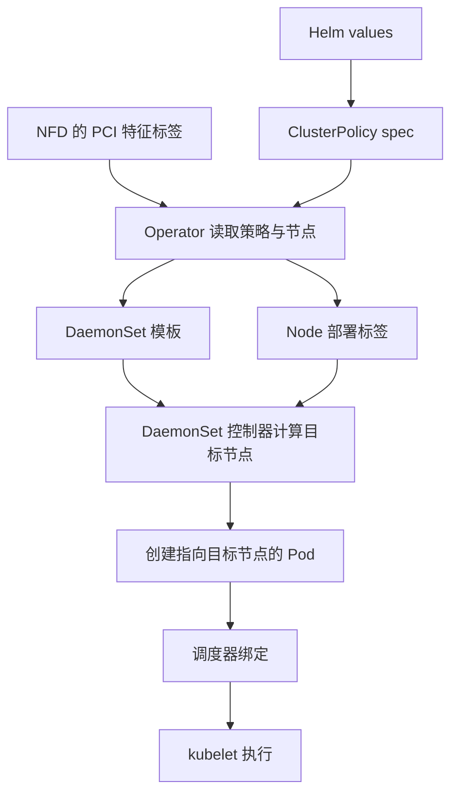

`gpu-h0` 已经运行驱动、Toolkit 和 Device Plugin，`gpu-h1` 刚注册。已有的 Helm release 无需随节点数量变化重新安装。安装时 Helm 提交配置和控制器，新增节点时 Operator 和 DaemonSet 控制器分别调节部署范围和 Pod。以下用 GPU Operator `v26.7.2` 的 Toolkit 配置追踪这三个环节。 [NVIDIA 安装文档](https://docs.nvidia.com/datacenter/cloud-native/gpu-operator/26.7/getting-started.html) · [ClusterPolicy 控制器](https://raw.githubusercontent.com/NVIDIA/gpu-operator/v26.7.2/controllers/clusterpolicy_controller.go)

## 从 Helm 值到 ClusterPolicy 的期望状态

Helm chart 是一组模板及默认参数。安装时，它部署运行 GPU Operator 的 Deployment，提供自定义资源定义（Custom Resource Definition，CRD），并默认部署 NFD 子 chart。CRD 在 API 中定义一种对象，自定义资源（Custom Resource，CR）是这种对象的实例。默认 `clusterPolicy.deployCR: true` 时，chart 渲染集群级的 `ClusterPolicy/cluster-policy`。`spec` 表示管理方期望的组件配置，`status` 表示控制器观察和汇报的协调结果。 [v26.7.2 chart 默认值](https://raw.githubusercontent.com/NVIDIA/gpu-operator/v26.7.2/deployments/gpu-operator/values.yaml) · [ClusterPolicy 模板](https://raw.githubusercontent.com/NVIDIA/gpu-operator/v26.7.2/deployments/gpu-operator/templates/clusterpolicy.yaml) · [Kubernetes 自定义资源](https://v1-36.docs.kubernetes.io/docs/concepts/extend-kubernetes/api-extension/custom-resources/)

下方分别是 Helm 输入和渲染出来的 CR，只摘取 Toolkit 相关字段。在第一段里，`clusterPolicy.deployCR` 控制是否创建策略对象，`toolkit.enabled` 指定 Operator 是否按这份策略部署 Toolkit。第二段里，Operator 从线上的 `spec.toolkit.enabled` 读取这项期望。 [v26.7.2 ClusterPolicy 模板](https://raw.githubusercontent.com/NVIDIA/gpu-operator/v26.7.2/deployments/gpu-operator/templates/clusterpolicy.yaml)

```yaml
clusterPolicy:
  deployCR: true
toolkit:
  enabled: true
```

```yaml
apiVersion: nvidia.com/v1
kind: ClusterPolicy
metadata:
  name: cluster-policy
spec:
  toolkit:
    enabled: true
```

排查现场时，`helm get values <release> -n gpu-operator --all` 查看安装输入与默认值的合并结果，其中 `<release>` 是实际 release 名。`kubectl get clusterpolicy cluster-policy -o yaml` 查看线上 CR。若管理员直接改过 CR，两处可能出现差异。解释控制器目前为什么部署了某个组件，要对照线上 `spec` 和生成的工作负载。 [Helm get values](https://helm.sh/docs/helm/helm_get_values/) · [ClusterPolicy 协调实现](https://raw.githubusercontent.com/NVIDIA/gpu-operator/v26.7.2/controllers/clusterpolicy_controller.go)

## 节点标签如何进入 DaemonSet 的选择范围

协调的输入还包括节点上的实际条件。假设 `gpu-h1` 初次注册时还没有 NFD 标签，而 `gpu-h0` 已经有 Toolkit Pod。稍后，NFD 写入 `feature.node.kubernetes.io/pci-10de.present=true`。在 v26.7.2 中，Operator 也认带 PCI 类别的 `pci-0300_10de.present` 和 `pci-0302_10de.present`，两者采用同样的 `feature.node.kubernetes.io/` 前缀。默认配置下，Operator 将 `gpu-h1` 标记为 `nvidia.com/gpu.present=true` 并加上适用的部署标签。Toolkit 模板用 `spec.template.spec.nodeSelector` 选择 `nvidia.com/gpu.deploy.container-toolkit: "true"`。策略决定有无这个受管组件，部署标签与模板约束共同决定组件在哪些节点运行。 [节点发现及部署标签源码](https://raw.githubusercontent.com/NVIDIA/gpu-operator/v26.7.2/controllers/state_manager.go) · [Toolkit DaemonSet 模板](https://raw.githubusercontent.com/NVIDIA/gpu-operator/v26.7.2/assets/state-container-toolkit/0500_daemonset.yaml)

在新节点满足模板约束时，DaemonSet 控制器为它创建 Pod，并把目标节点写入创建出的 Pod 的节点亲和性。默认调度器完成绑定，再由 kubelet 拉取镜像、运行 init 容器并启动主容器。观察实际落点可以对照 `spec.nodeName`，用 `metadata.ownerReferences` 中 DaemonSet 的 UID 验证归属。若 DaemonSet 存在却没有节点上的 Pod，先查节点是否进入目标范围，再查创建或调度的事件。 [Kubernetes DaemonSet Pod 放置机制](https://v1-36.docs.kubernetes.io/docs/concepts/workloads/controllers/daemonset/#how-daemon-pods-are-scheduled)



## 改变节点条件与改变策略的结果

只看 Toolkit DaemonSet，假定两台 GPU 节点都无其他放置约束。`gpu-h1` 缺部署标签时只有 `gpu-h0` 匹配，期望节点数是 1。补上标签后两台都匹配，期望节点数变成 2。旧节点的 Pod 可以继续运行，新节点的 Pod 仍要等实际的启动条件。把条件改为从一开始就设置 `toolkit.enabled: false`，即使新节点有 GPU 并匹配标签，这份策略也不会部署受管的 Toolkit DaemonSet。若仍要交付 GPU 给容器，节点管理方必须在运行时补齐 Toolkit 提供的能力。 [ClusterPolicy 组件协调](https://raw.githubusercontent.com/NVIDIA/gpu-operator/v26.7.2/controllers/clusterpolicy_controller.go) · [节点组件状态管理](https://raw.githubusercontent.com/NVIDIA/gpu-operator/v26.7.2/controllers/state_manager.go) · [NVIDIA 预装场景](https://docs.nvidia.com/datacenter/cloud-native/gpu-operator/26.7/getting-started.html#common-deployment-scenarios)

现在可以解释为什么 `gpu-h1` 上出现了 Toolkit Pod。这个 Pod 的启动还取决于驱动能否使用，后续的插件也要等运行时接入完成。
