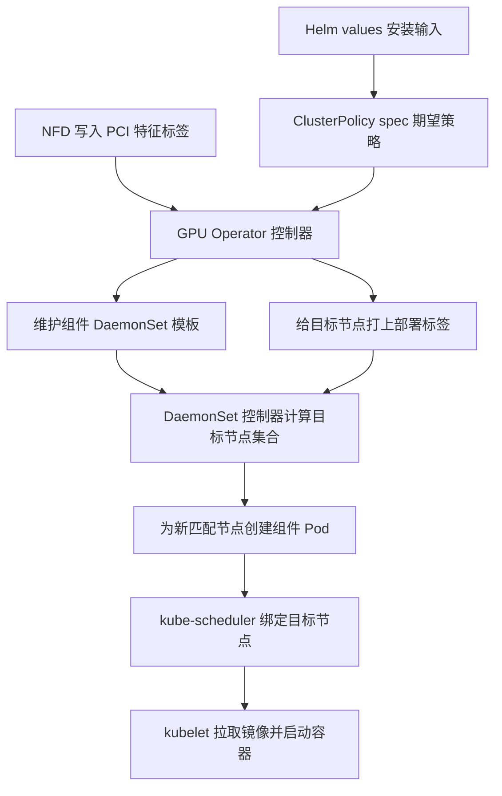

# Helm、ClusterPolicy 与节点组件部署

很多刚接触 GPU Operator 的工程师都有一个疑问：集群新扩容了一批 GPU 服务器，是不是得再跑一次 `helm upgrade` 才能给新机器装软件？答案是否定的。

Helm 只在安装或变更配置时提交声明与控制器。此后哪怕新节点在半夜自动扩出来，接手干活的是常驻集群的 **GPU Operator 控制器**与 **DaemonSet 控制器**。本篇以 Container Toolkit 和核心开关为例，把这条三环接力拆清楚。

## 从 Helm 输入到核心策略对象 `ClusterPolicy`

Helm chart 是一组清单模板加默认参数。执行安装时，它部署 GPU Operator 控制器 Deployment，向 API Server 注册自定义资源定义（CRD），并按默认配置拉起 NFD 子 chart。

在 `clusterPolicy.deployCR: true` 的默认设置下，chart 会渲染出集群级单例对象 **`ClusterPolicy/cluster-policy`**。它是全集群 GPU 节点软件的“唯一蓝图”：
- **`spec`**：运维方声明的期望配置（驱动开关、Toolkit 开关、CDI 开关、仓库地址等）。
- **`status`**：控制器持续比对现场后写回的协调结果与状态条件。

下面把安装时提交的 Helm `values.yaml` 片段，与集群中生成的 `ClusterPolicy` 核心配置段对照起来看：

```yaml
# 1) Helm values.yaml 核心片段（安装/升级时的配置输入）
clusterPolicy:
  deployCR: true            # 自动创建 ClusterPolicy/cluster-policy 单例
driver:
  enabled: true             # true=由 Operator 托管驱动；全池预装宿主机驱动时改为 false
toolkit:
  enabled: true             # true=由 Operator 部署 Container Toolkit DaemonSet
cdi:
  enabled: true             # v26.7.2 默认开启原生 CDI 设备注入
  nriPluginEnabled: false   # 关闭 NRI 插件，GPU 管理容器继续通过 runtimeClassName: nvidia 启动
```

```yaml
# 2) 集群中实际生效的 ClusterPolicy 对象（精简核心字段）
apiVersion: nvidia.com/v1
kind: ClusterPolicy
metadata:
  name: cluster-policy
spec:
  driver:
    enabled: true           # 控制器据此决定是否维护 driver DaemonSet
  toolkit:
    enabled: true           # 控制器据此决定是否维护 Toolkit DaemonSet
  cdi:
    enabled: true           # 决定是否按 CDI 模式配置 Device Plugin 与容器运行时
    nriPluginEnabled: false
```

线上排查时，有一个极易踩坑的分叉点：**Helm 历史值与线上 CR 并不总是一致**。如果有人用 `kubectl edit` 临时改过 `ClusterPolicy`，驱动控制器行为的是线上 CR，而非 Helm 记录。排障时建议用下面两条命令对照核验：

```bash
# 查看 Helm 安装输入与默认值合并后的配置（<release> 替换为实际 release 名）
helm get values <release> -n gpu-operator --all

# 查看 API Server 中实际驱动控制器协调的线上 ClusterPolicy
kubectl get clusterpolicy cluster-policy -o yaml
```

> [!tip] 工程直觉
> Helm 管的是“最初提交了什么清单”，而 GPU Operator 控制器只盯住线上 `ClusterPolicy.spec`。遇到“values 里明明关了组件、节点上却还在跑”的怪象，先比对这两条命令的输出。

## 节点标签如何驱动 DaemonSet 覆盖新节点

策略对象只回答了“集群要不要这套组件”。“具体跑在哪些机器上”还要结合节点实态。假设新入池节点刚注册进集群，尚未打齐标签，已有就绪节点上则已运行 Toolkit Pod。自动纳管按三环接力完成：

1. **硬件特征发现（NFD 环）**：NFD 扫描新节点的 PCIe 总线，识别到 NVIDIA 厂商 ID 后写入 `feature.node.kubernetes.io/pci-10de.present=true`。`v26.7.2` 同样识别带类别前缀的 `pci-0300_10de.present` 与 `pci-0302_10de.present`。
2. **打标与模板维护（Operator 环）**：Operator 感知到 PCI 特征后，为新节点加上 `nvidia.com/gpu.present=true` 与各组件部署标签（如 `nvidia.com/gpu.deploy.container-toolkit=true`）。同时，Toolkit DaemonSet 模板的 `nodeSelector` 精准选中该标签。
3. **建 Pod 与绑定（DaemonSet 环）**：DaemonSet 控制器发现新节点满足选择器，立即创建带目标节点亲和性的 Pod。随后 kube-scheduler 完成绑定，kubelet 拉取镜像并按序启动 init 与主容器。



*图 12-02-01：从 Helm 配置、`ClusterPolicy` 到节点 Pod 落地的三层控制环路。新节点入池时，只需触发左侧 NFD 硬件发现，后续部署全部由控制器自动接力完成。*

如果 DaemonSet 已经存在，新节点上却不见对应 Pod，排查要按环路拆开。先查目标节点是否拿到部署标签、是否存在未容忍的污点。确认已进范围后，再核对 Pod 事件、`spec.nodeName` 与 `metadata.ownerReferences` 中的 DaemonSet UID。

## 对比两种变化：单节点条件改变 vs 全局策略改变

把视角收敛到 Toolkit DaemonSet，就能清楚分辨“节点覆盖范围”和“全局组件开关”这两类独立变量。假设普通 CPU 节点不参与匹配，两台 GPU 节点均无额外污点约束：

| 变化条件 | 影响层级 | Toolkit DaemonSet 行为 | 期望节点数变化 | 维护方影响 |
| --- | --- | --- | --- | --- |
| 新入池节点尚未获得部署标签 | 节点级条件 | 仅覆盖已有就绪节点 | 维持为 `1` | 等待 NFD 发现与 Operator 补签标签 |
| 新节点补齐 `gpu.deploy.container-toolkit=true` | 节点级条件 | 立即为新节点补建 Toolkit Pod | 从 `1` 增至 `2` | 已有节点不受干扰，新节点进入启动流程 |
| 初始即设为 `toolkit.enabled: false` | 全局策略 | Operator 根本不创建 Toolkit DaemonSet | 无受管对象 | 哪怕节点有 GPU 标签，运行时接入也改由宿主机维护方兜底 |

> [!summary] 核心结论
> **`ClusterPolicy` 决定组件“存不存在”，节点部署标签与模板选择器决定组件“落不落在这台机器上”。** 节点增减改的是后者，全局托管模式变更改的才是前者。

现在我们已经清楚组件 Pod 是怎样自动落到新入池节点上的。但 Pod 被创建出来，距离节点真正对外提供 `nvidia.com/gpu` 资源还差一套节点内启动门禁。下一篇我们把镜头推进到新节点内部，走完从驱动加载到单卡计算验收的全过程。

> [!info]- 参考资料
> - **Helm 与 Kubernetes 扩展机制**：[Helm get values](https://helm.sh/docs/helm/helm_get_values/)、[Kubernetes 自定义资源](https://v1-36.docs.kubernetes.io/docs/concepts/extend-kubernetes/api-extension/custom-resources/)、[Kubernetes DaemonSet Pod 放置机制](https://v1-36.docs.kubernetes.io/docs/concepts/workloads/controllers/daemonset/#how-daemon-pods-are-scheduled)
> - **GPU Operator 安装与策略模板**：[NVIDIA 安装文档](https://docs.nvidia.com/datacenter/cloud-native/gpu-operator/26.7/getting-started.html)、[NVIDIA 预装场景](https://docs.nvidia.com/datacenter/cloud-native/gpu-operator/26.7/getting-started.html#common-deployment-scenarios)、[v26.7.2 chart 默认值](https://raw.githubusercontent.com/NVIDIA/gpu-operator/v26.7.2/deployments/gpu-operator/values.yaml)、[ClusterPolicy 模板](https://raw.githubusercontent.com/NVIDIA/gpu-operator/v26.7.2/deployments/gpu-operator/templates/clusterpolicy.yaml)
> - **v26.7.2 控制器与 Toolkit 模板源码**：[ClusterPolicy 控制器](https://raw.githubusercontent.com/NVIDIA/gpu-operator/v26.7.2/controllers/clusterpolicy_controller.go)、[节点发现及部署标签源码](https://raw.githubusercontent.com/NVIDIA/gpu-operator/v26.7.2/controllers/state_manager.go)、[Toolkit DaemonSet 模板](https://raw.githubusercontent.com/NVIDIA/gpu-operator/v26.7.2/assets/state-container-toolkit/0500_daemonset.yaml)
