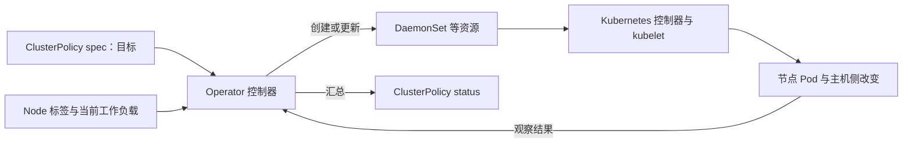

# 从配置目标走到节点工作负载

## Helm 配置与 ClusterPolicy 不是同一个对象

本章从 Helm 安装路径理解组件。Helm 根据 chart 和 values 生成 Kubernetes 对象，包括 Operator 的 Deployment、权限、配置以及描述受管理组件目标的 **ClusterPolicy**。CRD 规定这个自定义对象的字段结构；名为 `cluster-policy` 的对象才保存当前目标值。

ClusterPolicy 属于 `nvidia.com/v1`，作用域为集群。Operator 的 Deployment 与受管理 Pod 则在 `gpu-operator` 命名空间。不能因为 Pod 在某个命名空间，就把 ClusterPolicy 当作该命名空间私有的节点池配置。这个版本的控制器按单一有效 ClusterPolicy 工作，额外策略可能被标为 `ignored`；创建两份策略不是隔离两个池的通用办法。字段和作用域见 [v25.3.0 API 定义](https://github.com/NVIDIA/gpu-operator/blob/v25.3.0/api/nvidia/v1/clusterpolicy_types.go)，单例行为见 [ClusterPolicy controller](https://github.com/NVIDIA/gpu-operator/blob/v25.3.0/controllers/clusterpolicy_controller.go)。

下面是**自拟 Helm values 教学片段**，以 release chart 其余默认项为背景，不是可直接交付的完整安装文件：

```yaml
driver:
  enabled: true
  version: "570.124.06"
  kernelModuleType: open
toolkit:
  enabled: true
  version: v1.17.5-ubuntu20.04
devicePlugin:
  enabled: true
gfd:
  enabled: true
nfd:
  enabled: true
dcgm:
  enabled: false
dcgmExporter:
  enabled: true
mig:
  strategy: none
migManager:
  enabled: false
cdi:
  enabled: false
```

`driver.version` 规定容器化驱动的目标版本，`kernelModuleType` 规定模块类型。它们没有规定当前节点已经装载哪个模块。`mig.strategy: none` 与关闭 MIG Manager 是本章整卡模型的显式配置；不能据此把 L4 解释成支持 MIG 的 GPU。CDI 关闭后，仍需核实前章 legacy 路径要求的 handler、驱动根与可见性信息。

NFD 有一处特殊分工：`nfd.enabled` 是 **Helm 依赖 chart 的开关**，不是 ClusterPolicy 中一个同名的 `spec.nfd.enabled` 字段。关闭它意味着本 release 不再安装该依赖；若需要 NFD，应由原来的部署者继续维护。映射关系可以对照 [ClusterPolicy Helm 模板](https://github.com/NVIDIA/gpu-operator/blob/v25.3.0/deployments/gpu-operator/templates/clusterpolicy.yaml)和 [Chart 依赖定义](https://github.com/NVIDIA/gpu-operator/blob/v25.3.0/deployments/gpu-operator/Chart.yaml)。

若平台用 Git/Helm values 作为配置源，临时修改 ClusterPolicy 后还应回写配置源。否则一次后续 Helm 更新可能将临时修改覆盖。直接改受管理 DaemonSet 的镜像更容易被调谐覆盖，因为那是控制器从策略生成的结果。

## 调谐把目标与实际状态反复对照

**调谐（reconcile）**的输入是目标配置以及当前可见的 Node、工作负载等状态。控制器据此创建或调整需要的资源，再观察它们是否达到该版本的就绪判据，将汇总结果写入策略状态；未完成时继续重试。



图中箭头表示配置、控制和观测关系，不表示 GPU 数据流。节点 Pod 才执行节点侧任务；Operator 控制器并不是通过 Kubernetes API 直接装载远端内核模块。生成插图通过验收后，可替换此 Mermaid 图。

<!-- 配图 fig-12-02-01：替换上方 Mermaid 及紧接的解释，保留同样的控制与观测语义。 -->

设 `op-b` 的 Toolkit Pod 被意外删除，策略中 Toolkit 仍启用，DaemonSet 控制器会补出 Pod。若镜像拉取持续失败，补建会持续失败，Operator 不能凭调谐消除仓库认证错误。调谐提供的是“持续朝目标尝试”，可达性还取决于外部依赖。

受管理对象也并非全部是一种工作负载：节点常驻组件多用 DaemonSet，Operator 本身用 Deployment，验证过程还会产生短生命周期 Pod，并可能建立 RuntimeClass、Service 或 ConfigMap。只查询 Deployment，看到 Operator `1/1`，只能说明控制器进程就绪，尚未覆盖这些执行结果。

## 部署范围由标签与选择条件共同决定

在本章配置中，NFD 提供 `feature.node.kubernetes.io/pci-10de.present=true`，控制器据此识别候选 GPU 节点，再维护 `nvidia.com/gpu.present` 及组件部署标签。`10de` 是 NVIDIA 的 PCI vendor ID；它提供硬件发现入口，不能证明驱动可用。所选源码还识别带 PCI class 的 NVIDIA 标签形式，具体取决于 NFD 输出配置，见 [state_manager.go 的 gpuNodeLabels 与节点标签处理](https://github.com/NVIDIA/gpu-operator/blob/v25.3.0/controllers/state_manager.go)。

本章需要分清三类标签：

| 标签示例 | 作用 | 不可据此推出的结论 |
| --- | --- | --- |
| `feature.node.kubernetes.io/pci-10de.present=true` | 发现 NVIDIA PCI 设备 | CUDA 已通过 |
| `nvidia.com/gpu.deploy.driver=false` | 排除该节点的 Operator 驱动工作负载 | 主机驱动已安装或已卸载 |
| `nvidia.com/gpu.deploy.operands=false` | 排除该节点的一组 GPU 受管理组件 | 已经完成作业排空或设备隔离 |

组件开关决定是否启用整类组件，节点部署标签再限制其适用节点。`driver.enabled=false` 是全局不部署这条驱动路径；对个别节点设置 `deploy.driver=false` 只是节点选择条件。两者都不会自动创造替代管理者。标签用法见 [Install 的 Preventing Installation 小节](https://docs.nvidia.com/datacenter/cloud-native/gpu-operator/25.3.0/getting-started.html)。

CPU-only 节点不因本章驱动策略自动变成 GPU 节点；但发现组件或控制器本身可以运行在那里。应具体说“GPU 受管理组件的目标节点”，不要把整个 release 的每一个 Pod 都等同于每节点一份驱动。

## 读懂 status 才能接上节点观察

下面是**自拟、删节的 ClusterPolicy YAML 输出**，只保留本题字段：

```yaml
apiVersion: nvidia.com/v1
kind: ClusterPolicy
metadata:
  name: cluster-policy
spec:
  driver:
    enabled: true
    version: "570.124.06"
  toolkit:
    enabled: true
status:
  state: notReady
  namespace: gpu-operator
```

`spec` 说明想部署什么；`status.state` 是控制器对受管理状态的汇总。`notReady` 可能来自驱动、Toolkit、监控或验证等不同部分，下一步应读取 `status.conditions`、控制器日志和具体工作负载，再落实到节点。这个删节片段不能用来猜出唯一坏组件，也不作为完整 CR 提交。

`ready` 同样需要读范围。所选源码在没有 NFD 标签、各管理步骤没有未就绪项时，也会设置 `ready`，并通过 condition 表达未发现 NFD 标签。因此“策略 ready → 集群已有可用 GPU”这个推导缺少目标节点与设备证据。下一篇会从节点自己的变化补上这段过程。

[上一篇：把软件依赖与管理责任放在一起](01_把软件依赖与管理责任放在一起.md) · [下一篇：跟踪新节点从加入到资源可用](03_跟踪新节点从加入到资源可用.md)
