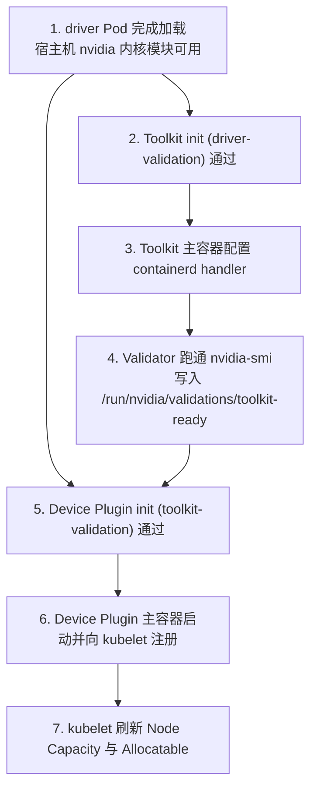

# GPU 节点入池与单卡计算验收

新节点拿到部署标签后，DaemonSet 控制器几乎同时派发出 driver、Toolkit、Validator、Device Plugin 和 GFD 的 Pod。此时看 `kubectl get pods`，常会发现一排组件停在 `Init:0/1`，Node 上也迟迟不见 `nvidia.com/gpu`。

这不是部署卡死了，而是 GPU Operator 刻意设计的**启动秩序**。DaemonSet 只管并发建 Pod，不管先后顺序。Operator 借助 Kubernetes 的 **Init 容器机制**，把跨组件依赖变成了节点本地的逐级放行门禁。

## Init 门禁如何把并发 Pod 编排成有序启动链

在裸金属节点上，driver、Toolkit、Validator 与 Device Plugin 按三道关卡依次解锁：

1. **驱动先就绪，再配运行时**：driver Pod 先向内核加载 `nvidia` 模块。Toolkit 的 `driver-validation` init 通过后，主容器才配置 containerd。在开启 CDI、关闭 NRI 的主线里，管理容器靠 `runtimeClassName: nvidia` 映射到对应 handler。
2. **Validator 盖章，插件才启动**：Validator 的 `toolkit-validation` 在管理容器中跑通 `nvidia-smi`，随后写入 `/run/nvidia/validations/toolkit-ready`。Device Plugin 的 `toolkit-validation` init 同时检查该标记与 `nvidia` 模块，缺一便持续等待。
3. **插件注册，库存入账**：门禁全部通过后，Device Plugin 主容器启动并向 kubelet 注册。kubelet 经 `ListAndWatch` 收到健康设备列表，将整卡数量写回 Node 的 `Capacity` 与 `Allocatable`。



*图 12-03-01：新节点入池时的 init 启动依赖链。图中箭头表示前置放行条件；各组件状态与 Node 资源字段由不同控制器异步写回 API Server。*

排查新节点入池进度时，最直接的抓手是按目标节点过滤 `gpu-operator` 命名空间的 Pod。下面对照“正在解锁 init”与“全部就绪”的典型输出（以新入池节点为例）：

```bash
# 按目标节点筛选所有 GPU Operator 组件 Pod（关键看 READY 与 STATUS 列）
kubectl get pods -n gpu-operator --field-selector spec.nodeName=gpu-h1 -o wide

# --- 典型过渡态（驱动已加载，Toolkit 正在配置，插件与特征发现尚在等 init 门禁）---
# NAME                                       READY   STATUS     RESTARTS   NODE
# nvidia-driver-daemonset-7k2mn              1/1     Running    0          gpu-h1  # 驱动已就绪
# nvidia-container-toolkit-daemonset-9x4pl   1/1     Running    0          gpu-h1  # 正在配置运行时
# nvidia-operator-validator-3q8rt            0/1     Init:1/4   0          gpu-h1  # 正执行 toolkit-validation
# nvidia-device-plugin-daemonset-5v2wb       0/1     Init:0/1   0          gpu-h1  # 等待 toolkit-ready 标记
# gpu-feature-discovery-8h6zc                0/1     Init:0/1   0          gpu-h1  # 同上，等待验证标记
# nvidia-dcgm-exporter-4m9dn                 0/1     Init:0/1   0          gpu-h1  # 同上，等待验证标记

# --- 全部就绪态（可继续核对 Node 的 nvidia.com/gpu 资源字段）---
# nvidia-operator-validator-3q8rt            1/1     Running    0          gpu-h1  # 四道校验全通，进入驻留
# nvidia-device-plugin-daemonset-5v2wb       1/1     Running    0          gpu-h1  # 已向 kubelet 注册
# gpu-feature-discovery-8h6zc                1/1     Running    0          gpu-h1  # 已发布型号特征
# nvidia-dcgm-exporter-4m9dn                 1/1     Running    0          gpu-h1  # /metrics 采集就绪
```

## 区分两套账本：DaemonSet 节点数 vs Node 整卡数

观察入池进度时，必须分清 **DaemonSet 聚合计数**和 **Node GPU 资源计数**。

前者来自 `nvidia-device-plugin-daemonset` 的 `desiredNumberScheduled` 与 `numberReady`，单位是**节点**。后者来自目标 Node 的 `status.capacity` 与 `status.allocatable` 下的 `nvidia.com/gpu`，单位是**整卡**。

假定已有就绪节点始终健康、普通 CPU 节点不在部署范围内，新入池节点从刚注册到入池完成会呈现三个清晰阶段：

| 入池阶段 | 插件 DaemonSet 期望 / 就绪（节点） | 新节点 `gpu-h1` GPU Capacity / Allocatable（整卡） | 现场判断与下一步 |
| --- | ---: | ---: | --- |
| 1. 节点已 `Ready`，部署标签未到位 | `1 / 1` | 两键均缺失 | 两个 `1` 全来自已有节点；先查 NFD 发现与 Operator 标签 |
| 2. 已匹配模板，插件停在 `Init:0/1` | `2 / 1` | 两键均缺失 | 期望数已纳入新节点，就绪仍为 `1`；直接去新节点查 init 等待条件 |
| 3. 两个插件 Pod 均就绪，上报完成 | `2 / 2` | `2 / 2` | 两张健康整卡已入账，可以提交业务形态测试 Pod 做计算验收 |

> [!warning] 常见误区：只看聚合数容易误判
> `kubectl get ds` 的 `1/1` 在新节点尚未打标签时完全“看起来正常”。必须把下面三条命令的节点名与采集时刻对齐，才能把“进范围”“Pod 就绪”与“可调度库存”连到同一台机器上。

```bash
kubectl get ds -n gpu-operator nvidia-device-plugin-daemonset -o yaml           # 1) 读集群级期望与就绪节点数
kubectl get pods -n gpu-operator --field-selector spec.nodeName=gpu-h1 -o wide  # 2) 看目标节点组件是否卡在 Init
kubectl get node gpu-h1 -o yaml                                                 # 3) 查 status.capacity 与 allocatable
```

## 用单卡 CUDA 负载完成端到端验收

Node 上出现 `nvidia.com/gpu: 2`，只说明调度器看到了库存。它不能替代**调度、分配、CDI 注入与真实 CUDA 计算**的闭环验收。生产入池前，最干净的做法是提交一个单卡验证 Pod（改写自 NVIDIA 官方 CUDA VectorAdd 示例）：

```yaml
apiVersion: v1
kind: Pod
metadata:
  name: cuda-vectoradd
spec:
  restartPolicy: Never
  nodeSelector:
    kubernetes.io/hostname: gpu-h1   # 用 nodeSelector 限定目标节点，仍走 kube-scheduler 完整调度流程
  containers:
    - name: cuda-vectoradd
      image: nvcr.io/nvidia/k8s/cuda-sample:vectoradd-cuda12.5.0-ubuntu22.04
      resources:
        limits:
          nvidia.com/gpu: 1          # 独占扩展资源只写 limits 时，requests 自动取同值 1
```

这里有两个关键细节。第一，用 `nodeSelector` 而不是硬写 `spec.nodeName`，是为了保留 kube-scheduler 的完整调度过程。第二，在独占扩展资源上只填 `limits: 1` 时，调度器会自动记入同值请求。

假定新节点初始没有其他占卡负载，该 Pod 绑定后节点账本上的调度余量为：

$$\text{剩余可调度整卡数} = \text{Allocatable} - \text{已计入 GPU 请求} = 2 - 1 = 1\text{ 张}$$

只要两张物理卡仍健康，Node 对象的 `Allocatable` 字段本身保持为 `2`。它不会因 Pod 占用而扣减，调度余量由调度器在内存账本中实时核算。

整条端到端验收按四项证据收口：
1. **确认调度落点**：核对 `Pod.spec.nodeName` 指向目标节点，排除调度器跳过或绑定异常。
2. **核对逐卡身份（按需）**：在运行窗口调用本机 kubelet 的 PodResources `List` 接口，读取容器拿到的 `device_ids`（默认是 GPU UUID）并与驱动枚举对照。VectorAdd 运行极短，需要从容取证时可改用常驻测试镜像。
3. **确认注入与启动**：检查 Pod 未卡在 `CreateContainerError` 或运行时 CDI 解析失败。
4. **验收计算输出**：核对容器日志输出 `Test PASSED`，且终止状态为 `exitCode: 0`。

> [!summary] 核心结论
> 新节点入池是四层递进的证据链：**组件覆盖 → init 门禁解锁 → kubelet 库存上报 → 单卡调度与 CUDA 计算**。唯有跑通带调度的单卡计算测试，节点才真正具备生产交付条件。

如果新节点在其中任意一层卡住了——比如 `ClusterPolicy` 明明报 `ready`，或者 Validator 全绿，业务 Pod 却依然拿不到卡——该如何一眼锁定根因？下一篇我们拆解 `ClusterPolicy` 状态、Validator 边界与分层排障清单。

> [!info]- 参考资料
> - **Kubernetes Pod、DaemonSet 与资源机制**：[Kubernetes Init 容器](https://v1-36.docs.kubernetes.io/docs/concepts/workloads/pods/init-containers/)、[DaemonSetStatus 定义](https://v1-36.docs.kubernetes.io/docs/reference/kubernetes-api/apps/daemon-set-v1/#daemonsetstatus)、[Kubernetes GPU 请求规则](https://v1-36.docs.kubernetes.io/docs/tasks/manage-gpus/scheduling-gpus/)
> - **Device Plugin 注册、健康计数与 PodResources**：[Kubernetes Device Plugin 注册与设备状态](https://v1-36.docs.kubernetes.io/docs/concepts/extend-kubernetes/compute-storage-net/device-plugins/#device-plugin-registration)、[Kubernetes 不健康设备计数规则](https://v1-36.docs.kubernetes.io/docs/concepts/extend-kubernetes/compute-storage-net/device-plugins/#device-plugin-and-unhealthy-devices)、[Kubernetes PodResources API](https://v1-36.docs.kubernetes.io/docs/concepts/extend-kubernetes/compute-storage-net/device-plugins/#monitoring-device-plugin-resources)
> - **GPU Operator 启动门禁与验收示例**：[Toolkit 模板](https://raw.githubusercontent.com/NVIDIA/gpu-operator/v26.7.2/assets/state-container-toolkit/0500_daemonset.yaml)、[Device Plugin 模板](https://raw.githubusercontent.com/NVIDIA/gpu-operator/v26.7.2/assets/state-device-plugin/0500_daemonset.yaml)、[Validator 清单与实现](https://raw.githubusercontent.com/NVIDIA/gpu-operator/v26.7.2/assets/state-operator-validation/0500_daemonset.yaml)、[验证标记实现](https://raw.githubusercontent.com/NVIDIA/gpu-operator/v26.7.2/cmd/nvidia-validator/main.go)、[GPU 管理容器的 RuntimeClass](https://docs.nvidia.com/datacenter/cloud-native/gpu-operator/26.7/cdi.html#cdi-and-gpu-management-containers)、[NVIDIA CUDA VectorAdd 示例](https://docs.nvidia.com/datacenter/cloud-native/gpu-operator/26.7/getting-started.html#cuda-vectoradd)
