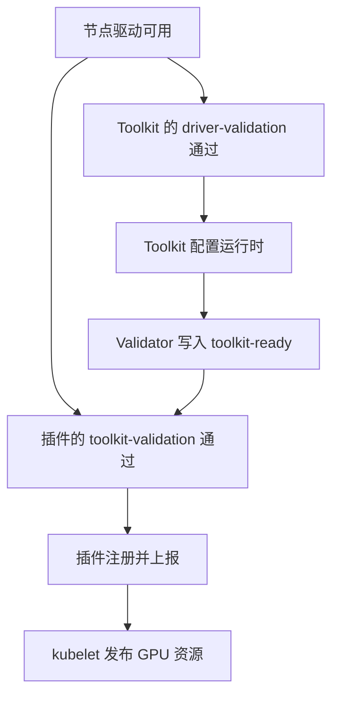

`gpu-h1` 是新加入的 Ubuntu 24.04 LTS 节点，运行 containerd 2.3，有两张 H100 PCIe。其他组件由 GPU Operator `v26.7.2` 的 `ClusterPolicy` 部署，Kubernetes 版本为 v1.36。节点已经具备 NFD 的 PCI 标签，Operator 已将它纳入 GPU 组件范围。接下来观察节点软件如何启用，并用一张卡验收这条交付链。

## 驱动与 Toolkit 如何解除插件的启动等待

DaemonSet 可以先后为 `gpu-h1` 创建 driver、Toolkit 和 Device Plugin 的 Pod。每个 Pod 中的初始化容器（init container）完成后，kubelet 才启动该 Pod 的应用容器。这个机制把分散在多个对象里的依赖变成节点上的等待条件。 [Kubernetes Init 容器](https://v1-36.docs.kubernetes.io/docs/concepts/workloads/pods/init-containers/) · [Toolkit 模板](https://raw.githubusercontent.com/NVIDIA/gpu-operator/v26.7.2/assets/state-container-toolkit/0500_daemonset.yaml)

1. driver Pod 将驱动装到节点上，内核加载 `nvidia` 模块。Toolkit Pod 的 `driver-validation` init 检查驱动能否使用，通过后 Toolkit 的主容器才开始配置运行时。在 CDI 开启、NRI 关闭的主例中，直接访问 GPU 的管理 Pod 使用 `runtimeClassName: nvidia`。RuntimeClass 将这个名字映射到 containerd 的运行时处理器（handler）。Toolkit 配好这个 handler 后，使用它的管理 Pod 才能启动。 [Toolkit 模板](https://raw.githubusercontent.com/NVIDIA/gpu-operator/v26.7.2/assets/state-container-toolkit/0500_daemonset.yaml) · [GPU 管理容器的 RuntimeClass](https://docs.nvidia.com/datacenter/cloud-native/gpu-operator/26.7/cdi.html#cdi-and-gpu-management-containers)
2. Operator Validator 的 `toolkit-validation` 在 GPU 管理容器中运行 `nvidia-smi`，成功后写入节点共享位置 `/run/nvidia/validations/toolkit-ready`。本章的裸金属路径里，Device Plugin 的 `toolkit-validation` init 等待该标记和加载中的 `nvidia` 模块。即使插件 Pod 已被创建并绑定节点，缺其中任一条件时，插件的主容器仍在等待启动。 [Validator 清单与实现](https://raw.githubusercontent.com/NVIDIA/gpu-operator/v26.7.2/assets/state-operator-validation/0500_daemonset.yaml) · [验证标记实现](https://raw.githubusercontent.com/NVIDIA/gpu-operator/v26.7.2/cmd/nvidia-validator/main.go) · [Device Plugin 模板](https://raw.githubusercontent.com/NVIDIA/gpu-operator/v26.7.2/assets/state-device-plugin/0500_daemonset.yaml)
3. 插件启动后向本机 kubelet 注册。kubelet 通过 `ListAndWatch` 接收设备 ID 与健康列表，更新 Node 的资源状态。两张健康整卡经过这一步才成为调度器可用的数量。 [Kubernetes Device Plugin 注册与设备状态](https://v1-36.docs.kubernetes.io/docs/concepts/extend-kubernetes/compute-storage-net/device-plugins/#device-plugin-registration)



这张图表示启动依赖。就绪状态和资源状态分别写回 API，实际采集时可能先看到其中一项变化。

## 组件覆盖与 GPU 资源分别计数

下面是三个教学快照。`gpu-h0` 始终就绪，`cpu-0` 始终在 Device Plugin 范围外，`gpu-h1` 之前从未上报 GPU。DaemonSet 的两个数来自 `nvidia-device-plugin-daemonset` 的 `status.desiredNumberScheduled` 与 `status.numberReady`，单位是节点。Node 的两个数取 `status.capacity` 与 `status.allocatable` 下的 `nvidia.com/gpu`，单位是本例的整卡。 [DaemonSetStatus 定义](https://v1-36.docs.kubernetes.io/docs/reference/kubernetes-api/apps/daemon-set-v1/#daemonsetstatus) · [Kubernetes 不健康设备计数规则](https://v1-36.docs.kubernetes.io/docs/concepts/extend-kubernetes/compute-storage-net/device-plugins/#device-plugin-and-unhealthy-devices)

| 教学时点 | 插件期望 / 就绪节点数 | `gpu-h1` 的 GPU Capacity / Allocatable | 推理 |
| --- | ---: | ---: | --- |
| 节点已注册，部署标签尚未到位 | 1 / 1 | 两键缺失 | 两个 1 都来自旧节点。先看新节点的发现和部署条件。 |
| 新节点匹配模板，运行时 handler 已就绪，插件 init 正等待验证标记 | 2 / 1 | 两键缺失 | 期望多了 `gpu-h1`，就绪仍只有 `gpu-h0`。去新节点查等待条件。 |
| 两个插件 Pod 均就绪，kubelet 已发布两张健康整卡 | 2 / 2 | 2 / 2 | 新节点已发布整卡资源，可以用业务形态的 Pod 检查后续交付。 |

可以用 `kubectl get ds -n gpu-operator nvidia-device-plugin-daemonset -o yaml` 读聚合计数，再用 `kubectl get pods -n gpu-operator --field-selector spec.nodeName=gpu-h1 -o wide` 找目标节点的组件 Pod，最后用 `kubectl get node gpu-h1 -o yaml` 读资源键。将三次读取的节点和时间对应起来，才能把“已选中”和“可调度”连到同一台机器。

## 用普通 Pod 验证调度、注入与计算

下面改写自 NVIDIA 的 CUDA VectorAdd 示例。假定 `kubernetes.io/hostname=gpu-h1` 唯一匹配目标节点，CPU、内存、污点、镜像获取等其他条件满足，初始没有 GPU 请求。使用节点选择器限定目标，保留调度器的放置过程。在这种独占资源上，只写 GPU limit 时，同值作为请求计入调度。Pod 的一张卡进入节点调度账本后，剩余量为 `2 − 1 = 1` 张。若两张卡仍健康，Node 的 `Allocatable` 继续为 2。 [NVIDIA CUDA VectorAdd 示例](https://docs.nvidia.com/datacenter/cloud-native/gpu-operator/26.7/getting-started.html#cuda-vectoradd) · [Kubernetes GPU 请求规则](https://v1-36.docs.kubernetes.io/docs/tasks/manage-gpus/scheduling-gpus/)

```yaml
apiVersion: v1
kind: Pod
metadata:
  name: cuda-vectoradd
spec:
  restartPolicy: Never
  nodeSelector:
    kubernetes.io/hostname: gpu-h1
  containers:
    - name: cuda-vectoradd
      image: nvcr.io/nvidia/k8s/cuda-sample:vectoradd-cuda12.5.0-ubuntu22.04
      resources:
        limits:
          nvidia.com/gpu: 1
```

先确认 `spec.nodeName=gpu-h1`，再看容器的创建、运行和终止状态。需要验证具体卡的身份时，在容器运行期间用节点 kubelet 的 PodResources `List` 接口查看对应 Pod 和容器的 `device_ids`。本章插件默认使用 GPU UUID，可以同节点上的驱动枚举核对。VectorAdd 的运行窗口较短，必要时用可保持运行的测试负载采集身份。对于这次 CUDA 验收，查容器日志是否输出 `Test PASSED`，并核对终止状态的 `exitCode: 0`。这组预期证据覆盖目标节点上的一次调度、分配、CDI 注入和 CUDA 计算。 [Kubernetes PodResources API](https://v1-36.docs.kubernetes.io/docs/concepts/extend-kubernetes/compute-storage-net/device-plugins/#monitoring-device-plugin-resources) · [v26.7.2 Device Plugin 模板](https://raw.githubusercontent.com/NVIDIA/gpu-operator/v26.7.2/assets/state-device-plugin/0500_daemonset.yaml) · [NVIDIA 示例的预期输出](https://docs.nvidia.com/datacenter/cloud-native/gpu-operator/26.7/getting-started.html#cuda-vectoradd)

若节点已发布资源，Pod 却停在绑定或容器创建，就从该 Pod 的状态向前追到最后一项已有证据，再检查下一环的输入和输出。
